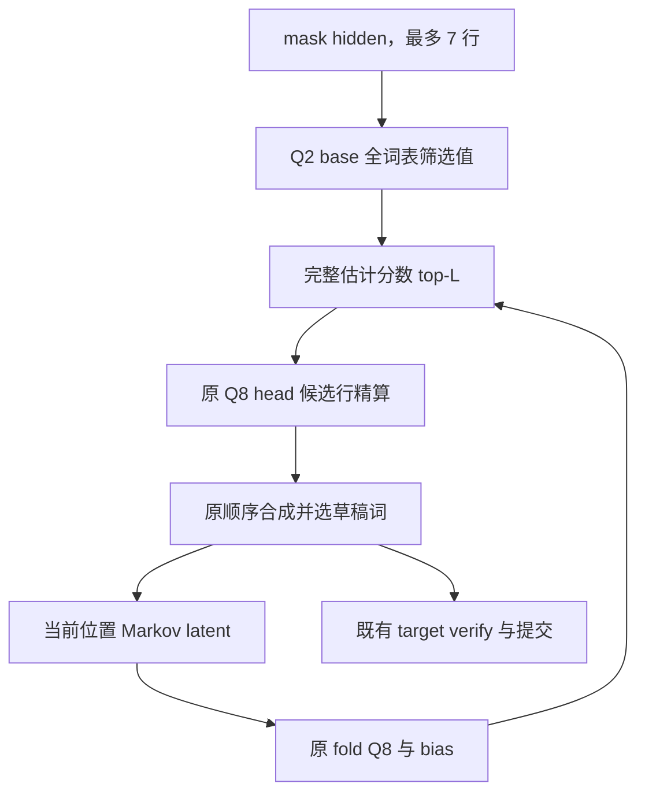
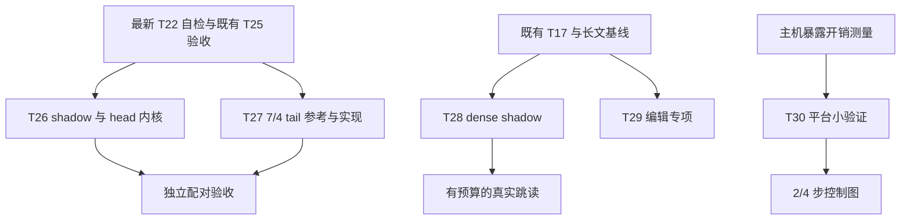

# Inkling 4090 新一轮底层改造优化方案

## 基于 2026-11-27 最新源码与实验记录，排除方案 10 和现有任务表的增量设计

**日期：** 2026-11-27，北京时间。  
**最终分支复核：** 2026-11-27 11:10:10，北京时间；以下两个 HEAD 与文档固定版本一致。  
**目标：** 在单张 RTX 4090 24 GiB、64 GB 主机内存上，为自有 Inkling Rust/CUDA 引擎寻找尚未进入既有方案的具体改造；优先保留 A1 目标权重，直接改变实际执行、读写和状态管理。  
**源码基线：** `lkyprogramer/inkling-4090-engine@744e32a22131aa2ad4457964dade79d4a65a602f`。  
**实验基线：** `lkyprogramer/CodexGame@19a431a91a85145e17cb2ef814ee42ee51840edc`，`4090-report`，`docs/inkling-4090-lab-v3.0/`，v3.0.14。  
**文档性质：** 已完成资料、源码和公开证据审计的设计与实施计划。本文所有新候选均为 `NOT_RUN`，不表示已获得新的 4090 加速结果。  
**建议仓库位置：** `docs/inkling-4090-lab-v3.0/docs/11_new_optimization_plan_20261127.md`。本文可以独立阅读；旧方案仅作为依赖与排除依据，不要求重新实施。

> 执行说明：本文是本轮新增设计及其实施规格。后续实现按候选独立提交、独立验收；可使用 `superpowers:subagent-driven-development` 或 `superpowers:executing-plans`，但不得把研究候选的描述当成已通过的实现。

### 全局约束

- 主目标是 A1、固定三遍、SM89；A4 变遍数、不同量化资产和新架构训练各自保留独立身份。
- 不重提已纳入的 T16/K1–K11、T17、T21–T25、R1–R13、target KV 量化/无损压缩研究。
- 目标权重、草稿权重、草稿提案策略、数学等价但浮点路径变化、目标近似计算五类变化分别记录。
- 代码/状态“已提交”、仓库“报告已测”、本次“能离线复核”分开叙述。公开主干没有的现场补丁不作为已审计代码。
- 采用现有 Rust、CUDA C++、CUDA Driver API、SM89 `mma.sync` / `dp4a` / `cp.async`。不增加通用编译器、通用执行调度器或多代理平台。
- 新 GPU 数值路径复用最新已提交的 T22 非零输入修复与自检，补齐对应运行身份/结果归档；输出、verify、reset、失败退出等承接 T25。本文不再次定义它们为新增任务。
- 新开关默认关闭；证明收益前保持旧路径可达。性能计时关闭探针，不能把微基准速度当作服务净收益。

### 重点评审输入

1. 草稿 base 排名靠后、但 Markov 修正后成为第一的词：必须能进入完整分数筛选。
2. prefill 末块不足 7 行、两段卷积跨块、下一 token 紧接生成：裁剪必须保留正确的 raw 卷积尾状态。
3. 全局注意力 near/far 边界、尚未提交的 verify 行、虚拟 sink：选块不能漏近端或读到未来。
4. 上下文编辑改变位置但保留后缀文本：只复用已证明依赖域未变的前段计算，首个 global 之后重算。
5. GPU 连续生成块中途遇到 EOS、容量边界或返回后继续调用：不能让内部状态跑到已返回输出之后。

---

## 1. 建议：先做两项具体改造，其他方向按条件推进

本轮最值得进入实现准备的是 **T26：原生 DSpark 的完整分数候选筛选**，以及 **T27：最后一个 coda 层的 prefill 反向依赖裁剪**。

前者减少原生草稿器扫描大词表原权重的工作，后者删除已经能证明不再被读取的终端层计算。它们均能在现有 8K 路径上做第一轮实验，且相对于上一轮方案有明确算法增量。T26 的草稿提案允许变化；T27 的模型数学语义保持不变，但必须控制小行数触发不同 kernel 的舍入变化。

**T28：全局远历史的受控块稀疏**值得研究，但先做 dense shadow，等 T17 的长上下文与既有长文数值问题有明确基线后再开启真实跳读。**T29：编辑后局部计算复用**是面向长期代码/文档会话的专项；当前 8K 下理论空间有限。**T30：GPU 有界连续生成**只在测得主机往返确实占比足够时投入，不能根据“launch 很多”就推导有收益。

| 建议编号 | 新增内容 | 与旧方案的实质区别 | 首轮结论类型 | 优先级 |
|---|---|---|---|---|
| T26 | Q2 全词表 base screening + 完整 Markov 分数选候选 + 原 Q8 head 行精算 | 旧 FP4 开关仍算全词表；T21 是成本/策略，未改变 head 搜索算法 | 净提交 token/ms、提案召回与额外显存 | P1 |
| T27 | 终端 coda 层每块仅算末 7 行 Attention/O、末 4 行 MoE | 旧末行 head 只裁 LM head；这里跨两段短卷积做反向依赖分析 | 末行、状态、后继生成一致；TTFT 收益 | P1 |
| T28 | 保留 F16 KV，按 query 跳过低贡献的远端 64-token 块 | 旧远端快循环仍遍历全部 KV；旧 KV 压缩改变存储表示 | 漏失质量、局部误差界、读量与净收益 | P2，先 shadow |
| T29 | 编辑后复用首个 global 之前、依赖域完整保留的计算切面 | 旧 prefix snapshot 只能复用未改前缀；这里处理编辑之后的旧后缀 | 依赖证明、恢复状态、编辑后重放成本 | P3，专项 |
| T30 | GPU 内完成 2/4 次普通 greedy step，设备判断停止 | 旧 pinned packet 仍每 token 回主机；不采用全模型 megakernel | 主机可消除开销上限、流式/取消代价 | P3，先否决实验 |

编号是对 v3.0.14 的建议增补，未写入远端任务表。若实施前任务编号已被占用，按内容顺延，不覆盖旧条目。

## 2. 最新项目情况：此次真正新增了什么

### 2.1 提交与实现范围

相对上一轮引擎 `18bf3e3`，最新引擎增加 **4 个提交、11 个文件变化**：`2c2f424` 加只读探针、`213960e` 格式整理、`02259e1` 增加固定请求的遍数配置与 bank 容量计算，`744e32a` 修复 T22 的 `Gemv::quantize` 未写 F16 plane，并补充有效输入测试。最后一项于本轮调研期间提交，已重新拉取增量审查，未沿用过期的 `02259e1` 为最终基线。相对上一轮 lab `9f6d4b0`，实验分支增加 **5 个提交、50 个文件变化**，推进到 v3.0.14，并正式吸收方案 10。[P01] [P02] [P03]

原生 checkpoint loader 早在 11 月 25 日已经存在；此次新进展是 A4 原生路径的实际实验和 `is_varloop → loop.varying` 元数据接通，不能把原生 loader 整体写成本轮新实现。[P04]

| 项目 | 当前任务状态 | 本次审计后的准确解释 |
|---|---|---|
| T15 只读探针 | PASS | 代码已提交；仓库报告 C 集 80 点、3840 visit 的 decode 检查通过，prefill/verify 探针与 coda lens 未覆盖 |
| T18 固定遍数 | PASS | `ASTRAL_PASSES=1..10` 已接通；A4 的 1–5 遍实验完成，6/10 遍属于外推 |
| T17 长上下文 | NOT_RUN | 文档称现场 ring 代码已写、未验证；公开引擎仍按 capacity 线性分配全部 slot，仍有 8192 上限 |
| T20 | PASS，指实验交付 | B 短序列各路径通过；D 长文 num-3 仍失败，不能理解成所有数值条件通过 |
| T16、T21 | NOT_RUN | 深入热点调优和 DSpark 成本模型仍待执行 |
| T22 | lab 仍为 NOT_RUN；核心修复已进 main | 最新提交补写 F16 plane，并新增非零、FP16 operand CPU 参考、单 token 扰动隔离和零 plane 负控制；运行证据尚未同步到 lab |
| T23–T25 | NOT_RUN | 旧方案中的执行映射、消息预计算和覆盖补全已进入正式任务表 |
| R1–R13 | NOT_RUN | 已有研究设计，T15/T18 的描述性观察不等于这些研究问题已经解决 |

依据是最新任务表、实验结果与固定 SHA 源码。[P03] [P05] [P06]

### 2.2 新测试给出的结论与不能给出的结论

**T15：** 仓库报告 probe 开/关、eager/graph 和对旧基线的若干对照为 80/80 bitwise；attention 派生量最大相对误差约 `1.05e-6`，router IDs 重算没有不一致。公开 trace 只有一个位置的 49 行，完整 80 点原始数据未公开，因此本次只能复核该样本结构及摘要一致性，不能宣称独立重跑了全部 GPU 检验。其输入很短，远历史 mass 为零不构成 T28 稀疏化有效的证据。[P05]

**T18：** A4 在 W1、c512×8、2040 个评分位置上的 PPL 从 R=1 的 3.6669 降至 R=5 的 3.5425；R=6/10 并未继续改善到更好结果。A1 的 R=1/2 截断 PPL 为 6.8125/6.3795，而 R=3 为 3.5359。可配置 R 已经实现，但“少一遍免费提速”不成立；A4 与 A1 是不同资产，不能混合质量比较。单次 128-token 速度记录也不替代 T14 正式配对基准。[P06]

**T20：** 本次从现行包的公开 JSONL 重汇总，B prefill 336 点、decode 320 点、verify k=1/3/7 各 320 点仍 PASS；D prefill 64 点和 decode 56 点仍 FAIL，分别有 3/1 个高 margin argmax 硬门违规。另一个密集 V4 序列通过不抵消 D 的失败。相关修复、独立 E 集和 fail-closed wrapper 已归入 T25，本轮不重列。[P07]

**证据身份：** T15/T18 的现场 identity 仍指向 `18bf3e3 + dirty files`，随后才归档为新提交，且缺少 binary/patch hash。T18 脚本计算后删除原始 `.bin`；hash 与摘要不能恢复完整分布。本报告使用“仓库报告的运行结果”，不把它们升级成已复现的干净 HEAD 测试。

**T22 的最新增量：** `744e32a` 的代码已经闭合此前零 F16 plane 的缺陷：CUDA quantize 可选写 `xh`，Rust 同步更新参数，并在两种 GEMM shape 上新增共 8 个断言。提交说明报告旧实现 `87/93`、修复后 `93/93`，模型路径 `68/68` dump bit-identical；本次未取得这轮运行的独立 raw 结果与完整身份归档，lab 仍停留在原任务状态。因此应记录为“修复及测试代码已审计，4090 结果由提交说明报告，lab 归档待同步”，不能继续写最新代码有该缺陷，也不能仅凭提交叙述将全部 T22 证据判定齐备。两种 shape 是 Q8 `n=2304,k=3072,mats=1,nt=5` 和 NVFP4 `n=2304,k=1152,mats=3,nt=6`，不是所有新 kernel 的覆盖保证。[P01] [P19]

### 2.3 T17 的特殊情况

最新文档已经选定加余量 ring：`rows = align64(W + max(tmax,8))`，默认 3072 行，对 A1 的 40 个 SWA slot 约 480 MiB。原方案的只读 ring + delta 仍是已知后续候选。

但是本次可审计主干没有该改动，`Session::new`、Rust/CUDA `MAX_CTX`、KV append 仍是线性 8K 逻辑。因此本文所有 16K/32K/128K 设计均是后续条件实验，不是当前可运行能力。[P08] [P09]

### 2.4 本次明确排除的旧方案

| 排除项 | 现有归属 |
|---|---|
| 非零 FP16 测试、ActPlanes 数据合同、负控制 | T22、K8 |
| visit/slot/tap 静态映射、graph 身份 | T23 |
| M1–M4 消息预计算、双源 basis/Gram | T24、方案 10 |
| SWA ring、delta、长位置、解除 MAX_CTX | T17 |
| NVFP4 访存/解码、fragment/mma5、Q8→FP8、split 数、controller 融合 | K1–K7 |
| 小 expert tile、SiTU epilogue、verify MoE 尾融合、去 memset、pinned packet | K8–K11 与后置项 |
| GQA 三头共享、远端 bias=0 快循环、K 转置 | K4 与方案 10 |
| DSpark 成本表、自适应 k、local draft KV、FP16 draft KV | T21 |
| target KV 无损编码、SRFT/Lloyd–Max、有损 KV、无 scale V | 06 §4 |
| 普通 prefix snapshot、reset、输出模式和真实 verify 行数覆盖 | T25、方案 10 |
| MoLT/Loom 新模型、port/head 干预、跨遍 KV、动态深度、树推测/DFlash 替换 | R1–R13 |
| 直接打开 `ASTRAL_DRAFT_HEAD_FP4` | 源码已有，注释记为不更快且接受率略降 |

尤其不能把“重新做一套 NVFP4 fragment 布局”列为新发现：`frag_q/frag_sc`、`add_frag`、`launch_mma5` 和量化模块的 fragment 转换已经存在；如何接入 Inkling 已是 K6。[P10] [P11]

## 3. 七个新来源：创新、迁移边界与最终取舍

本节概括来源本身；后面各章的具体算法、预算和代码接口是针对当前引擎的设计推导，并非来源论文声称的 Inkling 实测效果。

### 3.1 Understanding GPU Megakernels: Why Residency Can Mislead

论文的价值在于把“常驻执行”拆成启动重叠、操作数预取、依赖粒度、运行时调度与内存排序，使用相同算子重建 separate-kernel 对照。它在 H100 上发现：修正跨 CTA 完成信号的 release/acquire 后，PDL 的 separate-kernel 版本能匹敌或超过被研究的 megakernel。高驻留率既不保证有 ready work，也不保证还有带宽余量。[S01]

迁移判断：4090 的 CC=8.9 不支持 PDL；当前代码也已经把它限制在 CC≥9，不能新增一个开关就获得论文收益。原论文的 5.7% 属于 H100/Llama-1B 配置。本文采用其归因方法审查 T26/T27，并据此设计 T30 的主机往返上限实验；不建立全模型 persistent interpreter。[S02] [P12]

### 3.2 Cortheon

Cortheon 的新增点是外部推理编排：不同求解角色并行、可执行 Python/SymPy/Z3 验证、等价答案聚类、共识后的提前终止、分歧时增加反证或裁决。它是 Python agent 系统，既没有 CUDA 推理内核，也没有可直接迁移的 hidden-state/loop 训练机制。[S03]

可借的是可执行 oracle 和相同计算预算的对照方法。本文将其用于 T26 的“完整分数筛选”反例、T27 的依赖闭包和状态后继测试。不会把多角色 API 编排写成单 4090 引擎优化。固定提交的 AIME 消融原始数据中，`pal_b1` 列表只有 29 项却汇总为 30 项，缺 `AIME25_22`；它也提醒我们先核验样本完整性，不能只摘 headline。[S04]

### 3.3 Scaling Looped MoE Language Models under Matched Budgets

论文组合 gated inner-loop 更新与 cross-stage residual，并在参数/FLOPs 匹配条件下研究循环 core 深度与专家参数分配。它给出的 core/unrolled-depth 25%–35% 区间是训练设计经验，增加 routed experts 使用的是权重共享释放出的参数预算。[S05]

A1 的 `12/48=25%` 已处于该区间；现有 controller、AttnRes 又比简单残差接线复杂。改变循环遍数、添加门或扩大专家表都不是保持 A1 权重的免费运行时优化。R1/R5/R13 已覆盖相关研究，因此本文不新增同类训练任务。官方论文所链仓库在本次审查时返回 404，无法声称已读到其公开实现。T18 的新实验作为这一判断的项目内证据，而不是论文收益的复现。[P06] [S05]

### 3.4 Kolibri 1.1 / YASA

YASA 将全局层改为粗块筛选、细 token 筛选、有限集合 attention，使用 tied indexer、pool 复用、低位 KV 和跨层 KV 共享；它还通过 producer 前置使后段 prefill 只处理局部尾部。其稀疏结构与低位缓存经过继续训练/QAT，不能把新掩码直接装到 A1 上。[S06]

实际可借的两个机制是：**按可见依赖逆推哪些 query 行无需算**，形成 T27；**用便宜的粗索引减少远历史读取**，形成 T28。T28 保留原 F16 KV，不重复现有量化路线。当前 Transformers 实现可用作选择语义参考，其 dense mask 实现不是本项目要复用的高性能 CUDA kernel。[S07]

还要区分两个 sink：YASA 保留若干真实前缀 token；Inkling 当前有额外零 logit、零 value 的虚拟 sink。T28 保留后者，不能用“前 8 个 token”代替。[P09]

### 3.5 Inkling 2 Mini / RTX 5090 / EXLR8-gr8 recipe

recipe 固定 gr8 `6b8748038bc74cd746c2f83075b0fbb6ba5aa99e`，使用独立 EXLR8 权重、SM120a/CUDA 13 路径和 DFlash。EXLR8 的 trellis、Hadamard/sign 与混合 bit 分组是新权重表示，不能当作 A1 NVFP4 的无损重排，也不能将 5090 吞吐外推到 4090。[S08] [S09]

本次实际新增借鉴是 gr8 的 **低位 head 筛选→候选原权重重评分**。但其实现中的 histogram 截断不是严格 top-64，也没有 DSpark 的 Markov head。T26 因而借两阶段搜索思想，重新设计完整分数和确定性选择，继续使用当前原生 DSpark，不重提旧 R7 的 DFlash 替换。

### 3.6 Letting Models Manage Their Own Context: Where We Stand

论文让模型通过 context API 决定何时、如何压缩上下文，并研究引擎复用编辑后不变后缀的 KV。论文自身将 suffix KV reuse 作为近似处理；其 Qwen/SGLang 实验的 prefill token 减少不能直接变成 Inkling 延迟结论。[S10]

无 RoPE 只排除了位置旋转问题，并不消除被删文本对后续 hidden state、global attention、controller 与卷积状态的影响。本文不把整段后缀 KV 当成可精确复用，而是沿当前源码找到首个 global 之前的有限依赖范围，形成 T29 的小范围计算复用。完整 global/loop 后缀仍重算。

源码侧已核对 NOOA 的事件归档与 context 管理；另检查了 CLM/SGLang 的 overlay、状态 fork 与 suffix 复用测试。后者是相关实现参考，不把它标为 NVIDIA 论文 prototype 的公开发布版本。没有取到确定发布 SHA 的 prototype 不声称已完成其代码复现。[S14] [S15]

### 3.7 Compiling Python to SASS

该文展示了一个 B200/SM100 目标的 Python 到 SASS/cubin 教学编译器，重点是直接处理机器指令、寄存器、依赖与二进制装载。它不是已经支持 SM89、完整 CUDA 语义和生产调度的替代工具链。[S11] [S13]

本项目可借其“逐层确认编译器实际生成什么”的方法：检查 T26 的 Q2 展开、gather 行地址、Tensor Core 操作数和寄存器溢出，以及 T27 的 tail kernel 是否真的走了指定路径。不新增 Python→SASS 编译器；已有 K1/K6 的机器码调优也不重列。编译器替换不能代替真正减少计算或数据移动。

## 4. T26：DSpark 完整分数筛选与原 Q8 候选精算

### 4.1 当前算法与新的计算边界

当前 `DraftWeights` 有原生 Markov head，rank 固定为 256；一次 `mm_small` 为最多 7 个 mask hidden 计算原 target Q8 LM head 的全词表 base。随后按位置递推 Markov latent，并计算：

$$s_i(v)=\operatorname{fold}_{Q8}(v)^\top z_i+b_i(v)+\beta(v),\qquad b_i(v)=W_{\mathrm{head},Q8}(v)^\top h_i.$$

其中 `fold`、`fold_bias` 已预折叠，latent 依赖前一个提案。原 `fold_argmax` 按当前顺序合成三项并选词。[P13] [P14]

新方案只近似计算用于**发现候选**的 base，之后对候选使用同一原 Q8 head 行精算。目标验证 head 和最终目标选择不改变。不能只取 `b_i(v)` 的 top-L，因为 Markov 项和 bias 能把低 base 的词推到第一。



图中的回边是下一个草稿位置的 Markov 更新，不是新增多轮目标 forward。

### 4.2 第一版固定规格

建议新增私有 `DraftHeadScreen`，只由 A1 的原 Q8 target head 派生，不改变 GGUF 文件。第一版明确以下参数：

| 字段 | 规格 |
|---|---|
| screen 格式 | 每 32 个权重一组，2 bit 编码，4 个对称值 `{-3,-1,+1,+3}`，每组 FP16 scale；全零组 scale=0 |
| screen 输入 | 复用当前 mask hidden 的 Q8 激活和值域，不重新定义 activation 量化 |
| 扫描列数 | 保留当前 n≤7 的批量扫描，不能退化成逐位置重新读取整个 screen 权重 |
| Markov 项 | 原 fold Q8 和 fold bias；每位置仍完整计算，保持 latent 递推 |
| 候选预算 | 开发集比较 L=64/128/256；固定一个后再进入独立验证 |
| 选择 | 完整估计分数的确定性 top-L；有效词表和并列规则与现有 head 一致 |
| 精算 | gather 原 Q8 target head 行，沿用激活、分组 scale、K 分片与合成次序 |
| 回退 | 形状、资产或模式不匹配时回全 head；调试可逐位置对照全 head |

Q2 的量化规则与 shortlist 大小是本文建议的首版实验设定，不是来源仓库已经证明的最优值。第一次先用简单 `amax/3` scale 与最近码值；如需修改码本/scale 搜索，另立实验臂，避免把策略和 kernel 改动混在一起。

### 4.3 必须保留的细节

1. **完整分数筛选。** 用 `approx_base + exact_fold + bias` 选候选。可执行负例：base 分数为 `[100,99,0]`，Markov 修正为 `[0,0,200]`，L=2；只按 base 会丢失真正 winner。
2. **严格选择与近似提案不同。** top-L 对估计分数必须是真的 top-L；Q2 对原 base 的近似误差另计。gr8 的同桶按词 ID 截断不满足前者，不直接复制。
3. **原 Q8 精算不是“换成更高精度就算正确”。** 候选行采用与原全 head 一致的输入量化、整数/浮点累加和 K-split 顺序；优先复用原 4-way 分片形状。其他算法需要单独说明数值差异。
4. **精算后仍可能漏掉全词表 winner。** shortlist 并非数学保证。第一版将它明确作为草稿近似，统计漏选率和接受长度；不称为无损 argmax，也不用于 target head。
5. **当前保证只围绕现有 greedy verify。** 当前 verifier 比较 draft token 与 target `next_all`，失败时回 target 选择并按既有规则提交。未来扩展随机采样时，必须重新证明 proposal 概率与拒绝校正，不能自动沿用本结论。
6. **目标输出的保证仍受既有 verify/step 舍入边界约束。** 改草稿策略不直接修改目标 score，但改变分轮可改变目标形状；因此不宣称与普通 decode 天然 bitwise 相同，继续执行 T25/G2 的实际合同。[P14] [P15]

精算合成使用 `(fold_acc + exact_base) + bias`。选择阶段保存所需的 fold_acc，或对候选按原顺序重算它；不要通过 `estimated_score - approximate_base + exact_base` 恢复完整分数，这会额外引入浮点消减和重结合。shadow 用原提案的 previous token/latent 衡量局部召回；真正 free-run 必须使用新路径自己的 previous token，不能用 teacher-forced latent 冒充自由递推接受率。

### 4.4 真实成本与 Amdahl 上限

按当前 padded vocab=201024、hidden=2304、rank=256 计算：

| 对象 | 逻辑字节量 | 含义 |
|---|---:|---|
| 原 Q8 head | 492,106,752 B，469.31 MiB | 原矩阵保留，不是节省常驻显存 |
| 新 Q2s32 screen | 144,737,280 B，138.03 MiB | 新增常驻权重；需计入 24 GiB 预算 |
| 原 Q8 fold | 54,678,528 B，52.15 MiB | 每个 Markov 位置仍有全表计算 |
| L=64 的原 head 候选行 | 156,672 B，153 KiB/位置 | 7 个位置合计约 1.05 MiB，未含事务放大 |

这些是格式和形状算术，不是实际 DRAM 流量。原 head 已将最多 7 行一起计算、复用权重；**不能把旧成本乘 7，再宣称节省 7 次 469 MiB**。单次 base-head 扫描的理想逻辑字节差约 331.28 MiB。净收益还要扣除新增的 top-L、gather、精算和 launch 成本，并以实际缓存与事务行为计时。完整 fold 扫描仍是两路共同成本，因此会限制整个草稿轮的 Amdahl 上限。

完整草稿轮的时间为：

$$T_{new}=T_{draft\ body}+T_{Q2\ screen}(n)+\sum_{i=1}^{n}(T_{fold,i}+T_{select,i}+T_{rescore,i})+T_{verify}+T_{commit}.$$

最终目标是 `committed_tokens / round_wall_ms`。head kernel 变快但接受长度下降过多，或者增加 138 MiB 导致可用 context 缩小，都可能判 `NO_BENEFIT`。

### 4.5 文件、接口与独立提交

| 文件 | 拟议职责 |
|---|---|
| `crates/model/src/dspark.rs` | 选择原 full head 或 screen；保留原 Markov 递推和目标接口 |
| `crates/quant/src/lib.rs` 或其现有子模块 | Q8 head 行到 Q2s32 的派生编码；原资产 hash 与编码版本 |
| `crates/kernels-src/cu/dspark.cu` | 完整分数选择、候选分数合成，或调用新增专用 kernel |
| 新 `crates/kernels-src/cu/draft_head.cu` | 若 dspark.cu 继续扩大会混淆职责，在这里实现 Q2 screen 与 Q8 行 gather 精算 |
| `crates/kernels/src/dspark.rs` | 专用参数/launch wrapper；不扩展成通用 top-k 框架 |
| `crates/testing/src/selftest.rs` | 新算子的非零、边界、tie、候选 row ID 和负控制 |
| lab 新 `tools/t26/` | shadow 候选覆盖、原/FP4/screen 三臂、完整轮次配对结果 |

建议接口骨架：

```rust
enum DraftHeadMode { FullQ8, ScreenQ2 { shortlist: u16 } }
struct DraftHeadScreen { /* device q2/scales; source_head_hash; format_version */ }
struct DraftCandidates { /* per-position ids, estimated scores, exact base scores */ }
// consumes: same mask QAct + existing fold latent; produces: original draft token buffer.
// target output weights, verify path, and accepted-state commit are not owned by this module.
```

- [ ] **T26-A，shadow：** 新编码器、CPU 参考和完整分数候选记录；原 head 继续产生提案。断言 `fold_changes_winner` 反例通过，非法 vocab、重复候选和 NaN 不得被当成有效结果。
- [ ] **T26-B，screen kernel：** 批量 n=1..7，校验输出对 Q2 解码后的参考；包含全零组、不同 scale、n 尾列和数据扰动。原 Q8 与 Q2 的模型误差在另一项统计中记录。
- [ ] **T26-C，candidate rescore：** 用原 full head 输出对照随机与真实候选行，先争取 bitwise；若不能一致，定位 K-split/累加顺序，不能静默接受。
- [ ] **T26-D，端到端：** 原 full-Q8、既有 FP4 负面对照、新 shortlist 三臂；每臂固定资产、k、上下文、token IDs。记录 head 命中率、逐位置 winner 召回、acceptance、round wall time、峰值显存与回退。
- [ ] **T26-E，是否保留：** 仅当正式配对规则支持净收益且 T25/G2 不回退时进入默认候选；否则关闭。不得用单次高接受样本代替总体收益。

---

## 5. T27：终端 coda 的 prefill 反向依赖裁剪

### 5.1 为什么这是新的机会

当前 `forward` 在所有层执行完以后才只取末行做最终 depth mix、norm 和 LM head。最后物理层 23 自身的 Attention、O 投影和 MoE 仍对整批 token 计算。这个层是最后一个 coda，且 `23 % attn_res_block(6) != 0`，不在这里新写一个供后续层消费的 bank block。[P08]

因此可以从最终消费者向前推导最少工作。它与旧的“末行 LM head”有不同边界：这里跨两段 kernel=4 的短卷积，把终端 transformer layer 的 query/FFN 行数缩短。

### 5.2 末 7 行、末 4 行的推导

令 T 为本 chunk 最后一行，C 是进入层 23 的 residual；A 是 gate 与 W_O 之后、attention post-conv 之前的原始量；F 是按权重合并专家之后、FFN post-conv 之前的原始量：

$$A_t=W_O\left(\sigma(g_t)\odot\operatorname{Attn}(Q_t,K_{\le t},V_{\le t},r_t,sink_t)\right),$$
$$S_t=C_t+\operatorname{Conv}_A(A_{t-3:t}),$$
$$F_t=\operatorname{MoE}\!\left(\operatorname{RMS}(\operatorname{DepthMix}(bank_t,S_t))\right),$$
$$H_t=S_t+\operatorname{Conv}_F(F_{t-3:t}).$$

这里 Conv 代表当前实现完整的缩放/加法定义，不是删掉残差项的简写实现。最终只读 H_T，于是：

$$H_T\Rightarrow F_{T-3:T}\Rightarrow S_{T-3:T}\Rightarrow A_{T-6:T}.$$

| 计算/状态 | 第一版保留范围 | 原因 |
|---|---|---|
| depth-mix、Q/K/V 投影和 prep | 全 ntok | 第一版降低接口风险；特别是全部 K/V 必须存在 |
| K/V 动态 taps、短卷积、clip/value norm、append | 全 ntok | 当前末尾 query 与未来 global attention 都依赖全部有效历史 |
| Attention 读出、gate、W_O | 最后 7 行 | 产生最后 4 行正确的 attention residual |
| FFN mix/norm/router/expert/SiTU/combine | 最后 4 行 | 最后一行 FFN conv 需要四个 raw 输入 |
| 最后 FFN conv、最终读出 | 末行 | 仅末行是当前输出消费者 |
| attention conv state | 最后 3 行 raw A | 下一 chunk/下一 token 使用，不能存卷积输出 |
| FFN conv state | 最后 3 行 raw F | 同上 |
| K/V conv state | 全量 K/V 投影的最后 3 行 raw 输入 | 不能用 half KV cache 反推 |

保留的最后 4 行 FFN 仍要读取这些 token 对应的所有 depth-bank 行，最终 head 也仍要读取末 token 的 bank。不能把 bank stride 改成 4 或 7，更不能只保留一条 cur 后忽略 depth mix。

### 5.3 对所有 prefill chunk 的归纳

第一版对每个 eligible chunk 统一使用 7/4：K/V 和四处卷积末态完整，其余 47 个逻辑 visit 完整执行。下一个 chunk 读到的跨 token 状态具有原数学定义，因此可以逐块延续，不局限于 prompt 最后一块。

中间 chunk 在不读 logits 时理论上可缩到 6/3，但这增加一个模式分支；首版保留原有每块末行读出和统一 7/4。`ntok≤8` 走旧实现，因为原 8 行仍属于 small-batch 路径。这个选择也避免小块 halo 从旧 conv state 读取时引入不必要的首轮复杂度。

### 5.4 启用条件与模式边界

首版仅对已固定结构的 A1/R=3 普通 prefill 启用：最后物理层为 23，block size=6，四路 conv kernel=4，`ntok>8` 且原 dispatch 确认为所支持的 prefill regime，`io.feats/io.all/io.hist` 均为空，无中间层诊断捕获（`Session::capture`）、debug/armed probe 或完整中间行导出要求。正常 prefill 的 CUDA Graph 捕获/重放继续保留，不属于这里的禁用项。

**DSpark 的 prefill 必须回退。** 它需要每个 prompt token 的最终归一化 feature，并由 `store_ctx` 消费整块。不能因为只返回一条文本 token 就误判中间 token 的最终特征已经死掉。对 A4、其他 R、结构不匹配和未知模式，先回退，后续逐项证明才放开。[P08] [P13]

### 5.5 最容易写错的六处

1. **Q 与 KV 的跨度不同。** 第一版不能直接把 `AttnPrep.ntok` 改成 7，否则只写 7 行 K/V；保持 full prep，另做 query-tail reader。
2. **绝对位置。** 第一个 tail query 是 `pos0 + ntok - 7`，不是 pos0。只移动 Q 指针、不改 query 位置，会弄错可见历史、causal mask 和 relative bias。完整 prep 已按正确位置将 global τ 乘入 Q/R，tail reader 直接复用这些结果，不再施加 τ。使用独立的 `tail_pos`，不要临时污染 `s.pos`。
3. **工作项。** 现有 `s.items_dense`、`MmaWork` 对应原整块。tail 的 dense work、MoE xi/yi、pair index 必须重新映射；把 `ex.mm` 的 ntok 改小并保留旧表会越界或错行。
4. **prefill 数值路径。** 当前 7/4 会落入 `small_batch` 范围。必须显式保留原 prefill 的 FP16/MMA3 等算术合同，不要自动改用 Q8 小批路径后称为无数值变化。若必须换路径，作为独立候选验收。
5. **卷积状态的来源。** 保存 raw A/raw F 的末三行；卷积后的输出不等价。读取 halo 时须保持旧状态与本块输入的明确先后关系。
6. **不能继续无条件向前裁。** 前一 coda 层的全行输出要为最后 global 的全量 K/V 提供输入；仅凭“最后只输出一个 token”不能把所有 coda 都裁成末 7 行。

### 5.6 代码落点与实施步骤

| 文件 | 新增/修改 |
|---|---|
| `crates/model/src/inkling.rs` | `terminal_tail_eligible`、`layer_terminal_tail_prefill`；原 layer 保留对照 |
| `crates/kernels/src/inkling.rs` | 带原始行偏移的 query-tail 与 conv-tail wrapper |
| `crates/kernels-src/cu/inkling.cu` | 仅对有效行写出的 tail conv、明确 raw 尾态提交 |
| `crates/testing/src/selftest.rs` | 非对称 taps、非零旧状态、tail offset 和工作项测试 |
| lab 新 `tools/t27/` | 末 logits、必要状态、分块 prefill 和后继 decode 对比 |

```rust
struct TerminalTail {
    source_rows: u32,
    query_start: u32, query_rows: u32, // source_rows - 7, 7
    ffn_start: u32, ffn_rows: u32,     // source_rows - 4, 4
}
// 保留 source bank stride 和完整 KV append 范围。
// 实际行数与选用的 prefill 算术 regime 分开表达。
```

- [ ] **T27-A，数学参考：** 固定 raw K/V/A/F、非零旧 state 和非对称 taps，证明 7/4 与全行最后输出、四类末态一致。删掉第七个 A halo、第四个 F halo的负例必须失败。
- [ ] **T27-B，tail helpers：** 只裁 attention、W_O、FFN；全 QKV prep 保留。新工作项使用真实 row offset，tail query position 独立，输出 poison 未保留行以发现潜在误读。
- [ ] **T27-C，状态回归：** 比较最后 slot 全 K/V、四种 raw conv 末态、末 logits，并继续至少 32 个 decode token；其余 47 slot 不应因裁剪而改变。
- [ ] **T27-D，边界：** 长度 7/8/9/15/31、1023/1024/1025、2047/2048/2049、8191/8192；pos0=0 与非零；不同分块；所有禁用模式验证确实回退。
- [ ] **T27-E，计时：** plain prefill 的 512/2K/8K，报告 TTFT、最后层阶段耗时、launch 数和临时内存。decode 稳态吞吐不作为此候选的主要收益指标。

验收需要区分数学依赖裁剪和浮点调度变化。即使末行可能做到 bitwise，也不预先承诺；出现差异先定位 dispatch、tile 和 split 顺序，不能修改既有质量门掩盖它。

### 5.7 工作量上限，而非性能预测

以 8192-token prompt、4 个 2048 chunk 为例，自行核算：最后层 MoE 行数从 8192 降到 16，占全模型 48 visits 的 MoE 行工作量减少约 **2.0793%**；最后 global 层的 attention score pairs 从 33,558,528 降到 143,276，按 8 global+40 SWA/W=1024 合计约减少 **5.7310% 的 attention score pairs**。

这两个百分比属于不同组件，不能相加，也不是 TTFT 提升预测。全 QKV 仍保留，tail 小矩阵效率可能较低，额外节点也有成本。局部 MoE 减少约 99.8% 不能写成整模型加速 99.8%。

## 6. T28：保留 F16 KV 的全局远历史块稀疏

### 6.1 改的是“是否读取”，不是 KV 编码

当前 A1 有 8 个 global 逻辑 slot、40 个 SWA slot；每个 global 有 8 个 KV head，每组 3 个 Q head，head_dim=128。旧 K4 远端快循环利用 distance≥1024 时 relative bias=0，但仍访问所有远端 K/V。新候选在保持原 F16 缓存的前提下，选择一部分远端块进入 attention，其余块不读取。[P08] [P09]

这会改变目标计算，属于**明确的近似候选**。第一版只运行 shadow，不改变输出。不能因 YASA 在另一个经过训练的模型上有效，就假定 A1 各 head/各 pass 具有同样稀疏性。

### 6.2 固定几何与不可删除部分

- 只作用于 global，SWA 保持原路径。
- 按绝对 token 位置形成 64-token 块，与已有 `ATT_CHUNK=64` 对齐。
- 最近 1024 个可见 token 完整保留，使相对 bias 的非零区不进入简化评分。
- 当前未提交的 prefill/verify delta 完整保留；首版只索引已提交且完整封口的远块。
- 原虚拟 sink 的零 logit/零 value 一直存在，且只加入归一化一次。
- 尾部不满 64 的块、跨 near/far 边界的块走 dense。全局 absolute position、τ 与 causality 仍由原定义控制。
- 每个 KV 组单独索引；不能让第一个 KV head 代表其余七个。组内三个 Q head 取候选并集，并分别满足误差预算。
- 第一版不跨 layer/pass 共享 KV 或最终 selection；不同 visit 的激活与历史状态不同。跨遍 pool 复用若要研究，另在本候选建立实证后展开。
- 第一轮真实跳读仅用于原 FP32 split-attention 的单 token decode。小批 verify 在其数值合同逐项对齐后再接入；大 prefill 继续 dense，仅做观测。

### 6.3 64-token 块元数据

对实际已存 F16 的 K/V 解码值，为每个 `(global slot, kv_head, block)` 保存：

$$\mu_b=\frac1{|b|}\sum_{j\in b}k_j,\quad r_b\ge\max_{j\in b}\|k_j-\mu_b\|_2,\quad v_b\ge\max_{j\in b}\|v_j\|_2.$$

μ 用 FP32 的 128 维；r、v 各 FP32。参考半径必须相对于**实际存下的 μ**计算，而不是相对于未舍入的均值。状态另外记录封口范围、有效 epoch 和绝对 block ID。

裸统计量为 `128×4+4+4=520 B/组/块`，A1 共 64 个 global-slot/KV-group 组合。8K 时约 4.0625 MiB，128K 时约 65 MiB，另加索引、对齐和工作区。这里没有计算 KV 压缩收益，因为原 KV 全量保留；本方案主要减少 attention 的读取与乘加。

### 6.4 从 heuristic 选择到可检查的局部误差预算

令 q 为当前代码已经完成 learned scale、clip、global τ 的实际 query，γ 为 attention scale。远端 logit 为：

$$\ell_j=\gamma q^\top k_j-sink_h.$$

实数数学下，块内 logit 有上界：

$$U_b=\gamma q^\top\mu_b+|\gamma|\|q\|_2r_b-sink_h.$$

先计算 retained 集合 R：近端、delta、选中的远块以及虚拟 sink。其分母为：

$$Z_R=1+\sum_{j\in R_{tokens}}e^{\ell_j}.$$

遗漏块的上界质量：

$$\bar Z_M=\sum_{b\in omitted}|b|e^{U_b},\qquad
\rho_M\le\bar\rho=\frac{\bar Z_M}{Z_R+\bar Z_M}.$$

实现须在稳定的 log-sum-exp 标尺下计算，不能直接对大 logit 调 `exp` 后溢出。Vmax 必须覆盖当前全部有效可见 V，包括 near、未封口块、当前 delta 和已封口远块，不能只取远端索引中 v_b 的最大值。首版在 KV append 后按各 KV head 对新增的实际 F16 值建立保守范数上界：已提交历史维护单调 max，当前 delta 单独算 max，两者合并用于当前 query；commit 才合入历史，拒绝的行不污染已提交 max，reset/编辑使相关 epoch 失效并重新建立。多 query verify 尚未启用；以后若启用，还需按各 query 的可见前缀约束 delta。其额外归约、提交和存储成本均计入 metadata 开销。由此得到局部 attention 输出误差：

$$\|o_{dense}-o_R\|_2\le 2\bar\rho V_{max}.$$

这个界不依赖值向量正负；零 value sink 也包含在归一化中。输出 sigmoid gate 不放大向量范数，但 W_O、残差、controller 与 MoE 可继续放大误差，因此**局部界不是最终 logits 或 token 一致性保证**。

还要明确数值证明范围：以上是实数/高精度参考推导。GPU 的 FP32 dot、r/μ 舍入、expf、归约和 underflow 都需要向外舍入或保守余量。当前大 prefill 的 flash kernel 还将 Q 舍入 FP16，并将 softmax 中间 P pack 成 FP16 后做 PV MMA；本节的 F32 q 与实数 softmax 界不能直接成为该路径的输出误差界。因此首个真实跳读版本限定单 token split decode。若以后扩展 prefill，需要定义该模式的 q_eff 和 P 舍入误差，或严格复用其原算术再单独界定增量误差。尚未完成这些实现前只能称为“参考误差界”，不能宣传为 CUDA 已认证保证。NaN、无穷、未知状态、界计算不可靠时回 dense。[P09]

### 6.5 实际算法与退出机制

第一阶段，dense 路径照常产生结果；便宜评分只生成候选。对每头记录候选遗漏的真实 softmax mass、输出误差、保留块比例、index/top-k 成本，并与随机选块和“仅保留近端”对照。现有 T15 的短样本不够，必须使用有远历史的输入，D 的已知错误保留为基线标签。

第二阶段才做真实跳读：优先保留 near/delta，按块评分选远块，计算 retained 分母；估计/界超预算时按最大上界继续加入块，直到满足预算或回 dense。三个 Q head 的要求都满足才采用该 KV 组的选择。可预先固定几档 block budget，避免不可控的多轮小 kernel。

建议开发阶段比较局部 mass 预算 `1e-6/1e-5/1e-4`，只用于确定成本曲线；最后预算必须先冻结，再用独立 E 集验证最终质量。若上界太松导致几乎总回 dense，结论就是该界在 A1 上不具筛选价值，不能放宽到破坏质量来制造通过。

不要在首版同时加入 token 级 fine selection、FP4 KV、跨层 cache sharing 或共享 pool。一次先回答：64-token whole-block 选择能否真正节省端到端时间。

### 6.6 metadata 的提交合同

每个完整远块的统计只能由有效、已提交的 K/V 构建。verify 的被拒绝行不得进入 μ/r/v，不能先更新全块统计再试图仅回滚 count。reset、编辑和覆盖会失效相关 block epoch。

为避免“summary 包含未来但 KV mask 正确”的隐蔽泄漏，第一版对当前 batch/delta 全量 dense；summary 只覆盖上一提交边界之前已封口的块。跨提交刚封口的块在 commit 之后建立，下一轮才可用于选择。

### 6.7 文件、阶段和验收

| 文件 | 职责 |
|---|---|
| `crates/model/src/inkling.rs` | global slot metadata 寿命、封口、reset/commit 连接；保持原 KV 分配 |
| 新 `crates/kernels-src/cu/inkling_global_select.cu` | block stats、coarse score、selection/bound，按实际需要分 kernel |
| `crates/kernels-src/cu/inkling.cu` | selected-block attention 与原 split/merge 数学对齐，sink 一次性合并 |
| `crates/kernels/src/inkling.rs` | `GlobalBlockIndex` / `SelectedBlocks` 设备描述 |
| `crates/model/src/inkling/probe.rs` | dense shadow 的真实漏失质量与局部误差对账 |
| lab 新 `tools/t28/` | 长文 shadow、随机负对照、预算曲线和端到端结果 |

- [ ] **T28-A：** 仅收集实际 stored-F16 块统计和 dense shadow；关闭后行为不变。
- [ ] **T28-B：** CPU 数学参考，验证块上界与质量界；构造 sink 主导、单远 token 主导、分散 mass、极端 τ、正负 V 等反例。
- [ ] **T28-C：** 单 token split reader 选择全部块时，对照原 dense decode；不夹带 KV dtype 或算子精度变更。verify 与 prefill 各自有独立启用门，不能靠这一项自动放开。
- [ ] **T28-D：** 预算触发的部分选择与 dense fallback；检查 near=1023/1024/1025、block=63/64/65、pos 非零、完整/部分接受、reset 和 metadata poison。
- [ ] **T28-E：** T17 放行后逐级测长历史。报告 index、metadata、attention、fallback 的总时间与读量；明确选择率高而净收益低的情况。

只有完整计时证明 selection+metadata+fallback 的成本小于省掉的 attention 工作，且质量门通过，才继续。8K 的目标只是原型与正确性，不预设一定有收益。

---

## 7. T29：上下文编辑后的有限依赖域复用

### 7.1 不复用整段高层 suffix KV

编辑 `A B C → A B′ C D` 时，C 的文本相同，不代表 C 在新前缀下的全部 hidden/KV 相同。Inkling 没有 RoPE，但有 global attention、位置相关 τ、relative bias、四路短卷积和跨遍消息。一次 global 传播之后，不能通过“重算接缝后 3 个 token”获得一般性的精确恢复。[P08] [P09] [S10]

新机会仅位于**第一个 global 之前的前 1–5 层 SWA**。这些层没有 global τ，depth mix 和路由不跨 token，其空间依赖有有限边界。首版复用这个局部计算切面，切面之后全部重算。

### 7.2 因果半径

一个 SWA layer 最远向左传播：窗口 `W-1`，K/V conv 3，attention-output conv 3，FFN-output conv 3。K 与 V 是并行分支，不能各加一次 3。因此：

$$R_0=0,\qquad R_{g+1}=R_g+(W-1)+3+3+3=R_g+W+8.$$

当前 W=1024，得到 `R_g=1032g`，g=5 时为 5160。若一个 C token 在新旧序列中的整个 R_g 左侧依赖域都落在同一个逐 token 一致、常量位置平移的连续 C 内，则该 token 的前 g 层输出具有相同数学定义。

这是保守充分条件，不是通过相似文本判断。需检查 token IDs、新旧窗口左边界和相对位置映射。到第一个 global 为止这个有限域结论终止，之后不复用旧的高层计算。

### 7.3 必须保存的切面

当前 block size=6；进入 g≤5 的切面时，只有 ip0 建立的 `bank.row0`，后面还没有新的 bank block。恢复条件是：

| 内容 | 恢复方法 |
|---|---|
| `cur=H_g` | 从清洁 C 的 F32 frontier 行读取 |
| `bank.row0` | 按保留 token 重新 embedding+tok_norm；不必额外常驻一份 |
| `blocks=[0], next_row=1, visit=g` | 显式重建执行切面元数据 |
| 前 g 层的有效 SWA KV | 保留/恢复到后续生成实际需要的末窗口，并标明失效范围 |
| 前 g 层四类 conv 输入末态 | 从原始 preconv 尾态保存，不从过滤后输出重建 |
| token 映射与数值身份 | 精确 token 区间、模型/权重/执行模式、cut g、mutation epoch |

F32 H_g 为每 token `2304×4=9 KiB`，8K=72 MiB，32K=288 MiB；若把 bank0 也保存则翻倍。改为 FP16 会新增精度变化，第一版不混入。

g=5 对应 DSpark 的第一个 tap 生产位置，但不能假定已有持久缓存正好保留完整 F32 H5；需要检查实际 buffer 生命周期。g<5 时更不能直接把 Hg 当成 tap5，必须计算剩余 stem 后再按原位置收集。后续 tap23/41/48全部重算。

### 7.4 第一版只支持连续终端后缀

首版限制为单次中间替换、C 是旧已提交序列的连续终端后缀，然后可追加 D。任意内部 span 的旧末态通常没有保存，不直接支持通用片段拼接。

执行顺序：

1. 编辑前保存 C 末端的前 g 层必要 KV 窗口、raw conv 尾态和清洁 Hg；避免后续原地写入覆盖。
2. 取得 A 末的准确状态。当前没有运行状态 checkpoint API；首版可从开头重放 A。新增 `EditAnchor` 是后续减少这项成本的局部接口，不要把原生权重 loader 当成它。
3. 对 B′ 和 C 的前 R_g guard 正常计算前 g 层，并对这些 token 正常执行 cut 后全部层，建立新上下文的完整高层 KV、conv、loop messages 与 coda 状态。
4. 对 C 的清洁部分载入 Hg、重建 bank0，并从第 g 层开始运行所有后续层。**cut 后全部层必须对 B′、整个 C（包括 guard）和 D 按新位置完整重放**；只省去清洁 C 的前 g 层，不能跳过 B′/guard 的高层计算。可沿原 chunk 顺序执行，不能先跳到清洁 C 再补前段状态。
5. 在 C 末恢复前 g 层正确的继续生成末态，再处理新 D。

首个 global 的 K/V/O/FFN conv 在 B′ 开头必须接上 A 的准确 raw 尾态；它不是只在 C 头部刷新三行。保留五个低层 slot 的末 1024 KV 窗口约 20 MiB，四路 conv 末态约 390 KiB，另计 Hg；不为此复制 48 slot 的整段历史。

由于中间某些低层历史行没有重新物化，应标记其无效区间。后续编辑/续接需要这些位置时回退重算。首版编辑重放作为一个完整操作：发生错误或中途取消后，Session 标记为需要重放，不能将半更新状态当成有效对话继续使用。

### 7.5 为什么当前不排在最前面

对保留后缀长度 S，理想省量为：

$$\operatorname{SavedVisitTokens}=g\max(0,S-1032g),\quad 1\le g\le5.$$

| S，理想化 | 可选单 cut | guard | 对 48S visit-token 的理想省量 |
|---:|---:|---:|---:|
| 2048 | g=1 | 1032 | 1.03% |
| 4096 | g=2 | 2064 | 2.07% |
| 8192 | g=4 | 4128 | 4.13% |
| 8192 | 固定 g=5 | 5160 | 3.86% |
| 32768，待 T17 | g=5 | 5160 | 8.78% |

这些忽略 A/B′/D、cache 搬运、额外 embedding 和调度成本，是乐观工作量上界。当前 8K 上限下不应为它投入大规模状态框架。不能运行时免费切换 g：要选择哪个 cut，就必须已有该 cut 的缓存；每多保存一个 cut 再增加 9 KiB/token。

### 7.6 落点、验收和停止条件

建议在 `crates/model/src/inkling.rs` 的私有模块增加 `StemFrontier`、`EditAnchor`、`prefill_after_stem`；kernels wrapper 仅增加重叠安全的行 gather/scatter。新 `tools/t29/` 保存 edit token map、guard、被复用行、回退原因和完整重放对照。

- [ ] 在 CPU 依赖模型中测试 g=1..5 与 R_g−1/R_g/R_g+1；两边序列起点和删除/插入长度均变化。
- [ ] GPU 首先只 shadow 保存 Hg，不复用；检查相同 token、完整域内的切面差异。
- [ ] 单 cut 复用，检查 bank0、blocks、visit、tap 和所有后继状态；遗漏 bank0、把卷积输出当尾态的负例必须失败。
- [ ] 编辑后至少 32 token continuation，与从头重放新 token 序列比较；测试重复编辑、短 C、容量不够与中途取消。
- [ ] 按完整 edit+prefill wall time、额外显存和有效复用比例判定；Hg 搬运与状态处理抵消收益时关闭。

“相同数学依赖”不等于 CUDA 逐位相同：不同 chunk/ntok/tile 会改变算术路径。先以固定执行策略对照，再按实际数值门评价；不靠“无 RoPE”跳过数值验证。

## 8. T30：有界 GPU 连续生成，先测上限再决定

### 8.1 新增边界

当前 `Session::step` 每 token 上传 token/position、launch 一次图、同步、读取 next，再由主机决定下一步。此前 pinned packet 只减少单次输入开销，仍保留每 token 往返。[P08] [P12]

本候选让 GPU 在一个有界控制图内完成最多 2/4 次现有 greedy step，设备更新下一个 token 和 pos，并判断 EOS/容量/预算。模型计算仍是原独立 kernels 和图内依赖，不做全模型 megakernel，不依赖 PDL。

### 8.2 第一项交付是可否决的上限实验

设每 token 墙钟为 T_wall，CUDA event 测得的原图执行时间为 T_gpu，可消除的主机暴露部分上界约为：

$$H=\max(0,T_{wall}-T_{gpu}),\quad S_{ideal}\le T_{wall}/T_{gpu}.$$

需要同一稳态区间、相同输出处理口径，不能把 `ASTRAL_STEP_TIMING` 中等待 GPU 的 `sync` 全算成可消除 CPU 开销。建议开发决策线：若 H/T_wall 不足 2%，不做后续控制图；这个 2% 是投入筛选规则，不是已测结果。

### 8.3 实现选择与平台可得性

CUDA 条件图支持设备条件和 WHILE body，可用设备端 `cudaGraphSetConditional` 结束循环；它与仅在 CC≥9 可用的 PDL 是不同机制。[S12]

项目已有 CUDA 12.8 构建记录，但尚未在此环境验证条件图 API 与当前 driver/SM89 的具体组合。第一步是在目标 4090 上用计数器/EOS 哨兵做最小编译、实例化、运行测试；返回 NOT_SUPPORTED 或工具链无法生成所需 device 调用时回到普通 step，不私自升级驱动。

body 只包含现有 decode kernel 图与一个 `finish_step`。条件 handle 每次启动显式初始化，并且只由一个有序 producer 更新；不用并发写 handle、动态并行或 device graph launch 混搭。保留 CUDA 图节点的先后关系即可，不引入跨 CTA 自旋协议。

### 8.4 状态合同

```rust
struct ChunkRequest { seed_token: u32, max_steps: u8, stop_on_eos: bool }
struct ChunkResult {
    generated: Vec<u32>,
    computed_inputs: u8,
    next_input: u32,
    stop_reason: ChunkStop,
}
enum ChunkStop { Budget, Eos, Capacity }
```

`finish_step` 顺序固定：保存 next 到输出槽；pos 增加 1；computed_inputs 增加 1；将 next 放到下一轮输入；判断是否还有预算、容量且未遇 stop EOS；最后设置 condition。

例如 seed=x0、预算 2：处理 x0 得 x1，处理 x1 得 x2，返回 `[x1,x2]`，状态只处理到 x1，x2 仍是未送入模型的下一个输入。这与两次 `step` 的语义一致。不能返回两词却让内部额外处理了第三词，也不能在 EOS 后继续更新 conv/KV。

初版只用于 plain greedy、无 spec/probe/中间层诊断捕获/all-logits 的路径；正常 CUDA Graph 是该实现的一部分。交互首 token 仍按原方式返回；连续块只在调用方接受分组返回时使用。取消在块边界处理，最坏响应粒度随块长增加；默认交互路径可保持 B=1。

### 8.5 文件与验收

- `crates/gpu/src/sys.rs`：只加入所需条件图 Driver API 装载与错误处理。
- `crates/gpu/src/graph.rs`：支持构造条件 body，并管理 raw graph/exec/handle 生命周期；现有仅保留 GraphExec 的捕获接口不能直接假定可嵌套。
- `crates/model/src/inkling.rs`：`step_chunk`、设备控制 packet、结果同步和 Session.pos 更新。
- `crates/kernels-src/cu/inkling.cu`：很小的 finish_step/control kernel；原模型 kernels 不改数学。
- lab 新 `tools/t30/`：B=1/2/4 配对，记录 GPU/host 时间、生成输出和停止行为。

- [ ] 先证平台可用，再证 B=1 与现有 step 等价。
- [ ] B=2/4 与重复 step 对照；EOS 在第 1/2/4 次，容量只剩 0/1/3，预算耗尽后继续调用。
- [ ] 检查返回最后词尚未送入模型这一不变量；比较 KV、conv、pos 与后继 token。
- [ ] 测端到端 token/s、首 token、分组返回间隔和取消边界；只报告净收益。

如果设备条件控制成本和额外 finish 节点抵消 H，判 NO_BENEFIT。它的价值来自减少主机往返，不来自减少模型 FLOPs。

## 9. 新方案之间如何组合

### 9.1 组合矩阵

| 组合 | 第一版策略 | 原因 |
|---|---|---|
| T26 + 普通 DSpark | 允许 | 原生草稿 body/verify/commit 保持，替换 proposal head 搜索 |
| T26 + T27 | 不在同一 prefill 同时启用 | DSpark 的全 token 最终特征阻止 T27 裁剪；后续生成阶段仍可 T26 |
| T27 + T28 | 分开建立基线后再组合 | 两者都影响最后 global 的 query 工作，不能相加独立百分比 |
| T28 + KV 量化 | 本轮不组合 | 两种目标近似应先分别测；旧量化已有独立研究任务 |
| T29 + T27 | 后置组合 | 恢复后的数据模式与 tail eligibility 要重新证明 |
| T30 + DSpark | 第一版禁止 | 先处理 plain 控制流，避免把接受/回滚状态机一并迁入 GPU |
| T30 + T28 | 后置组合 | 稀疏 metadata、fallback 与每 token commit 必须先独立正确 |

### 9.2 工作顺序



允许并行准备参考、主机代码和文档；同一张 4090 的正式测量串行。无需等待旧研究 R11–R13 完成才做 T26/T27，也不能把 T17 尚未公开的实现当成已经可用。

### 9.3 每个候选的放弃标准

| 候选 | 提前停止的证据 |
|---|---|
| T26 | head 占比不足；完整分数 shortlist 召回差；top-L/gather/fold 抵消节省；额外权重挤占实际所需 context |
| T27 | 数值合同必须改变但不能通过；plain prefill 占比低；tail 小矩阵和额外 launch 吃掉收益 |
| T28 | attention 分布过于分散；保守界太松；selection/fallback 成本高；独立集质量不通过 |
| T29 | 实际连续保留后缀短于 guard；重放 A、搬 Hg 和恢复状态比省下的层工作更贵 |
| T30 | 可消除 host 占比很小；平台不支持；chunk 返回/取消代价不符合调用场景 |

NO_BENEFIT 是有效结论。不能通过换更短样本、删未命中请求或改质量门将其改写成成功。

## 10. 交付到两个仓库的具体安排

### 10.1 实验分支的新增文件

| 文件 | 内容 |
|---|---|
| `docs/11_new_optimization_plan_20261127.md` | 本文完整设计、来源和边界 |
| `docs/07_tasks.md` | 增加 T26–T30，初始 NOT_RUN；不改旧任务历史结果 |
| `docs/04_astral_fork.md` | 对上述执行路径添加链接和模式限制；不覆盖 K1–K11 |
| `docs/05_validation.md` | 为 proposal 近似、数学裁剪、目标稀疏、编辑复用、控制图分别链接专项验收 |
| `docs/09_sources.md` | 新来源的固定 SHA/论文版本、404 与源码可得性说明 |
| `tools/t26` 到 `tools/t30` | 候选独立驱动与可重算小结果 |

新 task 的核心交付分别是：T26 完整分数筛选器；T27 terminal-tail helper；T28 dense shadow+选块 reader；T29 单 cut 编辑复用；T30 开销上限实验及可选控制图。不要先建一个横跨全部候选的大框架。

### 10.2 引擎提交切分

| 顺序 | 独立提交主题 | 合入前所需证据 |
|---|---|---|
| 1 | T26 Q2 编码与 shadow 候选记录 | 编码参考、完整分数反例、无输出变化 |
| 2 | T26 原 Q8 候选精算与接入 | 行级原 head 对照、proposal/verify 状态和净收益 |
| 3 | T27 依赖参考与 tail state helpers | 7/4 闭包、raw state、offset/work items |
| 4 | T27 普通 prefill 接入 | 模式回退、全状态/后继、TTFT |
| 5 | T28 metadata 与 dense shadow | 不改变输出、真实漏失质量与费用 |
| 6 | T28 选择读取与预算回退 | 全选退化到 dense、提交/边界、质量与墙钟 |
| 7 | T29 单 cut frontier | guard、bank、失效区间、完整编辑成本 |
| 8 | T30 测量结论及可选控制图 | 上限值得投入、平台可用、状态/停止正确 |

这是建议的可审查切分，不是强制同时实施八个提交。依赖相关的实验仍沿用同一冻结基线；不同候选不能在未验收前一起打开。

### 10.3 专项结果必须额外保存什么

沿用既有 run 身份与 evidence manifest，不重建数据库。除 T25 已要求的信息外，本轮新增字段如下：

| 专项 | 必须新增的信息 |
|---|---|
| T26 | screen 格式/hash、L、n、逐位置完整-score winner 召回、候选精算误差、head/fold/select/rescore 时间、额外常驻内存 |
| T27 | source_ntok、7/4 span、tail absolute pos、原 bank stride、实际 dispatch/工作项、raw conv tail 差异、禁用原因 |
| T28 | per-slot/group 保留块、真实 missed mass、参考 bound、fallback、封口 epoch、summary/selection 时间、metadata 大小 |
| T29 | edit token map、cut、guard、复用区间、bank 重建、失效范围、重放/搬运/恢复时间 |
| T30 | B、computed_inputs、returned tokens、最后未消费词、stop reason、GPU/host 时间、分组返回延迟 |

验收命令应由对应 tools/tXX 驱动返回非零失败状态；这些入口是待实现文件，不把它们写成当前已经能运行的命令。正式性能继续沿用 T14 的配对重复协议，质量承接 T25/G2；新增近似另列预算与 holdout，不覆盖历史 FAIL。

## 11. 本次实际验证、局限与未采用的迁移

### 11.1 已做的工作

- 读取并固定最新两个分支，比较上次交付以来的提交与文件；核对最新任务表和旧方案全文，逐算法去重。调研中新增的 `744e32a` 已单独复核，4 个变更文件的本地 Git blob hash 均与远端匹配；最终分支复核截至北京时间 11:10:10。
- 最新 lab package 的 172 条 SHA256 全部匹配；主机工具测试 17/17，package 结构检查通过。这些不证明 CUDA kernel 正确。
- T20 七组公开 JSONL 重汇总与发布 verdict 一致；D FAIL 保留。T18 的 20 份摘要与分歧计数一致，T15 的单个 49 行 trace 样本结构完整。
- 对三项外部代码来源及其依赖缓存 56 个文件并核对 hash；定位 Cortheon 的 29/30 样本缺口、gr8 histogram selector 反例、当前 DSpark 完整 Markov 分数和原 head 批量复用。
- 对 T27 的工作量、T26 的矩阵字节数、T28 的 metadata 大小、T29 的 guard 与工作量上限做独立算术核对。
- 用 600 组 FP16 K/V、FP32 q 的随机输入，在 float64 数学参考中检查 T28 的块 logit 上界、漏失质量界与局部输出误差界，均成立。这只验证所写参考公式与实现算术，不验证真实 Inkling 稀疏性，也不认证 CUDA 浮点边界。

### 11.2 未做的工作

本次没有访问目标 4090 执行环境，没有运行 nvcc、CUDA selftest、模型生成或新的性能测试；没有修改或推送两个远端仓库。新候选的速度、质量和显存峰值均待现场实测。论文官方实现不可得、源码与现场运行身份不完整的地方已经逐项标记。

### 11.3 本轮明确不采用

| 看似可直接移植的提议 | 本轮判定 |
|---|---|
| H100 的 PDL 直接用于 4090 | 硬件不支持，且已有代码能力判断 |
| 全模型常驻 megakernel / 自制 Python→SASS 编译器 | 缺少当前瓶颈证据，工程面远大于已找到的窄改造 |
| 5090 EXLR8 数字作为本机目标值 | 权重、硬件、kernel、草稿器和口径均不同 |
| YASA 第一头 selector、FP4 KV、跨层共享原样装到 A1 | 依赖训练适应；现有旧权重不保证保持质量 |
| 用首 8 个真实 token 替换 Inkling 的虚拟 sink | 模型定义不同 |
| 改 A1 的循环遍数或添加论文 residual 当无损优化 | 新模型行为；现有 T18 已显示截断代价 |
| 任意编辑后直接粘贴旧高层 suffix KV | 是近似状态，不是无 RoPE 下自动精确 |
| 为原生 DSpark 重新打开现有 FP4 head | 已有负收益记录，非新方案 |
| 将 fragment/mma5、KV 量化、ring、消息预计算重新编号 | 已属于旧任务，排除 |

**建议的下一次实际开发起点：** 在既有数值测试前置补齐后，先落 T26 的 shadow 与 T27 的 CPU 依赖/状态参考，两条各自产生是否值得上 GPU 的证据；最先进入目标 4090 的是可清楚归因的单项实现。长上下文稀疏和编辑复用保留为后续专项，不能挤占当前最明确的工作。

---

## 12. 固定来源索引

正文 `[Pxx]` 是项目代码/实验，`[Sxx]` 是本轮外部原始来源。建议实施时再次读取 branch HEAD；若变动，先更新差异与排除表，保留本文固定版本作为审计基线。

### 12.1 项目与实验

| 引用 | 原始来源 | 固定版本/用途 |
|---|---|---|
| [P01] | 引擎最新提交 | `744e32a22131aa2ad4457964dade79d4a65a602f`，T22 修复 |
| [P02] | 引擎上次基线到最新 compare | `18bf3e3…744e32a`，4 commits/11 files |
| [P03] | lab 最新任务表 | `19a431a9`，T00–T25、R1–R13 |
| [P04] | 原生权重 loader | `inkling_checkpoint.rs`，权重身份与 varloop 元数据 |
| [P05] | T15 小结果与公开 trace | 仓库报告和单样本核对 |
| [P06] | T18 report.txt | A1/A4、PPL、遍数、单次生成摘要 |
| [P07] | T20 results | num-3 与 JSONL，D FAIL 保留 |
| [P08] | 当前 Inkling Rust 执行 | forward/layer/Session/SpecIo/step |
| [P09] | 当前 Inkling CUDA | prep、attention、conv、softmax/sink |
| [P10] | 当前 kernel dispatch | QAct、small MMA、fragment/mma5 |
| [P11] | 最新 loop/量化研究表 | 旧 R 任务与 target KV 压缩排除依据 |
| [P12] | GPU Context/PDL | CC 判断与 module/stream 基础设施 |
| [P13] | 当前 DSpark Rust | full base、Markov、head_fp4 负面对照 |
| [P14] | 当前 DSpark CUDA | fold、argmax、accept 合同 |
| [P15] | 最新验证规范 | T20/T25、数值类别与状态门 |
| [P16] | 已纳入的方案 10 | 本轮逐算法去重依据 |
| [P17] | 最新 fork 技术任务 | K1–K11、T17现场状态与公开代码区别 |
| [P18] | lab 上次到最新 compare | `9f6d4b0…19a431a9`，5 commits/50 files |
| [P19] | 最新 T22 自检代码 | 非零参考、输入扰动、零 plane 负控制；与提交说明的证据层级区分 |

### 12.2 外部原始来源与可得性

| 引用 | 来源 | 固定版本/说明 |
|---|---|---|
| [S01] | Understanding GPU Megakernels | arXiv:2611.00495v1，H100 归因研究 |
| [S02] | NVIDIA PDL 文档 | 官方 CC≥9.0 条件 |
| [S03] | Cortheon 核心实现 | `194a62b020fe2247e306376c2c4c6d5c07275d33` |
| [S04] | Cortheon AIME 原始 JSON | 同 SHA；PAL 一臂缺 `AIME25_22` |
| [S05] | Scaling Looped MoE | arXiv:2611.34276v1；官方代码链接 [S16] 本次 404 |
| [S06] | Aleph Alpha YASA 博客 | 2026-11-25 发布，选择/共享/QAT/prefill exit |
| [S07] | Transformers Kolibri1.1 实现 | `bdc94eee07d5198917c6f1a6fbe7d9dfa49c272b`，选择语义参考 |
| [S08] | RTX 5090 EXLR8-gr8 recipe | recipes `62a97059afcecaf183462265eb49e9701169ee3d`，gr8 pin `6b8748038bc74cd746c2f83075b0fbb6ba5aa99e` |
| [S09] | gr8 Head2 kernel | 最新 `9f4f9c4f700d8a53c753e98f5388a92cc8cfd869`；所查 Head2 文件相对 recipe pin 未变 |
| [S10] | Letting Models Manage Their Own Context | arXiv:2611.34147v1 |
| [S11] | Python→SASS 博客正文 | 作者网站源 `26e24bbc2422ac0a136c866ff5699be199c2ff64` |
| [S12] | NVIDIA 条件图文档 | CUDA Graph conditional/WHILE 与运行限制 |
| [S13] | pycubin 实际源码 | `835a1207f0c455e12d79d1a6426233ee68f1afbf`，SM100 固定项 |
| [S14] | NVIDIA-NeMo NOOA | `d4daffba3d5d97419c02bea33d1a7a47b21edf8a` |
| [S15] | CLM/SGLang suffix overlay | `3c89408be27d34e9e8d14eade365a8d440b041e9`，相关实现，非冒称论文 prototype |
| [S16] | Looped MoE 论文所链代码 | 本次不可取得，未伪造 commit |

复用许可边界：Cortheon、recipes、gr8、pycubin 所审代码采用 MIT；如复制实质实现需保留对应许可声明。本文主要借算法和验证方法，不下载或迁移它们的模型权重，也不把代码许可自动扩展为模型或博客文字许可。

[P01]: https://github.com/lkyprogramer/inkling-4090-engine/commit/744e32a22131aa2ad4457964dade79d4a65a602f
[P02]: https://github.com/lkyprogramer/inkling-4090-engine/compare/18bf3e338a08bd66223b0bc5aaa26f3896fb9446...744e32a22131aa2ad4457964dade79d4a65a602f
[P03]: https://github.com/lkyprogramer/CodexGame/blob/19a431a91a85145e17cb2ef814ee42ee51840edc/docs/inkling-4090-lab-v3.0/docs/07_tasks.md
[P04]: https://github.com/lkyprogramer/inkling-4090-engine/blob/744e32a22131aa2ad4457964dade79d4a65a602f/crates/loader/src/inkling_checkpoint.rs
[P05]: https://github.com/lkyprogramer/CodexGame/tree/19a431a91a85145e17cb2ef814ee42ee51840edc/docs/inkling-4090-lab-v3.0/tools/t15/results
[P06]: https://github.com/lkyprogramer/CodexGame/blob/19a431a91a85145e17cb2ef814ee42ee51840edc/docs/inkling-4090-lab-v3.0/tools/t18/results/report.txt
[P07]: https://github.com/lkyprogramer/CodexGame/tree/19a431a91a85145e17cb2ef814ee42ee51840edc/docs/inkling-4090-lab-v3.0/tools/t20/results
[P08]: https://github.com/lkyprogramer/inkling-4090-engine/blob/744e32a22131aa2ad4457964dade79d4a65a602f/crates/model/src/inkling.rs
[P09]: https://github.com/lkyprogramer/inkling-4090-engine/blob/744e32a22131aa2ad4457964dade79d4a65a602f/crates/kernels-src/cu/inkling.cu
[P10]: https://github.com/lkyprogramer/inkling-4090-engine/blob/744e32a22131aa2ad4457964dade79d4a65a602f/crates/kernels/src/ops.rs
[P11]: https://github.com/lkyprogramer/CodexGame/blob/19a431a91a85145e17cb2ef814ee42ee51840edc/docs/inkling-4090-lab-v3.0/docs/06_loop_research.md
[P12]: https://github.com/lkyprogramer/inkling-4090-engine/blob/744e32a22131aa2ad4457964dade79d4a65a602f/crates/gpu/src/lib.rs
[P13]: https://github.com/lkyprogramer/inkling-4090-engine/blob/744e32a22131aa2ad4457964dade79d4a65a602f/crates/model/src/dspark.rs
[P14]: https://github.com/lkyprogramer/inkling-4090-engine/blob/744e32a22131aa2ad4457964dade79d4a65a602f/crates/kernels-src/cu/dspark.cu
[P15]: https://github.com/lkyprogramer/CodexGame/blob/19a431a91a85145e17cb2ef814ee42ee51840edc/docs/inkling-4090-lab-v3.0/docs/05_validation.md
[P16]: https://github.com/lkyprogramer/CodexGame/blob/19a431a91a85145e17cb2ef814ee42ee51840edc/docs/10_molt_loomformer_inkling4090_plan.md
[P17]: https://github.com/lkyprogramer/CodexGame/blob/19a431a91a85145e17cb2ef814ee42ee51840edc/docs/inkling-4090-lab-v3.0/docs/04_astral_fork.md
[P18]: https://github.com/lkyprogramer/CodexGame/compare/9f6d4b030ba26b51af2a41edfba2679febd104ee...19a431a91a85145e17cb2ef814ee42ee51840edc
[P19]: https://github.com/lkyprogramer/inkling-4090-engine/blob/744e32a22131aa2ad4457964dade79d4a65a602f/crates/testing/src/selftest.rs
[S01]: https://arxiv.org/html/2611.00495v1
[S02]: https://docs.nvidia.com/cuda/cuda-programming-guide/04-special-topics/programmatic-dependent-launch.html
[S03]: https://github.com/ashhart/Cortheon/blob/194a62b020fe2247e306376c2c4c6d5c07275d33/flash_forge/reason_forge.py
[S04]: https://github.com/ashhart/Cortheon/blob/194a62b020fe2247e306376c2c4c6d5c07275d33/results/official_aime2025_ablation_glm53.json
[S05]: https://arxiv.org/html/2611.34276v1
[S06]: https://aleph-alpha.com/en/blog/sparse-attention-in-kolibri-1-1/
[S07]: https://github.com/huggingface/transformers/blob/bdc94eee07d5198917c6f1a6fbe7d9dfa49c272b/src/transformers/models/kolibri1_1/modeling_kolibri1_1.py
[S08]: https://github.com/kindlingai/recipes/tree/62a97059afcecaf183462265eb49e9701169ee3d/inkling-2-mini/rtx-5090/1x/exlr8-gr8
[S09]: https://github.com/kindlingai/gr8/blob/9f4f9c4f700d8a53c753e98f5388a92cc8cfd869/engine/kernels/ink2_dflash2.cuh
[S10]: https://arxiv.org/html/2611.34147v1
[S11]: https://github.com/a-r-r-o-w/a-r-r-o-w.github.io/blob/26e24bbc2422ac0a136c866ff5699be199c2ff64/src/blog/00006_compiling_python_to_sass/README.md
[S12]: https://docs.nvidia.com/cuda/cuda-programming-guide/04-special-topics/cuda-graphs.html
[S13]: https://github.com/a-r-r-o-w/pycubin/tree/835a1207f0c455e12d79d1a6426233ee68f1afbf
[S14]: https://github.com/NVIDIA-NeMo/labs-OO-Agents/blob/d4daffba3d5d97419c02bea33d1a7a47b21edf8a/src/nooa/runtime/event_manager.py
[S15]: https://github.com/facebookresearch/context-language-models/blob/3c89408be27d34e9e8d14eade365a8d440b041e9/suffix_cache_reuse/sglang/suffix_cache_reuse/overlay.py
[S16]: https://github.com/lxi01766/Scaling-Looped-MoE-Language-Models-under-Matched-Budgets-Information-Flow-and-Parameter-Allocation
