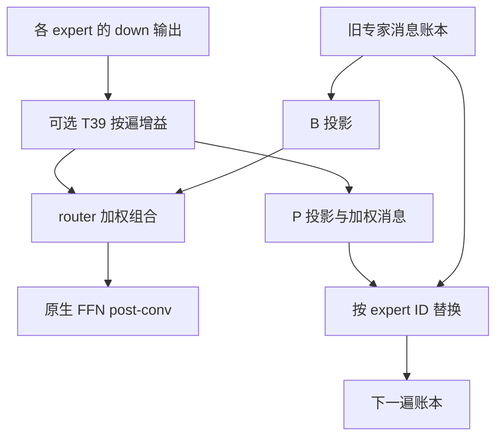

# Inkling 循环模型底层探索与改造方案 13

> 版本：2026-11-28，北京时间。对象：无念的 Astral fork 与 CodexGame / 4090-report。本文是一份新的研究设计与实施计划；T37–T40 的模型训练、CUDA 实现及性能收益全部为 **NOT_RUN**。本次已执行的是源码审读、资料取证、主机测试、公开实验数据重算与数学合同检查。
>
> 实施代理：逐任务采用 superpowers:subagent-driven-development 或 superpowers:executing-plans；本文件交付范围是完整方案，不自动实施模型改造、运行远端 GPU 或发布权重。

**Goal / 目标：** 在现有 Inkling 的真实循环图上，探索专家级可改写状态、共享参数的学习规则、跨遍量化补偿和独立潜在工作区，找到能通过对照实验证明的新能力或新效率边界。

**Architecture / 架构：** 保留当前工程作为可测量的参照，另建可改变模型数学的实验分支。先分别证明四种机制，再做有归因能力的组合；任何权重、状态或拓扑变化都允许，但每个候选必须具有独立模型身份和完整成本账。

**Tech Stack / 技术栈：** 当前 Rust/CUDA、SM89、GGUF/native checkpoint；新增 NumPy 数学参考和 PyTorch 可训练缩比模型；单 RTX 4090 24 GiB、主机 RAM 64 GB。

**Spec / 规格：** 本文第 5–10 章是机制规格，第 11–14 章是验收与实施计划。既有规格以固定版本的计划 10/11/12、lab 05/06/07 为历史参照；本轮明确允许改变模型，不沿用旧计划中“只能改控制器少量参数”的研究范围限制。

## 全局约束

- 不把已经提出但尚未运行的方案重新编号为创新；T23–T36、R1–R14 继续保留原身份。
- 不要求新模型兼容旧权重语义、旧输出或旧缓存；要求能够准确说明改变了什么，并有独立参考实现。
- 首个机制实验固定三遍、使用 plain target，避免混入动态深度和 DSpark 的接受率变化；这些既有能力在模型成立后再组合。
- 科学对照先控制参数、训练数据、优化器、损失、有效计算和持久状态；4090 墙钟、峰值显存另报，不能互相替代。
- 所有新增数值、速度和准确率阈值在观察候选结果前冻结；不足以作结论的数据标成不确定，不把小样本 pilot 写成正式通过。
- 当前仓库没有完整训练 backward。冻结主干仍可能需要主干输入梯度，不等于可以免费训练插入主干的模块。
- 单卡实验串行；沿用现场驱动和生产目录保护要求。模型研究自由不涉及修改驱动、功耗或生产服务配置。

## 重点审查项

1. 专家消息在 token、chunk、请求和重放边界的生命周期；新 token 不得读旧 token 的显式账本。
2. 模型开关为零时的真实调用路径；不能只把参数乘零，却继续改变归约、量化或 kernel 选择。
3. teacher/student、A1/A4、固定三遍/可变遍数的身份；不能把格式差异当成循环机制收益。
4. 训练中的答案边界、共享参数梯度和路由重算；不能让未来答案进入工作区，也不能把错误 detach 当作节省显存。
5. 新增状态、反向激活、额外投影及 TTFT 的真实成本；不能只给小参数量或单个 buffer 的大小。

---

## 1. 判断与优先级

这批资料最值得转化的内容不是再加一个“自我改写 agent”，也不是继续给动态遍数换名字。当前工程已经具备较好的单卡推理基础，下一步的关键是：**让共享权重的重复使用拥有可检验的新计算语义。**

四个新增方向如下。编号沿现有 T36 接续，尚未写回仓库任务表。

| 新编号 | 真正改变的对象 | 首轮要回答的问题 | 现实优先级 |
|---|---|---|---|
| **T39 按遍数值补偿** | expert-down 的运行时量化/累加误差；共享 packed 权重不复制 | 三遍分别补偿，是否比所有遍共用一个尺度更有效？ | **先做一层证伪**：现有FP32 SiTU/GEMV可组成算术teacher |
| **T37 专家消息替换账本** | 同 token、同物理层内的可写计算状态 | 显式保存并替换“某专家上次说了什么”，是否有别于普通残差历史？ | **主架构线**：最接近当前 MoE/loop 的特殊性 |
| **T38 按访问梯度 Gram 合并** | 共享权重的训练更新规则 | 求和前保留各遍梯度几何关系，能否改善共享角色冲突？ | 与 T37 的缩比训练并行，推理端可零新增状态 |
| **T40 只读输入＋可改写工作区** | 注意力拓扑、可写容量与计算时钟 | 用不生成文本的少量 latent cells，能否改善因果 decoder 的多步求解？ | 高风险研究，先在缩比因果模型证伪 |

**我最看重 T37 的架构潜能；最建议先实施 T39；最不能草率投入全尺寸工程的是 T40。** T38 的潜在优势在训练侧，不能把它包装成现成的推理提速。

全面融合的顺序是：先建立可信基线 → 单机制对照 → T37×T39 的交互 → 用 T38 训练有效的共享模块 → T40 若独立成立再加入 → 最后重新校准量化并接回 DSpark/旧深度方案。不是第一天把所有东西打开，再拿一个总分推断各部分有效。

### 1.1 本轮不承诺的数字

没有证据支持“这些改动能把 4090 从 222 tok/s 提到某个确定数字”，也没有证据支持“少一遍可以无损”。本文件给的是算子、状态、统计和停止规则，所有收益都留给实验。

对新模型，更有意义的主指标是：

\[
\text{任务有效吞吐}=
\frac{\text{在预定判分下正确完成的任务数}}
{\text{包含工作区构建、prefill、decode、重试的总墙钟}}.
\]

还要同时公布准确率与时间的两条原始轴。不能只报这个比值，否则任务难度和错误率变化会被隐藏。

## 2. 最新项目基线：哪些事情已经发生

### 2.1 固定身份与本轮读取范围

| 对象 | 本轮固定版本 | 与上一轮基线相比 |
|---|---|---|
| lkyprogramer/inkling-4090-engine / main | **7108b78dbc6da1b6253ae68354ecc807fca8b021** | 对 744e32a：4 提交、15 文件变化 |
| lkyprogramer/CodexGame / 4090-report | **475d4c892bb3723a7b8597ca7049158745694749**，lab **v3.0.19** | 对 19a431a：7 提交、158 文件变化 |
| 计划 10/11/12 | 同一 CodexGame 固定提交；计划 12 包括末尾第 16 节修订 | 全文排重，不只读取旧摘要 |

两个最新提交分别为北京时间11月27日21:11:13、21:13:12；交付前于11月28日01:05再次查询分支，HEAD未变化。本轮读取lab完整子树318个文件，以及引擎核心源码、配置、文档、比较器共113个文件；逐文件Git blob核验一致。不是声称下载了整个CodexGame或整个引擎仓库。[E1][L1][P10][P11][P12]

### 2.2 已保留的实际改动

| 改动 | 当前实际状态 | 对本方案的影响 |
|---|---|---|
| T17：目标 SWA KV ring | 已实现；plain 作者容量记录为 **132096 tokens** | 不能继续把项目写成“当前只能 8K” |
| T16 第一轮单 token Q8 dp4a | B decode 数值门失败，默认选择已撤回 | 不能拿其提速作为现行正确基线 |
| T16 第二轮 | SM89 默认：单 token decode 用 TC，T=2–8 小批 Q8 用 dp4a | 新实验以这一最终选择为起点 |
| T21：DSpark local 层 ring | 已实现；作者容量 f32 **106496**、可选 f16 **114688** | 计划 12 的 DSpark 73728 容量已过期 |
| T22：非零 F16 激活平面测试 | 修复代码已在前基线；本次新增完善归档 | 不把“修复刚出现”计为本轮引擎增量 |
| T25：状态/长文/odd verify/硬退出补充 | 仍为 **NOT_RUN** | 相关正确性债务仍在 |

作者 T21 报告 burst/plain 配对几何均值 **1.564×**，总体 mean throughput 分别 **222.4 / 139.2 tok/s**。这两个均值的比值不是配对几何均值；本轮没有取得逐请求吞吐原始流，不能独立重建 1.564× 或置信区间。此前 T16 的 206.3 tok/s 也属于不同记录，不能直接相减解释为单一改动的收益。[L07][T21C]

### 2.3 测试已经证明了什么

| 证据 | 本次复核 | 实际边界 |
|---|---|---|
| lab Python 测试 | 17/17 通过 | 工具逻辑，不是 GPU 推理 |
| engine Python 比较器 | 18/18 通过 | 阈值、缺项、有限性等逻辑 |
| lab 结构校验 | PASS | 原工具自己标明 package_structure_only |
| package SHA256 清单 | 317 个现存条目匹配；**3 个文件缺失**，完整校验退出 1 | 缺失项在远端固定 Git 树本来就不存在 |
| T17 的 16K/32K step/serve | 四项 V4 判定重算通过 | 从已发布摘要重算；不是重新运行模型 |
| T21 草稿精度 | 120 条 JSONL 重新汇总 | 属于 llama.cpp 固定 k7 试验，不是 Astral BF16 臂 |
| T22 日志 | 87/93 → 93/93 计数吻合 | 作者 GPU 日志，本次未运行 selftest |
| 最新 D 组 | **仍 FAIL** | 不能被 B 组或 selftest 通过覆盖 |

缺失的三项是 tools/t16/results/g2/greedy-div 下的 dp4a.log、ll.log、mma.log。T17 的 64K/128K 是内部一致性、attention 参考与有限 passkey 检查，不具备 16K/32K 同等级的外部完整模型参考。当前 host 没有 cargo、rustc、nvcc、nvidia-smi；本轮没有 Rust/CUDA 构建或 GPU 实验。[T17][T16][T22]

最新第二轮 D decode 有 **2 处** margin≥0.5 翻转；旧 T20 JSONL 的 **1 处**是旧版本数据。两者分别保留，不混用。T21 Q8/BF16 草稿臂的接受率约 .264090/.264712，mean throughput 95.196/92.684：只能说该固定设置中 BF16 没有净收益，不能据此否定所有草稿训练方向。[T16][T21A]

### 2.4 三个会影响后续研究的真实工程细节

**第一，T21 的 PASS 范围小于原始合同。** 当前 Policy 仍使用在线接受统计、EMA 成本和缺测时的旧先验；没有冻结成本表身份、没有 plain 候选，也没有表失配后退回 plain。ASTRAL_SPEC_LOG 只记录 position/k/accepted/整轮 ms，未拆 draft/verify/commit/rollback；日志 flush 还在这项 ms 之外。公开摘要 28 格中有 10 格的离线估算与观测差超过 3%，最大约 9.41%；聚合口径不同，足以否定统一“≤3%”的表述，不足以断言算法错误。[E3][T21C]

**第二，策略状态跨请求保留。** API 复用同一 Session；reset 清 conv 和 pos，但没有重建 Policy；spec_begin 也没有清其 cur、接受统计和成本。warm-up 还先执行 4 轮 spec_next。因此首个请求带着 warm-up 策略状态，后续请求带着前请求统计。这不是已证明的 KV 污染，但性能复现必须冻结请求顺序和策略初始状态。[E3][E4]

**第三，旧开关可能重新打开失败路径。** 最新代码的 decode_q8_mma 同时检查 ASTRAL_DECODE_DP4A 和 ASTRAL_SMALL_DP4A。显式设置 ASTRAL_SMALL_DP4A=1，也会让单 token decode 走已撤回的 dp4a。SM89 的正确当前默认不需要这个开关；旧 ASTRAL_DECODE_MMA 已删除。所有新实验要记录实际 kernel 命中路径。[E2]

这些是旧任务补齐和基线修正，不计入 T37–T40 的创新。

## 3. 既有方案排除账本

### 3.1 明确排除的内容

| 既有内容 | 原编号/出处 | 本轮处理 |
|---|---|---|
| visit/slot/tap/graph 显式计划与身份 | T23 | 复用已有设计，不再发明通用 Plan 框架 |
| message 批算、逆 RMS、半投影、两源 Gram 化 | T24 / M1–M4 | 不是 T38 的梯度 Gram；两者发生在不同计算阶段 |
| NVFP4/Q8/FP8、dp4a、mma5、专家 tile、conv/controller/SiTU 融合 | K1–K11 及后置项 | 只有新机制必要的 kernel 才新增 |
| 草稿 head shortlist、terminal coda 裁剪、远端 block sparse | T26–T28 | 不重提 |
| 编辑后 stem 复用、GPU 多步生成、低位 GGUF 资产对照 | T29–T31 | AP 只补到 T31 的候选资产，不算新任务 |
| 固定 1–5 遍、动态 2/3 遍、小判断器、96 个 gain 校准 | T32/T33/T35 | 不重提 |
| 浅遍起草、深遍验证、LS v0/v1、3→4/5 遍验证 | T34/T36/R14 | 不重提，包含尚未实施的部分 |
| 专家局部性、跨遍 KV、量化传播、收敛/病理观测 | R1–R13 | 观测可复用，单纯再观察不叫新机制 |
| 普通 LoRA、控制权重自改写、量化自修复、多代递归 | 前序讨论及计划 12 | 大方向已经提出；本轮只新增明确定义的运算语义 |

Self-Rewriting、QDA 中“少量参数搜索”“agent 自动选 recipe”与此前方向重合。LoopTitan 的 per-visit LoRA、EMA memory 也已有公开实现，不能包装成本轮新发现。[P10][P11][P12][LT-code]

### 3.2 对旧计划 12 的必要勘误

1. 当前 n_slots=12+12R。R3 是 48，R5 是 72；“在三遍分配里运行 1–5 遍”不能成立。T33 要选择最大深度预分配或重建，并重新算 graph、bank、tap、显存。
2. T34 的“输出严格等于原生三遍贪心”不能由容许 argmax 分歧的 num-3/V8 推出。结构前缀可复用不等于不同 batch/kernel 的舍入结果全同；必须明确等价的数值参考路径。
3. DSpark 长上下文优势区间需按最新 106496/114688 容量重新计算，而且 A4 要跑自己的 L0，不能搬 A1 数字。
4. 326 是先前外部方案的可编辑张量数，不是标量参数数；缩小为 96 个 gain 是另一种受限问题。

这些修正不占新任务编号。[E2][P12]

## 4. 五项新材料：贡献、证据与迁移边界

### 4.1 Self-Rewriting：能提出有效干预，不等于八代累积进化

研究对象为 Language Models Can Rewrite Their Own Weights，arXiv **2611.21885v2**。论文的编辑者参数固定，编辑作用于其请求的 target runs；附录 E.9 的八个会话各自从 base weights 开始。最大报告变化为所有 48 个线性注意力层 dt_bias 加 0.5，held-out 得分 57.2%→63.8%，截断率下降。修复实验由未损坏模型编辑损坏副本。没有足够依据称它为已经实现的连续多代自进化。[SR]

**值得借鉴的是实验协议：** 对候选做成对因果干预，拆开组件，设置编辑者看不到的验证集，允许撤回，并在新题上复测。不能把“更少耗尽 token”直接解释为知识增加，也不能把 Qwen 的线性记忆 dt_bias 数值移植到 Inkling 的 conv4、KV 和 depth bank。

本轮使用方式：作为 T37–T40 的候选筛选和因果干预方法。不会另立一个泛化“自改写平台”任务。本次未找到作者明确链接的完整官方工程或编辑后权重，能做的是按论文独立重建协议。

### 4.2 LoopTitan：把循环配方拆回可比较的资源和训练条件

论文为 LoopTitan: What Does Parameter Revisit Buy a Mixture-of-Experts?，arXiv **2611.34821v1**；官方代码固定 **a9f526a78469069e7ab3d628e4e7395254837f4e**。它匹配参数、训练 FLOPs、logical KV，区分复访、网络形状、残差尺度与优化器，指出在所测设置中循环配方的大部分优势可由这些因素解释；不能外推为所有循环模型没有价值。[LT][LT-code]

代码已包含物理 owner/logical visit 分离、visit-specific 组件、EMA memory、每 visit KV 和 Muon。其优化器对共享 owner 的梯度先求和再更新，正是 T38 要进一步拆分的位置。残差尺度等价关系还联动初始化、学习率、衰减及 epsilon 等条件，不是“训练后随便调 scale 无损”的定理。[LT-opt]

作者训练主要使用 8×H200，大设置 16×H200；公开 17 个模型为 seed42 导出。本次核验了源码、配方及发布说明；单模型 HF 权重文件/revision 未成功取得，不能声称已检查其权重内容。第一轮不在 4090 上复现其 5B-token 大训练，而借用其控制变量方法。[LT-recipe]

### 4.3 AP GGUF：有价值的资产对照，不能按名称推断格式

固定模型库 **agentionai/Inkling-2-Mini-AP-GGUF@94a178b6dad70c9ecee7784cd4a9b9ebfa383f6c**。AP 为 Agention Precision，作者定义为压缩配方品牌，不是新算子格式。Inkling 卡声明沿用 Unsloth 的逐张量布局、以自有数据重新编码；没有披露完整源权重身份、imatrix、校准数据和编码命令。[AP-card][AP-name]

本次对两个文件分别实际获取 16 MiB 前缀，读完 70 项 metadata 和完整 tensor directory；API 与 Content-Range 的字节数一致，张量跨度总和与文件数据区一致。

| 实物 | IQ2_XXS v1.2 | Q3_K_XL v1.0 |
|---|---:|---:|
| 文件字节 | 8,486,215,264 | 13,631,775,136 |
| GiB | 7.903404 | 12.695580 |
| 张量数 / 类型数 | 704 / 14 | 736 / 13 |
| NVFP4 参数 | 2,378,170,368 | **14,948,499,456，约 57.34%** |
| Q2_0 参数 | 5,775,556,608 | 0 |

两者仍为 24 物理层、core[6,18)、固定三遍、2304 hidden、128 experts/top-8。Q3 额外有 32 个 F32 per-expert scales，总计 16 KiB；忽略它们会得到错误资产。全文件 SHA 是发布方/HF LFS 宣告，本次只独立复算前缀 SHA，没有下载完整 8.49/13.63 GB 权重。[AP-tree]

当前 Loader::mat 只直接支持 F32/BF16/Q8_0/NVFP4，IQ1/2/3 与 Q2_0 的目录/布局及执行支持不完整，K 系列也缺对应 Inkling 执行路径。**两个 AP 文件均不能直接在当前 fork 运行。** 全部展开成 BF16/Q8 后是另一资产，不得沿用原文件显存和带宽预算。[E2][E5]

卡片的“tool-call 改善 15%”是 KL .0478 vs .0560；IQ2 agent test 是 42/44 vs 42/44，不能叫准确率提高 15%。其速度来自 Strix Halo/Vulkan，记录链接本次返回 403。结论：加入旧 T31 资产对照；不拿 AP 作为血缘明确的 teacher/student，不为 AP 单独发明一个新主线。[AP-card]

### 4.4 QDA：真正有用的是实际 serving 数值闭环

新闻入口已追到 MIT HAN Lab 官方博客、论文 **2611.23388v1** 和 **humanfia/qda@dc39a02bfd87bb2790e34001708d54ce9131e076**。贡献是组合 PTQ 方法、快速 KL、压缩 teacher cache、长生成验证和受限搜索；不是新的量化 primitive。scale distillation、norm/gate 校准等已经存在，泛称“量化自修复”没有新增性。[QDA][QDA-blog][QDA-code]

需要保留三个边界：top-128+tail 是聚合后的 KL，下界不等于 full-vocab 精确 KL；主实验每项 8×GH200×8h，GLM 的 6.5h 使用 16×GB300，宣传中的美元费用主要是 agent token；当前 GGUF 支持清单没有已验证 Inkling 路径，也不是所有 PTQ 方法都支持 GGUF。[QDA-formats][QDA-repro]

本项目借它的反馈方法，具体增量落在 **共享 packed 权重＋按 pass 区分的 expert-down 输出补偿**，见 T39。代码 Apache-2.0 与 recipe-inputs 的 CC-BY-NC-SA 4.0 是不同许可；研究数据优先使用有权使用的自有/合成轨迹，不自动拷入非商业校准池。[QDA-data]

### 4.5 Dlouapre：把“算法迭代”和“记忆事实”分开，但拓扑不同

Space 内文章和嵌入脚本已经读取。它用约 0.6–2M 小模型对比链式推理、随机事实记忆、随机循环深度和残差 gate；随机遍数训练有助于某些外推，但更多遍数也可能饱和或退化。[DL]

重要差别：其中图任务是对已观察边集合做**双向 attention**，不是带 KV 的自回归 Inkling；没有现行 MoE/conv/AttnRes 全套结构。高跳数还要防止 distractor 随链长减少造成题目变简单。gate 近零会延缓甚至抑制学习，所以“初始关闭更稳定”不能直接当好配方。

它启发的是 T40：把已观察输入与可反复更新的求解空间分开，显式允许 scratch 内部双向通信，同时让生成端保持因果。文章不是 26B、4090 或现行 Inkling 的性能证据；其 tiny 结果不能直接换算成更深 Inkling 的收益。

### 4.6 来源如何融合到四个新增机制

| 来源 | T37 专家状态 | T38 学习规则 | T39 按遍补偿 | T40 工作区 |
|---|---|---|---|---|
| Self-Rewriting | 检验 state read/write 是否真正致效 | 禁止只看训练 loss 后宣称自改进 | 用隔离验证筛选补偿，不靠编辑者自评 | 测固定预算得分与截断率，区分停得更早和算得更好 |
| LoopTitan | 加同容量匿名状态/无状态对照 | 核心动机：求和前的访问角色 | 同格式、同计算与优化器控制 | 等参数、等 FLOPs、等 wall-clock 三种比较 |
| AP | 不直接提供新状态 | 无新增训练证据 | 说明真实混合格式、血缘和 agent 校准的重要性 | 更小权重未来可换状态空间，但先测成本 |
| QDA | 新状态训练完再重新校准 | 不能把 recipe 搜索混作学习规则改善 | 实际 serving KL、局部 fit、自由生成 | 最终候选在真实执行路径评分 |
| Dlouapre | 算法状态与参数记忆分开 | 随机深度先作为后续对照 | 更低 KL 不等于更强推理 | 双向 scratch＋因果 decoder 的拓扑动机 |

## 5. 从真实计算图出发

### 5.1 Inkling 已经有状态，不能从“只有一个 hidden”起步

固定三遍下，24 个物理层形成 48 个逻辑访问：6 层 prelude、12 层 core×3、6 层 coda。每遍有自己的 KV/conv slot。后续 core pass 从 prelude 起点恢复，读取上一遍的 blocks/message bank 和 bank_out；已有 attention-residual bank 会保留多个深度快照。[E2]

更准确的描述是：

\[
(H_{r+1},S_{r+1})=
\mathcal F_\theta(H_{\rm prelude},H_r,S_r,\mathcal K_{r,\le t},\mathcal C_r),
\]

其中 S 包含 depth bank、message/controller 状态；KV 与短卷积历史也是图的一部分。不能只用 h_{r+1}=F(h_r)，再把某个 Jacobian 的谱半径当作全模型收敛证明。稳定在错误答案附近没有价值；局部收缩也不等于全局可求解性。

### 5.2 五项预算必须分开

| 预算 | 增加它可能带来什么 | 不能推出什么 |
|---|---|---|
| 唯一训练参数 | 事实容量、函数族扩大 | 不必然提高多步求解 |
| 每次请求可写状态 | 暂存、修订和组合证据 | 不等于增加永久知识 |
| 实际循环计算 | 多次变换/搜索机会 | 不等于循环本身优于同预算深层模型 |
| 学习规则与数据 | 让共享参数适应不同角色 | 不等于增加推理 FLOPs |
| 表示/访存/执行 | 改善数值和墙钟 | 不等于能力增加 |

T37 改第二项，T38 改第四项，T39 改第五项中的跨遍数值结构，T40 同时改变第二项和信息可见性。它们可以组合，但必须分别归因。

### 5.3 当前最具体的接点

在 inkling.rs 的 layer 中，expert gate/up→SiTU→down 后，s.y 保有各 token、各选中 expert 的 2304 维输出。batch 路径随后 moe_combine_t 得到 s.o，再进入 FFN post-conv；单 token 则由 conv_residual 融合加权组合和 post-conv。这是 T37/T39 应进入的真实位置，不需要从聚合后的向量猜回专家贡献。[E2]

T37 首版改变 **组合后的 FFN 输入**，T39 改 **组合前的 expert 输出**。T40 选择首个 coda 层的 **depth-mix 之后、Q/K/V 输入 norm 之前**；直接向 cur 加向量可能被下一次 mix 遮蔽，因此不采用模糊的“pre-coda 随便加一个 residual”接法。

## 6. T37：按专家身份替换的消息账本

**状态：NOT_RUN。** 改变模型函数，需要训练。全尺寸首版R=3、rank=64，beta=1；缩比rank=min(64,D/16)，即M0为4、M1/M2为16。不增加跨token账本，不同时修改router或动态深度。

### 6.1 假设与新增性

原模型能保存“经过一段深度后的整体状态”，却没有显式暴露“这个 token 在这个物理层，上次选到 expert e 时，它提交的加权消息是什么”。T37 把后者变成可寻址对象。

假设是：迭代求解需要**修订已有证据**，而不仅是叠加新的残差。按专家身份保留最近一次贡献，可能让共享专家形成不同遍次的纠错协作。只有它胜过同容量匿名状态和普通 adapter，才能支持这个解释。

这里的“替换”仅指独立账本，不撤销旧消息已经经主干、attention、conv 传播的全部后果；不能称为无损撤回。

### 6.2 完整首版数学

记 t 为 token，l 为 12 个 core 物理层之一，r 为 pass，S 为当前 top-8 专家集合。原生 down 输出为 y_e，router 权重为 w_e。增加：

\[
P_l\in\mathbb R^{64\times2304},\qquad
B_l\in\mathbb R^{2304\times64}.
\]

每个 token/物理层保存最近消息 m_e 和总账 L：

\[
L_{l,t}=\sum_{e\in U_{l,t}}m_{l,t,e},\qquad L^{(0)}=0.
\]

本次访问严格按以下语义：

\[
\begin{aligned}
L_{\rm old}&=\operatorname{snapshot}(L),\\
o_{\rm base}&=\sum_{e\in S} w_e y_e,\\
o_{\rm new}&=o_{\rm base}+B_lL_{\rm old},\\
\widetilde m_e&=w_eP_ly_e,\quad e\in S,\\
m_e^+&=\widetilde m_e,\quad e\in S,\\
L^+&=L+\sum_{e\in S}(m_e^+-m_e).
\end{aligned}
\]

未选中的 expert slot 保留。o_new 进入原生 FFN post-conv 和后续残差流程。**先读旧账本，再统一提交本次消息**；不让同一 top-8 内后处理的专家看到前一个专家的新消息。

writer 读取各专家本身的 down 输出，不读取已经加了 B·L 的组合结果，避免把整份账本直接写回每个专家产生自激回声。新的支路当然仍会影响后续层及后续遍的 y_e，这是真实模型反馈，训练和对照必须包含它。

初始化P非零、B=0。这样B的梯度可由第二/三遍的非零L启动，P会在B打开后获得梯度。不能P/B都置零；训练时也不能因为B当前数值为零就跳过支路，删掉B梯度。关闭实验是独立的部署开关，此时完全绕过支路和写入、保留旧kernel；训练初始化的数学等价与部署开关关闭的逐位等价分开验证。



图中 T39 默认关闭；它加入后，writer 和 combine 必须使用同一份补偿后的 y，不能一个读补偿前、另一个读补偿后。

### 6.3 生命周期与布局

首版记录：

| 字段 | 索引/类型 | 作用 |
|---|---|---|
| expert_ids | [core_layer, token_row, capacity] / int16 | expert 身份，未使用为 -1 |
| messages | [core_layer, token_row, capacity, 64] / FP32 reference | 最近一次加权消息 |
| ledger | [core_layer, token_row, 64] / FP32 | 所有已占 slot 消息的和 |
| used_count | [core_layer, token_row] / uint16 | 活跃并集大小 |

capacity=min(E,R·top_k)，R3/top8/E128 时为 24，R5 为 40；首版按保守上界分配，不作 eviction。有限并集内线性搜索最多 24 项是可测的实现选择；不要先引入通用 GPU hashmap。

每次完整 target forward 的 token rows 从空账本开始，只跨该 token 的 core passes 保留；decode 的 row0 在新 token 开始时清空。prefill 的不同 rows 各自独立，所以不增加显式跨 token state。不过修正后的主干仍会通过原生因果 KV/conv 影响后续 token，不能说它与历史完全无关。

最后一遍后不再读取账本，可省最后一遍 writer；首个 reference 仍可写以便检查。CUDA Graph 捕获中包含初始化和固定地址，不能由主机“偶尔清零”。与旧 T34 浅遍复用组合时，如果跳过已执行 pass，就必须同时恢复对应账本或重放；首版禁止这种组合。

### 6.4 浮点合同

FP32 reference 每次用固定 expert ID 顺序重新求和作为 oracle，同时保留增量更新路径作比较。两者允许有预先界定的舍入误差，不宣称换归约顺序逐 bit 相同。

若部署尝试 BF16/FP16 messages：

1. 先把新消息量化成实际将存储的值。
2. 用解码后的 stored_new−stored_old 更新 FP32 ledger。
3. 不得用舍入前消息更新 L，却把舍入后值写入 slot。
4. 对第一、第二遍末尾做固定顺序重算可以消除累计漂移；它有读带宽成本，独立测量。

本轮 CPU 负控制已能在三遍例子中复现错误做法的偏差；这证明合同必要，不证明 BF16 对真实模型可接受。

### 6.5 成本账

以下均为设计算术，T=2048、12 core、D=2304、rank64、容量24；不包含原生 KV、conv、bank、激活和 allocator。

| 内容 | 大小 |
|---|---:|
| P/B 参数 | 2×12×2304×64 = **3,538,944** |
| BF16 参数副本 | **6.75 MiB** |
| FP32 message reference | **144 MiB** |
| BF16 message 工程候选 | **72 MiB** |
| FP32 ledger | **6 MiB** |
| int16 ID 表 | **1.125 MiB** |
| decode 单 token BF16 messages | **36 KiB**，另加 ledger/ID |
| dense[E=128] BF16 messages | **384 MiB**，不作为首版部署布局 |

R5 保守容量40时 BF16 message pool 是120 MiB。若最后一遍不写，R3 的有效并集可只分配16项，降到48 MiB，但必须在 reference 通过后再优化。

两次 writer、两次 reader 的投影代价约：

\[
12\times(2\times8+2)\times2304\times64
=31,850,496\ \text{MAC/token}.
\]

按乘加2 FLOPs 是约63.7 MFLOPs/token，另有 slot 查找、读写与 kernel launch。不能用“参数只有6.75 MiB”推断低延迟。

### 6.6 训练与严格对照

先在第 11 章的因果缩比 Inkling 参考上训练，固定终端 CE、相同 router aux、相同 token 顺序。主要对照：

| Arm | 目的 |
|---|---|
| 原生 R3 | 总体基准 |
| 同 P/B 的无状态支路：B·P·o_base | 排除新增低秩 adapter 本身的收益 |
| 同 P/B、每 visit 清零 | 空状态负控制；不能把这个无效支路当唯一等参数对照 |
| 匿名append：每次submission新增一个slot，读取全部旧slot之和 | 同P/B、同分配容量、无身份替换；R3无eviction的FIFO与此等价，只算一个arm |
| 消息错配：每visit开始只打乱已占slot的message，不动expert IDs | 保持打乱前后L总和、occupied数、真实IDs和替换/新增数量；改变被替换的是哪个旧消息 |
| T37 正确身份＋替换 | 候选 |

append臂按(pass,top-k rank)依次写slot，每次消息仍为w_e P y_e；容量24足够，首版没有eviction。消息错配臂在每个(token,physical layer,pass)用固定记录的随机种子，对已有message行作置换，ID表不变；此刻L不变，随后按原规则replace/allocate。它保留单步错配时的占用和提交数量；模型自由运行后路由仍可能因此前干预分叉，这一真实后果另报。ID与message同步的一致置换必须等价，作为实现正控制。

无状态P/B臂仅在r=1/2启用，使用当前pass的w_e P y_e求和再读B，r0无支路；与原版两次writer/两次reader的投影次数对齐。训练reference用函数式状态更新保留跨pass梯度，不detach ledger，不能照搬推理时覆盖buffer的实现。

先统计实际expert union、复访率和消息更新幅度，复用R3已有探针。若几乎没有专家复访，T37的修订解释缺乏机会，应停止或降为一般容量研究。

全尺寸 A4 的桥接训练需可训练 reference 和 frozen-weight input-gradient。T37 位于 core，会改变后续 core/coda 和跨 token KV/conv；不能只对 P/B 的局部输出拟合就声称训练完成。首次只在短序列、无 DSpark 的受控分支迁移。

### 6.7 继续/停止条件

- 在同参数/状态对照下，正确身份替换没有稳定独立收益：NO_BENEFIT，不继续写专用 kernel。
- 只有 PPL 改善、独立可判分推理没有改善：只记录语言建模结果，不宣称推理增强。
- B 长期趋零、旧 slot 成为陈旧噪声、错配身份也一样好：拒绝“专家协作纠错”解释。
- 额外 decode 成本超过5%：可继续作为架构研究，但不能进入当前效率主线。
- 机制先成立后，才可做固定 R2+ledger 对 R3 的压缩；必须同时比较固定 R2+同参数无状态 adapter。这与旧动态早退是不同实验，但不提前承诺少一遍无损。

## 7. T38：共享权重各次访问的梯度几何

**状态：NOT_RUN。** 首轮只在完整 autograd 缩比模型上运行。它改变训练，不改变推理数学；不是 T24 的前向 Gram 计算，也不是简单换 Muon。

### 7.1 定义

对一个共享物理权重 W，取同一个最终 loss 的各次使用贡献：

\[
g_r=\left.\frac{\partial\mathcal L}{\partial W}\right|_{\text{use }r},
\qquad g=\sum_{r=1}^{R}g_r,\qquad
G=[g_1,\ldots,g_R],\quad K=G^\top G.
\]

这些不是人为给每遍加一个独立 loss。后续 pass 对早期状态的依赖必须完整反传。

定义：

\[
\lambda=\rho\,\operatorname{tr}(K)/R+\epsilon_K,
\quad u_0=G(K+\lambda I)^{-1/2}\mathbf1,
\quad u=u_0\frac{\|g\|_2}{\|u_0\|_2+\epsilon_u}.
\]

首轮rho∈{0.01,0.1,1}，搜索预算与基线LR校准预算一起冻结。FP64 reference取epsilon_K=10⁻³⁰、epsilon_u=10⁻¹²；norm(g)或norm(u0)≤10⁻¹²时直接返回g。inactive expert的该visit梯度是零，不伪造样本。范数匹配因epsilon是近似等长，文档和测试不能说数学上严格等长。

第一轮只处理 core expert-down，owner 明确定为 (physical_layer, expert_id, down) 的二维参数 slice；每个 expert 各自计算 R×R Gram，再回写唯一物理 slice。当前 GGUF/GemvMatrix 把128个expert装在一个stacked tensor中，不能把“每个tensor”误当“每个expert”。router/norm/embedding/head 保持原优化器；成功后才扩大到 gate/up/attention。整层128专家一起做Gram只能作为另一个明确的whole-layer对照。

### 7.2 一阶性质与限制

在精确算术和 optimizer 变换之前：

\[
g^\top u_0
=\mathbf1^\top K(K+\lambda I)^{-1/2}\mathbf1\ge0.
\]

所以负 u0 对当前局部一阶目标不是上升方向。**这不保证 AdamW/Muon、momentum、weight decay 或有限步长后的下降**，也不保证泛化。

完全共线时，归一化后的方向退回原始总梯度；完全抵消且 g=0 时，不能凭空制造学习信号。系数可能为负，不把它解释为每遍正权重平均。列置换不改变算法，因此“打乱 pass 编号”不是有效负控制；正确消融是去掉 K 的非对角项。

### 7.3 如何拿到真的各次贡献

在训练参考里，各 invocation 使用数值相同、梯度独立的临时 leaves；不更新这些 leaves，只把贡献收集回唯一物理 owner。第一步验证：

\[
\sum_r g_r\approx \nabla_W\mathcal L_{\rm 真正共享图}.
\]

中间 hidden 不 detach，所有 leaves 的数值来自同一 W，路由/dropout/recompute 的随机状态一致。checkpoint 重放若选到不同专家，不能把其梯度解释为原图贡献。

Gram 先用 FP64 小矩阵求谱分解作为 reference，负的舍入特征值截到0；训练实现可 FP32 构建 Gram、FP64 解小矩阵。大梯度缓存是否 FP32/低精度是后续独立工程变量。

### 7.4 实验矩阵

| 更新器 | 直接 sum | Gram 合并 |
|---|---|---|
| AdamW | A0 | A1 |
| Muon（仅适用矩阵） | M0 | M1 |

另有 diagonal-Gram 对照，区分“访问范数均衡”和“利用跨访问相关性”。每臂匹配初始化、数据、batch、终端 loss、router aux 归约、weight decay、LR 搜索次数。先同 token/FLOPs，再报告同 GPU-hour 的质量曲线，不能因训练变慢却在更多时间后得分更高而宣称无代价。

记录 g_r 的范数、K 的谱/有效秩、g 与 u 的夹角、验证 loss 和推理任务分数。记录用于诊断，不以“夹角变好了”替代最终任务。

### 7.5 内存与迁移

额外贡献缓存约4R·P_selected bytes；R3为12P_selected。若常规 master/grad/Adam 状态按16P_train估算，加部署副本和激活后另算。即使只3×3求逆，生成并保留各次梯度也绝不免费。

全26.07B参数仅按16 B训练状态就约388.5 GiB，远超24 GiB；不能拿“每 token只激活少数专家”替代全部可训练权重的优化器容量。

T38 最直接的产物是缩比模型训练后的权重，没有推理端状态成本。若用于 A4 冻结主干，不能再对冻结主干谈梯度改善；只可另测对 T37 的共享 P/B 或其它明确可训练共享模块使用该规则。其有效 invocation 数未必为3，必须从真实图记录。

### 7.6 否证条件

Muon 或 norm-matched/diagonal 对照消除了优势；各遍梯度基本共线；收益只来自更大的有效 LR；同 GPU-hour 不占优；或三 seed 结果不稳定，均不得进入全尺寸适配。学习曲线有价值也可以只保留训练研究，不强行写成推理引擎功能。

## 8. T39：共享 packed 权重、按遍补偿 expert-down 输出

**状态：NOT_RUN。** 首版无需完整反向，当前代码已有 dequantize、quantize_nvfp4 和 quantize_q8_0，可据此新增受控资产构建与前向采样工具；它们现在还不是现成研究命令。[E5]

### 8.1 为什么循环会改变补偿问题

一般权重量化场景中，同一物理权重的误差E在各遍遇到不同输入，最终影响为：

\[
\delta z\approx\sum_r J_r(E x_r).
\]

J_r 是真实展开的prelude/message/controller/KV/conv图到终态logits的全路径敏感性。首验研究的是运行时算术误差，改写为δz≈ΣJ_r ε_r(x_r,W)，不把它强行当成固定矩阵E。两种情况下终态误差平方或KL二阶近似都有跨遍交叉项，分别最小化每遍局部MSE不保证终态最优。

这个观察本身已属于旧 R8。新增的是可以实际执行的干预：

\[
y'_{l,r,e,i}=
\bigl(1+c_{l,e,g(i)}+a_{l,r,e,g(i)}\bigr)y^Q_{l,r,e,i},
\quad \sum_{r=1}^{3}a_{l,r,e,g}=0.
\]

首版 g(i)=floor(i/64)，每64个输出通道一个参数；保存 common 和两个自由 contrast，第三个为二者负和。它不复制三份大权重，也不修改每个 weight group 的 packed codes。

### 8.2 首轮 teacher/student 必须明确

**实物检查改变了首验设计。** 本次另外获取A1固定revision 8078d149286eec7193795413b9e0643da6d11fa1的16MiB前缀，LFS身份与lab的e6427665…一致。744个tensor目录显示：core6–17所有down均为NVFP4，shape为GGML[1152,2304,128]，每层都有F32[128]的.scale。并不存在“挑一个core Q8 down再压成NVFP4”的入口；该想法已删除。[A1-header]

首验命名 **T39-A：相同权重数值的算术补偿**。固定physical layer6，其余层、route规则和R3不变：

- teacher：由同一A1的NVFP4解码为F32权重，保留相同per-expert mat_scale；用F32 SiTU输入和F32 GEMV参考路径。
- student：同一层继续当前native NVFP4 fast算术；所有补偿对照共用同一份packed权重。
- 当前InklingOps::situ已有F32输出接口，输入s.gu、输出[ntok×top8,1152]；可复用它和Gemv::launch_ids。不能只换Loader类型，却继续走quantized activation，然后声称用了F32输入。[E2][E6]

teacher对整个目标模型自由前向时只替换这一物理层的down算术；局部fit对相同s.gu、expert IDs计算两条路径。它研究运行时activation/累加误差，**没有weight存储压缩收益，也不恢复未公开的BF16 master**。如果一层差异低于重复测量噪声，立即NO_BENEFIT，不为了“做出收益”人为加噪。

一个down bank为339,738,624个数，F32约1.265625GiB，原NVFP4约182.25MiB；释放原bank后替换净增约1.087646GiB。如果同输入shadow同时保留两bank，新增分配是1.265625GiB，再加ref_act/ref_y、graph和workspace。先在2K实测峰值，完整teacher/student请求分时运行。F32参考更接近所定义的矩阵算术，不自动代表任务更准确；自由任务测试仍是必要条件。

mat_scale必须只乘一次：保留未fold的F32解码权重与原.scale，或fold后移除.scale/设1，不能两者同时保留。Config.expert_weights_scale是router权重尺度，与weight scale不同。本次文件头只确认scale的类型和形状，没有取得其数值。

只有以后取得血缘明确、实际可执行的新量化student，才开 **T39-W：权重再量化补偿**。它沿用同一按遍机制，但单独报告收益；AP和“把NVFP4升成Q8再降回去”都不能假装成更高精度原始teacher。

### 8.3 不依赖 autograd 的拟合闭环

1. 在固定student的真实三遍路径采样physical layer6的s.gu/F32 SiTU输入、expert ID、router weight和pass。不同pass必须使用实际输入，不能复制第一遍输入。
2. 对相同输入、相同 expert，分别计算 teacher/down 与 student/down。局部固定 route 只用于隔离误差，最终评价仍自由路由。
3. 每个(l,r,e,g)流式累计A=Σωq²、B=Σωq·t和覆盖数，ω=min(w²,1)。ω只用于局部拟合，不修改真实router权重；所有对照使用同规则。覆盖数按不同(prompt_id,token_position)统计，pooled common按其并集计算，不把同token的三遍当三个独立样本。
4. 求带近1先验的 ridge 解：

\[
\widehat g=\frac{B+\lambda}{A+\lambda},\qquad
\lambda=0.1A\quad(A>0).
\]

当 A=0 或覆盖少于32个不同token位置时设g=1；这个覆盖门不把相邻token视为统计独立样本。首轮clip到[0.9,1.1]；这是实验定义，不是普遍最优范围。大量命中边界时停止并分析，不放宽范围追分。

5. 每遍gain先按s=n/(n+32)收缩到1，再以三遍算术均值为中心形成零和contrast方向。**公平的common-only另外拟合**：g_common=(ΣB_r+λ_c)/(ΣA_r+λ_c)，λ_c=.1ΣA_r，再按相同覆盖、shrink和clip规则处理。各遍能量A不同，三个局部gain的均值不等于最佳共享gain，不能用它削弱common对照。
6. 将contrast方向加到这个独立拟合的g_common上；先对同一组的三个contrast统一乘最大可行beta∈[0,1]，使三遍总gain都在[.9,1.1]且仍零和。然后只试contrast强度{0,.25,.5,1}，0就是公平的common-only；common强度固定1。另保留no-gain student。候选数固定，不对16万参数逐项finite difference。
7. 用完整 teacher-forced serving KL 和独立自由生成筛选。若扩到多个层，最多三层、总计48次开发集完整 forward score，达到预算即停止；新的量化层选择规则和强度搜索预算先登记。

采样到拟合的分布变化只允许一轮 on-policy refresh；它若打开，所有对照同样刷新。局部闭式解不是全图最优，最终判定不使用固定 teacher route 代替自身运行。

### 8.4 存储、运算和接点

保存接近0的 FP16 delta，FP32 输出做 fma(delta,y,y)，避免把接近1的绝对 gain 保存成 BF16 而抹掉小修正。部署时可预合成三遍 delta，每个输出组只读一个值。

| 预算：12 core×128 experts×2304输出×3遍 | group64 | rowwise，仅条件升级 |
|---|---:|---:|
| common＋2contrast 参数 | **165,888** | 10,616,832 |
| 两字节资产 | **0.31640625 MiB** | 20.25 MiB |
| 仅2contrast增量 | 0.2109375 MiB | 13.5 MiB |
| 两contrast逻辑读取上界/token | 40.5 KiB | 2.53125 MiB |

上表是假设全12层都启用的上界；首轮单层只用其1/12。新增乘法全模型上界663,552次/token，实际延迟由融合、cache和launch决定。第一版用显式 gain kernel 核验参考，只有机制成立再融合到 down/组合 epilogue。

单 token 的 conv_residual 目前融合 combine+post-conv，需要明确在合并前读取每专家 gain；batch 路径在 s.y→moe_combine_t 之间修改。禁止在聚合后用一个总 gain 冒充逐专家补偿。

### 8.5 精度目标与质量门

保留三个角色不同的指标：

- **局部解释指标：** 每 pass/expert/group MSE、gain 分布、cold expert 覆盖。
- **完整分布指标：** 同 token history 的终态 served KL；top128+tail 筛选，抽取至少256个预先固定位置做 full-vocab KL，报告两者差值。
- **自由任务指标：** 工具协议正确率、可执行代码通过率、数学/逻辑答案、截断/循环、答案长度和墙钟。

router 的 top8 overlap 与第8/9名 margin 是稳定性诊断；route 改变不必然错误。但局部 MSE 下降而终态 KL、长生成或高 margin 稳定性恶化，要停止扩展。

必要对照是 no-gain、common-only、correct contrast、在每物理层循环轮换 pass contrast 的错配对照。错配只在测试副本里做，不重新拟合；若错配后同样好，就缺乏按遍机制的证据。

各遍敏感性若近乎相同，零和 contrast 一阶上可能落入近似 nullspace，只有 common 有价值。不能宣称“正负交替自然消除相干误差”。

### 8.6 资源与停止条件

三个 FP64 统计量×165,888组约3.8 MiB。一个层、三遍、8192 token、top8、2304维的 BF16 expert 输出若全部保存，teacher 一份就约864 MiB；应流式累计/reservoir，不能同时保留12层 teacher/student 激活。

top128 teacher cache 每 token 约1024 B另加tail，32×2048 token约64 MiB。完整26.07B BF16权重约48.56 GiB，64 GB主机再放student和加载副本可能超限，所以 teacher streaming/mmap 是现实要求。

如果 common+contrast 不能在独立数据上胜过 common-only，结案为普通尺度修复，不升级 rowwise。若只在重拟合数据有效，结案为过拟合。若收益小于真实执行成本，保留数值研究结论，不进入主引擎默认路径。

## 9. T40：只读 prompt 与可改写的潜在工作区

**状态：NOT_RUN，高风险研究。** 新拓扑必须训练；首版固定主干R3、K=32个scratch、S=3轮，构建后整段生成只读。它不读当前答案、不随生成回写，也不承担动态深度选择。

### 9.1 先解决真实的首token边界

当前chat.rs::render没有在末尾追加assistant-start；常规最后一条消息以已有的 <|end_message|> 结束。不能凭空增加模型没按当前模板接收的token。[E7]

将实际prompt最后一个已核验的模板边界token暂缓，称为anchor；前面是payload：

1. payload按原生R3正常prefill，bridge关闭，收集prelude/stem输出；其coda历史也正常建立。
2. 所有payload已观察后，计算workspace并固定bridge K/V。
3. 在原生位置消费暂缓的真实anchor，bridge打开；该步logits预测首个生成token。
4. 后续生成按正常token顺序进行，只读workspace。

真实token ID序列没有增加，也没有重复消费末token。代价包括workspace build和anchor从大batch分离的调度成本。若先完成普通全prompt prefill，再建立workspace，已算出的首token logits不会自动包含新状态。

首版只接受已核验的chat边界；raw completion若最后一个token是内容词，暂不套用该合同。要支持它，另做“最后token运行到stem暂停、建workspace、恢复core/coda”的执行分段，不能假装当前已有可恢复的通用snapshot。

gamma=0逐位回归对比的是**相同payload/anchor分块调度的原生模型**。普通整prompt prefill可能走不同batch/kernel，不能无条件承诺它与分段调度逐位相等；端到端成本同时对比普通调度和分段空bridge调度。

### 9.2 首版完整计算

全A4取d=2304、workspace宽m=256、4个head、K=32、S=3；M1取d=256、m=128，其余相同。新增矩阵无bias，新增RMSNorm带gain、epsilon=10⁻⁶；stem与bridge query各一个d维gain，prompt/cross/self/FFN/final-Z各一个m维gain，不同端口不共享，三轮之间共享。原生norm仍用原配置。

payload第i个token的prelude输出为A_i。定义：

\[
P_i=\operatorname{RMS}_d(A_i)W_P,\quad W_P\in\mathbb R^{d\times m},
\qquad q=P_{N-1},
\qquad Z^0_j=e_j+qW_I.
\]

q已经是m维；qW_I只算一次再广播。e_j是可学习slot角色向量。P在请求内只读，先norm并一次计算prompt K^p/V^p；三轮cell共享权重，不能每轮重复统计这两个投影的成本。

令Attn表示分head的softmax(QKᵀ/√(m/4))V拼接，输出投影在式中只乘一次。所有softmax归约用FP32，a=1/√(3S)=1/3，各实验臂相同：

\[
\begin{aligned}
U^s&=Z^s+a\,\operatorname{Attn}
(\operatorname{RMS}(Z^s)W_{Qp},K^p,V^p)W_{Op},\\
V^s&=U^s+a\,\operatorname{Attn}
(\bar U^sW_{Qs},\bar U^sW_{Ks},\bar U^sW_{Vs})W_{Os},
\quad \bar U^s=\operatorname{RMS}(U^s),\\
Z^{s+1}&=V^s+a\,[\operatorname{SiLU}(\bar V^sW_1)
\odot(\bar V^sW_3)]W_2,\quad \bar V^s=\operatorname{RMS}(V^s).
\end{aligned}
\]

FFN宽2m。cross-attention可读完整已观察payload，self-attention可读全部K个scratch，包括自己；只屏蔽padding。不使用scratch位置RoPE、native relative bias、native conv4或native tau。slot是角色，不是真实token位置。

最终Z做norm，投影出K^z/V^z；它们在整个生成期间只读。没有新增原生KV slot，也不推进token position。

### 9.3 精确bridge接点

在首coda物理层18，先用原生DepthMix从该token的active bank与cur得到Q/K/V的输入行h_j。以真实Q输入h_0为query：

\[
\Delta_t=\operatorname{Attn}
(\operatorname{RMS}_d(h_{t,0})W_{DQ},K^z,V^z)W_{DO},
\qquad \gamma=\tanh\alpha,
\qquad \widetilde h_{t,j}=h_{t,j}+\gamma\Delta_t.
\]

对每个**不同的**输入行只加一次；当前layer18是SWA，Q/K/V共用一行，不能在别名地址加三次。随后按原生流程做input norm、activation quant、Q/K/V、conv、attention、FFN及后续coda。[E2][E6]

启用bridge的这个visit要局部拆开mix_rms_q8为mix→bridge→rms/quant。仅在现有fused调用后修改s.mixed是无效的，因为normed/qa已经生成，后面的norm循环还会跳过。关闭bridge时走原来的融合路径；不通过全局ASTRAL_NO_FUSE_MIX改变其它层。

alpha初始0，其余新增矩阵非零，norm gain=1；先32个update仅训练alpha，再联合训练。训练必须仍计算Delta和tanh(alpha)Delta，不能if gamma==0就bypass而删除alpha梯度；native推理的零门bypass是另一条合同。若Delta或W_DO也全零，会把门一起锁死。32步后仍无非零alpha梯度就停止排错，不直接扩大训练。此处不声称闭门一定有利于小模型训练，需记录门是否打开。

### 9.4 因果性与同步合同

训练样本物理拆为payload_ids、anchor_id、target_ids。workspace构造器的接口不接收target，不从拼接tensor或answer长度推导输入。teacher forcing使用[anchor]+target[:-1]，监督target，包含模型原生需要生成的role/content标记和EOS。

固定payload、参数、随机状态，任意替换、打乱、加长target，P/Z/bridge K/V必须完全相同。当前答案不能进入workspace；已经观察到的历史对话可以。

每轮读完整Z_old，cross写U，self的所有Q/K/V来自同一U快照，写V，FFN写Z_new，完成后交换buffer。不得依赖CTA启动顺序或让后写slot读到前写slot的新状态。U/V和score工作区另计，“双buffer”不等于总共只有两个张量。

把slot角色embedding与状态同步置换，双向scratch和bridge结果应在容差内不变。每请求重新构建；scratch不调用原生conv4、不增加native位置、也不把tau当scratch温度。原生tau仍由真实token位置计算。

### 9.5 一个实际可利用的训练减负：只反传coda

T40桥只在首coda。固定teacher-forced token IDs和R3时，所有prelude/core计算与bridge参数无关，源码的per-slot KV/conv也不被coda回写。因而可以缓存frozen前半部分，仅训练workspace/bridge并通过六层frozen coda、output mix/norm/head反传。[E2]

必须导出每个anchor/answer输入token的**cur＋全部active bank rows**，以及真实position、row index、next_row；不能只导出一个hidden。所审A4首coda前有3个active bank rows，加cur为4d个数，但导出接口从运行图记录，不把3写死成通用假设。

还需要payload每token的原始stem A、payload结束时六coda的KV和四个conv站点历史。A不能只替换为P缓存，因为W_P训练时变化。payload状态可detach；anchor/answer之间被bridge改变的coda KV/conv必须保留跨token梯度。

这条缩减**不适用于T37**：它写在core内，会改变后续core。也不使当前仓库突然拥有训练能力；需要新增coda可微reference，先对齐前向再验证输入梯度。训练若用dequantized权重和activation STE，应明确是surrogate gradient，导出后仍需native检验。

冻结主干下损失为answer CE，加独立retention数据上的teacher KL；每次update使用相同条数的task和retention样本，两项各按其有效token平均，lambda只在{0,.1,1}中选择。tiny首版只用answer CE与统一的router balance，不提供中间scratch正确答案或每轮oracle监督。

原生前半部分feature cache只对固定token history有效；自由生成评估必须在线运行完整模型，不能复用另一候选答案轨迹的缓存。

### 9.6 参数、显存和计算账

在上述无bias、共享三轮、一套bridge的定义下：

\[
P_{\rm new}=3dm+17m^2+Km+2d+5m+1.
\]

A4为**2,897,665参数**，两字节权重约5.527 MiB；按16 B/参数的训练状态约44.215 MiB。M1的d256/m128为382,081参数。这个小数不包含frozen coda、激活或缓存。

乘加按2 FLOPs，矩阵计算：

\[
F_{\rm build}=2Ndm+4Nm^2+2m^2
+S(24Km^2+4KNm+4K^2m)+4Km^2,
\qquad
F_{\rm bridge}=4dm+4Km.
\]

| A4工作点 | 构建矩阵计算 | 每个bridge输入token |
|---|---:|---:|
| N2048 | **3.3168 GFLOPs** | **2.3921 MFLOPs** |
| N32768 | 50.6285 GFLOPs | 同上 |
| N131072 | 202.0261 GFLOPs | 同上 |

总成本是build＋(anchor及答案输入数)×bridge，另加norm/softmax/SiLU、访存、launch及分段调度。固定R3下它首先是能力研究，不能据2.39 MFLOPs就声称decode无成本。

A4/N2048两字节状态：P/Kp/Vp合计3 MiB；Z双buffer32 KiB；U/V各16 KiB；最终bridge K/V合计32 KiB；materialized cross scores约1 MiB。构建后可释放P/Kp/Vp，生成期间保留bridge K/V。full-width d2304的scratch单buffer144 KiB、双buffer288 KiB只是被排除的宽版本参照，不能与m256方案混报。

更大的训练成本来自frozen coda：六层expert若全展开BF16就约**11.39 GiB**，另有约0.863 GiB output head、attention和反向激活。payload2048、答案输入256的紧凑feature cache约55.46 MiB/样本，native ring实际allocation还可能更大。分shard存取，host peak限48 GiB；训练microbatch1、答案输入64起步，GPU实测峰值门22 GiB。尚未证明该门能通过。

### 9.7 实验和淘汰

主对照是双向scratch vs causal scratch：参数、K/m/S、初始化、数据、loss一致，后者仅改变scratch self-attention的mask，仍执行完整dense矩阵计算。它隔离scratch间可见边，**不证明双向prompt编码更好**，因为两臂都读完整已观察payload。

再比较下列已固定的辅助对照：

| 臂 | 精确替换/输入可见性 | 匹配的预算 |
|---|---|---|
| 无slot通信 | self子层换成U+a·[((Q⊙sigmoid(K))⊙V)W_O]，Q/K/V均由同一norm(U)独立投影；其它cross/FFN/round保持 | 参数完全相同；少4SK²m矩阵FLOPs，逐点开销另报 |
| 无状态adapter | 同一首coda post-mix的h0，Δ=[SiLU(norm(h0)A1)⊙(norm(h0)A3)]A2，同样加到唯一Q/K/V行；不读取P/Z或其它token的新特征 | A4瓶颈宽416：2,877,697参数，较T40少约0.69%；M1宽496：381,185，少约0.23% |
| S1 | 保留相同workspace参数，只更新一轮 | 同参数，较少计算 |
| 原生R3 | 无新增模块 | 总体基准，不是等预算因果对照 |

adapter计数为3db+d+1，包含独立norm gain与gamma门；使用同样32步门warmup和相同LR/retention搜索预算，不能拿未训练adapter充数。主双向/causal比较才要求同dense执行量；无通信/adapter/S1不宣称同计算，分别报告实际成本。

进入A4前，建议tiny主OOD任务双向对causal提高至少5pp、配对区间下界>0、至少2/3 seed为正，in-domain下降不超过2pp，再补其它消融。这里是投资门，不是声称模型已经达到这些数字。

若只有读取prompt的摘要作用、没有双向/迭代优势，归类为普通adapter结果；如果需要K增长到接近N才有效，视为K32有界方案失败。若tiny成立而frozen coda不能解读workspace，A4迁移失败；是否解冻更多层属于另一笔明确预算，不自动扩大实验。

## 10. 怎样融合，才能知道融合为什么有效

### 10.1 组合次序

| 阶段 | 启用内容 | 固定/重新拟合什么 |
|---|---|---|
| A | 单独T39-A | 固定A1/R3/native kernel，先证明运行时误差补偿有用 |
| B | M1的T37与T38分别验证 | 同一可训练reference、独立对照，不交叉追分 |
| C | T37×T39的2×2 | 先冻结T37权重，再重新采样gain；不能直接搬原模型gain |
| D | T38用于有效的新共享模块 | 只对实际可训练owner，报告invocation数与训练成本 |
| E | T40独立成立后再与T37组合 | 新增状态全部计入预算，保持workspace不读答案 |
| F | 冻结结构后最终数值校准 | 量化/校准在最后训练完成后重做，目标身份更新 |
| G | 接回DSpark、旧LS/动态深度 | 重测接受率、tap、状态、graph与端到端成本，不假定自动保留旧收益 |

改变target后，旧DSpark即使还能运行也未必有原接受率。若新模型plain质量变好，但旧draft拒绝率上升、总体更慢，完整结果必须报告；不能只展示plain优势。

### 10.2 T37与T39的固定组合语义

先对每expert的原生down输出施加T39 delta，得到y_hat；router加权组合和T37 writer均读取y_hat。然后在组合向量上加B·L_old，最后进入原生FFN post-conv。账本只保存加权expert消息，不保存带账本旁路的总输出。

校准T39时，teacher与student都要带着同一份T37权重和状态算法；否则补偿会把新的架构行为当成量化误差。T37训练中是否开启固定T39需写进模型身份。

### 10.3 可以探索，但不提前列为已决定的追加主线

若T37成立，后续可比较低rank与较高rank、替换与带观测ID的校正、固定R2的蒸馏；若T38成立，可研究更多共享矩阵；若T40成立，可研究允许生成回写的双时钟工作区。这些都是改变前提后的研究问题，当前不混入首版验收，也不据此声称已经实现“在线自进化”。

Self-Rewriting的候选提案能力可以用于提出这些具体变体，但评分器只读独立数据、权重修改以显式patch表达，候选预算有限。是否由模型或人提出patch，不影响验证标准。

## 11. 训练参考、数据、统计与真实硬件预算

### 11.1 先补一条可训练的科学路径，不建立通用平台

只新增本次需要的可训练因果 Inkling 参考，复用固定数学合同。它要包含 prelude 锚点、core 共享、各遍 KV/conv、depth bank、message/controller、MoE route 与 coda；不能用一个普通循环 MLP 的成功代替这些机制。

| 层级 | 用途 | 初始配置 |
|---|---|---|
| M0 算子/梯度 oracle | FP64 finite difference、状态更新、共享梯度求和 | D64、4物理层、1/2/1划分、E8/top2、R3、短序列；固定远离route边界的输入 |
| M1 机制筛选 | T37/T38/T40 的第一轮训练 | D256、8物理层、2/4/2、E32/top2、expert FFN128、Q6/KV2/head64、conv4、R3；global层1/3/5/7，其余SWA128 |
| M2 结构确认 | 减少缩比拓扑混杂 | D256、24物理层、6/12/6、E32/top2、FFN128、Q6/KV2/head64、conv4、R3；global层5/11/17/23 |

M1 的字节词表固定为256字节加明确BOS/EOS/PAD/分隔符，只用于机制研究；M2 改用已有 Inkling tokenizer，并重算 embedding/head 参数及训练内存。M1 的 global 密度与真实模型不同，M2 用来检查结论是否依赖这点。它们是从头训练的新小模型，不假装是截取 A4 权重。

所有难以缩放的clip、norm、tau、relative bias、SiTU、router top-k归一化和AttnRes规则写进配置与reference mapping。tiny统一router辅助项为mean_layers(E·Σ_e f_e·mean(π_e))，f_e是全部真实token×visit的入选份额且stop-gradient，π_e为归一化sigmoid概率，系数0.01；这是研究配方，不冒称原模型训练recipe。M0验证基本运算导数，M1/M2验证autoregressive cached与full causal teacher-forced forward一致性；缩比维度、专家数、词表都显式列出。

先2M有效训练token作筛选，至少3个seed确认方向；通过后才考虑50M-token级确认。2M不能充分学习某任务就记“预算下未形成能力”，不宣称算法被彻底否证。GPU小时先测100个真实训练step再预测，第一轮每机制最多4 GPU小时诊断预算是**停止预算**，不是能在4小时完成训练的承诺。

### 11.2 三类数据各解决一个问题

**机制任务：** 新生成的路径追踪、带干扰的状态更新、短程序执行、约束满足。训练链长2/4/8/12/16，外推24/32/48；每个长度维持64条不可达干扰边，节点重新编号，避免长链占据更多图导致候选答案更少。train/dev/test 的图拓扑族、随机种子与节点映射隔离。

**存储对照：** 固定随机关联事实的记忆任务，训练时见过事实、测试换提问形式；和“所有事实都在prompt里”的推理任务分开。更多循环若只能改善后者，就不声称参数记忆容量增加。

**工程任务：** 有执行器/规则可判定的代码、工具JSON、数学/逻辑和长上下文约束任务。使用有权使用的自有或合成轨迹；工具返回通过沙箱 fixture 固定，外网副作用与模型能力分开。长上下文除passkey还包括多约束交互与冲突证据。

首轮建议32条校准轨迹、64条开发任务、256条独立pilot验证任务；这是排错和估计方差的规模，**不能自动证明1pp或2pp非劣**。确认集大小根据pilot的不一致率/任务方差预先算功效，冻结后再运行。若实际样本资源不足，就维持“不确定”，不换一批更简单题求通过。

### 11.3 训练、选择、确认严格分开

校准集用于拟合参数；开发集用于有限候选选择；确认集只在候选冻结后运行。每个问题的多个采样属于一个 cluster，统计重采样按问题而非按回答条数；不同训练seed也分别报告，不能把同一题8次采样当8道独立题。

报告至少包括：正确/错误互转表、配对准确率差、cluster bootstrap区间、截断/循环率、生成长度、TTFT、请求总时间、p50/p95和峰值显存。固定题集差值与对未知任务分布的外推区间分开。

新质量模型允许输出变化，因此有两条不同验收线：

1. **实现正确性：** Rust/CUDA 对新的独立 reference，检查状态、logits、route、梯度合同；关闭新分支回到旧实现路径。
2. **模型有效性：** 新目标对父模型的任务质量和成本，不用“应逐位相等”否定有意改变的模型，也不因任务得分提高就原谅实现偏离规格。

既有 D FAIL 原样保留；新的研究结果不把它变成PASS。进入默认服务前，仍需处理T25/完整G2等既有门，科学实验可以在显式限制下先行。

### 11.4 预登记的继续标准

下列是工程筛选门，不是已证实最优阈值；执行前可以由新的功效计算修订，但看候选结果后不得改。

| 方向 | 支持继续的最低证据 | 主要停止信号 |
|---|---|---|
| T37 | 正确身份替换在3seed、独立任务上持续优于同参数无状态和同容量匿名状态；至少一个外推长度桶有效 | 只容量有效、身份无效；decode额外成本>5%则退出效率线 |
| T38 | 相同token下胜对应sum基线，且diagonal/norm控制不能解释；同GPU-hour仍有价值 | Muon或LR控制消除优势、训练成本过高 |
| T39 | 相对common-only，held-out平均KL至少降低5%，full-vocab抽样一致，自由任务无可信退化 | 局部MSE变好但终态变差、pass错配不影响收益 |
| T40 | 无泄漏，优于同参数/同dense计算的causal scratch；在上述等参数adapter和无通信对照下保留收益；含build总时间后仍改善前沿 | 只靠读到答案、只是增加容量、构建成本压倒收益 |

5% KL是screening规则，不等于任务准确率提高5%。最终效率候选要求预注册任务质量非劣（默认界1pp，样本不够则BLOCKED），配对请求墙钟改善的95%下界≥5%、p95不劣于1.10×；质量优先候选可以更慢，但必须画出其质量—时间前沿并声明额外成本。

### 11.5 单4090资源调度

| 阶段 | 可执行起点 | 主要未知 |
|---|---|---|
| CPU参考/资产审计 | 当前host已可完成部分 | 不涉及模型收益 |
| T39一层fit | 现行A1＋F32 SiTU/GEMV算术teacher及新采样 | 原生算术误差是否足够大，实际gain有效性 |
| M1训练 | 新增autograd参考之后 | 路由/AttnRes梯度实现及训练收敛 |
| T37全A4 | 量化冻结主干的input-gradient、checkpoint之后 | 主干激活、跨token状态反向、显存峰值 |
| T40全A4 | bridge＋coda backward和上下文快照之后 | coda反向、特征缓存I/O、跨答案状态 |
| CUDA融合/DSpark组合 | 模型质量和reference已成立 | 新target与旧draft的接受率及状态一致性 |

新研究首个全尺寸工作点固定2K上下文、batch1、无DSpark，测实际峰值后再开8K。给24GiB留下至少1GiB测量余量；这只是实验资源门，不代表可维持既有132K容量。任何“新增只有几MiB”的说法都必须包含捕获图、临时激活、输入平面和allocator的实际峰值。

从头训练M1/M2与A4迁移不是同一预算。禁止用小模型的训练GPU小时、H200/GB300论文时间或“激活参数数”推算全A4训练可行性。

## 12. 文件、接口与可执行任务

以下路径以各仓库根为起点；标“新增”的文件和命令目前都不存在，不是本次已交付的代码。实验文档建议归档到CodexGame的docs/13_inkling_loop_model_extreme_research_plan_20261128.md；结果继续在lab包内按任务保存。

### 12.1 最小文件划分

| 仓库/文件 | 动作 | 职责 |
|---|---|---|
| engine：crates/model/src/inkling.rs | 修改 | 显式core_pass、实验分支接线、scratch生命周期、首coda桥接 |
| engine：crates/model/src/inkling/research.rs | 新增 | 固定T37/T39/T40资产、张量shape与状态；不建通用插件系统 |
| engine：crates/kernels/src/inkling.rs | 修改 | gain/ledger的设备调用封装；复用现成situ/conv/mix |
| engine：crates/kernels-src/cu/inkling.cu | 修改 | 先简单独立reference kernel，机制成立后才融合 |
| engine：crates/api/src/engine.rs | 条件修改 | T40的payload/anchor调度、workspace生命周期 |
| engine：crates/cli/src/main.rs | 条件修改 | 经实际CLI结构确认后增加研究入口，不更改普通默认命令 |
| lab：tools/loop_model/reference.py | 新增 | M0/M1/M2的因果Inkling可训练数学 |
| lab：tools/loop_model/ledger.py / visit_gram.py / workspace.py | 新增 | 三种机制，直接调用reference，不层层抽象 |
| lab：tools/loop_model/fit_gain.py | 新增 | 流式统计、pooled common、contrast方向和有界资产导出 |
| lab：tools/loop_model/train.py / score.py | 新增 | 明确配置的训练、独立评估和完整原始记录 |
| lab：tools/loop_model/configs/*.json | 新增 | 冻结shape、来源、arm、数据split、预算、数值合同 |
| lab：tests/test_loop_*.py | 新增 | 数学、状态、梯度、无泄漏的必要测试 |
| lab：tools/t37…t40/results/ | 新增 | 原始JSONL、配置、权重/来源hash及结论 |

CLI入口的具体文件需实施者按固定tree再确认；这是可由工程师决定的注册细节。数学接点、pass语义和资产边界不可由实现时自行猜测。

### 12.2 必须先落实的窄接口

从forward传到layer新增CoreVisit{physical_core:u8,pass:u8}，非core为None；第一遍core必须是Some(pass=0)。现有loop_i表示物理core的局部索引，且第一遍为None，是controller启用语义；**保留它，不用它冒充pass**。若T23已落地，就直接从既有visit映射读这些字段。[E2]

新增接口的语义如下，签名为设计约定，不宣称当前已存在：

```text
CoreVisit { physical_core, pass }                   // 0-based，首遍也必须有值

fit_gain(stats: GainStats, policy: GainPolicy) -> GainAsset
GainStats: A/B/count + prompt/token coverage by [layer,pass,expert,group]
GainAsset: pooled_common + 2 zero-sum contrasts + alpha + identities

ledger_read(state, layer, token_rows) -> old_ledger
ledger_commit(state, layer, ids, stored_weighted_messages)
// commit不改原生cur；所有old-state读先完成

visit_gram(contributions[visit,param], rho, eps) -> merged_gradient
// owner=(physical_layer,expert_id,down)，不更新invocation leaves

build_workspace(payload_stem, payload_valid_mask, weights) -> FrozenWorkspace
bridge(mixed_query, frozen_workspace, weights) -> delta
// 两接口均不接收target IDs或target长度
```

所有导出资产至少带base_model_sha、tensor/scale_hash、engine_sha、reference_sha、结构配置、dtype/rounding、数据split_hash、训练/拟合参数和parent_asset。沿用models.lock.json的身份方式，使用T39A-layer6等研究命名；不要占用已有A1–A6编号，也不猜测下一可用编号。

### 12.3 阶段0：基线与继承债务

**交付：** 能说明新结果相对哪条执行路径产生；不以此重新立一个研究平台任务。

- [ ] 把本文第2/3章的容量、T21范围、T33/T34勘误写进对应旧任务注释。
- [ ] 固定env、二进制、模型、实际kernel选择；移除会误开decode dp4a的旧命令组合。
- [ ] 性能实验记录request ID、顺序、warm-up和Policy初态；清Policy的实现若需要，归入既有T21/T25。
- [ ] 按T25补全状态/失败退出/原始证据门，保留D失败；先建立新机制关闭时的父基线。
- [ ] 提交独立的文档/证据修正，再进入模型改造；不要混入T37–T40收益commit。

本次主机复核已经完成其中的数据核对，但远端GPU门尚未完成。

### 12.4 T39-A 第一阶段：可在现有推理能力上做的一层实验

**输入：** 固定A1、physical layer6的NVFP4和scale、native fast路径。

**产出：** F32算术teacher模式、统计文件、gain资产、五组结果；无需完整autograd。

- [ ] 写可失败的scale测试：per-expert scale取0.25和2，故意重复乘scale必须失败；expert IDs用非排序与重复token组合，防止pair映射错。
- [ ] 复用InklingOps::situ与Gemv::launch_ids，F32输入stride=1152；先逐expert小矩阵对FP64 oracle，再采真实层的固定行。参考允许误差按FP32求和界与输出scale舍入定义，不把另一kernel当oracle。
- [ ] 在forward传入CoreVisit；测试第0/1/2遍能得到不同且正确的索引，prelude/coda不启用gain。
- [ ] 增加原生SiTU/FP32 SiTU的同输入采样，记录完整shape、pair映射、dtype与SHA；遇到非有限数立即退出失败。
- [ ] 按第8章拟合pooled common与contrast，验证重构、范围、冷专家回退、零能量、错pass映射负控制。
- [ ] 比较native、F32 teacher、common-only、correct contrast、wrong-pass contrast；两条student补偿臂共用同packed权重。
- [ ] 先跑开发筛选，冻结候选后跑独立KL/自由生成/墙钟；只有通过再考虑fused epilogue。
- [ ] 单独提交reference接线、拟合工具、机制结果，结论只能是PASS/NO_BENEFIT/FAIL/BLOCKED之一。

建议的新工具验收命令（实现后才可运行）：

```bash
python -m unittest discover -s tests -p 'test_loop_gain.py' -v
python tools/loop_model/fit_gain.py --config tools/loop_model/configs/t39a_layer6.json
python tools/loop_model/score.py --experiment t39a --require-raw --fail-on-missing
```

最后一条必须对0样本、缺arm、重复request ID、非有限值或硬门失败返回非零。不能继承“打印FAIL仍退出0”的旧问题。

### 12.5 T37 第一阶段：训练前先把状态语义做对

**输入：** M0/M1因果reference、固定R3、原生expert输出。

**产出：** 可训练账本、必要对照、状态算术证明和首轮学习曲线。

- [ ] FP32 dense oracle实现每expert替换并重新求和；compact实现与它比较，覆盖0复访、全部复访、部分复访和容量上界。
- [ ] 测试每token reset、chunk1/7/128及token-major causal replay，状态不从上一token显式继承。
- [ ] 测试训练B=0仍能得到B梯度，P/B同时0的反例应失败；部署关闭则完全绕过新路径。
- [ ] 测试读旧值后统一提交；BF16/FP16候选先舍入再更新ledger，误用舍入前值必须被负控制检出。
- [ ] 训练原生、无状态P/B、匿名append、消息错配、正确identity-replace等臂，按同参数/状态/计算分别记录；不把无eviction的FIFO重复算一个对照。
- [ ] 仅当第11章机制门通过，才移植CUDA。batch必须在conv_res_par和conv_state前都使用o_new；decode可显式combine后用conv_residual的moe=None路径。
- [ ] verify以后接入时，hist必须保存同一份o_new；不能只改输出却仍提交旧raw conv输入。
- [ ] 独立提交状态reference、训练证据、CUDA接线；新增模型参数和父权重分别锁定。

验收命令（新增）：

```bash
python -m unittest discover -s tests -p 'test_loop_ledger.py' -v
python tools/loop_model/train.py --config tools/loop_model/configs/t37_m1.json
python tools/loop_model/score.py --experiment t37 --require-controls --fail-on-missing
```

### 12.6 T38 第一阶段：先验证梯度来源，再跑optimizer对照

**输入：** 完整autograd M0/M1、明确共享owner。

**产出：** 梯度contribution收集器、Gram规则、AdamW/Muon对照记录。

- [ ] M0用FP64、固定远离top-k边界的输入，验证invocation贡献之和等于真正共享图梯度；再做有限差分。
- [ ] 测共线、完全抵消、inactive、列置换、去非对角、非有限输入；梯度全零必须返回零。
- [ ] 各二维expert slice独立处理，权重只更新一次；checkpoint重放保持路由与随机状态。
- [ ] 按AdamW/Muon×sum/Gram运行；额外diagonal arm和相同LR预算，记录训练token与GPU小时。
- [ ] 同token有效但同时间无效时如实降级；没有证据就不移植全A4训练。
- [ ] 独立提交数学oracle、收集器和训练结论，不能以CPU点积检查代替训练成功。

验收命令（新增）：

```bash
python -m unittest discover -s tests -p 'test_loop_visit_grad.py' -v
python tools/loop_model/train.py --config tools/loop_model/configs/t38_m1.json
```

### 12.7 T40 第一阶段：tiny证明拓扑，A4只建必要的coda训练路径

**输入：** M1及第9章workspace；A4迁移另依赖真实模板、stem/bank/coda快照。

**产出：** 无泄漏可训练workspace、拓扑对照；通过后才有A4桥接资产。

- [ ] 物理分离payload与target，做target替换/加长毒化；workspace输出必须不变。
- [ ] 验证slot同步置换、双buffer/同步批量参考、scratch不增加原生position/conv访问。
- [ ] 验证训练alpha0仍有梯度，native gamma0走原fused路径；逐位比较使用相同anchor分块。
- [ ] tiny先比较双向/causal，同dense执行量，之后无通信/adapter/S1消融。
- [ ] 达门后增加A4只读导出：原始stem、每token完整pre-coda bank+cur、payload coda KV/conv及row/position元数据。
- [ ] 构建六层coda可微reference；先缓存前向对齐，再验证包含跨答案KV/conv的输入梯度，明确STE边界。
- [ ] microbatch1、答案输入64测真实峰值；超过22GiB或reference不能对齐即BLOCKED。
- [ ] 训练bridge后在线全模型自由生成，不能用固定轨迹cache冒充；单独报告build、anchor调度、decode三项墙钟。
- [ ] 只有质量/成本前沿有价值才写native融合；首版不增加生成回写scratch。

验收命令（新增）：

```bash
python -m unittest discover -s tests -p 'test_loop_workspace.py' -v
python tools/loop_model/train.py --config tools/loop_model/configs/t40_m1.json
python tools/loop_model/score.py --experiment t40 --include-build --require-controls
```

### 12.8 组合阶段

- [ ] 先冻结T37与T39各自候选，运行2×2，而不是共同反复调参后只报最终组合。
- [ ] 重新生成补偿统计，teacher/student带同一架构权重。
- [ ] T38只应用于可训练shared owner，保证对照相同训练预算。
- [ ] T40进入组合后继续验证答案隔离和真实anchor序列。
- [ ] 冻结完整目标模型后重测DSpark/L0；graph/tap/历史合同沿用旧任务并按新身份重新验证。
- [ ] 完整G2、T25和任务质量门未闭环前，不把新分支标成默认服务版本。

## 13. 优先级、阶段产物与预算决策

### 13.1 推荐执行顺序

**第一个闭环：T39-A一层证伪。** 复用已存在的F32 SiTU和GEMV，回答现行kernel误差是否存在可利用的pass结构。如果native与F32参考差异很小，快速NO_BENEFIT也有价值，避免把大量时间花在泛化量化搜索。

**第二个闭环：M1＋T37。** 这是最贴近该模型独特结构的架构实验：共享专家、重复访问、已有depth bank都参与。先把identity/replacement是否有用说清楚。

**第三个闭环：T38。** 它可复用M1、数据和训练工具，但独立比较更新规则；不把T37和T38同时打开才第一次跑baseline。

**第四个闭环：T40。** 先小模型验证双向scratch的价值，再利用coda-only backward降低全尺寸迁移成本。若前面没有证据，不先写复杂的生产workspace调度。

一张4090的GPU工作串行；源码审计、CPU参考、数据生成和结果分析可并行。没有测到真实训练step之前，不给“几天完成全部”的伪精确排期。

### 13.2 每个阶段应交付什么

| 阶段 | 合格交付 | 不能充当交付的替代物 |
|---|---|---|
| 数学/状态 | 独立oracle、反例、shape/生命周期合同 | 只写设计图 |
| reference | 模型前向/梯度对齐和有限失败边界 | 仅能启动或loss下降 |
| 科学实验 | 对照齐全、原始结果、固定预算、支持/不支持/不确定 | 挑一条最好曲线 |
| A4迁移 | 资产身份、显存实测、native自由生成、retention结果 | tiny结果直接外推 |
| 工程融合 | 同实验模型对新reference、wall-clock和状态验证 | 只看解析FLOPs |
| 默认候选 | 继承门＋新质量/性能门全部可追溯 | 改一行PASS而缺原始流 |

每个候选最多两轮有数据支撑的工程修正；科学假设若失败，保留失败结论，不把它无限改名再试。必要的更换假设要开新实验身份，说明与前一个问题的差别。

## 14. 本次实际完成的核验

### 14.1 项目证据

已核验两个固定提交、318个lab blob、113个引擎关键文件、三份旧方案；实际运行17项lab Python测试和18项引擎比较器测试。公开T17/T21/T22/T20数据按第2章边界重算。完整manifest缺3个文件仍为失败，不在此“修成通过”。

### 14.2 新机制的CPU合同检查

固定seed20261128，NumPy/标准库脚本运行16项，全部通过。它只验证代数、状态更新和预算，不导入项目模型，不执行GPU：

| 检查 | 观察结果 | 结论范围 |
|---|---|---|
| stored-delta ledger | FP32对已存slot重算最大误差约2.38×10⁻⁷ | 舍入一致性，不是bitwise归约等价 |
| 舍入前更新负控制 | 三遍例子BF16漂移0.005859375 | 错误合同可以被检出 |
| 乱序读写/不reset/直接减cur | 负控制产生偏离 | 证明应明确状态顺序 |
| Gram随机例/共线/抵消 | 160随机例点积非负，列置换误差约1.12×10⁻¹⁴ | optimizer之前的数学性质 |
| gain分解/ridge | 零和重构与局部驻点成立 | 不证明公平common对照下的模型收益 |
| 预算 | 165888 gain参数；full-width scratch双buffer288KiB | 算术，不是实测峰值 |

T40窄m256方案另用独立算术复算：2,897,665参数、N2048 build 3,316,776,960 FLOPs、每bridge输入2,392,064 FLOPs、双buffer32KiB。与full-width参照分开。

终稿补充脚本又运行5项检查：公平pooled common优于不等能量的简单均值、统一contrast收缩保留零和及范围、窄workspace预算、adapter参数差在1%内，以及F32 teacher替换/影子的不同显存账；全部通过。合计16项原始合同检查＋5项终稿算术检查，不是21项模型或GPU测试。

本轮还实际解析AP两个文件及A1一个文件的完整GGUF目录，每个只下载16MiB前缀；没有下载全权重复算LFS全文件hash。A1目录促使T39放弃不存在的Q8 core-down前提，这是本方案已经吸收的一次实物纠正。

### 14.3 仍为NOT_RUN的部分

M0/M1/M2训练参考、四种机制训练、CUDA实现、A4桥接、T39真实层fit、GPU性能及新模型质量全部未运行。本文件给的是可以逐项证伪的研究与实施规格，不能引用为模型已经更快或更强的证明。

### 14.4 独立实施审查

独立审查者核对了完整文档及关键源码，提出T37身份扰动/重复对照、T40附加对照函数两个重要缺口。终稿已明确消息-only置换、合并等价append/FIFO、规定无通信函数及adapter输入/参数，并统一验收范围。复查确认这两项关闭；它是设计可实施性审查，不替代后续reference、训练和GPU验收。

## 15. 为什么这一轮值得做

当前工程已有不少“把原模型执行得更好”的路径，旧计划也已经充分覆盖“决定算几遍”。本轮新增的价值在于四个更窄、更底层的问题：

1. 同一个expert再次参与计算时，能否修订一条有身份的证据，而不只是追加到混合状态？
2. 同一份权重承担不同pass角色时，训练是否应该先看到各角色的梯度，再决定怎样合并？
3. 共享权重在不同pass的实际数值误差，是否需要不同的低成本补偿？
4. 因果生成模型是否应该拥有一个独立、只读取已观察输入的可改写求解空间？

这些问题都允许得到否定答案。只要对照和成本账完整，否定结果也能缩小未来投入范围。真正值得保留的融合，应当是单机制各有证据、组合后仍处于更好的质量—成本前沿，并能在你自己的Rust/CUDA工程里完整解释每个状态和算子的版本。

## 16. 固定来源与证据索引

所有项目链接固定到本次提交；论文固定版本，外部代码固定SHA。论文作者结果、发布者模型卡结果、本次实物解析和本次设计推导在正文分别标识。

### 项目

- [E1：引擎4提交比较][E1]
- [E2：Inkling实际forward、layer、Loader、Session][E2]
- [E3：DSpark策略与状态][E3]
- [E4：API复用Session与warm-up][E4]
- [E5：量化格式、解码和量化函数][E5]
- [E6：SiTU、mix、conv与设备调用][E6]
- [E7：真实chat模板][E7]
- [L1：lab7提交比较][L1]
- [L07：最新任务和执行记录][L07]
- [P10：方案10][P10]；[P11：方案11][P11]；[P12：方案12含第16节][P12]

### 新材料

- [SR：Self-Rewriting论文v2][SR]；[项目页][SR-page]
- [LT：LoopTitan论文v1][LT]；[官方项目][LT-page]；[固定源码][LT-code]；[优化器][LT-opt]；[配方][LT-recipe]
- [AP：固定模型卡][AP-card]；[实际目录来源][AP-tree]；[作者AP命名][AP-name]
- [A1：本次追加核验的固定资产目录][A1-header]
- [QDA论文][QDA]；[官方博客][QDA-blog]；[固定代码][QDA-code]；[格式支持][QDA-formats]；[复现资源][QDA-repro]；[数据许可][QDA-data]
- [Dlouapre文章及嵌入源码][DL]；[Space入口][DL-space]

[E1]: https://github.com/lkyprogramer/inkling-4090-engine/compare/744e32a22131aa2ad4457964dade79d4a65a602f...7108b78dbc6da1b6253ae68354ecc807fca8b021
[E2]: https://github.com/lkyprogramer/inkling-4090-engine/blob/7108b78dbc6da1b6253ae68354ecc807fca8b021/crates/model/src/inkling.rs
[E3]: https://github.com/lkyprogramer/inkling-4090-engine/blob/7108b78dbc6da1b6253ae68354ecc807fca8b021/crates/model/src/dspark.rs
[E4]: https://github.com/lkyprogramer/inkling-4090-engine/blob/7108b78dbc6da1b6253ae68354ecc807fca8b021/crates/api/src/engine.rs
[E5]: https://github.com/lkyprogramer/inkling-4090-engine/blob/7108b78dbc6da1b6253ae68354ecc807fca8b021/crates/quant/src/lib.rs
[E6]: https://github.com/lkyprogramer/inkling-4090-engine/blob/7108b78dbc6da1b6253ae68354ecc807fca8b021/crates/kernels/src/inkling.rs
[E7]: https://github.com/lkyprogramer/inkling-4090-engine/blob/7108b78dbc6da1b6253ae68354ecc807fca8b021/crates/api/src/chat.rs
[L1]: https://github.com/lkyprogramer/CodexGame/compare/19a431a91a85145e17cb2ef814ee42ee51840edc...475d4c892bb3723a7b8597ca7049158745694749
[L07]: https://github.com/lkyprogramer/CodexGame/blob/475d4c892bb3723a7b8597ca7049158745694749/docs/inkling-4090-lab-v3.0/docs/07_tasks.md
[T17]: https://github.com/lkyprogramer/CodexGame/tree/475d4c892bb3723a7b8597ca7049158745694749/docs/inkling-4090-lab-v3.0/tools/t17/results
[T16]: https://github.com/lkyprogramer/CodexGame/blob/475d4c892bb3723a7b8597ca7049158745694749/docs/inkling-4090-lab-v3.0/tools/t16/results/round2/t20_judge.out
[T21C]: https://github.com/lkyprogramer/CodexGame/blob/475d4c892bb3723a7b8597ca7049158745694749/docs/inkling-4090-lab-v3.0/tools/t21/results/cost_report.txt
[T21A]: https://github.com/lkyprogramer/CodexGame/tree/475d4c892bb3723a7b8597ca7049158745694749/docs/inkling-4090-lab-v3.0/tools/t21/results/llama-acc
[T22]: https://github.com/lkyprogramer/CodexGame/tree/475d4c892bb3723a7b8597ca7049158745694749/docs/inkling-4090-lab-v3.0/tools/t22/results
[P10]: https://github.com/lkyprogramer/CodexGame/blob/475d4c892bb3723a7b8597ca7049158745694749/docs/10_molt_loomformer_inkling4090_plan.md
[P11]: https://github.com/lkyprogramer/CodexGame/blob/475d4c892bb3723a7b8597ca7049158745694749/docs/11_inkling4090_new_optimization_plan_20261127.md
[P12]: https://github.com/lkyprogramer/CodexGame/blob/475d4c892bb3723a7b8597ca7049158745694749/docs/Inkling_4090_Adaptive_Loop_Exploration_Plan_20261127.md
[SR]: https://arxiv.org/html/2611.21885v2
[SR-page]: https://www.jiajunfan.com/projects/self-rewriting/
[LT]: https://arxiv.org/html/2611.34821v1
[LT-page]: https://datamllab.github.io/LoopTitan/
[LT-code]: https://github.com/datamllab/LoopTitan/tree/a9f526a78469069e7ab3d628e4e7395254837f4e
[LT-opt]: https://github.com/datamllab/LoopTitan/blob/a9f526a78469069e7ab3d628e4e7395254837f4e/src/moeloop/optim.py
[LT-recipe]: https://github.com/datamllab/LoopTitan/blob/a9f526a78469069e7ab3d628e4e7395254837f4e/recipes/phase1/m3-muon.json
[AP-card]: https://huggingface.co/agentionai/Inkling-2-Mini-AP-GGUF/blob/94a178b6dad70c9ecee7784cd4a9b9ebfa383f6c/README.md
[AP-tree]: https://huggingface.co/api/models/agentionai/Inkling-2-Mini-AP-GGUF/tree/94a178b6dad70c9ecee7784cd4a9b9ebfa383f6c?recursive=true&expand=true
[AP-name]: https://www.agention.ai/models/qwen3.8-flash-next/
[A1-header]: https://huggingface.co/unsloth/Inkling-2-Mini-GGUF/blob/8078d149286eec7193795413b9e0643da6d11fa1/Mainline_Support/Inkling-2-Mini-UD-Q4_K_XL.gguf_file
[QDA]: https://arxiv.org/html/2611.23388v1
[QDA-blog]: https://mit-han-lab.github.io/qda-blog/
[QDA-code]: https://github.com/humanfia/qda/tree/dc39a02bfd87bb2790e34001708d54ce9131e076
[QDA-formats]: https://github.com/humanfia/qda/blob/dc39a02bfd87bb2790e34001708d54ce9131e076/docs/formats.md
[QDA-repro]: https://github.com/humanfia/qda/blob/dc39a02bfd87bb2790e34001708d54ce9131e076/docs/reproduce.md
[QDA-data]: https://huggingface.co/datasets/qda-lab/qda-recipe-inputs/blob/52912ce2f49628d35ae919132aadab85e38d56a5/README.md
[DL]: https://dlouapre-looped-transformers.hf.space/?__theme=system
[DL-space]: https://huggingface.co/spaces/dlouapre/looped-transformers
