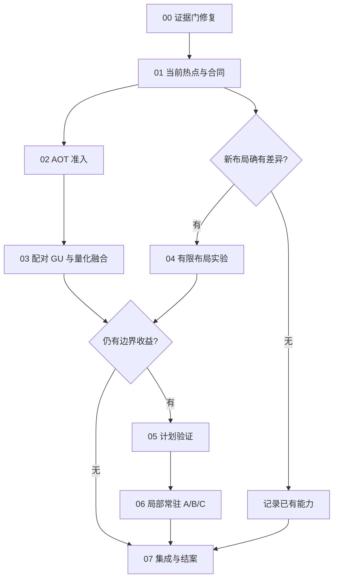

# Inkling 4090：Mirage、TileLang 与 Basalt 后续探索及验证方案

> **面向执行本文件的 AI / 工程师：**本文件同时包含研究结论、设计约束、任务规格与验收合同。逐项执行，先检查前置条件，再实现一个可归因的改动；可使用 `superpowers:executing-plans` 或 `superpowers:subagent-driven-development`。同一张 GPU 的测量串行。本文中的新 GPU 候选均未实测，初始状态为 `NOT_RUN` 或 `DEFERRED`，不能把方案描述写成已获得收益。

**日期：**2026-11-28，北京时间。  
**目标：**在现有 Astral Rust/CUDA 分支上，为 Inkling 2 Mini 的单 RTX 4090 推理寻找仍有证据支持的底层改进，并给出能被直接实施、否决与复核的实验计划。  
**架构决策：**保留现有 Session、模型语义、CUDA Graph 和 DSpark；用 TileLang 做离线算子实验与代码生成，借鉴 Mirage 的依赖表示和静态排程验证，吸收 Basalt 指定 fork 中有实际价值的布局与移植经验。先做一个真实热点，局部融合之后仍有机会才研究有界常驻执行。  
**技术栈：**Rust、CUDA C++、CUDA Driver API、SM89；离线研究环境可包含固定版本的 Python/TileLang。  
**规格来源：**本文；项目原合同以固定快照的 `docs/inkling-4090-lab-v3.0/docs/05_validation.md`、`07_tasks.md` 和最新明确用户授权为准。  
**本次完成范围：**论文与源码审计、项目最新记录复核、验证器的 CPU 合成复现、方案编写。没有连接用户的 4090，没有运行新的 GPU 基准，没有修改或推送用户引擎。

## 阅读导航

1. 结论与项目基线
2. 当前实现及必须保留的语义
3. 先修的验证与测量问题
4. Mirage 的实质价值与移植边界
5. TileLang 的实质价值与移植边界
6. Basalt 指定 fork 的增量与取舍
7. 三者如何接到现有引擎
8. 去重、路线选择与实验总表
9. 逐项可执行任务
10. 数据合同、数值及性能验收
11. 执行顺序、预算与停止规则
12. AI 执行入口与结果模板
13. 来源索引

---

## 1. 结论：优化现有路径的剩余成本

本轮建议的主线是：**先补齐证据门，重新确认当前版本的热点；以 CTA 内融合推进现有候选，只有证明不同于现有 SoA 才研究新布局；把静态任务执行限定在一个可验证、资源可容纳的 MoE 片段。**

上一轮把“全模型常驻 Kernel”和“GPU 原生循环控制”直接列为 P0，缺少当前项目证据。此次审计后应撤回这一优先级：项目已经采用整步/整轮 CUDA Graph，且已明确不采用全模型 megakernel。不能为了复刻外部项目重新建设通用运行时。Mirage 仍然值得研究，但理由应是设备内部的依赖、Kernel 边界和中间数据写回，而非笼统的“消除 CPU 指挥”。[P04] [P05] [P07]

三个项目的分工如下；这是本方案的工程判断，性能需后续验证。

| 项目 | 建议吸收的内容 | 在本项目中的落点 |
|---|---|---|
| Mirage / MPK | 张量切片依赖、静态队列校验、实测成本绑定、数据发布与就绪信号协议 | 一个局部执行计划及其验证器；有条件的 MoE 常驻片段 |
| TileLang | 布局/线程分工/载入/量化解码/epilogue 的离线实验，CUDA/PTX 导出 | 原有 Kernel 的候选生成与受控编译；上线继续由 Rust 启动 |
| `losingle/basalt` | 异构移植暴露的布局成本、小批行数分流、同步风险与回退经验 | 审查已有分派与融合，排除重复布局改造，补强性能/正确性对照 |

### 1.1 固定版本，避免混用不同日期的事实

| 对象 | 本次固定身份 | 说明 |
|---|---|---|
| 用户引擎 | `lkyprogramer/inkling-4090-engine`，`main`，`e83ef7db237e2a64125ccba449d25a987a488161` | 最新提交增加 `ASTRAL_DUMP_FIRST` 诊断，不是新的加速 |
| 用户实验室 | `lkyprogramer/CodexGame`，`4090-report`，`32ca78607f4225d39a7b05a3ed96314092891f9e` | 包版本仍 v3.0.19；最新 T25/T26/T27 材料比任务表更靠前 |
| Mirage | 默认分支 **`mpk`**，`ed771bda1b1143e660eb36d0f82e6e24e9df7b9c` | 不能用 `main` 分支代替本次 MPK 快照 |
| TileLang | `v0.1.16` / `main`，`640fdcae3cd93620e5fcf98d36ee0ef7e17ae1f1` | 本次 API 核实 tag 与该提交一致 |
| Basalt 用户指定 fork | `losingle/basalt`，`main`，`aa696248103444d0507387aac3b0812ee8d60991` | 主要研究此 fork 的增量，不用上游最新功能冒充其新增 |
| Basalt 上游对照 | `jesdga95/basalt`，`6035661ec669231b1c94ff07544a9fe76282972c` | 仅用于区分继承能力及分叉差异 |

来源为本次仓库 API 与固定提交源码。[P01] [P02] [M01] [L01] [B01]

执行时若 HEAD 已变化：记录新 SHA，先比对受影响文件和测试结果，再决定是否基于新版本重做结论；不能悄悄将旧性能数字挂到新代码上。

### 1.2 当前基线已经做到什么

以下均为**仓库报告的 4090 测量**，本次没有重新跑 GPU。不同负载的数字分开保留。[P03] [P06] [P07]

| 项目 | 已记录结果 | 使用边界 |
|---|---:|---|
| A1，无草稿，32 prompts × 5 服务测试 | 142.0 tok/s | 当前正式短上下文对照 |
| A1 + DSpark，同一 32 prompts × 5 | 206.3 tok/s | 配对几何平均相对无草稿 1.44×；不要直接用两个均值相除替代它 |
| T21 的 40 请求、四类负载 | burst 222.4 tok/s | 与上一行负载不同，不能称从 206.3 再提升到 222.4 |
| 无草稿 16K / 32K / 64K / 128K decode | 126.9 / 115.8 / 97.4 / 73.7 tok/s | 长上下文扫描，各长度的验证强度不完全相同 |
| 无草稿可容纳的最大 capacity | 132,096 tokens | 显存/可运行记录不等于所有长文质量门通过 |
| DSpark，草稿 KV FP32 | 106,496 tokens | 旧 73,728 上限已过时 |
| DSpark，草稿 KV FP16 选项 | 114,688 tokens | 不能据此声称默认 DSpark 已支持 128K |
| selftest | 93/93 | 非零 FP16 输入修复已完成；仍非所有未来算子的通行证 |
| T20 B 短文 num-3 | prefill / decode / verify 2、4、8 行通过 | 新候选必须继承，不能只跑较容易的子集 |
| T20 D 长文 num-3 | **FAIL 保留** | 后续诊断不自动推翻旧结论 |
| T25 密集 D / num-4L | 有诊断 PASS | 规则仍写待确认，未见独立 E 集结果，且判定器有具体缺陷，见第 3 节 |

近期最重要的成功是 `aa837c7`：**2–8 行 Q8_0 运算采用 dp4a，单 token decode 继续 Tensor Core 路径**。此前单 token decode 改为 dp4a 曾达到 156.6 tok/s，但 T20 B 保留集失败，已撤回。换 DSL、换布局或使用外部项目都不能绕过这条数值结论。[P03] [P06]

### 1.3 先把收益上限算对

T16 旧快照报告主机拷贝、launch、读回共约 22.4 µs / 7.14 ms，约 **0.3%**；T30 据此暂缓。即使这部分全部消失、其他时间完全不变，上限也只有：

\[
S_{host}\leq\frac{1}{1-0.003}\approx1.003.
\]

同一历史 profile 观察过约 11% 的设备 Kernel 间隙，但它来自插桩时间线、快照较旧，分母也不同于各 Kernel 的 GPU 忙碌占比。假设这 11% 全部真实且可消除，理想上限约 1.124×；实际融合还有调度、同步和资源成本。因此它只能成为**重新测量的线索**，不能成为承诺收益。[P07]

通用估算只用于筛选：一个占总时长 `p` 的片段加速 `s` 倍，整体上限是 `1 / ((1-p)+p/s)`。必须使用当前真实关键路径份额，不能把重叠区间重复相加。已经带宽受限的权重读取，不会因为 Kernel 常驻而消失。

---

## 2. 当前实现与必须保留的模型语义

### 2.1 现有能力清单

此次实际读取了 `crates/model/src/inkling.rs`、`dspark.rs`、GPU graph 封装和 Kernel 调用代码。[P04] [P05] [P08]

| 能力 | 现状 | 本轮要求 |
|---|---|---|
| 整步 decode Graph | `Session::capture_graph` / `step` 已实现 | 用它作为性能基线 |
| DSpark 每轮 Graph | 按 verify 长度捕获，GPU 接受并提交卷积状态 | 保留接受、拒绝和回滚位置 |
| prefill Graph | 以实际形状捕获一次性图 | 不能只比较 Python eager 或新 JIT 首次调用 |
| GPU 专家分组 | 小批 `moe_group_q`，大 prefill `moe_group` | 不再立项“首次 GPU 分组” |
| 常用融合 | router+topk、depthmix+RMS+quant、Q/K/V batched controller 等已有 | 只跨越仍存在的边界 |
| decode MoE 尾 | combine+conv+residual 已在 `conv_residual` 中 | 若要新增，必须继续跨越 Down 边界 |
| 小批 verify MoE 尾 | `moe_combine_t` 与 `conv_res_par` 仍分开 | 原 K9 已覆盖，本文只补具体实现手段 |
| 可调固定遍数 | `ASTRAL_PASSES=1..10` 与 varloop 已实现 | 不等于逐 token 动态深度已经正确 |
| target / draft SWA ring | T17 / T21 已完成 | 不重复提出用 ring 解锁长上下文 |
| 确定性 split-K | 部分和写工作区，再按固定顺序合并 | 禁止用浮点 `atomicAdd` 把历史漂移重新带回来 |

部分旧注释还写着多 token 要同步到主机分组，实际默认分支已有 GPU 分组；判断以执行分支及命中记录为准。

### 2.2 Inkling 的循环不是对一个 hidden 简单原地重复

源码每一遍 core 都从 **prelude 输出重新开始**；第二遍起读取上一遍产生的 message bank。共享的是权重，KV 与短卷积状态按执行 slot 独立。固定三遍的身份如下。[P04]

| 阶段 | 物理层 `ip` | 执行访问 `visit` | 状态 `slot` |
|---|---|---|---|
| Prelude | 0–5 | 0–5 | 0–5 |
| Core 第 1 遍 | 6–17 | 6–17 | 6–17 |
| Core 第 2 遍 | 6–17 | 18–29 | 24–35 |
| Core 第 3 遍 | 6–17 | 30–41 | 36–47 |
| Coda | 18–23 | 42–47 | 18–23 |

自然语言的“第几遍”从 1 开始；trace 的 pass 从 0 开始。所有新记录明确使用哪种编号。DSpark 的 tap 是执行位置含义，不能因 slot 数量也为 48 就把两者混用。

由此得到四条约束：

1. 固定 R3 可以在编译/捕获时展开成有向无环执行计划，但不能合并不同 visit 的 KV/conv。
2. 下一遍的 message 依赖上一遍输出；除非做了具体切片依赖证明，否则不能宣称两遍可重叠。
3. L2 局部性必须测跨 12 个物理层后的真实复用距离。专家 ID 重复率高，不等于权重一直在片上。
4. A1 截断为两遍是模型行为变化。A4 varloop 才有多遍数训练背景，但混合深度仍需历史状态语义与质量验证。

### 2.3 量化合同与资产身份

A1 的文件名是 UD-Q4_K_XL，当前实际类型表为 NVFP4 ×40、Q8_0 ×154、F32 ×518、BF16 ×32。不能把它当作所有矩阵都是普通 Q4_K。4090 上 NVFP4 是已有软件解码路径；有低比特文件不代表硬件支持原生 FP4 Tensor Core。[P03]

新的布局或融合必须保持：packed 值、每块 scale、全局 scale、专家索引、token/expert 映射、累加精度、舍入及饱和规则、padding 掩码、SITU 参数及运算顺序。`QAct` 的 Q8 与 FP16 平面按真实消费者写入。T22 已经证明“接口说有 FP16 平面，实际没写入”会让测试虚假通过；不能再犯。[P08]

---

## 3. 新实验之前先修具体的证据缺口

这里不是要求重建验证平台，而是对本次发现的代码问题做有限修复。短上下文的既有 num-3 合同继续使用；长文新规则保持待确认状态，不因本文自动被批准。

### 3.1 T25：负控制没有真正参与总判定

固定快照的 `tools/t25/t25_judge.py` 读取 NPZ 时只遍历 pair `0..7`；后面负控制使用 pair `8、9…`。因此负控制文件即使存在，也不在 `data` 中。缺少负控制或负控制未被抓到只被写进报告，没有并入 `ok_all`。`t25_e.sh` 打印 judge 返回码后继续执行，最后 `guard` 的返回码可能覆盖失败。[P09] [P10]

本次已经独立运行一个 CPU 合成 fixture：8 个正常 pair 加一个确实存在、KL 比正常参考大 10,000 倍的坏 pair。**实际输出为 `verdict=PASS`、进程返回 0，同时报告负控制 missing。**这是验证器逻辑复现，不是 GPU 模型实测。

此外，case 集合仅通过 glob 已有文件获得，未与预期样本 manifest 做完整集合核对；整篇文档缺失不能被可靠发现。`t25_kld.py` 取两侧词表宽度最小值的行为也不适合作为新候选的严格身份检查。[P09]

**修复目标：**预期 case/pair/位置/词表必须一致；负控制存在、加载并触发预期失败才算验证器有效；任何缺件、NaN、未知 schema、异常退出均不能 PASS；wrapper 保留各子步骤失败。数值阈值不在此修复中改变。

### 3.2 num-4L 是诊断规则候选，不能偷换正式门槛

规则文件明确写了“在 D 诊断之后、E 之前冻结，待用户确认”。D 的诊断 PASS 不构成独立保留集验证。当前快照有 E 脚本，未见 E 结果。后续若没有更晚的明确授权与证据，长文最终结论只能保持未闭环；可以继续做不依赖该规则的短文算子实验。[P11]

修复验证器不等于批准 num-4L。新输出区分：旧 num-3 结论、num-4L 诊断、独立集结果、规则授权状态。内部 diagnostic `INCOMPLETE` 对外统一映射为 `BLOCKED` 并附原因，沿用原任务状态枚举。

### 3.3 T26：旧热点比例在新路径下已经变了

最新材料在 `7108b78 + 诊断 hook` 上记录：普通 burst 11.619 ms/轮；重复一次草稿 base head 后 12.173 ms/轮；重复 fold 后 11.695 ms/轮。因此重复 head 的边际成本约为 4.77%，贴近原“≥5% 才推进 shadow”的门槛。[P12]

这不是“删去一次 head 必定省 4.77%”：重复读会受缓存、调度及固定开销影响，材料也没有置信区间。合理做法是下调优先级、确认口径，不能继续使用旧 Tensor Core 路径下每次约 1.26 ms 的数字把筛选方案列为必做，也不能仅凭 4.77% 正式结案为 NO_BENEFIT。

### 3.4 T27：计时字符串混入多段时间

`t27_share.sh` 提取所有 `in ... s` 后拼接数字，结果出现 `10.831.879` 这类非法数值。skip hook 也明确写着输出错误，只用于估计可删工作量的上限。[P13]

应精确解析唯一的 prefill 字段或增加结构化 JSONL 计时，字段缺失、重复、无法解析都返回非零。不要从拼接字符串反推时间，更不能把 skip 模式记为正确优化。

### 3.5 本轮验证工作的边界

以上问题不证明现有 206.3 tok/s 结果是假的，也不自动否定历史通过的短文测试；它们说明**不能依赖现行包装脚本的最终 exit 0 来批准新候选**。修复并扩展对应离线 fixture 后，重跑受影响的检查，不要求把全部历史 GPU 实验重做一遍。

---

## 4. Mirage / MPK：借鉴依赖与计划，不移植整套后端

### 4.1 真正创新在哪里

MPK 把张量算子拆成细粒度任务，用事件表示生产者写完了哪些输入区域；消费者仅等待自己需要的数据。编译器做事件融合、图规范化与线性化，设备 runtime 派发任务。相比算子级依赖，它能表达部分生产/消费重叠与计算通信重叠。论文发表于 OSDI 2026，官方报告端到端最高 1.7×；这不是用户模型或 4090 的预测。[M02] [M03]

本文以 USENIX 正式出版 PDF 为论文依据。仓库 README 的 1.2–6.7× 是不同口径，不与论文区间合并。当前源码的静态后端又比原论文多了一层离线排程工程，不能把所有能力混成一个“MPK 自动完成”的功能。[M01] [M03]

### 4.2 最新静态路线更适合借鉴的四个细节

**第一，数据依赖要落到 region。**`Gate/Up → SITU → Down` 不是三个任意可重叠的盒子。SITU 需要配对的 gate/up 值；Q8 的 scale 需要完整量化组；Down 某个输出需要整个 K 维或完整的有序部分和；expert combine 必须等所有需要的 expert。一个 Tile 就绪不代表整条链可提交。[M04]

**第二，队列顺序也是依赖。**`static_schedule.py::check_deadlock_free` 检查任务是否恰好分配一次，并将数据边和 worker 队列内的顺序边一起拓扑排序。单独的数据 DAG 无环，不代表排到队列后不会循环等待。这个验证可缩小为本项目一个局部计划，无需引入通用编译器。[M05]

**第三，成本与代码、硬件、生产者分块绑定。**`search.py` / `cost_records.py` 保存任务形状、前驱、首次执行、GPU、nvcc、代码标签、统计量等；缺测候选不参与搜索。本项目只需枚举少量合法计划；更换 dtype/布局/Kernel 或 shape 时，旧成本失效。[M06]

**第四，写数据与发布 ready 是不同操作。**动态与静态 runtime 使用明确的 acquire/release 语义；任务完成前需保证所有参与线程已写完，不能让 lane 0 提前发布信号。跨 Graph replay 还要区分执行实例，避免读取上一轮 ready。设备内事件一般使用 device scope，不能只抄一个 `volatile` 标志。[M07]

### 4.3 4090 支持必须按后端区分

| 路径 | 已读源码事实 | 对用户的决策 |
|---|---|---|
| 动态 MPK 的 Ada 分支 | 存在 Ampere/Ada 路径，sm89 动态 shared 预算约 96 KiB；有真实 Ada shared-memory 修复 | 可研究基础执行机制，不能概括为完全不支持 4090 |
| 新 `StaticMegakernel` | 使用 TMA、TMEM、`tcgen05` 等，默认小 token 配置的 ring 已达 179,200 bytes | 不能直接改 `-arch` 就跑；只抽取计划/验证思想 |
| “每 SM 一个队列” | 当前代码主要以 `blockIdx.x` 作为逻辑 worker ID | 不等于绑到固定物理 SM，不保证 L1/shared 权重常驻 |
| 无环检查 | 检查任务及队列逻辑可推进 | 不证明 CTA 同时驻留、内存可见性或资源可容纳 |
| 固定点归约 | 部分静态路径使用定点映射以消除到达顺序影响 | 不等于原 FP32 累加，不能不验数值直接抄 |

共享内存例子来自当前 `config.cuh`：`T=1 → TW=8`，`5×(32768+8×256)+5×2×512 = 179200` bytes，尚未计入其他 scratch。4090 每块 opt-in shared 上限约 99 KiB；这仅证明现成布局不适用，不代表用户局部链也需要如此多空间。[M08] [M09] [N01]

### 4.4 Mirage 的 Inkling builder 不等于 Inkling 2 Mini 支持

`python/mirage/mpk/models/inkling/builder.py` 注册的是 `thinkingmachines/Inkling`，默认 66 层、hidden 6144、256 routed+2 shared experts，BF16、单 token decode、单 GPU。代码按普通层序执行，缺少 Mini 的 per-pass prelude 重置、visit/slot/taps、DSpark 验证/提交和现行量化格式；专用任务在 Blackwell 目录。[M10]

它有分层 KV 和短卷积状态，但这不是循环 Mini 的状态合同。不能以“仓库里出现 Inkling 文件名”为理由推荐直接运行用户模型。

---

## 5. TileLang：用作离线实验编译器

### 5.1 它解决的问题

TileLang 让开发者用 Tile 描述数据流，再控制布局、线程映射、流水和矩阵指令。对本项目，它的价值是快速验证“这组 packed weights 怎么载入、解码、喂给计算单元、完成 epilogue”，而非代替现有 Rust Session。原论文与后续会议版本支持这种编程模型，但它们的大 GEMM/attention 数字不能外推单 token 量化 MoE。[L02]

### 5.2 PersistentTileScheduler 的准确含义

当前 `PersistentTileScheduler` 将二维 Tile 网格线性化，worker `w` 处理 `w, w+num_workers, ...`；支持遍历次序、L2 swizzle、尾 panel、状态化迭代。它没有跨算子事件 DAG、动态 ready queue、模型 pass 或 KV 语义。[L03]

因此可比较“相同 Kernel 的普通 grid 与 persistent grid”，但不能从这个类推导出模型级常驻引擎已经存在。4090 首轮 `cluster_size=1`；默认 worker 数等于 SM 数也只是起点，不是最优或物理绑定保证。

### 5.3 当前 SM89 能力边界

| 能力 | 当前结论 | 实验要求 |
|---|---|---|
| `mma.sync`、FP16/BF16 | 有 SM89 目标与 dispatch 路径 | 固定 target，检查生成代码、实际 dtype 和 tile 限制 |
| `cp.async` | 可以探索 global→shared 异步加载 | 检查 commit/wait、尾块和读写顺序 |
| FP8 MMA | 有 SM89 路径 | 本方案不因此更换现有量化；另属 K7 |
| 自动 producer/consumer warp specialization | 当前 pass 要求 TMA | 4090 不采用该自动分支；手工分工另测 |
| `T.alloc_barrier()` | 当前后端对 pre-sm90 拒绝 | 这是 TileLang 实现限制，不代表 Ada 没有任何异步 barrier 能力 |
| `T.sync_grid()` | 有 cooperative 路径，但不同 backend 包装不等价 | 必须保留 cooperative launch 和资源准入，不能普通 launch 冒充 |
| TMA / WGMMA / tcgen05 / TMEM | 属于其他架构路径 | 4090 实验明确排除 |

源码依据见 CUDA pipeline、GEMM dispatch、PersistThreadblock pass 和 wrapper。[L04] [L05] 资源上限以现场 `cuDeviceGetAttribute` / 函数属性和 occupancy 查询为准，而非只看 TileLang 源码估算。[N01] [N02]

### 5.4 AOT 导出可用，但不是一键 Rust 化

当前 `JITKernel` 提供 `export_sources`、`export_ptx`、`export_sass`；NVRTC 路径有 CUDA、cubin 和 Python launcher。`export_library` 属于 TVM-FFI 模块导出，不保证裸 CUDA 稳定 ABI。导出方法可能记录异常后返回，所以执行器要检查目标文件存在、非空及 hash。[L06]

建议首选：**离线生成 CUDA，纳入现有 `crates/kernels-src/build.rs` 的 SM89 构建，再沿原有模块/stream 启动**。只有现有构建确实不适合时才新增独立 cubin 加载器。避免为了一个算子再引入一套内存分配、context 或 Python 服务。

产物必须附 manifest：源码与二进制 hash、入口名、参数顺序/位宽、dtype/stride/layout、grid/block、dynamic shared、cooperative requirement、工具链及数值合同。不能只复制 cubin 而丢掉 launcher 的语义。

另一个关键边界：普通 TileLang 产物是 `__global__` Kernel。它不能在另一个 persistent Kernel 内作为普通 device 函数直接调用。跨到 Mirage 式任务需要显式 `__device__` body、逻辑 Tile 坐标、shared arena、参与线程和 barrier 所有权；这是单独的工程任务。[L06] [L07]

### 5.5 量化示例不能成为数值参考

TileLang 的 INT4/FP4 示例是编程材料，不是用户 GGUF 的 loader。某 INT4 示例用 unsigned 值、FP16 累加并有很宽的测试容差；旧 `example_dequant_gemm_fp4_hopper.py` 的指数变换按源码会把 nibble 0 映射成 half 0.5，而标准 E2M1 的零码为 0。新 `quantize/nvfp4.py` 有明确 LUT，但也含其他架构的 blocked scale 布局。[L08]

本项目真值始终是现有 loader/解码和 reference：先验证 16 个 E2M1 code、全部允许的 scale 编码、Q8 极值、零 scale、非整 Tile 和 expert 索引；再融合。layout-only 变化需要字节可逆；改编码、activation quant 或 reduction 不得混入“仅调度”名义。

### 5.6 上游已报告的风险如何转成有限测试

| 来源 | 报告场景 | 本轮做法 |
|---|---|---|
| Issue #3773 | 0.1.15、SM89，uniform while + shared GEMM 的重复执行错误 | 锁定 v0.1.16 重跑最小相关 case；对照 serial / while |
| Issue #2668 | 0.1.12、SM89，共享 buffer 先读后写，`num_stages>=2` 静默错误 | 覆盖 loop-carried RAW/WAR/WAW、stages 0/1/2/3 |
| Issue #3996 | fragment 多缓冲与显式阶段设置 | 只有候选使用这种构造才追加复验 |

这些是上游报告，**本次没有在 v0.1.16 实机复现**。不把旧 issue 写成当前必现 bug，也不因 release 更新就默认问题消失。与本候选无关的上游测试不无限扩展。[L09]

---

## 6. Basalt：指定 fork 的价值与必须剔除的重复工作

### 6.1 研究对象是 `losingle/basalt`，不能与上游混为一谈

用户给的是 `losingle/basalt`，上游为 `jesdga95/basalt`。本次固定两个 HEAD 的共同祖先为 `bd01438b7592a65dc57854814cfa41f6fe6e34c0`；指定 fork 相对上游为 51 ahead、5 behind。其主要新增是 **AMD RDNA4 / gfx1201、Radeon AI PRO R9700 的 HIP 移植和调优**，包括双卡路径。CUDA 架构文件仍限制为 SM120/121。因此它不是已经完成的 4090 后端。[B01] [B02]

它比 Mirage 更贴近 Inkling 2 Mini 的实际模型工程，也覆盖推测解码、量化权重、长上下文和请求状态。然而“模型相同”仍不等于用户资产、量化、草稿器、KV dtype、硬件和质量合同相同。B20 以后部分主要数据已切到 DFlash 2；本项目当前正式基线用 DSpark，不能直接相减比较。

### 6.2 基础 SoA 已经在用户引擎中完成

Basalt 的 Q8_0 HIP 路径把交错 block 中的 int8 codes 与 FP16 scales 分为连续 plane，按源字节搬运。这是合理的低风险布局技巧，但用户项目早已具备同类基础表示：[B03] [P08]

| 对象 | 当前用户实现 | 对本轮的影响 |
|---|---|---|
| Q8_0 权重 | `qs` 每行 K 字节；`aux` 每行 K/32 个 FP16 scale | 不能再立项“codes/scales 分离” |
| NVFP4 权重 | `qs`、`aux`、可选 `mat_scale` 分离；另有 fragment 等可选布局 | 先查现有 K1/K6 的地址映射 |
| 激活 `QAct` | 独立 q/d，可选 h；`slots` 与 stride 有明确合同 | 不能再立项“首次缓存量化激活” |

若还要研究布局，必须先交出一张**新旧地址公式对照表**：`(matrix, row, K-group, element) → byte address`，明确改变的是 plane 内的 tile、行组、swizzle 或对齐，而非仅换了 SoA 名称。没有真实差异就结束该候选，在去重字段记 `ALREADY_DONE`，不消耗 GPU 调优轮次。

还有显存成本：Basalt 的 Q8 SoA 会保留部分原始权重并额外分配 proj/out/head 副本。按其默认 Mini 形状推算，24 层 proj/out 约 658 MiB，head 约 467 MiB，合计约 1.10 GiB；这是源码尺寸推算，不是本次显存实测。用户的长上下文容量已经靠近 24 GB 边界，不能复制这种常驻双份权重策略。[B03]

### 6.3 NVFP4 repack 不全是可逆搬运

其 HIP NVFP4 格式将 codes 与 UE4M3 scales 分开，完成后回填到原空间；这有助于避免常驻双份专家。但源码还做 `scale & 0x7f`，并把 `0x7f` 映射为 0。因此这不是对所有输入无条件可逆的字节重排。另有 Q8→NVFP4 转换，是明确的重新量化，不属于 layout-only。[B04]

对用户当前资产，可以检查是否根本不存在这些特殊编码，或现有 loader 已有同一规范化规则；只有证据一致才能讨论等价。不能因为现有模型“似乎不会出现 NaN”就默许格式变化。临时 repack buffer 也计入加载峰值；在 Graph capture 前完成，不能混入 token 热路径。

### 6.4 真正可用的经验：按行数分派、完整 epilogue 与可撤回默认值

**小批不能统一选一个算子。**B22 保留 `BASALT_DECODE_SOA_DENSE_MAX_T=4`，T=8 使用 `native_q80_mma`，记录的理由同时包含速度与更低 KL。本项目已经在 T=1 与 T=2–8 分开采用 Tensor Core/dp4a；可借鉴的是继续按真实矩阵和行数测量，而非照抄 HIP 的阈值 4。[B05] [P07]

**Gate/Up 与激活量化一起组织。**其 HIP 专家路径提供 GU + softcapped activation + q8 epilogue 与分离版本，说明把配对投影的完整输出留在 CTA 内是一条具体实现路线。用户模型当前使用 SITU，数学合同按本项目源码执行，不能把外部叫作 SwiGLU 的代码直接替换。第 9 节将该路线拆成 epilogue、paired 投影、融合三步，允许逐步否决。[B04] [P14]

**危险融合应该退回默认关闭。**指定 fork 的 `dspark.cpp` 明确将 `BASALT_DSPARK_PERSIST` 和 `BASALT_DSPARK_FUSE_STEP_FINAL` 默认关闭；后者注释指出非 cooperative 的软件全局 barrier 与进程全局同步状态会造成死锁。这是对本轮局部常驻计划的重要反例。加 timeout 或退避不能修复根本不可推进的依赖。[B06]

**资源与状态身份比“零 spill”更重要。**按 shape 选择 split、只让合法的访问发生、Graph replay 前正确更新/重置状态都值得借鉴；零 spill 只是一个编译观察，不能替代数值、死锁和端到端验证。用户现有 split attention、ring 和 GPU grouping 已做过，相关内容并回原 K4/T17/T21，不另开重复项目。[B05] [P04]

**用符号 reference 验证 buffer 生命周期。**Basalt 的 `walk_test.cpp` 用“每次都复制”的简单 reference，与重用 8 个具名 buffer 的执行顺序逐步比较 hidden、bank 和最终 head。这种不需要 GPU 的 alias/lifetime oracle 很适合补 T23 和局部计划的缺口：验证 1/2/3/4 遍与 slot 身份，故意错绑一个 buffer 后应失败。它验证状态流向，不能替代 GPU 浮点验证；已有等效测试就直接复用。[B08]

### 6.5 不把自报 parity 当作统一质量证明

当前 B23 文档报告 GPU CTest **50/54 passed，2 skipped，2 waived**；应保持这个完整口径。`batch_decode_test.cpp` 的部分输出文字写 bit-exact，但 HIP/TP2 默认分支允许 greedy token 不同，只要对应 log-prob 差不超过 0.35；严格模式需要 `BASALT_BATCH_TEST_STRICT=1`。所以其“parity PASS”不能等价替换用户的 num-3 或逐位一致合同。[B05] [B07]

B22 的 512K/960K decode 报告为 112.1/89.4 tok/s，B23 对应章节为 55.5/42.4；两者配置、输入、缓存与执行路径并未被证明完全匹配。既不能挑较快的一组作为本轮目标，也不能只凭这两行宣判确定回退。这里只引用它们说明：**必须固定 workload、模型、草稿器和缓存状态，不能按项目宣传的最高数字选路线。**[B05]

### 6.6 本轮明确不引入的 Basalt 能力

通用多模型服务、TP2/EP2、多租户 KV 池、视觉、DFlash 2 全套迁移、FP8 KV、重新量化、语法约束与会话缓存都不进入这条底层等价优化主线。它们有独立价值，但需要不同目标与验收，部分已经在旧方案讨论。特别是 GDN 等其他模型算子不适用于 Inkling 当前 SITU/短卷积链。

---

## 7. 统一设计：把外部经验落到已有引擎

### 7.1 分层边界

保留现有模型层负责 pass / visit / slot / tap、KV 和短卷积；Kernel 层负责一个数学操作或局部子图；离线工具只生成候选、校验计划和输出固定产物。运行时不依赖 Python，也不启动通用任务服务。

| 层 | 负责什么 | 不新增什么 |
|---|---|---|
| `Session` / DSpark | 现有 Graph、路由数据、接受/提交、reset | 新框架、第二套 allocator 或 context |
| Rust Kernel wrapper | 检查 shape/layout、分派、实际命中记录、stream/launch 属性 | token 内 JIT、隐式 CPU 路由读取 |
| CUDA 数学核心 | 同一输入的投影、SITU、量化与有序部分和 | 偷换 dtype 或未经批准的近似 |
| 离线生成/计划 | TileLang 产物、少量候选、依赖证明、成本表 | 全模型自动编译器和无限 autotuning |

### 7.2 路线图与启动门



编号是本文局部 ID `MTB-00…07`，避免占用既有 T23–T36，也不假定更晚任务编号已写进仓库。箭头表示依赖；跳过 04、05、06 是正常结果，不代表方案没完成。

### 7.3 一个 MoE 局部片段的输入输出合同

第一轮只选一个物理层、一个已测形状，输入包含现有 q/d/h、GPU expert IDs/权重、该层参数以及必要 slot 身份。输出先保持现有 `gu → qa_ff → down` 的格式；通过后才逐步消除中间物化。局部片段不负责全模型 token loop、KV 分配或最终 DSpark 提交。

微基准可使用真实路由的冻结快照；进入整模型时读取现有 GPU 路由 buffer。不能新增一次 D2H 获取专家，再由 CPU 按实际专家重建图，把成本排除在计时之外。若计划按“选中专家的位置”静态展开，实际 expert ID 在执行时作为索引读取。

### 7.4 A/B/C 对照如何分离收益来源

| 组 | 执行方式 | 用途 |
|---|---|---|
| A | 当前 CUDA Graph + 当前已采用 Kernel | 总体基线 |
| B | 相同外层 Graph 捕获与调用范围，图内包含已验证的新核心或局部融合 | 量化解码、Tile 与 epilogue 的贡献 |
| C0 | 相同数学核心、相同中间存储与归约分区 + 有界常驻 wrapper | 仅衡量执行/调度边界变化 |
| C1 | C0 通过后，单独减少一个中间物化 | 衡量局部数据驻留的额外贡献 |

`A→B` 不能归功于 Mirage 式调度；`B→C0` 才是初始常驻机制的对照。即使共享 `__device__` body，编译到较大 Kernel 后寄存器分配与 spill 也可能变化，必须记录编译结果，不能声称指令完全相同。

先用所有 worker 参与的合法阶段同步验证 C0，再视数据决定是否需要更细 region/event 释放。更复杂的就绪协议只有在有剩余收益时才做。初版允许保留一部分全局中间存储，目的在于把执行错误与数学错误分开。

---

## 8. 去重与实验总表

### 8.1 与现有路线的关系

| 方向 | 固定快照的现状/既有任务 | 本文处理 |
|---|---|---|
| 整步 Graph、GPU 分组、QAct、权重 SoA | 已实现 | `ALREADY_DONE`，仅审查实际命中 |
| Q8 小行数 MMA/dp4a | K2；2–8 行已采用，T=1 数值失败撤回 | 不改名重做；若新增候选必须交代数值差异如何解决 |
| GU→SITU epilogue | 既有方案 10 后续候选，关联 K1/K3/K8/K10 | MTB-03 是实现拆解，明确标继承 |
| decode combine+conv+residual | 已融合 | 不能再计一次收益 |
| verify combine+conv | K9 | 后续有证据可与 Down 边界研究；不是全新选题 |
| fragment / MMA5 | K6；默认大 prefill 仍为已有路径 | MTB-04 若触及它，直接挂 K6，不平行造另一套 |
| QAct 消费者平面裁剪、工作区 clear | K8/K11 | 只在读写覆盖证明后推进，不能默认删除 |
| GQA 头分组、near/far、split attention | K4 及旧后续候选 | 独立备选，不混进首轮 MoE 实验 |
| visit/slot 计划、消息预计算 | T23/T24 | 本文 MTB-05 仅补局部任务/队列与 buffer 依赖，不取代它们 |
| 长文数值门 | T25 | MTB-00 修具体实现，保留旧 FAIL 与规则授权状态 |
| draft head 筛选、末段 prefill 裁剪 | T26/T27 | 使用新测量纠正优先级，本文不重立项 |
| 稀疏全局 attention、编辑复用、GPU 连续生成 | T28/T29/T30 | 不进入本轮主线 |
| 动态深度、浅 draft/深 verify | T32–T36；已有独立方案 | 继续原轨道，不能混入“数值等价加速” |
| 局部静态队列、代码绑定成本、A/B/C 归因 | 新的工程拆分 | 只在前置热点与局部融合证明有空间后启用 |

“ALREADY_DONE”是去重标签，不是新的实验状态；仓库状态仍只使用 `NOT_RUN / RUNNING / PASS / FAIL / BLOCKED / NO_BENEFIT / DEFERRED`。[P07] [P15]

### 8.2 本文任务

| ID | 优先级 | 初始状态 | 主要产物 | 启动条件 |
|---|---|---|---|---|
| MTB-00 | P0 | NOT_RUN | fail-closed 判定及测时修复、CPU fixture | 可立即做；本次只是复现缺陷，未修改原工具 |
| MTB-01 | P0 | NOT_RUN | 当前成本表、量化/布局合同、一个候选选择 | 修复相关测量入口后 |
| MTB-02 | P1 | NOT_RUN | TileLang AOT/ABI 准入样本 | 01 确认有值得推进的算子 |
| MTB-03 | P1 | NOT_RUN | 分步验证的 paired GU + SITU + QAct | 02 加载及语义合同通过 |
| MTB-04 | 条件 P1 | DEFERRED | 一个真正不同的新布局或分派候选 | 01 发现明确差异；泛泛 SoA 不满足 |
| MTB-05 | 条件 P2 | DEFERRED | 小型 plan/region/queue 校验器和成本输入 | 03/04 后剩余边界成本仍有空间 |
| MTB-06 | 条件 P2 | DEFERRED | 一层一形状 C0/C1 常驻对照 | 05、资源与 cooperative 准入均通过 |
| MTB-07 | 收敛门 | NOT_RUN | 被接受的改动、完整复现材料或否决记录 | 每个候选最终都进入此门 |

这里的优先级是研究排序，不构成新的性能保证。若热点复测表明 GU/SITU 边界的总体可改善上限低于原项目最低收益要求，直接停止 03，重新比较已有 K4/K6/K9/K10 的收益上限，不为了用上三个项目而强行开发。

---

## 9. 逐项可执行任务规格

以下文件名为**仓库相对路径**。标“已有”的需先核对实际 HEAD；标“拟新增”的只是本方案约定，尚不存在，命令也不能被描述成已可运行。每项候选独立开关，默认关闭；开关关闭应恢复旧分派和旧数据路径。采集实际命中数，不能出现回退到 baseline 却报告候选通过。

### MTB-00：修复验证器与测时入口

**目的：**让失败、缺样本和坏负控制真实阻止通过，保持既有数值规则。

**修改范围：**实验室已有 `tools/t25/t25_judge.py`、`t25_kld.py`、`t25_e.sh`、相关运行包装；`tools/t16/t16_g2.sh`；`tools/t27/t27_share.sh`。仅按调用链需要扩展其输入 manifest；测试放实验室已有 `tests/`。不建立另一套覆盖全项目的新框架。

**实施顺序：**

1. 保存现版本 judge 与 wrapper 的合成失败复现。输入 manifest 明确预期 case ID、pair ID/用途、位置集合、词表宽度、来源身份和规则 hash；不能从“目录里恰好有的文件”反推期望。
2. 从 manifest 加载正常 pair 和负控制 pair，完整集合比对，拒绝重复位置、额外未知 pair、缺失 case、非有限数值及不一致词表。既有旧数据若需迁移，单独写转换并保留原件，不静默补齐。
3. 把负控制存在、被实际读取、产生预期拒绝纳入总 verdict；区分“候选没过”与“验证器本身无效”，两种都返回非零。
4. wrapper 保存每个关键步骤返回码，使用可靠的 pipeline 失败传播；日志和 guard 清理不能覆盖原错误。无需因为修退出码自动重跑全部历史 GPU 数据。
5. T27 精确读取唯一 prefill 用时字段，或为原测量命令增加结构化记录。缺失、重复、`10.831.879`、NaN/Inf 等均拒绝，不再字符串拼接。

**必要测试：**正常且负控制有效的完整 fixture 通过；坏负控制被漏检、缺一个完整 case、缺负控制文件、重复位置、错误 vocab、NaN、子命令非零、计时多匹配分别失败。覆盖本次已证实的缺陷即可，不做无关测试扩张。

**验收与产物：**受影响 CPU 测试通过；本次完整 fixture 修复后应明确输出负控制已加载且 `caught=true`，正常候选通过时总体可为 PASS。另构造缺负控制、负控制未被抓到或不可判定的变体，这些必须非零。不能把“故意坏的负控制被成功抓到”误判为验证器整体失败。原阈值文件 hash 不变，保存前后 JSON 和命令。num-4L 如仍无授权，长文最终判定保持 BLOCKED，短文候选可继续。

### MTB-01：锁定当前热点与输入合同

**目的：**只选一个有总体收益空间、尚未完成的真实热点。

**入口：**已有 `docs/hardware/rtx4090.md`、benchmark 记录、`crates/model/src/inkling.rs` 的 `layer`/`forward`，`crates/kernels/src/ops.rs` 的实际分派，实验室 T16/T21 工具。拟新增 `tools/mtb/profile_manifest.json` 与结果目录；它们记录身份和统计，不创造新的服务 runner。

**实施顺序：**

1. 固定 engine/lab SHA、工作区 diff hash、二进制 hash、模型/草稿 hash、模板和 token IDs；确认用户现场最新运行授权与 GPU 占用。沿用现场守卫，不能因本文重启此前被要求保持停止的生产服务。[P16]
2. 当前版本先跑短 smoke，覆盖 plain decode、DSpark、prefill，复核选中 Kernel。只在升级/集成门运行完整 32×5 服务基准；避免在每个微变体上重复全量。
3. 短上下文 profile 分开报告 plain 与 DSpark；DSpark 拆为 draft、verify、accept/commit、其他，但总时间采用真实 wall time。长文先选能覆盖工作集变化的两个代表点；只有候选将影响所有长度时，推广前才扩到 16/32/64/128K 的适用子集。
4. 报告 GPU 忙碌区间的并集、关键路径与 kernel 间隙；单 kernel duration 相加另列，不能当总时长。profile 的插桩版只定位，性能数字来自无探针版本。无硬件 counter 权限就记 N/A，不修改驱动权限。
5. 导出实际 `(op, dtype, rows, N, K, expert_count, layout, split, QAct_planes)` 频率表；包含 T=1、2/4/8 及边界行数。复核 SoA、fragment、现有融合，选定一个物理层和真实路由快照。
6. 对候选计算 Amdahl 上限，给出保守可实现部分和新增显存；最大理论收益都不达原门槛就停止，不进入“先写完再看”。

**验收与产物：**`baseline.json`、小型 shape/cost 表、一个候选选择及其他候选未选择原因、量化地址映射合同。未知或缺测项标 N/A，不填估计值当实测。

### MTB-02：TileLang AOT 与 ABI 准入

**目的：**证明离线生成产物能由现有 Rust 调用，并保留正确启动与数值语义；本项不追求加速。

**文件范围：**拟新增 `bench/mtb/tilelang/` 放生成器与固定依赖；拟新增 `crates/kernels-src/cu/inkling_mtb.cu` 或现有 build 能接纳的生成文件；已有 `crates/kernels-src/build.rs`、KernelRegistry、`crates/kernels/src/inkling.rs`、`crates/testing/src/selftest.rs`。若无需改 build 脚本则不改。所有新文件按仓库现有组织习惯调整，并在实施记录写清最终路径。

**实施顺序：**

1. 固定 TileLang v0.1.16 的提交、依赖锁与 CUDA 编译器；显式 SM89。先选 MTB-01 的一个真实形状，使用已有 buffer、context、stream，构造最小复制或 epilogue 产物验证 ABI。
2. 导出 CUDA/PTX 与 launcher metadata；检查文件非空、入口存在、参数宽度、对齐与动态 shared 属性。保留依赖头文件及 license；完整生成环境可移除后，再由 Rust 独立加载运行。
3. 将 `exp/tanh/reciprocal/FMA`、accumulation dtype、scale 位置和 reduction order 纳入合同。必要时调用明确的 CUDA device helper 保持原语义；不要把 `T.exp` 自动 lowering 当作等价保证。
4. 对实际用到的 while/shared/pipeline 构造跑有限回归：serial 对照，stages 0/1/2/3，整块/尾块，重复 replay，reset 后同地址重用。无关构造不测。普通 launch 不使用 grid barrier。
5. 捕获到现有 Graph 后验证一次 eager/Graph 一致性及多次 replay，实际命中数必须非零；检查编译资源，不把一次 Python 调用成功当成 AOT 成功。

**验收与停止：**ABI、产物身份、相关微算子合同及重复执行全部通过。若编译器无法在有限尝试中满足数值/同步合同，记录 BLOCKED 或 FAIL，保留手写 CUDA 方式继续原候选；TileLang 是研究工具，不是项目目标。

### MTB-03：把 GU→SITU→QAct 融合拆成三个可归因步骤

**来源：**继承既有 GU epilogue 候选；TileLang 提供生成方法，Basalt 提供配对投影的工程参照，Mirage 提醒依赖粒度。不是全新优化方向。

**入口：**已有 `crates/model/src/inkling.rs` 的 MoE 分支、`Gemv::launch_q/launch_items/launch_mma`、`QAct`、`crates/kernels-src/cu/inkling.cu::astral_ink_situ_q8` 和 `q8_store`。[P08] [P14]

**形状合同：**32 元素指同一 token、同一 expert、同一输出 hidden 维度上的完整量化组，绝不是只算 32 个 K 输入。CTA 必须拥有该组全部 gate 与 up 的最终值。若采用 split-K，非线性之前先按基线分区与顺序完成全部 K 的归约。

当前数学顺序来自原 CUDA，保持参数与括号顺序：[P14]

```text
g = gu[s * 2F + c]
u = gu[s * 2F + F + c]
a = beta * tanh(g / beta) * (1 / (1 + exp(-g)))
v = a * (lb > 0 ? lb * tanh(u / lb) : u)
amax = max(abs(v[0..31]))
d = amax * (1.0f / 127.0f)
q = amax == 0 ? 0 : round_to_nearest_even(v / d)
h = float_to_half_round_to_nearest_even(v)   # 如该平面有消费者
```

FP16 平面由原始 `v` 转换，**不能用 `q*d` 反量化后再写 h**。`mat_scale`、激活 Q8 scale 与权重 scale 的应用位置保持基线；量化组不得跨 expert/token；尾块无效 lane 不能污染 max。F 从模型配置读取，不硬编码外部项目常数。

**三个步骤依次执行：**

1. **Epilogue 独立版：**读取原 `gu`，生成 q/d/h。与旧 `situ_q8` 逐项比较，首先要求相同输入下逐位一致；如果 compiler 数学原语不同，则先解释并消除，不能直接放宽该门。覆盖非零 h、全零组、极值、正负边界、尾块和多 slot。
2. **Paired GU 独立版：**同 CTA 组织相同输出组的 gate/up，但仍写原 F32 `gu`。比较两个投影、量化之后结果与完整模型 num-3。若 reduction 或 MMA 布局改变，承认它是数值路径变化；固定顺序只是可重复性，不自动等于基线。
3. **融合版：**前两项通过后才把 epilogue 放入投影出口。先与“已通过的 paired GU 独立版 → 已通过的 epilogue 独立版”直接比较 q/d/h 和 Down 输入，优先要求逐位一致。任何融合新增的 scale/FMA/舍入差异都应定位并消除；若必须保留，则单列为数值路径变化，不因整模型 num-3 通过就叫纯融合等价。先保持下游 Down 与全部 QAct 平面；按消费者证明可省的平面另做 K8 变体，不能一起改。

**搜索空间：**首轮只比较基线和最多 4 个有解释的组合；维度可为输出组 32/64、128/256 threads、单/双 buffer，先根据资源筛掉非法组合，不做全笛卡尔搜索。记录 registers、shared、spill、occupancy、载入字节与每组实际工作量。paired 可能增加寄存器或破坏连续访存，失败是正常结论。

**收益口径：**每 token/expert 若取消完整 GU 写回及下一 Kernel 的读取，理论少访问 `16×F` bytes；这可能主要命中 L2，并不等于节省同样 DRAM 流量。权重读取仍存在，q/d/h 的必要写入仍存在。最终使用总体关键路径衡量，不以“少了一个 Kernel”作为成功标准。

**验收：**步骤逐项有结果；T=1、verify 2/4/8 和受影响 prefill 分别通过原合同；3/5/7 行、长到短 replay、reset、DSpark 接受 0/部分/全部与拒绝路径通过；无容量回退；端到端达第 10 节门。初版只支持已验 shape，其余显式走旧路径并记录覆盖范围。

### MTB-04：只有地址映射真实变化才做布局实验

**默认 DEFERRED。**“AoS→SoA”已经完成，不能据此启动。

**前置与入口：**MTB-01 必须证明某个具体矩阵的访问存在浪费，例如 lane/group 与物理 byte stride 不匹配；同时核查现有 `astral_quant` repack、`GemvMatrix::add_frag` 和 K1/K6。实现位置沿用已有量化模块、`ops.rs`、`gemv.cu`，不为所有矩阵建立第二套全局格式。

**实施顺序：**

1. 写新旧地址公式、规模、对齐、专家顺序和逆变换；layout-only 不修改 codes、scale 字节、padding 的定义。
2. 在加载阶段做双向逐字节校验；实际权重与小型极端 fixture 都测试。所有消费者都纳入，特别是共享 embedding/head 或用于 prefill、decode、draft 的不同路径。
3. 原则上只保留一个最终常驻表示；临时转换和峰值内存计入预算。若需要副本，先提供容量损失测算并限制到一个矩阵；不默认接受约 GiB 级额外副本。
4. 固定数学核心，只改布局及地址计算；再单独比较 T=1、2、4、8 分派。不得把 Basalt HIP 的 `MAX_T=4` 直接设为 Ada 默认值。

**验收与停止：**转换逐位可逆；同数学核心结果不变；端到端和容量门通过。若没有新的地址差异，记去重结论后保持 DEFERRED；若存在差异但两轮无收益，NO_BENEFIT，不继续累加 layout 变体。

### MTB-05：最小静态计划与资源准入

**前置：**03/04 后仍有足够大的设备边界开销；单纯主机 0.3% 不满足。先验证一个 MoE 局部计划，不接全模型、KV 分配或 token loop。

**拟新增：**`bench/mtb/plan/` 放 plan schema、离线验证和小型成本输入；若 T23 已落地 `inkling_plan.rs`，复用其 visit/slot 身份，避免两套映射。运行时计划结构仅包含候选实际需要的字段。

**计划至少表达：**

| 字段 | 要证明的问题 |
|---|---|
| `task_id / op / tile / worker / epoch` | 每个任务恰好执行一次，身份不混轮 |
| read/write region 及布局 | 消费者不会提前读、不越界、不读错 slot |
| 数学前驱与 queue-order edges | 数据 DAG 与 worker 排序联合后无环 |
| buffer 生命周期与复用边 | 补齐 RAW/WAR/WAW，scratch 不提前重用 |
| complete 发布协议 | 生产线程写完后 release，消费者 acquire 后可见 |
| block/warp/shared/barrier 合同 | 参与线程和资源一致，不误用其他 Kernel 的 barrier |
| 阶段编号 `phase_id` | 使用全 grid barrier 时，各 block 以同一顺序、同一次数参加同步 |
| cost 与 code/shape/device hash | 排程不使用不匹配或缺测成本 |

**实施顺序：**从既有顺序计划开始；再枚举最多两种局部队列变化。拓扑校验以 `data ∪ queue ∪ buffer-reuse` 为准，按 tile 计算覆盖、重叠写和生命周期。校验器必须拒绝重复/缺失 task、故意倒置依赖形成环、提前复用、错 slot/epoch 的 fixture；这些测试用于验证计划安全性，不镜像某个调度算法。

物理准入独立进行：查询 cooperative launch 支持、当前编译函数属性、动态 shared 设置和 `cuOccupancyMaxActiveBlocksPerMultiprocessor` 等结果；grid 必须满足合法 cooperative launch 条件。图无环不替代物理资源准入，occupancy 也不替代内存顺序证明。[N01] [N02]

**验收：**CPU plan 校验通过且负控制能被拒绝；只有一层一形状、有限 worker；所有未知资源项阻止上线。成本缺失就不选该计划，不允许用虚构常数填表让搜索完成。

### MTB-06：一个有界常驻片段的 A/B/C 实验

**前置：**MTB-05 通过，A/B 数值基线通过，候选总体收益上限仍足够。

**文件范围：**拟新增 `crates/kernels-src/cu/inkling_mtb_worker.cu`，在现有 Rust Kernel wrapper 中新增一个局部入口；模型仅替换选定 MoE 调用点。若原封装没有 cooperative launch，需要最小、显式的 API 扩展，并保留 Graph capture 的对应属性；不假定普通 `cuLaunchKernelEx` 自动满足要求。

**实施顺序：**

1. 抽出明确的 `__device__` 数学核心，由 B 的 global wrapper 和 C0 的 worker wrapper 共同调用。所有 tile 坐标、shared arena、参与 warp、barrier ID 明确传递；不得直接调用原 `__global__`。
2. C0 保留 B 的中间工作区、split-K 分区、尺度位置和合并顺序，先用合法阶段同步证明结果与状态；使用全 grid barrier 的阶段按 `phase_id` 验证全部 cooperative blocks 同序、同次数到达。空 worker 执行 no-op 并参加同步，task 不能局部 return/break 跳过后续 barrier。完全不使用全 grid barrier 的事件协议另按自己的参与合同证明。
3. 限制 grid 到现场准入的 cooperative 范围，当前 stream 不与别的测量并发。CPU 超时只能终止失败实验，不能作为死锁安全证明。
4. 若引入 ready/event，发布之前完成生产线程 CTA 同步与必要的内存顺序；消费者 acquire 后按参与线程做相应同步。每次 Graph replay 使用 epoch 或完整复位，不依赖 allocator 恰好清零。不使用进程全局的单份同步状态。
5. 校验后从已有 GPU 路由读取 IDs；把所有 reset/ready/计划更新成本纳入计时。先做 C0 vs B，再在独立 C1 变体减少一个中间物化；其他变化冻结。
6. 通过后才扩到其他物理层或 T=2/4/8。任何新 shape 都重新检查资源与数值，不能从一层外推整模型。

**验收与停止：**覆盖重复 replay、长到短、reset、跨 request 同地址、稀疏/满负载 expert 分布以及尾块；无未初始化读、竞态、死锁；原数值门通过；B→C 的净收益计入状态开销后仍达到总体门。若 C 不优于 B，保留 B 的已通过融合，结束 persistent 路线。

### MTB-07：集成、回退与研究结案

**每个候选必须独立完成：**

1. 保存 A/B 或 B/C 原始时间、同一输入/前缀的 logits 与必要中间张量、错误样本、负控制、编译资源及实际命中记录；hash 不能替代可恢复原文件。
2. 候选关闭与旧路径对齐，候选开启仅在已验 shape 生效；不支持的模型、dtype、layout、capacity 或架构走明确回退，不伪报优化已覆盖。
3. 通过数值后测正式配对服务负载、适用长文、prefill、显存和 DSpark；数据归档后才提出默认启用或合并建议。本文只授权产出方案，不代表已经批准部署/发布。
4. 更新原 K/T 任务与本地 MTB 映射，不复制互相矛盾的状态；FAIL 和 NO_BENEFIT 也应保留最小复现及否决原因。

**最终产物：**可独立 review 的小补丁/提交、复现命令、状态表、性能统计、数值门、容量变化和明确 fallback。未达门槛就交付否决结论，不通过删样本、改阈值或隐藏代价制造 PASS。

---

## 10. 数据合同、数值及性能验收

### 10.1 先区分四类改动

| 类别 | 例子 | 必须证明什么 |
|---|---|---|
| 表示变化 | 纯字节重排、地址映射 | 有效编码逐位可逆；所有消费者匹配；同算术结果一致 |
| 执行变化 | Graph→局部 worker、减少中间物化 | 数学/归约分区与状态语义相同，重复性和原数值门通过 |
| 数值路径变化 | MMA tile、split-K 分区、FMA/exp lowering | 明确列出变化，按固定门检验；不叫位级等价 |
| 模型/算法变化 | 重量化、KV FP8、删 expert、动态深度、近似 head | 单独资产/策略身份与质量实验，沿旧相应任务推进 |

三类“相同”必须分别记录：同一候选重复运行一致、候选与 baseline 一致、候选符合原模型数值容差。前一项成立不推出后一项。不同 token 轨迹的自由生成不能用于逐位置 logits 比较。

### 10.2 必须保留的数值合同

短文沿用已批准的 num-3：在同一批、相同 token 前缀的位置上做路径配对，比较既有参考形状；argmax 不同只允许 Astral `as:step` 的 `margin_ref`（top-2 margin）< 0.5，`near_w` mean/p90 与 KL mean/p90/max 的候选/参考比值按原规则 ≤2，`max_near` 只记录。用于统计分母的 llama.cpp `ll:single → ll:batch` 是另一参考形状对，不用其 margin 替代 Astral step 的 margin。执行时读取原规则与脚本，不从本段重新手写一份近似实现。[P17]

T20 B 的 prefill、decode、verify 2/4/8 覆盖继续作为回归，T19 C 保持其历史保留集身份；已经看过的数据不能再称全新 holdout。D 中所有失败点保留，不能“清掉分岔点”。T25 的 num-4L 规则只有在确认授权、冻结 rule hash、完成独立 E 且修复判定器后才能作对应长文结论。

新候选应输出投影、SITU/QAct、Down、路由 margin 等最早可能偏离的位置，以便区分局部累加变化与后续敏感分岔。诊断张量只在失败定位时启用；正式性能运行关闭探针。

### 10.3 最小必要矩阵

| 维度 | 最小覆盖 | 用途 |
|---|---|---|
| 执行行数 | 1、2、4、8；影响分派/尾块时加 3、5、7 | 避免只验最整齐的 batch |
| 执行路径 | prefill、step、prefill→decode、verify | 防止同权重的不同消费者失配 |
| expert 分布 | 真实快照、集中于同一 expert、分散 expert、空/尾 Tile | 验证分组及负载边界 |
| 状态 | 同请求 replay、reset、同地址跨请求、长→短 | 暴露陈旧 flags/partial/tail |
| 推测提交 | 接受 0、部分、全部；连续拒绝；环尾拒绝 | 保留 anchor/bonus 与 rollback 语义 |
| 内存/位置 | 非零哨兵、环边界、capacity 尾部；相关时加长文 | 防止未写输入和越界掩盖错误 |
| 执行方式 | eager / Graph；A/B；启用 C 时 B/C | 明确错误由数学还是排程引入 |

不是每个候选都重跑所有长文和外部参考；先按受影响路径选择最小集合，推广前完成其声明支持范围的覆盖。检测工具可用于风险明确的 shared/grid 变体，工具没有报警也不替代协议证明。

### 10.4 性能与统计口径

原 G3 使用 32 prompts；现行 T14 runner 实际读取引擎 `bench/serving/prompts_set_a.json` 与 `prompts_set_b.json`（旧 prose 仍称 prompts16/promptsB）。每请求 512 输出 token、`ignore_eos`、单请求、ctx 8192，经相同 chat 模板生成 token IDs；每配置 5 次，剔除 warm-up，按 prompt 配对、case 等权 bootstrap，报告 decode tok/s、TTFT、ITL p50/p95。[P17] [P18]

本轮 candidate 与当前 engine baseline 在同一现场交替运行，记录时钟/温度/功耗，不用旧绝对数字替代当场 A/B。微基准使用相同输入和路由，Kernel 时间与 launch/reset/Graph 时间分开；端到端计时包含所有候选新增开销。

DSpark 主指标是**实际交付的有效输出 token / wall time**。同时记录 proposed/accepted draft token、每轮 verify 长度、round 数、acceptance、draft/verify/commit 时间；不使用 draft proposals/s 冒充用户吞吐。候选如改变了质量、接受率或 token 轨迹，应解释差异，并以相同 teacher-forced 数据检查数学路径。

原项目规则是“某项 4090 调优经过两轮 profiler 驱动尝试，收益 <3% 就 NO_BENEFIT”。它未指定 3% 的统计分母。[P15]

**本文执行细化：**性能候选以目标端到端负载中、按原配对工具得到的吞吐比值 `R` 报告 `R-1`，同时报告时间比与置信区间，不将“时间少 3%”和“吞吐多 3%”混用。正式推广要求效果达到 3% 的投入门槛、统计上能与无改善区分，且没有数值/容量或关键路径回退；不擅自声称原合同要求“CI 下界 ≥3%”。跨零或明显受噪声支配时记证据不足，不当作 PASS。

单层试点先检验局部净收益；是否扩展，按**所有满足准入条件的调用位置合计**估算总体收益。不能要求只替换一层就让整模型快 3%，也不能用局部快 3% 当整模型达标。MTB-00、02 等验证/编译基础任务没有速度门槛。

### 10.5 显存与资源门

分别记录四个峰值：加载/重排峰值、Graph capture 峰值、稳态 decode/verify、长上下文峰值。给出新旧 weights、KV、scratch、events/queues、cubin/module 的增量，不只报“运行前剩余显存”。

默认不接受原支持容量的回退。若一个 speed/memory 交换只有短上下文有价值，先作为显式选项记录其适用范围，不能替换现有默认。可容纳 context 与经过质量验证 context 分开报告。

SM89 资源从现场查询；编译资源统计包含 registers/thread、static/dynamic shared、local memory/spill、resident blocks 与 worker 数。不能根据“128 个 SM”就无条件设置 128 个共享内存大块，再假定它们同时可运行。

### 10.6 可复现记录

每次正式结果至少包含下列字段；实际 schema 可复用项目已有 `run.json` 扩展，避免双份身份：[P17]

```json
{
  "task": "MTB-03",
  "status": "NOT_RUN",
  "engine_sha": "<actual>",
  "lab_sha": "<actual>",
  "workspace_diff_sha256": "<actual>",
  "binary_sha256": "<actual>",
  "model_sha256": "<actual>",
  "draft_model_sha256": "<actual-or-null>",
  "template_hash": "<actual>",
  "rendered_token_ids_hash": "<actual>",
  "add_generation_prompt": "<actual-boolean>",
  "special_token_policy": "<actual>",
  "eos_policy": "<actual>",
  "reasoning_mode": "<actual>",
  "device_and_toolchain": "<GPU/driver/CUDA/nvcc/TileLang hashes>",
  "candidate_id": "<stable-id>",
  "code_and_manifest_hash": "<actual>",
  "rule_hash": "<approved-rule>",
  "passes_plan_hash": "<actual>",
  "layout_and_qact_planes": "<actual>",
  "capacity_tmax_ring": "<actual>",
  "selected_kernel_hits": "<actual-counts>",
  "cost_table_hash": "<actual-or-null>",
  "probe_state": "off",
  "measurement_scope": "<micro/prefill/plain/dspark>",
  "raw_artifact_locations": ["<recoverable-path>"],
  "numerical_verdict": "NOT_RUN",
  "performance_verdict": "NOT_RUN",
  "capacity_verdict": "NOT_RUN",
  "reason": "<required-for-non-PASS>"
}
```

这是占位 schema 示例，尖括号内容必须用真实值替换；不能直接作为一次运行记录。正式结果另附时间样本、CI、有效输出数、显存和错误位置，缺一个强制字段就阻止推广。

---

## 11. 执行顺序、投入上限与停止规则

### 11.1 分阶段推进

下面是**规划估计，不是实测工期或已获授权的资源预算**。以一位熟悉项目的工程师配合 AI、现场 GPU 可用为假设；CPU 工作可并行，同一 4090 的测量串行。长文完整门可能显著增加时间，应按实测重新估算。

| 阶段 | 工作 | 建议初始投入上限 | 决策点 |
|---|---|---|---|
| A | 00：修证据门；01：冻结身份与小范围 profile | 1–2 工程日，GPU 1–2 小时起 | 没有可观剩余热点就交付否决结论 |
| B | 02：AOT/ABI 准入；03 的独立 epilogue | 1–2 工程日，GPU 1–2 小时起 | 编译数值不可靠则退出 DSL 路线 |
| C | 03 paired GU 与融合；04 仅在准入时做 | 2–4 工程日，GPU 3–6 小时起 | 最多两轮有数据支撑的调优 |
| D | 05/06：计划与局部 C0/C1 | 3–5 工程日，GPU 3–6 小时起 | 只在 B 留下足够边界收益时投入 |
| E | 07：正式集成与适用范围验证 | 1–2 工程日，GPU 2–4 小时起 | 达门保留，否则结案 |

这不是要求把 A–E 全部做完。推荐首先只安排 A+B，再由数据决定 C/D。CPU 端可同时整理量化 oracle、审 ABI 与做计划静态校验，但不提前实现整套 persistent runtime。

### 11.2 具体停止条件

| 情况 | 处理 |
|---|---|
| 现有实现已经具备 | 记录去重依据，停止重复立项 |
| 必须依赖 SM90/100/120 特性 | BLOCKED 或换可验证的 SM89 原语，不盲目移植 |
| 负控制/集合完整性失败 | 验证器 BLOCKED，不能评价候选 PASS |
| 原数值门失败 | FAIL，保存最早偏离位置；不放宽门、不删除失败样本 |
| 两轮有依据的性能尝试仍低于 3% | 按项目合同 NO_BENEFIT；停止该性能候选 |
| 只有微基准改善，端到端无收益 | 不默认推广，记录适用局部范围与结论 |
| C 比 B 慢或不稳定 | 保留已通过的 B，结束常驻路线 |
| 新布局明显侵蚀现有容量 | 不替换默认；重新评估是否值得显式选项 |
| 缺 GPU、规则授权或依赖数据 | BLOCKED/DEFERRED，交付已完成部分和准确阻塞项 |

每轮必须有 profiler 或错误定位支撑；“换几个参数再碰碰运气”不算新的有效轮次。第三轮需要新的证据解释为何前两轮不代表路线失效，而不是继续无限搜索。

### 11.3 暂缓路线何时重新打开

**全模型常驻/设备 token loop：**只有当前主机往返重新成为显著瓶颈，或已经证明局部执行模式在多个真实片段稳定获益，才重新审议；本方案没有给它 P0。

**CUDA Graph 条件节点与动态深度：**作为 T32–T36 后续实现选择，先确定 A4 策略质量、历史 KV/conv 完整性和 prelude/message 语义，再讨论条件分支捕获。现有 48 个状态 slot 不能被一个简单 `while` 复用成相同地址；Graph API 的存在不解决模型语义。[N03] [P04]

**Attention 的非整齐 split：**Basalt 有 RDNA4 长文 full attention 调整 span 的实例，但其常数不能外推 Ada。若 01 证明当前长文关键路径有对应 stride/partition 问题，可作为 K4 的一个小变体，固定 dtype/窗口，扫描 2 的幂附近和实际目标长度；改变 split 顺序仍需数值验证。[B09]

**重量化、FP8 KV、DFlash 2、新缓存系统：**均另开模型/系统合同。本轮不把它们当调度优化塞进 A/B；原项目对应路线继续独立推进。

---

## 12. 交给后续 AI 的入口与结果模板

### 12.1 可直接使用的执行指令

> 读取本文及两个仓库当前 AGENTS.md、实验室 00/04/05/07/08。先核对最新用户授权和 HEAD 差异，不从旧文档推断生产停启。只实施 MTB-00，然后给出真实 CPU fixture 结果；随后做 MTB-01 的最小 profile 并选择一个候选。不要自动实现全模型常驻、重复 SoA、重新量化或动态深度。每次只改一个可归因因素；所有生成产物固定版本、manifest 与 hash。短文沿用 num-3，T25 D 诊断不等于 E 验收。若没有现场 GPU，完成 CPU/源码部分并把性能状态保持 NOT_RUN。将每个候选映射到原 K/T 任务，保留失败与否决结论。

这段只定义执行顺序，不代替现场环境路径、模型位置或用户后续授权。

### 12.2 已有命令入口

以下命令来自项目现有入口，本次未运行 GPU 构建/测试；路径、`env.sh`、模型与驱动使用现场值。[P16]

```bash
# 引擎仓库，设置实际 CUDA 12.8 nvcc 路径后
ASTRAL_CUDA_ARCHS=89 NVCC=/actual/path/to/cuda-12.8/bin/nvcc cargo build --release
./target/release/astral hw
./target/release/astral selftest
cargo test
cargo fmt --check
```

```bash
# 实验室目录，先修 MTB-00 的相关入口再调用
python3 -B -m unittest discover -s tests -v
python3 -B tools/check_package.py
tools/t16/t16_g2.sh
tools/t20/t20.sh
tools/t20/t20_judge.sh
# tools/t25/t25_e.sh 仅在判定器修好、规则状态明确、输入集冻结后执行
```

新增的 `tools/mtb`、TileLang generator 或 worker benchmark 尚未实现，因此本文不提供看似现成的虚构 CLI。执行者先落地对应脚本与 `--help`，再把精确命令写入 run 记录。

### 12.3 单项结果模板

```text
任务 / 对应原 K、T：
状态：NOT_RUN | RUNNING | PASS | FAIL | BLOCKED | NO_BENEFIT | DEFERRED
本轮假设 / 与当前实现的真实差异：
固定身份：engine / lab / binary / model / toolchain / rule / plan hashes
实际改动文件与开关：
覆盖 shape / 路径 / 实际 kernel 命中数：
基线与候选原始数据位置：
数值：严格重复性 / baseline 差异 / 原合同 / 负控制
性能：局部耗时 / 目标端到端配对比值及 CI / TTFT / ITL
DSpark：有效 tokens / accepted 与 proposed / 每轮长度与时延
资源：registers / shared / spill / occupancy / worker 数
显存：加载峰值 / 稳态 / capture / capacity 是否变化
错误或无收益原因：
回退方式：
下一步：仅根据以上证据推进、停止或保留显式选项
```

### 12.4 本次研究完成与尚未完成的边界

已完成：三个项目的固定版本源码研究；用户现状和旧计划去重；T25 判定器缺陷的独立 CPU 复现；本执行规格。尚未完成：修复原仓库、运行新 GPU 候选、批准 num-4L、确认新的端到端收益、合并或部署任何代码。

最先值得动手的不是新 runtime，而是 **MTB-00 → MTB-01 → 一个保留原数值合同的 GU/SITU/QAct 试点**。Mirage 的计划与事件进入后续有条件路线，Basalt 的符号状态 oracle 和失败记录贯穿验证，TileLang 负责缩短局部 Kernel 试验的编写成本。


---

## 13. 来源索引与证据等级

**源码事实**来自以下固定提交；**作者报告**保留其硬件、资产、草稿器、工作负载和测试豁免条件；**本文推导**包括 Amdahl 上限、SoA 副本尺寸和路线排序；**待测假设**是所有新 GPU 候选。本次交付前再次读取了引擎、实验室、Mirage、TileLang、Basalt 的分支 HEAD，与第 1.1 节一致。

### 13.1 用户工程与既有合同

- **P01** — [引擎固定提交](https://github.com/lkyprogramer/inkling-4090-engine/commit/e83ef7db237e2a64125ccba449d25a987a488161)。最新诊断功能与版本身份。
- **P02** — [实验室固定提交](https://github.com/lkyprogramer/CodexGame/commit/32ca78607f4225d39a7b05a3ed96314092891f9e)。T25 规则冻结与当前材料。
- **P03** — [4090 硬件、模型类型与运行记录](https://github.com/lkyprogramer/inkling-4090-engine/blob/e83ef7db237e2a64125ccba449d25a987a488161/docs/hardware/rtx4090.md)。配合 [CHANGELOG](https://github.com/lkyprogramer/inkling-4090-engine/blob/e83ef7db237e2a64125ccba449d25a987a488161/CHANGELOG.md) 核对当前采用/撤回的路径。
- **P04** — [模型 Session / forward / layer / loader](https://github.com/lkyprogramer/inkling-4090-engine/blob/e83ef7db237e2a64125ccba449d25a987a488161/crates/model/src/inkling.rs)。pass、visit、slot、Graph、MoE 与状态语义；[Graph 封装](https://github.com/lkyprogramer/inkling-4090-engine/blob/e83ef7db237e2a64125ccba449d25a987a488161/crates/gpu/src/graph.rs)。
- **P05** — [DSpark 执行与提交](https://github.com/lkyprogramer/inkling-4090-engine/blob/e83ef7db237e2a64125ccba449d25a987a488161/crates/model/src/dspark.rs)。verify 图、接受/拒绝、草稿路径与状态。
- **P06** — [32 prompt 正式性能记录](https://github.com/lkyprogramer/inkling-4090-engine/blob/e83ef7db237e2a64125ccba449d25a987a488161/docs/benchmarks/inkling2_mini_rtx4090.md)。142.0/206.3、配对统计与负载定义。
- **P07** — [现有 T 任务与研究结果](https://github.com/lkyprogramer/CodexGame/blob/32ca78607f4225d39a7b05a3ed96314092891f9e/docs/inkling-4090-lab-v3.0/docs/07_tasks.md)。T16/T19/T20/T21、T23–T36 状态；[K 候选和不采用路线](https://github.com/lkyprogramer/CodexGame/blob/32ca78607f4225d39a7b05a3ed96314092891f9e/docs/inkling-4090-lab-v3.0/docs/04_astral_fork.md)。
- **P08** — [量化矩阵、QAct 与分派](https://github.com/lkyprogramer/inkling-4090-engine/blob/e83ef7db237e2a64125ccba449d25a987a488161/crates/kernels/src/ops.rs)。独立 planes、slots、消费者；[CUDA GEMV/GEMM](https://github.com/lkyprogramer/inkling-4090-engine/blob/e83ef7db237e2a64125ccba449d25a987a488161/crates/kernels-src/cu/gemv.cu) 给出布局、载入与算术。
- **P09** — [T25 判定器](https://github.com/lkyprogramer/CodexGame/blob/32ca78607f4225d39a7b05a3ed96314092891f9e/docs/inkling-4090-lab-v3.0/tools/t25/t25_judge.py)。pair 加载与 negative_controls；[KLD 计算](https://github.com/lkyprogramer/CodexGame/blob/32ca78607f4225d39a7b05a3ed96314092891f9e/docs/inkling-4090-lab-v3.0/tools/t25/t25_kld.py)。
- **P10** — [T25 E 包装脚本](https://github.com/lkyprogramer/CodexGame/blob/32ca78607f4225d39a7b05a3ed96314092891f9e/docs/inkling-4090-lab-v3.0/tools/t25/t25_e.sh)。退出码传播；[T16 G2 包装](https://github.com/lkyprogramer/CodexGame/blob/32ca78607f4225d39a7b05a3ed96314092891f9e/docs/inkling-4090-lab-v3.0/tools/t16/t16_g2.sh)。
- **P11** — [num-4L 候选规则](https://github.com/lkyprogramer/CodexGame/blob/32ca78607f4225d39a7b05a3ed96314092891f9e/docs/inkling-4090-lab-v3.0/tools/t25/rule_num4l.json)。授权状态与规则冻结；[D 诊断 verdict](https://github.com/lkyprogramer/CodexGame/blob/32ca78607f4225d39a7b05a3ed96314092891f9e/docs/inkling-4090-lab-v3.0/tools/t25/results/d/verdict_num4l.json)。
- **P12** — [T26 最新 head 边际成本](https://github.com/lkyprogramer/CodexGame/blob/32ca78607f4225d39a7b05a3ed96314092891f9e/docs/inkling-4090-lab-v3.0/tools/t21/results/t26/head_share.txt)。11.619/12.173/11.695；[重复执行 hook](https://github.com/lkyprogramer/CodexGame/blob/32ca78607f4225d39a7b05a3ed96314092891f9e/docs/inkling-4090-lab-v3.0/tools/t21/results/t26/t26_dup_hook.patch)。
- **P13** — [T27 测时脚本](https://github.com/lkyprogramer/CodexGame/blob/32ca78607f4225d39a7b05a3ed96314092891f9e/docs/inkling-4090-lab-v3.0/tools/t27/t27_share.sh)。多段时间提取；[原始输出](https://github.com/lkyprogramer/CodexGame/blob/32ca78607f4225d39a7b05a3ed96314092891f9e/docs/inkling-4090-lab-v3.0/tools/t27/results/share_raw.txt)；[skip hook](https://github.com/lkyprogramer/CodexGame/blob/32ca78607f4225d39a7b05a3ed96314092891f9e/docs/inkling-4090-lab-v3.0/tools/t27/results/t27_skip_hook.patch)。
- **P14** — [SITU、q8_store、conv 与 attention CUDA](https://github.com/lkyprogramer/inkling-4090-engine/blob/e83ef7db237e2a64125ccba449d25a987a488161/crates/kernels-src/cu/inkling.cu)。数学与舍入原文；[Rust wrapper](https://github.com/lkyprogramer/inkling-4090-engine/blob/e83ef7db237e2a64125ccba449d25a987a488161/crates/kernels/src/inkling.rs)。
- **P15** — [实验室总计划与停止规则](https://github.com/lkyprogramer/CodexGame/blob/32ca78607f4225d39a7b05a3ed96314092891f9e/docs/inkling-4090-lab-v3.0/docs/00_plan.md)。两轮、3% 与研究阶段区分；[AGENTS 执行合同](https://github.com/lkyprogramer/CodexGame/blob/32ca78607f4225d39a7b05a3ed96314092891f9e/docs/inkling-4090-lab-v3.0/AGENTS.md)。
- **P16** — [现场运行入口与守卫](https://github.com/lkyprogramer/CodexGame/blob/32ca78607f4225d39a7b05a3ed96314092891f9e/docs/inkling-4090-lab-v3.0/docs/08_runbooks.md)。授权、生产停启与工具入口；[引擎 README](https://github.com/lkyprogramer/inkling-4090-engine/blob/e83ef7db237e2a64125ccba449d25a987a488161/README.md)。
- **P17** — [现有验证与 G3 性能合同](https://github.com/lkyprogramer/CodexGame/blob/32ca78607f4225d39a7b05a3ed96314092891f9e/docs/inkling-4090-lab-v3.0/docs/05_validation.md)。num-3、B/C/D/E、状态测试、记录身份与配对统计。
- **P18** — [当前服务基准 runner](https://github.com/lkyprogramer/CodexGame/blob/32ca78607f4225d39a7b05a3ed96314092891f9e/docs/inkling-4090-lab-v3.0/tools/t14/t14.sh)。实际 prompt 文件名、配置与配对服务入口。

### 13.2 Mirage / MPK

- **M01** — [Mirage MPK README](https://github.com/mirage-project/mirage/blob/ed771bda1b1143e660eb36d0f82e6e24e9df7b9c/README.md)。默认研究分支与项目表述；[固定提交](https://github.com/mirage-project/mirage/commit/ed771bda1b1143e660eb36d0f82e6e24e9df7b9c)。
- **M02** — [OSDI 2026 官方论文页面](https://www.usenix.org/conference/osdi26/presentation/cheng)。MPK 的研究问题与正式性能表述。
- **M03** — [USENIX 正式出版 PDF](https://www.usenix.org/system/files/osdi26-cheng.pdf)。本文件采用的论文版本；不混用 README 与不同 arXiv 稿的最大值。
- **M04** — [任务图与依赖构建](https://github.com/mirage-project/mirage/blob/ed771bda1b1143e660eb36d0f82e6e24e9df7b9c/src/kernel/annotated_graph.cc)。[runtime.cc](https://github.com/mirage-project/mirage/blob/ed771bda1b1143e660eb36d0f82e6e24e9df7b9c/src/kernel/runtime.cc)；张量 region 与依赖。
- **M05** — [静态排程和无环检查](https://github.com/mirage-project/mirage/blob/ed771bda1b1143e660eb36d0f82e6e24e9df7b9c/python/mirage/mpk/static_schedule.py)。check_deadlock_free；[compile_plan](https://github.com/mirage-project/mirage/blob/ed771bda1b1143e660eb36d0f82e6e24e9df7b9c/python/mirage/mpk/compiler.py)。
- **M06** — [成本记录](https://github.com/mirage-project/mirage/blob/ed771bda1b1143e660eb36d0f82e6e24e9df7b9c/python/mirage/mpk/cost_records.py)。[search.py](https://github.com/mirage-project/mirage/blob/ed771bda1b1143e660eb36d0f82e6e24e9df7b9c/python/mirage/mpk/search.py)；成本身份与候选搜索。
- **M07** — [任务原子与发布协议](https://github.com/mirage-project/mirage/blob/ed771bda1b1143e660eb36d0f82e6e24e9df7b9c/include/mirage/persistent_kernel/mpk_atoms.cuh)。[动态 runtime](https://github.com/mirage-project/mirage/blob/ed771bda1b1143e660eb36d0f82e6e24e9df7b9c/include/mirage/persistent_kernel/persistent_kernel.cuh)；[静态 runtime](https://github.com/mirage-project/mirage/blob/ed771bda1b1143e660eb36d0f82e6e24e9df7b9c/include/mirage/static_megakernel/runtime.cuh)。
- **M08** — [静态资源配置](https://github.com/mirage-project/mirage/blob/ed771bda1b1143e660eb36d0f82e6e24e9df7b9c/include/mirage/static_megakernel/config.cuh)。179200 bytes 推导；[core.cuh](https://github.com/mirage-project/mirage/blob/ed771bda1b1143e660eb36d0f82e6e24e9df7b9c/include/mirage/static_megakernel/core.cuh) 与 [runtime.cuh](https://github.com/mirage-project/mirage/blob/ed771bda1b1143e660eb36d0f82e6e24e9df7b9c/include/mirage/static_megakernel/runtime.cuh)。
- **M09** — [动态 Ada 资源分支](https://github.com/mirage-project/mirage/blob/ed771bda1b1143e660eb36d0f82e6e24e9df7b9c/include/mirage/persistent_kernel/runtime_header.h)。[Ada 修复 PR #641](https://github.com/mirage-project/mirage/pull/641)；[SM89 问题 #640](https://github.com/mirage-project/mirage/issues/640)。
- **M10** — [Mirage Inkling builder](https://github.com/mirage-project/mirage/blob/ed771bda1b1143e660eb36d0f82e6e24e9df7b9c/python/mirage/mpk/models/inkling/builder.py)。旧模型参数与执行语义；[Blackwell 专用 sconv](https://github.com/mirage-project/mirage/blob/ed771bda1b1143e660eb36d0f82e6e24e9df7b9c/include/mirage/persistent_kernel/tasks/blackwell/inkling_sconv_sm100.cuh)。

### 13.3 TileLang

- **L01** — [TileLang v0.1.16](https://github.com/tile-ai/tilelang/releases/tag/v0.1.16)。[固定 VERSION](https://github.com/tile-ai/tilelang/blob/640fdcae3cd93620e5fcf98d36ee0ef7e17ae1f1/VERSION)；API 核查使用正文列出的 SHA。
- **L02** — [TileLang 原始论文](https://arxiv.org/abs/2504.17577)。[ICLR 2026 正式版本](https://proceedings.iclr.cc/paper_files/paper/2026/hash/76fb92288bf90360c527efb0d1c2aba6-Abstract-Conference.html)。
- **L03** — [Tile 调度器](https://github.com/tile-ai/tilelang/blob/640fdcae3cd93620e5fcf98d36ee0ef7e17ae1f1/tilelang/language/tile_schedule.py)。[persistent GEMM 对照例](https://github.com/tile-ai/tilelang/blob/640fdcae3cd93620e5fcf98d36ee0ef7e17ae1f1/examples/gemm/example_gemm_persistent.py)。
- **L04** — [CUDA lowering pipeline](https://github.com/tile-ai/tilelang/blob/640fdcae3cd93620e5fcf98d36ee0ef7e17ae1f1/tilelang/cuda/pipeline.py)。[targets](https://github.com/tile-ai/tilelang/blob/640fdcae3cd93620e5fcf98d36ee0ef7e17ae1f1/docs/get_started/targets.md)；[GEMM dispatch](https://github.com/tile-ai/tilelang/blob/640fdcae3cd93620e5fcf98d36ee0ef7e17ae1f1/src/cuda/op/gemm.cc)；[mma.sync lowering](https://github.com/tile-ai/tilelang/blob/640fdcae3cd93620e5fcf98d36ee0ef7e17ae1f1/tilelang/cuda/op/gemm/gemm_mma.py)。
- **L05** — [PersistThreadblock pass](https://github.com/tile-ai/tilelang/blob/640fdcae3cd93620e5fcf98d36ee0ef7e17ae1f1/src/cuda/transform/persist_threadblock.cc)。[common wrapper](https://github.com/tile-ai/tilelang/blob/640fdcae3cd93620e5fcf98d36ee0ef7e17ae1f1/tilelang/jit/adapter/wrapper.py)；[NVRTC wrapper](https://github.com/tile-ai/tilelang/blob/640fdcae3cd93620e5fcf98d36ee0ef7e17ae1f1/tilelang/jit/adapter/nvrtc/wrapper.py)。
- **L06** — [JITKernel 导出 API](https://github.com/tile-ai/tilelang/blob/640fdcae3cd93620e5fcf98d36ee0ef7e17ae1f1/tilelang/jit/kernel.py)。[NVRTC libgen](https://github.com/tile-ai/tilelang/blob/640fdcae3cd93620e5fcf98d36ee0ef7e17ae1f1/tilelang/jit/adapter/nvrtc/libgen.py)；[NVCC 编译依赖](https://github.com/tile-ai/tilelang/blob/640fdcae3cd93620e5fcf98d36ee0ef7e17ae1f1/tilelang/contrib/nvcc.py)。
- **L07** — [Source Kernel 入口测试](https://github.com/tile-ai/tilelang/blob/640fdcae3cd93620e5fcf98d36ee0ef7e17ae1f1/testing/python/language/test_tilelang_language_source_kernel.py)。global 入口与 device task 的区别。
- **L08** — [旧 FP4 示例](https://github.com/tile-ai/tilelang/blob/640fdcae3cd93620e5fcf98d36ee0ef7e17ae1f1/examples/dequantize_gemm/example_dequant_gemm_fp4_hopper.py)。[新 NVFP4 LUT](https://github.com/tile-ai/tilelang/blob/640fdcae3cd93620e5fcf98d36ee0ef7e17ae1f1/examples/dequantize_gemm/quantize/nvfp4.py)；[INT4 GEMV 示例](https://github.com/tile-ai/tilelang/blob/640fdcae3cd93620e5fcf98d36ee0ef7e17ae1f1/examples/dequantize_gemm/example_dequant_gemv_fp16xint4.py)。
- **L09** — [SM89 循环问题 #3773](https://github.com/tile-ai/tilelang/issues/3773)。[共享读后写 #2668](https://github.com/tile-ai/tilelang/issues/2668)；[fragment 多缓冲 #3996](https://github.com/tile-ai/tilelang/issues/3996)。这些是上游报告，本次未实机复现。

### 13.4 losingle/Basalt

- **B01** — [用户指定 fork 固定提交](https://github.com/losingle/basalt/commit/aa696248103444d0507387aac3b0812ee8d60991)。[上游固定提交](https://github.com/jesdga95/basalt/commit/6035661ec669231b1c94ff07544a9fe76282972c)；ahead/behind 为本次 API 比较快照。
- **B02** — [Basalt CUDA 架构限制](https://github.com/losingle/basalt/blob/aa696248103444d0507387aac3b0812ee8d60991/cmake/target_arch.cmake)。[HIP/R9700 环境与移植记录](https://github.com/losingle/basalt/blob/aa696248103444d0507387aac3b0812ee8d60991/docs/rocm-gfx1201.md)。
- **B03** — [Q8 SoA repack](https://github.com/losingle/basalt/blob/aa696248103444d0507387aac3b0812ee8d60991/src/models/inkling2/kernels/inkling2_q8_soa_decode_hip.cu)。[layout 接口](https://github.com/losingle/basalt/blob/aa696248103444d0507387aac3b0812ee8d60991/include/basalt/models/inkling2/q8_soa_decode_hip.hpp)；[额外权重分配](https://github.com/losingle/basalt/blob/aa696248103444d0507387aac3b0812ee8d60991/src/models/inkling2/model.cpp)；[行数分派](https://github.com/losingle/basalt/blob/aa696248103444d0507387aac3b0812ee8d60991/src/models/inkling2/session.cpp)。
- **B04** — [NVFP4 HIP 编码与融合](https://github.com/losingle/basalt/blob/aa696248103444d0507387aac3b0812ee8d60991/src/models/inkling2/kernels/inkling2_nvfp4_hip.cu)。[接口与 packed 合同](https://github.com/losingle/basalt/blob/aa696248103444d0507387aac3b0812ee8d60991/include/basalt/models/inkling2/nvfp4_decode_hip.hpp)；[格式 reference](https://github.com/losingle/basalt/blob/aa696248103444d0507387aac3b0812ee8d60991/tests/core/nvfp4_format_test.cpp)。
- **B05** — [B22/B23 实验与质量记录](https://github.com/losingle/basalt/blob/aa696248103444d0507387aac3b0812ee8d60991/docs/rocm-gfx1201.md)。保留双卡、草稿器、量化与测试豁免条件；[模型 pack](https://github.com/losingle/basalt/blob/aa696248103444d0507387aac3b0812ee8d60991/docs/models/inkling2.md)；[精度说明](https://github.com/losingle/basalt/blob/aa696248103444d0507387aac3b0812ee8d60991/docs/precision/inkling2.md)。
- **B06** — [默认关闭的 persistent 与融合](https://github.com/losingle/basalt/blob/aa696248103444d0507387aac3b0812ee8d60991/src/models/inkling2/dspark.cpp)。[加固提交 c0b45493](https://github.com/losingle/basalt/commit/c0b454934818bd091138cf8c5e8687f1ead9d69c)；[device barrier](https://github.com/losingle/basalt/blob/aa696248103444d0507387aac3b0812ee8d60991/src/models/inkling2/kernels/dspark.cu)；[bounded wait](https://github.com/losingle/basalt/blob/aa696248103444d0507387aac3b0812ee8d60991/include/basalt/kernels/wait_abort.hpp)。
- **B07** — [batch parity 的实际门槛](https://github.com/losingle/basalt/blob/aa696248103444d0507387aac3b0812ee8d60991/src/models/inkling2/kernels/batch_decode_test.cpp)。HIP/TP2 与 STRICT 条件；[GQA width/place parity](https://github.com/losingle/basalt/blob/aa696248103444d0507387aac3b0812ee8d60991/tests/kernels/gqa_window_parity.cpp)。
- **B08** — [循环状态符号 oracle](https://github.com/losingle/basalt/blob/aa696248103444d0507387aac3b0812ee8d60991/src/models/inkling2/walk_test.cpp)。[walk](https://github.com/losingle/basalt/blob/aa696248103444d0507387aac3b0812ee8d60991/src/models/inkling2/walk.cpp)；[cache rings](https://github.com/losingle/basalt/blob/aa696248103444d0507387aac3b0812ee8d60991/src/models/inkling2/caches.hpp)；[visit 构建](https://github.com/losingle/basalt/blob/aa696248103444d0507387aac3b0812ee8d60991/src/models/inkling2/pack.cpp)。
- **B09** — [HIP attention span 启发式](https://github.com/losingle/basalt/blob/aa696248103444d0507387aac3b0812ee8d60991/src/models/inkling2/kernels/attn.cu)。仅作为 K4 的条件线索，不复用 RDNA4 常数到 Ada。

### 13.5 NVIDIA 架构与运行时

- **N01** — [NVIDIA Ada Tuning Guide](https://docs.nvidia.com/cuda/ada-tuning-guide/index.html)。SM89 的寄存器、warp、shared 与架构能力；实际显卡属性现场查询。
- **N02** — [NVIDIA Cooperative Groups](https://docs.nvidia.com/cuda/cuda-programming-guide/04-special-topics/cooperative-groups.html)。grid 同步与 cooperative launch 的条件。
- **N03** — [NVIDIA CUDA Graphs](https://docs.nvidia.com/cuda/cuda-programming-guide/04-special-topics/cuda-graphs.html)。Graph 与条件执行能力；API 支持不替代模型状态证明。

### 13.6 复用源码与本次证据

Mirage 主许可证为 [Apache-2.0](https://github.com/mirage-project/mirage/blob/ed771bda1b1143e660eb36d0f82e6e24e9df7b9c/LICENSE)，TileLang 为 [MIT](https://github.com/tile-ai/tilelang/blob/640fdcae3cd93620e5fcf98d36ee0ef7e17ae1f1/LICENSE)，Basalt 为 [MIT](https://github.com/losingle/basalt/blob/aa696248103444d0507387aac3b0812ee8d60991/LICENSE)。若后续直接复用代码，逐文件保留原头部与第三方出处，记录 upstream SHA；仅有主仓库许可证不能替代对具体移植文件来源的检查。

本次 CPU 合成复现使用原 `t25_judge.py`：正常 pair 0–7 的 KL=0.1，另一个已存在的负控制 pair 8 的 KL=1000；判定仍给出 PASS/exit 0 并报告负控制 missing。该证据只用于定位工具缺陷，不支持任何模型质量或 GPU 性能结论。后续修复应把这个最小 fixture 放入实验室测试并保留原输出。

所有计划中的新 CLI、CUDA 文件、生成器与 worker 都是拟新增内容，尚未实现；没有把上游性能数字、源码可行性或 CPU 测试当成用户 4090 的实测结果。

[P01]: https://github.com/lkyprogramer/inkling-4090-engine/commit/e83ef7db237e2a64125ccba449d25a987a488161
[P02]: https://github.com/lkyprogramer/CodexGame/commit/32ca78607f4225d39a7b05a3ed96314092891f9e
[P03]: https://github.com/lkyprogramer/inkling-4090-engine/blob/e83ef7db237e2a64125ccba449d25a987a488161/docs/hardware/rtx4090.md
[P04]: https://github.com/lkyprogramer/inkling-4090-engine/blob/e83ef7db237e2a64125ccba449d25a987a488161/crates/model/src/inkling.rs
[P05]: https://github.com/lkyprogramer/inkling-4090-engine/blob/e83ef7db237e2a64125ccba449d25a987a488161/crates/model/src/dspark.rs
[P06]: https://github.com/lkyprogramer/inkling-4090-engine/blob/e83ef7db237e2a64125ccba449d25a987a488161/docs/benchmarks/inkling2_mini_rtx4090.md
[P07]: https://github.com/lkyprogramer/CodexGame/blob/32ca78607f4225d39a7b05a3ed96314092891f9e/docs/inkling-4090-lab-v3.0/docs/07_tasks.md
[P08]: https://github.com/lkyprogramer/inkling-4090-engine/blob/e83ef7db237e2a64125ccba449d25a987a488161/crates/kernels/src/ops.rs
[P09]: https://github.com/lkyprogramer/CodexGame/blob/32ca78607f4225d39a7b05a3ed96314092891f9e/docs/inkling-4090-lab-v3.0/tools/t25/t25_judge.py
[P10]: https://github.com/lkyprogramer/CodexGame/blob/32ca78607f4225d39a7b05a3ed96314092891f9e/docs/inkling-4090-lab-v3.0/tools/t25/t25_e.sh
[P11]: https://github.com/lkyprogramer/CodexGame/blob/32ca78607f4225d39a7b05a3ed96314092891f9e/docs/inkling-4090-lab-v3.0/tools/t25/rule_num4l.json
[P12]: https://github.com/lkyprogramer/CodexGame/blob/32ca78607f4225d39a7b05a3ed96314092891f9e/docs/inkling-4090-lab-v3.0/tools/t21/results/t26/head_share.txt
[P13]: https://github.com/lkyprogramer/CodexGame/blob/32ca78607f4225d39a7b05a3ed96314092891f9e/docs/inkling-4090-lab-v3.0/tools/t27/t27_share.sh
[P14]: https://github.com/lkyprogramer/inkling-4090-engine/blob/e83ef7db237e2a64125ccba449d25a987a488161/crates/kernels-src/cu/inkling.cu
[P15]: https://github.com/lkyprogramer/CodexGame/blob/32ca78607f4225d39a7b05a3ed96314092891f9e/docs/inkling-4090-lab-v3.0/docs/00_plan.md
[P16]: https://github.com/lkyprogramer/CodexGame/blob/32ca78607f4225d39a7b05a3ed96314092891f9e/docs/inkling-4090-lab-v3.0/docs/08_runbooks.md
[P17]: https://github.com/lkyprogramer/CodexGame/blob/32ca78607f4225d39a7b05a3ed96314092891f9e/docs/inkling-4090-lab-v3.0/docs/05_validation.md
[P18]: https://github.com/lkyprogramer/CodexGame/blob/32ca78607f4225d39a7b05a3ed96314092891f9e/docs/inkling-4090-lab-v3.0/tools/t14/t14.sh
[M01]: https://github.com/mirage-project/mirage/blob/ed771bda1b1143e660eb36d0f82e6e24e9df7b9c/README.md
[M02]: https://www.usenix.org/conference/osdi26/presentation/cheng
[M03]: https://www.usenix.org/system/files/osdi26-cheng.pdf
[M04]: https://github.com/mirage-project/mirage/blob/ed771bda1b1143e660eb36d0f82e6e24e9df7b9c/src/kernel/annotated_graph.cc
[M05]: https://github.com/mirage-project/mirage/blob/ed771bda1b1143e660eb36d0f82e6e24e9df7b9c/python/mirage/mpk/static_schedule.py
[M06]: https://github.com/mirage-project/mirage/blob/ed771bda1b1143e660eb36d0f82e6e24e9df7b9c/python/mirage/mpk/cost_records.py
[M07]: https://github.com/mirage-project/mirage/blob/ed771bda1b1143e660eb36d0f82e6e24e9df7b9c/include/mirage/persistent_kernel/mpk_atoms.cuh
[M08]: https://github.com/mirage-project/mirage/blob/ed771bda1b1143e660eb36d0f82e6e24e9df7b9c/include/mirage/static_megakernel/config.cuh
[M09]: https://github.com/mirage-project/mirage/blob/ed771bda1b1143e660eb36d0f82e6e24e9df7b9c/include/mirage/persistent_kernel/runtime_header.h
[M10]: https://github.com/mirage-project/mirage/blob/ed771bda1b1143e660eb36d0f82e6e24e9df7b9c/python/mirage/mpk/models/inkling/builder.py
[L01]: https://github.com/tile-ai/tilelang/releases/tag/v0.1.16
[L02]: https://arxiv.org/abs/2504.17577
[L03]: https://github.com/tile-ai/tilelang/blob/640fdcae3cd93620e5fcf98d36ee0ef7e17ae1f1/tilelang/language/tile_schedule.py
[L04]: https://github.com/tile-ai/tilelang/blob/640fdcae3cd93620e5fcf98d36ee0ef7e17ae1f1/tilelang/cuda/pipeline.py
[L05]: https://github.com/tile-ai/tilelang/blob/640fdcae3cd93620e5fcf98d36ee0ef7e17ae1f1/src/cuda/transform/persist_threadblock.cc
[L06]: https://github.com/tile-ai/tilelang/blob/640fdcae3cd93620e5fcf98d36ee0ef7e17ae1f1/tilelang/jit/kernel.py
[L07]: https://github.com/tile-ai/tilelang/blob/640fdcae3cd93620e5fcf98d36ee0ef7e17ae1f1/testing/python/language/test_tilelang_language_source_kernel.py
[L08]: https://github.com/tile-ai/tilelang/blob/640fdcae3cd93620e5fcf98d36ee0ef7e17ae1f1/examples/dequantize_gemm/example_dequant_gemm_fp4_hopper.py
[L09]: https://github.com/tile-ai/tilelang/issues/3773
[B01]: https://github.com/losingle/basalt/commit/aa696248103444d0507387aac3b0812ee8d60991
[B02]: https://github.com/losingle/basalt/blob/aa696248103444d0507387aac3b0812ee8d60991/cmake/target_arch.cmake
[B03]: https://github.com/losingle/basalt/blob/aa696248103444d0507387aac3b0812ee8d60991/src/models/inkling2/kernels/inkling2_q8_soa_decode_hip.cu
[B04]: https://github.com/losingle/basalt/blob/aa696248103444d0507387aac3b0812ee8d60991/src/models/inkling2/kernels/inkling2_nvfp4_hip.cu
[B05]: https://github.com/losingle/basalt/blob/aa696248103444d0507387aac3b0812ee8d60991/docs/rocm-gfx1201.md
[B06]: https://github.com/losingle/basalt/blob/aa696248103444d0507387aac3b0812ee8d60991/src/models/inkling2/dspark.cpp
[B07]: https://github.com/losingle/basalt/blob/aa696248103444d0507387aac3b0812ee8d60991/src/models/inkling2/kernels/batch_decode_test.cpp
[B08]: https://github.com/losingle/basalt/blob/aa696248103444d0507387aac3b0812ee8d60991/src/models/inkling2/walk_test.cpp
[B09]: https://github.com/losingle/basalt/blob/aa696248103444d0507387aac3b0812ee8d60991/src/models/inkling2/kernels/attn.cu
[N01]: https://docs.nvidia.com/cuda/ada-tuning-guide/index.html
[N02]: https://docs.nvidia.com/cuda/cuda-programming-guide/04-special-topics/cooperative-groups.html
[N03]: https://docs.nvidia.com/cuda/cuda-programming-guide/04-special-topics/cuda-graphs.html
