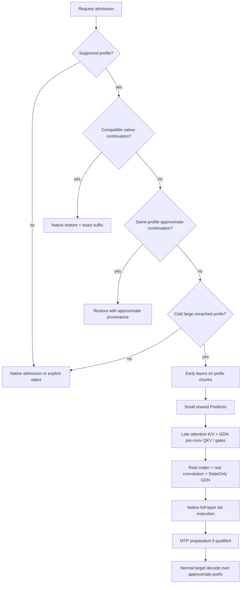

# 02 架构与执行算法

## 1. 产品边界

新增一个受控的 Late-State Prefill 路径，不改 base weights，不改变模型输出协议，不做原生 CED 重新预训练。第一目标是**大额未缓存旧前缀**；短后缀或有效 native continuation 继续原生复用。

定义：总输入 n；split s∈{48,40,32}；保留尾部 w≥1；近似前缀长度 p=n−min(n,w)；层区间统一为左闭右开。

| 实验 | 原生计算层 | 被跳过的旧前缀层 | GDN / full-attention |
|---|---|---|---|
| CED-16 | [0,48) | [48,64) | 12 / 4 |
| CED-24 | [0,40) | [40,64) | 18 / 6 |
| CED-32 | [0,32) | [32,64) | 24 / 8 |

模型维度、GDN、MTP 等既有事实来自 [S06]；代码路由来自 [S07]。以下新增设计是本计划的工程决策。

## 2. 路径选择

P4 只开放 `cache off + cold prefix + no-spec`。P5 才开放 warm approximate continuation 和 MTP。对已有 native prefix 命中，v1 **不把余下短段改成混合预测**；用原生 suffix，避免复杂的多段近似历史。多段近似不在 v1 范围。

## 3. CED-16 冷输入的准确执行顺序

1. Admission 完成全部容量和 workspace 规划；未触碰 lane 前校验 Predictor、base artifact 和 profile。
2. 从清洁 lane 开始，按固定 chunk 处理 token `[0,p)`。
3. 每 chunk 完整执行 `[0,s)`，得到 `h_split[t]`，并更新早期层原生 KV/GDN。
4. 运行共享 Predictor trunk。按**一个 hybrid block / 一层 head**依次产出晚层张量，立即消费，不把所有层的输出一起常驻。
5. Full-attention head 输出**未做 K norm/RoPE**的 K projection 和 V；使用该层真实 K norm、绝对位置、RoPE 和当前 KV codec 写入。
6. GDN head 输出 pre-conv QKV。用该层真实 width-4 convolution + SiLU 处理，更新 `[10240,3]` 卷积历史；从结果抽取 raw K、V；用预测 g/beta 做 StateOnly recurrence，更新 FP32 state。Q 不参与 StateOnly 输出，但 pre-conv Q 的历史不能遗漏。
7. 最后 chunk 完成后，所有层的 state frontier 都严格等于 p，KV 不含尾部，也不含未来 token。
8. 对 `[p,n)` 逐 chunk 执行**完整 [0,64)**。因为早期层尚未预处理尾部，不会重复推进其状态；最后 token 得到真实模型计算的 final hidden 和第一输出 logits。
9. 若 P5 已资格化 MTP：旧前缀的 MTP KV 用 Predictor 的 final-hidden head 准备，尾部用原生 final hidden 准备；保持 target hidden[t] 与 embedding(token[t+1]) 的现有对齐。prompt 最后列对齐第一个生成 token。
10. 一次性发布完整一致的可继续状态与 approximate provenance，之后正常 target decode。序列结束或缓存保存时保留 provenance。

**禁止的顺序**：先把所有 n 个 token 跑完早期层，再从 p 重新跑全层 tail；这会把早期层状态推进两次，除非显式 checkpoint/restore。本计划不用这种复杂实现。

## 4. Teacher-state injection 不是加速器

P1 先正常运行同一 prompt 到 p，导出晚层 KV、conv、recurrent、必要 hidden/元数据，再运行 split-only 到 p 并注入 Teacher 状态，随后跑同一 tail 和 decode。

Teacher run 与 candidate run 串行，不能同卡双驻留。Teacher 导出不进入计时，也不能用于 learned candidate。该实验只回答状态合同是否完整；它不能证明可学习性或速度。

## 5. Predictor 结构

初始推荐 rank=256，共享 `RMSNorm(h_split) → Linear(5120,r) → SiLU`，每个晚层为独立输出 head；另有 final-hidden head 供 P5 MTP 使用。允许 rank128/256/512 的有界对照，但先验证 rank256。

- Attention：每层 2048 输出（K1024+V1024）。
- GDN：每层 10240 pre-conv QKV，加 96 gate latent。
- final hidden：5120 输出，目标是现有 final norm **之后**的 represented hidden，不再重复施加模型 final norm。

g 使用 `-softplus(d)`，beta 使用 `sigmoid(b)`，FP32 计算，表达合法衰减和更新范围。预测的 pre-conv QKV、K/V 在对应边界转换到 BF16。禁止用未经定义的全局 clamp 掩盖 NaN/Inf。

默认先 BF16 Predictor runtime 建立正确性。INT8 Predictor 是可选优化；不得将主模型 INT8 prefill 与 Predictor 的数值合同混为一谈。FP8 不作为 v1 依赖。

## 6. StateOnly 大 T 算法

新 Op 从给定 state、raw K/V/g/beta 计算最终 state，不需要 Q readout、gated norm、output projection 或 MLP。大 T 路径优先提取现有 chunked GDN 的 state passing 部分，删除仅为输出服务的支路。

不得构造全序列 T×T attention / transition 矩阵；不得存储每 token 144MiB 的完整状态轨迹；不得将短窗口 ReplaySSM record 域直接扩为 100K 循环。短 T 参考路径可用逐 token recurrence，性能路径必须单独资格化。

同一数学递推的分块求值不保证逐 bit 相同。StateOnly 对数学 oracle 的误差，和它相对 native chunked 路径的额外误差，必须分别报告。

## 7. MTP 为什么单列 Phase

`mtp_prefill_chunk` 要使用每个 token 的 final hidden 来准备 MTP KV。早期层 hidden 不能冒充 final hidden；只准备最后 token 或清空旧 MTP KV 也不是完整修复。

P5 增加 final-hidden 预测和 streamed MTP prefix preparation，验证最后列生成 token 对齐、跨 chunk shift、turn checkpoint 与 continuation。Speculative correction 只相对于**近似前缀下的 target 分布**正确，不能恢复原 native prefix 分布。

## 8. 回退语义

预测失败后必须恢复到本请求进入前的合法 checkpoint，或清空私有 lane 从头 native prefill。不能让已经注入近似状态的 lane 继续 native 然后宣称“回退成功”。回退消耗纳入 TTFT；发生过回退的请求单列。

v1 不在同一 lane 半途改变 split 或 Predictor。缓存命中不意味着来源变为 native，exact tail 不意味着前缀变为 native。
