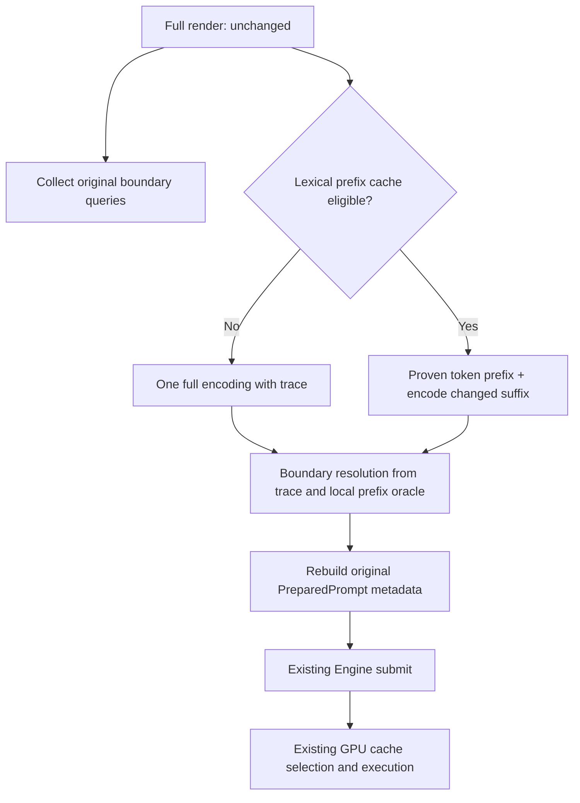

# 02｜架构与设计决策

## 2.1 设计目标

保持 `PreparedPrompt` 和HTTP可观察语义不变，把首字前重复CPU工作从“完整历史×检查点数”降到“一次主编码+局部边界片段”，再把热请求主编码降到变化后缀。优先消除工作，而不是并行执行同样的重复工作。

图中cache eligibility是前端字节/资源判定，不是读取未来的append_frontier。只有text-only进入候选路径；Vision保持原始processor分支。

## 2.2 两项独立交付

**B1 / single-pass**：无跨请求缓存。一次完整主编码时记录原始字节片段与token区间；对每个hint只在最后一个已完成added-token后的局部片段上重做必要的prefix验证。对同一字节offset去重计算，输出仍保留原hint顺序、重复、kind与allow_full规则。详见03。

**B2 / incremental**：在B1之上使用有界CPU cache。仍完整render，比较旧/新原始bytes，挑选经有限lookahead证明不变的lexer重启点；复用旧token前缀和trace，重新编码剩余bytes。metadata仍重建。详见04。

先测B1。若B1已消除绝大部分延迟，B2仍作为已定义优化，但其上线资格由新增收益决定；不可为完成路线图强上没有净收益的cache。

## 2.3 三个不变式

- **Prompt等价**：candidate token IDs与legacy完全一致；PreparedPrompt所有语义元数据也一致。
- **边界等价**：旧版会拒绝的hint仍拒绝，允许full/禁止full及uint32限制不变；不得把“不确定”处理为删除hint。
- **状态隔离**：CPU cache只省编码，不代替Engine的prefix验证，不修改GPU cache key、L1/L2格式、ReplaySSM或active slot。

## 2.4 选择与排除

| 方案 | 决策 | 原因 |
|---|---|---|
| 增大GPU L1 | 不做 | 已99.9%命中，瓶颈是CPU。 |
| 调低checkpoint数量 | 不做 | 可能改变回退/提示改写语义，是用功能换速度。 |
| 并行重复prefix encode | 不做 | 放大CPU内存/线程开销，保留错误复杂度。 |
| 一次trace + 局部prefix验证 | 采用 | 对当前hint边界通常只重算assistant header等短片段，能保持旧oracle语义。 |
| 直接移植新上游整个frontend | 不做 | API、模板、literal span、错误处理和资源边界已经变化。 |
| 只缓存整个相同prompt | 不足 | Agent几乎总追加新结果；用于exact-hit控制组可以，但不是主方案。 |
| 固定回退64/128个token overlap | 首期禁止作为证明 | 不足以统一覆盖NFC、added-token跨界和Qwen预切分。 |
| 复用模型刚生成的token作为下轮prompt | 首期不做 | reasoning/tool reserialization可能改变bytes与token。 |
| 重写BPE merge为heap | P3可选 | 是独立常数优化，需要保留rank/tie规则及oracle；不是前两个PR的内容。 |

## 2.5 Ownership

算法放family frontend；`Tokenizer`负责编码与词法trace，`processor`负责RenderedChat的边界业务规则，`Frontend`负责cache使用和PreparedPrompt装配。cache显式归属于Frontend实例，不能做全局单例。serve只传配置/汇报指标，不实现token化。public Engine仍只接收完整的PreparedPrompt，不新增一个绕开校验的客户端token入口。

`Frontend`当前copy共享`shared_ptr<const Impl>`。[S09] 可让Impl持有一个显式的线程安全cache owner指针；不使用const_cast。CPU缓存实例随对应frontend资源重建而销毁，不与GPU模型状态共享可变对象。

## 2.6 控制模式（拟新增，非现有参数）

`--frontend-tokenization legacy|single-pass|incremental|shadow`，阶段默认legacy。
`--frontend-shadow-candidate single-pass|incremental`，默认single-pass。
`--frontend-token-cache-mib 64`、`--frontend-token-cache-entries 8`。

shadow在同一前端请求中计算oracle和候选，只向Engine提交legacy PreparedPrompt；不双跑GPU。同步shadow会更慢，不允许拿shadow墙钟宣称加速。线下回放为主，生产仅有界采样并记录采样率；也可以完全不在现网开shadow。

T05先贯通legacy/single-pass用于B1独立验收；T08再扩展incremental/shadow及缓存配置；若现网overlay已有同名参数，先冲突审查，不能覆盖未知含义。
