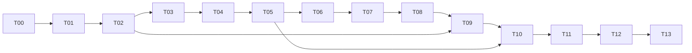

# 07｜Frontend Tokenization Implementation Plan

> 执行者逐任务阅读 `tasks/`，按红→绿→回归→Review→证据提交执行。可使用自有Agent执行器；不依赖某一个商业harness。未执行的检查不得标为通过。

**Goal:** 保持44a2c6c前端语义，消除hint引发的重复全前缀编码，并对已证明稳定的追加输入复用token前缀。

**Architecture:** 主编码产出raw-byte/token trace；边界验证改为局部oracle；跨请求缓存只复用有证书的词法前缀。GPU continuation完全不变。

**Tech Stack:** 原项目C++20、CMake/Ninja、CUDA sm_89构建依赖；辅助数据工具Python标准库。

**Spec:** [02](02_DESIGN_AND_ADRS.md)、[03](03_BOUNDARY_CORRECTNESS_SPEC.md)、[04](04_INCREMENTAL_CACHE_SPEC.md)。

## 全局约束

基线完整SHA固定。诊断overlay单独记录。模型/E8/MTP3/262K/采样/模板/工具协议不变。任何新接口、target、CLI选项由对应任务实现后才能使用。每张卡单个27B进程。生产切流不是默认授权。

## Review重点

1. 旧exact-prefix检查不等于未来稳定边界：T04/T06验证。
2. added-token同位置按ID，不是最长匹配：T03/T06验证。
3. GPU append_frontier事后产生，不能成为前端先决条件：T07/T08验证。
4. hints重复、顺序、allow_full、异常不许丢：T04/T09验证。
5. cache已命中仍重复编码所有hint：T05/T08/T10用工作计数抓住。

## 可执行任务表

| ID | 交付 | 依赖 |
|---|---|---|
| [T00](../tasks/T00.md) | 基线/overlay/工作树锁定 | 无 |
| [T01](../tasks/T01.md) | 主编码与边界重复工作计数 | T00 |
| [T02](../tasks/T02.md) | 独立oracle、合成输入及真实资源入口 | T01 |
| [T03](../tasks/T03.md) | 不改语义的lexer/token trace | T02 |
| [T04](../tasks/T04.md) | 局部prefix resolver | T03 |
| [T05](../tasks/T05.md) | single-pass处理器集成及独立Gate | T04 |
| [T06](../tasks/T06.md) | 增量安全cut与lookahead验证 | T05 |
| [T07](../tasks/T07.md) | 有界CPU prefix cache | T06 |
| [T08](../tasks/T08.md) | frontend/Engine/serve配置与指标贯通 | T07 |
| [T09](../tasks/T09.md) | 全前端/协议/错误/多模态回归 | T02/T08 |
| [T10](../tasks/T10.md) | 同机成对CPU与端到端性能 | T05/T09 |
| [T11](../tasks/T11.md) | 4090热续写、cache与Pi回归 | T10 |
| [T12](../tasks/T12.md) | 有界shadow/canary/回滚演练 | T11 |
| [T13](../tasks/T13.md) | 独立Review、证据与发布结论 | T12 |

## 并行边界

T02测试数据编制与T01统计设计可以由不同Agent研究，但代码合入串行。tokenizer.h/.cpp、processor.h/.cpp、frontend.cpp各自单写者。Review Agent只读；需要修复由当前任务owner操作。GPU测试和生产互斥不能用“并行提效”绕开。

## 每个任务必须更新的状态

`templates/task-result.md`记录输入版本、修改文件、红测、绿测、基准、失败/skip、下一任务可用接口。提交消息使用`test(frontend): ...`、`perf(frontend): ...`等明确标题；不要求每个文档改动单独commit，但实现与语义变更要可独立回退。

## 失败处理

同一失配最多连续两轮猜测修复；再失败必须缩小用例，回到原算法/边界证明。禁止用修改golden、删除失败输入、降低hint密度、关闭thinking或降低context通过Gate。

## 两个交付里程碑，不能混为一个

**B1-V**：T05交付时，提前执行T09–T12中的single-pass适用项，形成独立CPU/GPU/发布证据；这不解除T09–T12对B2完整验收的依赖。T05负责两个基础模式的实际配置贯通，因此B1可独立运行。

**B2-V**：T06–T08实现跨请求缓存后，按DAG执行完整T09–T13。所有报告标记milestone=B1或B2，不能用B1的对照报告为incremental填PASS。B1足够好而B2不进生产时，B2状态明确保留NOT_RUN/NOT_RELEASED。
