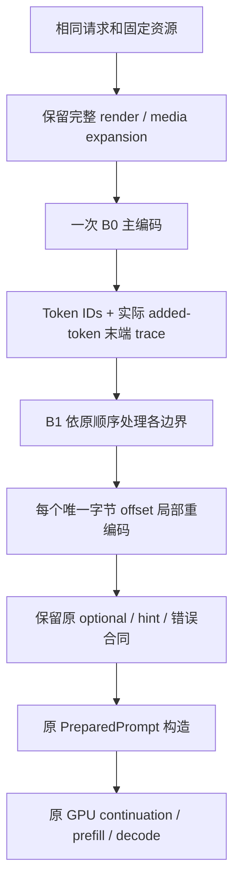

# 02 · v2 架构与决策记录

## 2.1 选定的最小方案

B0/B1均只使用只读资源和调用局部状态。Tokenizer可供并发请求共享，但请求trace/memo不写进Tokenizer。最终部署不需要缓存key、LRU、session锁或额外服务。

## 2.2 替代方案比较

| 方案 | 优点 | 缺点 | 决策 |
|---|---|---|---|
|只做B1|直接消除多次前缀编码，语义明确|主编码仍有added搜索二次项，评审4.3–4.5s|不作为最终首期完成标准 |
|只做B0|改动最窄，count等路径也收益|边界还会重复主工作，评审正文约10s|可独立提交/发布，但需单独授权与验收 |
|**B0+B1**|无跨请求状态，CPU保留原型约0.44s|需要严谨的局部边界与错误测试|**首期选定** |
|B0+B1+B2|进一步只编码请求增量|共享状态、锁、资源隔离、回退；收益尚小|延期 |
|换第三方tokenizer|可能提供成熟快速实现|资源/UTF8/NFC/flags/错误语义迁移与依赖变化|本期不做 |
|减少hint/关闭thinking|快且改动小|改变模型输入或cache边界语义|禁止 |

## 2.3 ADR-01：约束语义，而不是低效控制流

v1要求“沿旧encode控制流”原意是保护语义，但不应禁止等价搜索算法。现改为：BPE普通分段与added选择序列必须一样；搜索过程可替换。B0扫描最左位置，再按ID排序桶查找匹配，数学上与旧算法一致。详见[03](03_BOUNDARY_CORRECTNESS_SPEC.md)。

## 2.4 ADR-02：产品只保留单一优化路径

legacy以独立测试源码/固定构建保存。benchmark中可有四个build lane用于归因，不对应四个服务CLI模式。部署回滚依赖已保存且验证可启动的旧镜像完整ID。原版源码可作为外部oracle保留，不长期维护两个线上算法。

## 2.5 ADR-03：memo只缓存同请求的原始验证事实

每个byte_offset可缓存`tokenizable / count / prefix_match`及局部结果，不缓存带name的最终异常，也不跨请求存活。不同边界在同offset但allow_full不同，仍分别执行旧合同；hint不能因memo而去重。重复非法查询的第一次出现必须与legacy抛相同错误。

## 2.6 ADR-04：不做生产shadow

同步legacy双算最坏增加80秒；异步仍占CPU、内存和队列，而且不能保证无干扰。离线前端差分可严格比较整个输出，不需要在生产关键路径再跑legacy。一次维护窗口HTTP测试验证接线、缓存、协议和统计；普通生产观察只读新路径指标。

## 2.7 ADR-05：共享text/vision路径

B0对所有`encode`调用生效，B1对shared `encode_rendered_chat`生效。不能为了“首期text-only”另外增加media legacy分支。图片原始处理/位置语义不变；增加展开后重复`<|image_pad|>`的CPU测试及真实vision前端integration，未经GPU验证不声称视觉推理通过。

## 2.8 ADR-06：保留完整render与当前元数据构造

实测render毫秒级、positions/identity近零，继续完整执行。对新实现也重新测这些阶段；不把全量identity/hash改成增量，避免在主要问题已亚秒后扩大状态范围。

## 2.9 ADR-07：full_reset不能用中位数忽略

99.9%命中描述append子集，不代表所有请求均热。评审长请求里64次full_reset的prefill合计57.8分钟，足以单独立项。此ADR撤销v1“容量一概无须研究”的结论，但仍禁止在tokenizer PR顺带调L2/TTL。

## 2.10 ADR-08：正确性门不能因为范围缩小而取消

减少运维模式不等于减少语义检查。前端资源/请求空间无限，有限随机测试不能穷尽；用旧oracle、规则证明、边界/错误穷举、真实资源差分、产品接线、HTTP验证分层覆盖。性能必须增加绝对门，不只报告95%提升。
