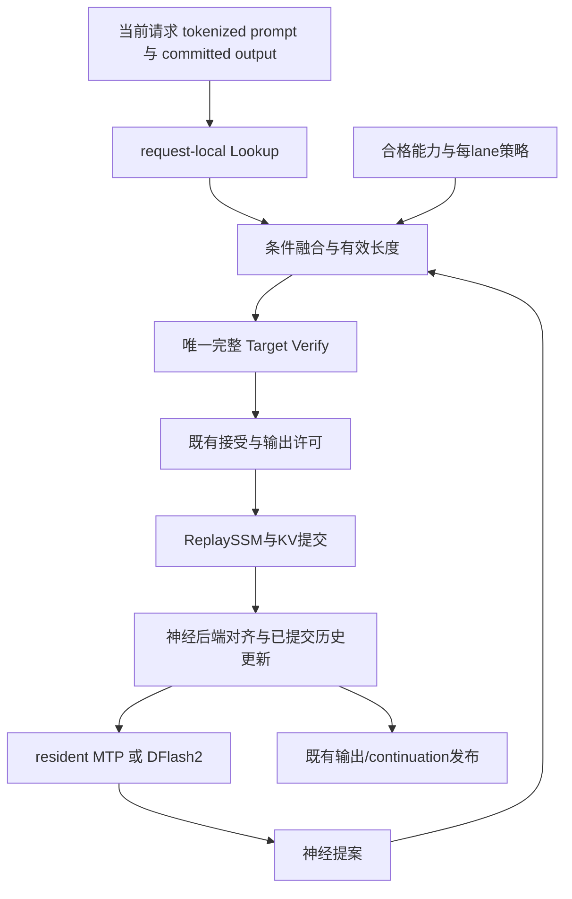

# 统一架构与冻结接口

本页是 **拟实现接口**。C++20 类型/签名由 H1-T01 冻结并落盘；引用现有 Tensor/View 的接口按 P6 编译环境连接。尚不存在的 target/CMake 测试不视作可运行。

## 所有权



现有 `.ninfer` 只读 Target、Frontend、Program、L1/L2/L3、row_commit 继续拥有原有职责。proposal head 与 DFlash2 为独立 `.ninfer` companion，不把 GGUF reader/动态格式插件/vLLM scheduler 带入主引擎。Decision始终不生成草稿；新路径先base/text。greedy/deterministic是proposal策略，最终Target保持生产sampling；新增sampling能力在相应资格前OFF/回既有合格sampling。Target-greedy另作数值诊断，media/LoRA保持原已合格路径。具体delta-q/processor/RNG/commit合同见design/11。

## C10：三个长度与一个资格集合

```cpp
namespace ninfer::runtime {
enum class ProposalSource : std::uint8_t { Neural, Lookup };
enum class ProposalDistribution : std::uint8_t { DeterministicDelta };
struct ChainProposal {
    ProposalDistribution distribution = ProposalDistribution::DeterministicDelta;
    std::array<ninfer::TokenId, 15> tokens{};
    std::array<ProposalSource, 15> source{};
    std::uint32_t length = 0;
    std::uint64_t history_epoch = 0;
    std::uint32_t history_tokens = 0;
};
struct VerifyShape {
    std::uint32_t neural_drafts = 0; // N; MTP<=5, DFlash2 bound from companion
    std::uint32_t logical_candidate_tokens = 0; // K<=15; excludes anchor
    std::uint32_t logical_valid_columns = 1; // V=K+1; includes anchor
    std::uint32_t physical_verify_width = 1; // W; qualified allocation/graph width, W>=V
    std::uint32_t physical_batch_rows = 1; // B; includes batch padding
    std::uint32_t physical_token_rows = 1; // checked B*W, not B or sum(valid)
};
struct HybridCapabilityKey {
    std::string target_fingerprint, tokenizer_fingerprint, kv_codec;
    std::string proposal_fingerprint, compiler_profile, qualification_id;
    std::string target_sampler_fingerprint, proposal_semantics, sampling_qualification_id;
    std::uint32_t max_context = 0, max_concurrency = 0;
};
}
```

头文件需 `<array>/<cstdint>/<string>` 与 `ninfer/types.h`。H1 初始K≤5；H3才开放K≤7/物理W8，H4才开放K≤15/物理W16。`neural_drafts` 不因W16被设为15。原文“W=K+1”现指逻辑V，物理W独立；valid mask/accept按V，workspace、graph与算力按B×W，乘积溢出启动拒绝。不能只mask始终W16图便宣称短块更快。

首版closed物理集合 `[1,4,5,6]` 的确定映射（B1）：

| 逻辑K | 逻辑V=K+1 | 物理W | 物理token行 | 规则 |
|---:|---:|---:|---:|---|
| 0 | 1 | 1 | 1 | ordinary/无有效候选 |
| 1 | 2 | 4 | 4 | 2列有效、2列padding |
| 2 | 3 | 4 | 4 | 3列有效、1列padding |
| 3 | 4 | 4 | 4 | 4列有效 |
| 4 | 5 | 5 | 5 | 5列有效 |
| 5 | 6 | 6 | 6 | 6列有效 |

W8/W16同理选择能覆盖V的最小已资格物理宽度；不同物理路线须独立数值资格。剩余输出budget=1时K截为0、V/W1；budget=2时K≤1、V≤2、物理W1或4。实际commit/stop仍由原许可策略控制；逻辑容量按实际O_eff与末token不入KV合同，物理scratch独立预算，不能额外扣拍脑袋固定context reserve。逻辑/页或物理资源不足则在提交前选择合法短shape，不多发bonus。外部候选不足不把padding计入有效K。

## C11：配置不抢占原 CLI

新 `--hybrid-policy FILE` 与可选 `--proposal-head FILE` 为 **本计划待实现**；不传时完全走旧 `--spec`。policy v1 具有 `enabled, qualify_id, allowed_widths, default_neural_drafts, lookup, copy_policy, proposal_head_fingerprint, resource_limits`；`allowed_widths`只表示物理W，不用逻辑V2/V3冒充新kernel。enabled 默认false；allowed_widths初始 `[1,4,5,6]`，实现/资格后才加入8/16。未知字段、无对应kernel、错误fingerprint应启动拒绝；自动选择发生在合格能力集合内，不静默减context/换codec。

结构性资源集合在启动冻结；请求开始选择神经 backend 与 capability；轮间允许改变候选来源及已预热 W。第一版不做请求中途 MTP↔DFlash2 权重加载。H4 只改变同一resident后端是否执行 proposal，mandatory alignment 仍在。

## C12：共同验证入口

`src/targets/qwen3_8/impl/runtime/hybrid_impl.h` 按现有 `instantiate.h` 的 per-Variant 机制实例化。不要把引用 `NINFER_QWEN38_RUNTIME_NS` 的运行时代码随意编译成独立通用 .cpp。

新增内部语义入口：`verify_hybrid_chain(schedule::ExecutionCore&, Tensor& continuation_hidden_store, TextContext&, schedule::TargetVerifyFrameView, ops::GqaExecutionEnvelope)`；该入口只检查新shape并连接已有 `target_verify_accept`，不复制 acceptance/hidden selection 算法。公共 `SpeculativeBackend::{None,Mtp,DFlash}` 的原值不变。H6 可在尾部增加 DFlash2；Lookup 不是 backend enum。

## C13：日志与缓存身份

保留核心 schema24 与 prepare_detail，增加 `extensions.hybrid_spec_v1`。Target缓存身份不因Lookup匹配长度或计时变化而改变；proposal状态及图资源绑定 `proposal_fingerprint/resource_generation`。任何需要变更已有 snapshot 布局的实现必须新版本，旧表示拒绝或明确迁移，不让旧镜像读新缓存。辅助索引在首版不持久化；恢复后request-local重建并记录CPU耗时。

## 当前B29与未来合同分开

schema24是未来P6后的日志合同；B29本次观察为schema20/E8，不能原地改名。当前 [baseline-only](../plans/05-baseline-29-execution.md) 使用版本化adapter映射已存在字段，缺失值null+原因。未来新hybrid先base/text并以确定proposal+生产Target sampling为目标，组合资格前OFF；production_sampling_29保留真实temperature1/.95/k20/presence0/preserve-thinking/medium。Target-greedy单列诊断，fallback不能报告为新算法命中/收益。

## C22—C24：proposal与最终输出分开

[design/11](11-sampling-acceptance-and-proposal.md)是新增确定性delta提案/Target sampling权威合同。policy/capability资格键必须区分proposal语义、实际Target processor归一化配置、W/B/资源/模型与sampling资格ID，不可用Target-greedy资格开放production sampling。启动默认OFF，配置不合格拒绝；原支持sampling请求仍走原路径，不改请求T/p/k来适配优化。H1-T07是H1性能对照的硬前置，其后的宽度/head/DFlash/selective组合各自复验。
