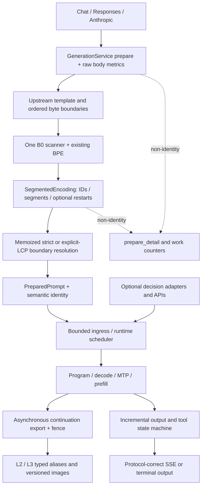

> V3 继承资料：P0—P6 的任务目标和上游合入顺序继续有效。命令依赖须先按根目录 `support/REHYDRATE.md` 恢复。

# 04｜合入后的架构与设计决策

## 1. 设计目标

保留现有服务的生产可用性和定制收益，同时接受上游已经改变的接口与资源生命周期。优化对象是 Java 长时编码流量，不是只提高一个 cold prompt 或短 token 微基准。

生产只保留一套 tokenizer / boundary 真相；同一份权重与固定 GPU 预算；非语义观测不参与缓存身份；状态版本变化显式隔离；测试 oracle 必须独立于被测优化。



## 2. 编码器：保留 B0，实现上游接口

### 2.1 唯一数据流

一次完整编码生成 token IDs，并可选生成两类轻量元数据：segments 覆盖所有 ordinary/added-token 区域；restarts 只标识真正选中 added token 的结束。三者由同一扫描状态推进。不要先 encode_traced 再 encode_segmented，也不要为每种 boundary 再完整 encode。

建议接口增量如下。这是待实现的接口方案，不是声称仓库已经存在这些签名：

```cpp
struct PrefixWork {
    std::uint64_t local_encode_calls = 0;
    std::uint64_t local_input_bytes = 0;
    std::uint64_t local_max_bytes = 0;
    TokenizerWork local_work;
};

SegmentedEncoding Tokenizer::encode_segmented(
    std::string_view text, TokenizerWork* work = nullptr) const;

SegmentedEncoding::PrefixRelation SegmentedEncoding::prefix(
    std::size_t cut, PrefixWork* work = nullptr) const;
```

保持上游不传 work 的调用方式兼容；encode/encode_traced 继续委托同一私有实现。计数为空时不做原子操作，不维护全局输入缓存。copy/move tokenizer 不应让首字节索引变成悬空指针，沿用索引而非指针。

### 2.2 Memo 与错误语义

Memo 位于一次 `encode_rendered_chat` 请求内，以 byte_offset 为 key。缓存结果包括可编码与否、PrefixRelation；内部 out_of_range/logic_error 不降级成合法客户端请求。使用 catch invalid_argument 处理 UTF-8 中间切点等预期不可独立编码情况，保持隐式失败与显式回退策略区分。

`common_tokens` 是独立前缀编码与全量编码的 LCP，不是“局部 prefix token 数”。`exact=true` 才表示前缀编码完整等于全量的前 N tokens。隐式边界检查 exact，显式边界只使用 common_tokens 后进行上游过滤。

### 2.3 性能选择不靠猜测

用四个 lane 比较：O 原 B0+B1、B 的完整前缀 oracle、纯 U 的 cached-find segmentation、合并后 B0 segmentation。相同 resources、文本、CPU 亲和性、warmup、采样方式；分别看扫描、BPE、boundary 数量和 prepare。

默认保留 B0，是为了保留已建立的可验证扫描行为与观测，不是宣称它对所有文本都优于上游的 cached-find。若数据证明合并方案退化，应先检查重复编码/计数开销和切点选段，再决定唯一生产后端；不保留两个默认热路径来掩盖差异。

## 3. 新边界模型的权威关系

`RenderedChat.boundaries` 是有序 byte hints，携带 kind/publish；`EncodedChat.boundaries` 是经过精确性/LCP 校验的 token depths；PreparedPrompt 的 semantic identity 接收后者。请求的 raw body size、计时、work counters 不影响上述链路。

显式边界最多数量、implicit/explicit mode、assistant opener 搜索窗口以及 rewrite frontier 过滤均采用上游契约。所有边界 identity 由 tokens、有效位置、模型/adapter、相关 preprocessing 等语义决定；不能只使用原始字符串前缀长度。

“关闭 implicit boundaries”不等于禁用 session routing、L1 retained lane 或 full-session continuation。测试必须分别控制这些维度，避免误判 cache hit 来源。

## 4. 异步 continuation 的生命周期设计

维持上游资源所有权：导出 job 拥有/持有直到完成事件所需的 snapshot、source lane 与 pinned staging；非 owning pointer 只能在对应持有对象仍存活时使用。以下操作均检查与导出/恢复的相容性：lane reset、重新 prefill、restore、evict、cancel、shutdown、adapter replace、prefix rewrite。

导出失败不得发布一个可命中的空/半成品别名；alias publication 与 payload admission 的一致性由上游 typed alias 机制保证。上游 settled-lane 优先策略保留，不用“立即复用最热 lane”覆盖 fence。

新增观测必须报告实际 export work，而非只报告被缩短的同步 publish 时间。生命周期测试记录请求 ID、lane、adapter、digest 和状态转换；token 内容不必默认写入日志。

## 5. KV 与状态版本：显式迁移，不做兼容假象

主方案采用 U 的 `rk4v4` midrise codec。其 4-bit codes 由一个统一编码函数服务 append/fill/fused decode，配套保持所有 decode/prefill 路径和 inverse V rotation。不能从旧 E8 代码只复制一个 encoder，而忘了读端、flag 和 serialized state。

`rk4v4-e8` 是旧的 4-bit E8 lattice；`rk2v4-e8` 是仍保留 E8-root keys 的另一个模式，两者不可混淆。旧 `rk4v4` 和新 `rk4v4` 名相同也不代表 payload 兼容。

| 状态阶段 | Session snapshot | Target continuation image | 决策 alias |
|---|---:|---:|---|
| `772b881` 所述新 codec 阶段 | 5 | 4 | 以阶段源码为准 |
| 最终 U 图像状态阶段 | 6 | 5 | 2 |

P0/P4/P5 都要从对应源码的 writer/reader 常量再次核对版本。上表不是跨所有层级的一个“统一 cache version”：容器格式、alias schema、target payload 各自版本都要参与兼容性测试。

部署 cache path 至少区分 source milestone、model/adapter manifest、codec revision 与 profile。旧 cache 不转换、不删除、不与新实例共写。回滚启动旧镜像及其旧目录，接受候选侧新增缓存不被回滚侧复用。

## 6. 日志扩展方案

主 schema 跟随上游，最终为 24。新增的命名扩展建议出现在 server-start 和 request-done：

```json
{
  "extensions": {
    "lkyprogramer.prepare_detail": {
      "version": 1,
      "time_unit": "seconds",
      "legacy_chars_unit": "utf8_bytes"
    }
  },
  "prepare_detail": {
    "serve_convert": 0.0,
    "frontend_convert": 0.0,
    "template_render": 0.0,
    "tokenize": 0.0,
    "positions_identity": 0.0,
    "engine_submit": 0.0
  }
}
```

以上 0 仅为字段结构示例，不是测试成绩。真实不可拆分的媒体 tokenize 沿用 -1 兼容约定，读取端归一为 unavailable；不得把 -1 当作负耗时纳入均值。若新增拆分计时，只有实际测量了才能写非负值。

历史 fork20 由 prepare_detail/size 扩展存在性识别；历史 upstream20 有不同新增字段。对未知扩展宽容读取，对同名核心字段类型错误严格报错。prepare 各段可能包含或重叠，TTFT 同时记录客户端首字节/首内容和服务端口径；不要把 progress event 的到达当成第一输出 token。

## 7. 模型与设备资格边界

27B groupwise-int + sm89 是本次主资格。35B-A3B 做构建/注册一致性，只有具备对应模型和明确用途才扩展实机资格；DFlash 路径不能偷换成 27B 的优化。NVFP4 A4 需要 Blackwell，4090 不做虚假性能验收。

Chat 生产 profile 沿用 P0 的 max context、KV 容量、MTP、thinking、adapter、prefix/cache 设置，仅按所处阶段显式调整 codec/cache namespace。决策 BF16 profile 独立设计容量，不和 262K 压缩 Chat profile 混成一组对比。只有一个模型实例驻留，不在一张 24GB 卡上假设同时跑两个 27B 实例做蓝绿。
