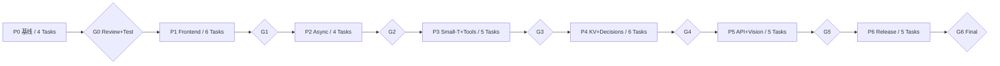

> V2 参考快照：P7—P12 不再是执行权威；按根目录 `plans/00-master-plan.md` 和 `plans/01-v2-migration-map.md` 执行。本文保留历史设计与来源，不表示实现完成。

# NInfer 上游融合 Implementation Plan

> **For agentic workers:** 使用 superpowers:subagent-driven-development（支持并行worker时）或 superpowers:executing-plans（无subagent时）逐任务执行。每个task独立工作树，phase统一集成review与测试。本计划是交付物，尚未在目标仓库实施。

**Goal:** 将固定上游U的34个独有提交完整纳入O分支，保留B0/B1价值、观测、测试与部署特性，并在4090上形成可回滚的Chat生产资格。

**Architecture:** 从O建立集成分支，以5个里程碑真实merge保留双方历史；前端采用上游新boundary接口与唯一B0编码器；cache、runtime、KV、protocol按依赖成套合入。源码完整性和可选新功能生产资格分离。

**Tech Stack:** C++/CUDA sm89、CMake/Ninja/CTest、Docker无权重镜像、Python3、Bun/TypeScript。

**Spec:** `../docs/03-conflict-resolution.md`、`../docs/04-target-design.md`、`../docs/05-validation.md`。

## Global Constraints

1. B=`44a2c6c3392c9d51e76a895ed97bf1867530d252`；O=`e0b05f7cb46adae2787be2ccbe605e1b0c9b3923`；U=`5b99996bc7c1fe6ff27f271a205eb605302ec8bb`。不得把浮动HEAD替换锁定对象。
2. 主执行目标Qwen3.8-27B groupwise-int，单RTX4090 24GB；其它package构建一致性与GPU资格分开。
3. 保留P0冻结的实际reasoning、MTP、模型资源、context和代理契约；不通过缩短输入/关闭thinking过性能门槛。
4. 原始tokens与边界精确契约用独立oracle；浮点/新codec按独立数值与业务判定，不泛化逐token一致。
5. corelog schema跟随阶段，最终24；fork扩展v1独立。观测不进入prompt/cache identity。
6. 新旧snapshot/codec/cache目录隔离；模型只读；单GPU串行A/B/A；回滚恢复镜像+argv+旧cache。
7. 一个task一个文件责任域；接口/CMake/AGENTS由Integrator串行仲裁。无自动push、无未批准生产切换。
8. 不把CPU helper测试、0test、skip77、模板或上游报告写成候选GPU通过。

## Review Focus

- 相同文字不同boundary/profile/adapter/image preprocessing，是否会错误共享状态；P1-T05/P4-T02/P5-T03必须覆盖。
- export尚未完成时cancel/reset/restore，是否复用在读buffer；P2-T02/T04必须覆盖。
- 异常UTF8、半个工具JSON、SSE中途断开，是否产生可执行假工具；P3-T03/P4-T05覆盖。
- 原oracle引用被修改的生产DTO，是否让测试随candidate“自证”；P0-T03/P1-T03隔离并核对原二进制。
- 一张24GB卡、共享KV、未知当前生产overlay和旧cache，是否使上线/回滚计划不可执行；P0-T02/P6-T03—T05实测。

## 阶段总览

**35个实施任务 + 7个统一gate，共42个DAG节点。** `tasks.json` 是可机器读取的任务定义，`tasks.csv` 为简表；Markdown每项包含精确文件、接口、测试断言、操作、验证与回滚。全部状态PENDING。

| Phase | 目标 | Tasks | 并行方式 |
|---|---|---:|---|
| [P0](phases/P0.md) | 基线冻结与完整冲突实测 | 4 | 4项任务，源码/环境并行，资源与基线按依赖推进 |
| [P1](phases/P1.md) | 前端、边界与观测融合 | 6 | 串行import后5个工作面并行；测试与实现在联合集成中校验 |
| [P2](phases/P2.md) | 异步 export 与调度 | 4 | import后lifecycle/metrics并行，GPU压测等待二者集成 |
| [P3](phases/P3.md) | small-T 与流式工具 | 5 | import后CUDA/serving/buildQA并行；GPU验收在合并后 |
| [P4](phases/P4.md) | midrise KV 与决策基础 | 6 | import后codec/decision/telemetry/output四面并行；实机qualification收敛 |
| [P5](phases/P5.md) | 最终上游 API、视觉与 Web | 5 | import后protocol/vision/web并行；最后统一API/GPU验收 |
| [P6](phases/P6.md) | 全量验收、试运行与回滚 | 5 | 最终review后quality与部署准备并行，再串行canary/rollback |



## 任务调度与工作区

每阶段先串行import/freeze接口，再为ready task创建独立worktree；依赖未满足不启动依赖该产物的工作。没有subagent能力时按tasks.json拓扑顺序串行执行，不能虚构已调用并行agent。

共享锁：Frontend头文件→P1-T02；public types/prepared/timing→P1-T04；CMake/AGENTS→Integrator；P4runtime/header冲突→import期间先定schema再交具体owner。后续phase重新分配owner。worker需要跨域改动时只提交review建议，不在别人worktree直接修改。

`src/serve/generation_service.cpp/.h` 在P5的Vision与protocol都可能需要理解，但写入由P5-T03持有；P5-T02改protocol层并通过固定接口调用，新增接口先与owner同步。`frontend.cpp`的计时、输出、decision关联多任务，但同一phase只有一个落盘owner。每次phase结束比较最终combined diff，防止最后合入的worker覆盖前者定制。

## 源码完成、测试资格、实际发布三条状态线

所有任务的源码/purecontract/synthetic/op测试都是必需；未加载decisionadapter不允许删除对应源码测试。可选的真实textdecision/imagedecision业务精度以及browser实际操作，在`qualification-scope.json`独立声明。只声明Chat资格时，这些可标UNQUALIFIED/BLOCKED，但生产profile必须不启用相关未资格功能，最终报告必须披露。

原G1素材、真实27B主路径、长上下文质量和GPU必测不是可选项。P0找不到原素材时应阻断完整计划资格，允许输出其余已完成成果，不能悄悄换suite。实际生产canary/回滚缺授权时，P6相关task保持PENDING；“源码可交付”不能表述为“生产已发布”。

## 每个 Phase 的统一门禁

Integrator合入所有任务，freeze提交；Reviewer按phase完整diff做架构/数值/并发/协议/部署审查。测试必须在这个相同提交的构建产物上执行，记录source、image、model、profile与dataset身份。Review后改动使旧证据失效：受影响测试和最终回归重跑。

门禁至少有：task状态齐全、独立review通过且无阻断项、全构建、JUnit required非skip、standalone G1逐case对齐、该阶段GPU场景、性能/质量报告和上一gate。`phase_gate.py`仅进行结构/哈希/JUnit/前置一致性核查，不是能自动判定C++正确性的裁判；原始日志和review结论不可省。

## 工期和资源

这里不给未经运行的工时估计。关键路径是P0真实基线→P1编码/oracle契约→P2异步→P3工具→P4codec质量→P5最终API→P6长场景/部署回滚。GPU实验串行，CPU代码开发可并行；不要因为GPU排队让多个27B同时加载。

## 计划自检与执行入口

```bash
python3 scripts/phase_gate.py --validate-plan
python3 -m unittest discover -s tests -v
```

然后阅读 `../AI_EXECUTION_PROMPT.md`。所有任务新建文件在本包是设计，不是已经存在于目标仓库的实现；已存在路径由P0 source audit再次验证，路径/CLI变化必须更新计划并留痕。


## v2接续阶段

原P0—P6计划不改。其后新增P7—P12，见[扩展总计划](01-tqllm-extension.md)与同目录完整tasks.json。原文涉及任务总数只指原包范围；所有新task均PENDING，不表示P6已经实施完成。
