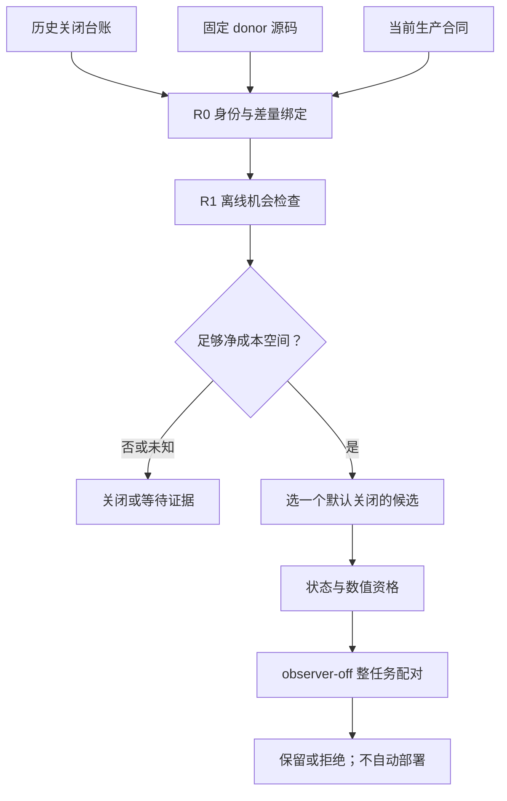
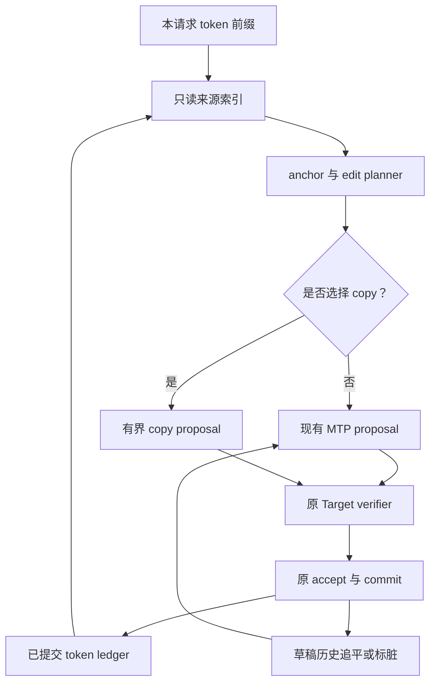

# 差量架构与接入边界

## 目标与非目标

目标是把少量 donor 机制放到你已有的“身份→完成路径→假说→数值/服务→净收益”链条上。非目标是移植完整 YASAKANI/OSAKANA、替换模型、建立另一个调度器，或让研究 Agent 自主无限跑参数。

## 组件归属

| 组件 | 复用/增量 | 责任 |
|---|---|---|
| ExperimentSpec / RunEvidence / Decision / BudgetLedger | 沿用 foundation 四件套 | 不能由一个布尔 PASS 合并所有证据 |
| `exploration_control.py` | 既有唯一控制器设计 | 批准、预算、OwnedServer、冻结集与停止规则 |
| completion-path/v1 | 沿用原 schema；附加命名空间 | 请求/窗口/图重放、状态 commit 与成本因果 |
| D1 source planner | 未来纯 token CPU 组件 | 查询与来源状态机，不能提交 target 状态 |
| D1 proposal adapter | 未来 NInfer 专用 | 选择 proposal、可证明的 skip/catch-up；不能改 verifier |
| H2 proposal-head adapter | 未来 NInfer 专用 | 粗筛/原 head 候选行重算；不能裁 Target |
| K-PAIR source check | 只读工具/报告 | 证明实际 pair 与 P3 差量，不能启动 kernel sweep |
| M0 deployment/regression card | 维护流程 | 绑定已有修复及精确 continuation 证据 |

## D1 的数据/状态边界

CPU planner 的 proposed token 不进入 authoritative ledger。拒绝后的 bonus token、EOS、取消边界只由原 verifier/Program 决定。索引只吸收真实提交/可见历史，不吸收被拒绝 proposal。`source_version`、request generation 和 tokenization 身份变化必须失效；跨请求全局检索不在本包。

MTP 能否真正跳过不是 planner 的属性。若现有 Graph 同时含 Target 和 next-proposal，CPU 标志并不消除 GPU 工作。R1 必须定位图/stream 依赖；R2 只有在已证明可保持状态、地址稳定的窄分支上改造。不可为了省草稿重构整个 Graph / 引入常驻 megakernel。

## H2 的数据边界

`真实 draft hidden → rank-r projection → V' 近似评分 → shortlist → 原 Q4 proposal-head 指定行重算 → 现有 argmax/remap`。

- `V'=131072` 是固定 b0 中已有草稿子词表，当前身份绑定后重新确认。
- Target 248320 行保持完整；不复用 donor 新权重、不把自己的 token remap 与 donor ID 对接。
- 选中行计算必须保持原 head 的 codec/scale/归约语义；粗筛可以近似，精排只承诺相对**原存储 head 的选中行**，不承诺未入围的全局 argmax。
- 资产是只读版本化 sidecar，非每请求训练；缺失、不匹配、OOM 风险或 sampled 未合格时默认原路。

## 接入原则

研究报告/CLI 放 `LAB_ROOT/tools/frontier/donor_delta_20261115/`；引擎补丁仅在 R0 绑定的隔离工作树。目标路径参照 [源码地图](02_EVIDENCE_AND_SOURCE_MAP.md)，不是本包已经修改的文件。

现有同等功能优先复用。未知 schema 使用小 adapter，不改变旧 `/v1/telemetry` v1 的语义。高基数 request/round ID 仅在脱敏的离线记录，不加到 Prometheus 标签。现有 A1 数值归因、A2 cache-work / lease / publication 边界完全继承。

成本表只补充旧 SpecPilot/utility 计划的约束：key 至少含 build、设备/driver、模型与 drafter、codec、W、采样、context band、cache 状态和观测模式。不同身份的数据不得混用。完整 round / committed token 与请求 wall 为目标；探索成本必须计入，输掉的探测要退避。**本包不实现新的自适应 W 控制器，也不改 Strata 已有 policy。**
