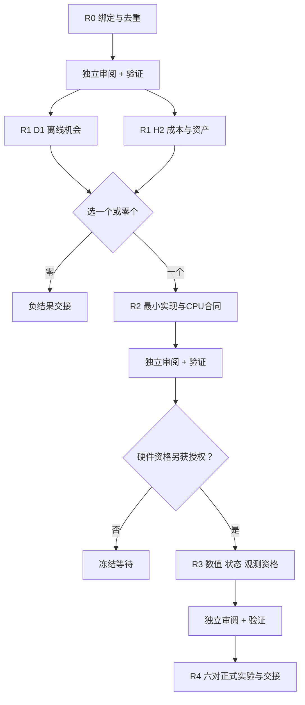

# AI 实施计划与任务 DAG

**Goal:** 在4090既有合同上识别和验证真实源码差量，允许零候选收口，不复活旧路线。

**Architecture:** 复用foundation控制/证据底座；D1纯token planner＋可证明的proposal adapter，H2草稿头adapter。最多一个进入引擎实现。

**Tech Stack:** 目标仓库现有C++/CUDA、现有测试/构建系统；离线adapter优先Python标准库，必要数值资产复用项目已有离线环境，不引入在线外部服务。

**Spec:** 本包[架构](05_ARCHITECTURE_AND_INTEGRATION.md)、[D1](06_D1_SOURCE_ANCHORED_COPY.md)、[H2](07_H2_DRAFT_HEAD_REFINEMENT.md)、[测试门](10_TEST_PROTOCOL_AND_GATES.md)。

**Global Constraints:** 当前GPU/HTTP/引擎预算0；只改获准的隔离树；模型/codec/容量/采样不变；Phase串行，最多一个性能候选；独立review与验证；未实现CLI不得当已可运行。

**Review Focus:** 是否重复H1/H2/H3/K1；生产身份绑定；skip是否真省GPU且计catch-up；head显存与q；终止input rows；统计单位与失败计入；底座/旧修复是否已存在。

## 任务总表

| Task | 依赖 | 可并行 / 文件所有权 | 最小验证 | Phase gate |
|---|---|---|---|---|
| R0-T1 当前身份/源码锁 | 无 | 与T2/T3并行；binding.json | hash、dirty状态、engine/model身份齐全 | G0 |
| R0-T2 旧路线/后续回执去重 | 无 | history_delta.md | 关闭ID逐项有源，未知不判未做 | G0 |
| R0-T3 K-PAIR/M0源码卡 | 无 | pair_gap.json、maintenance.md | P3与实际路径绑定，否则保UNKNOWN | G0 |
| R0-T4 合同冻结 | T1–T3 | 单一负责人spec/budget | null/0预算fail-closed，review签名 | G0 |
| R1-T1 D1离线planner规格/回放 | G0 | D1工具/报告 | 反例CPU＋真实holdout，B1/B2同来源同W | G1 |
| R1-T2 H2成本/资产可行性 | G0 | H2资产清单/报告 | head-only身份、peak账、数据资格 | G1 |
| R1-T3 单候选选择 | T1/T2 | decision.json | lower-bound机会≥门＋余量，未知不通过 | G1 |
| R2-T1 先写最小失败测试 | G1且开发授权 | 选中候选测试 | 新assert先红，baseline现有测试绿 | G2 |
| R2-T2 最小adapter/default-off | T1 | 选中候选引擎文件 | 不改Target/旧oracle，最小build/CPU测试 | G2 |
| R2-T3 证据/预算接入 | T1，可与T2分文件 | tools adapter/schema | missing/stale/drop/预算边界 | G2 |
| R3-T1 数据/状态资格 | G2＋硬件授权 | 单机GPU独占 | 边界case；所有失败原件保留 | G3 |
| R3-T2 观测中性/资源资格 | T1 | 单机GPU串行 | on/off门、所有阶段peak、现有cache合同 | G3 |
| R3-T3 有界预试判定 | T2 | report/decision | 不扫参数、不混正式样本 | G3 |
| R4-T1 六pair正式执行 | G3＋正式授权 | 单机GPU串行 | frozen run order / raw manifest | G4 |
| R4-T2 独立统计/质量复核 | T1 | reviewer/verifier独立 | 重新算CI、失败计入、holdout不改 | G4 |
| R4-T3 交接或关闭 | T2 | decision/rollback | 各层分开判定，生产仍原路 | G4 |

每Task结束只运行它负责的最小验证；Phase结束统一做该Phase的集成检查，避免每Task重复全套模型/长上下文测试。详细文件和命令合同见[ R0 ](../phases/R0_BINDING.md)、[ R1 ](../phases/R1_OFFLINE_ELIMINATION.md)、[ R2 ](../phases/R2_MINIMAL_ADAPTER.md)、[ R3 ](../phases/R3_QUALIFICATION.md)、[ R4 ](../phases/R4_E2E_AND_HANDOFF.md)。

可选`R0-E0`只在R1缺当前原件时单独申请baseline取证，见R0文件末节；不是DAG中的自动硬件步骤。其数据回填R1，候选始终关闭，无授权时保持BLOCKED。

## 独立角色

- Implementer仅提交其负责文件与证据，不能改冻结scorer。
- Reviewer检查需求、状态机、历史差量和越权风险，不仅看diff行数。
- Verifier从封存raw独立重算/重跑**获准最小测试**；没有GPU授权时只给CPU资格，不借review启动模型。
- Controller记录预算与最终门，不接受实现者一句“已通过”代替原件。

不能并行的：共享source改动、同GPUprofile/benchmark、改同一spec、同slot的状态测试。若task存在共享文件冲突先串行或拆出明确owner，不靠两代理同时改再自动覆盖。
