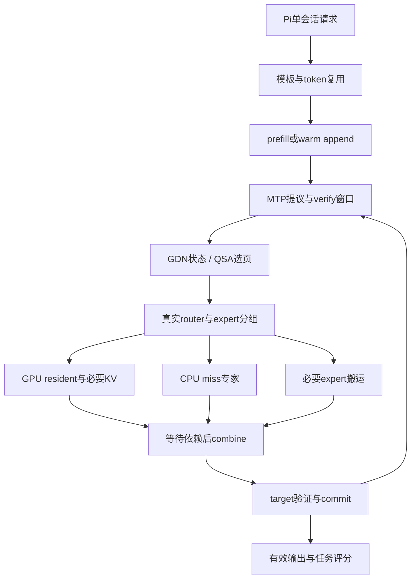

# 02 · 架构、瓶颈与可省上界

## 这不是普通dense模型的128K问题

现模型是GDN/QSA混合MoE：36层递推GDN状态、12层QSA选择性注意力，512专家top10。QSA按4-token block建索引，最多选择约2048个历史cell再加尾部；`qsa_selection_width`上限2051。不能假设每层都对128K做完整dense attention，也不能按Llama的全KV容量估算。

来源：[旧源码审计](https://github.com/lkyprogramer/CodexGame/blob/3cd82436ed7fe71daf79cfbe03f7fc05d5601fb0/docs/strata_flashnext_4090_extreme_lab_v2/docs/08_KERNEL_SOURCE_AUDIT.md)、[Strata QSA接口](https://github.com/Niko1221/Strata/blob/870aedd9e1ebe1c91f94da93b59af17729f6c5c0/include/strata/kernels/qsa.hpp)。

图只表示关键依赖；实际程序在多个layer、stream、窗口之间重叠。计时必须从真实事件/依赖重建，不能机械把图当串行模型。

## Amdahl必须用暴露成本

若完整decode时间为T，候选真正位于完成路径上的可优化时间为C，局部提速s，新增不重叠开销H，则理想化时间下降：

`gain_time = (C/T) × (1−1/s) − H/T`。

`C/T`是可审阅依赖证明下的非重叠暴露比例，不是所有该kernel的累计时长。乐观删光上界为C/T。吞吐增幅为`1/(1−gain_time)−1`，不能和耗时下降百分比混写。

例：暴露比例6%、局部快2倍、额外开销0.5%时，整体耗时仅下降2.5%。这是算例，不是4090预测。若完整专家已近本机DDR吞吐瓶颈，替换几条乘加指令甚至不会产生局部2倍。

## 每个窗口都可能被不同分支限制

近似的并行片段应读作`max(CPU_ready, GPU_ready, required_copy_ready)`加两侧不可重叠工作。加速本来先完成的分支，不会缩短join；加快某一侧可能让下一窗口的热度/缓存/接受率改变，因此微测上界不是请求净收益。

至少分五类记录：CPU实际expert计算、GPU resident/注意力计算、必要搬运、主机调度等待、接受/commit。GPU utilization99%无法证明每项有效；GPU wait也无法证明GPU空闲，可能是在等CPU或等待必要依赖。

## 预算不是“腾了多少显存”

显存账：常驻dense+GDN状态+KV/index+draft+expert slots+prefill/graph/MMQ scratch+allocator+reserve。

RAM账：冷专家文件/匿名拷贝+CPU激活+host KV+pinned staging+会话快照+allocator保留+OS/共存容器。共享页与page cache不能重复加成，pinned预算不是可回收内存。

若scratch释放1GiB，却使预取、元数据、slot布局或分派发生变化，必须同时记录request墙钟、expert命中/搬运/暴露等待、VM faults及完整数值。P23/P24已经否定只凭“保留601个expert、少搬8GB”判定采用。

## 软件极限与结构性边界

旧NP0的nt1读带宽约35.3GB/s，接近同机历史约36GB/s；它是特定微测，不是所有warm请求已达物理极限。P5没有测IMC/LLC流量，不能把VNNI无收益唯一归因DRAM。后续应在实际warm decode中区分带宽、codebook依赖、执行端口和频率，权限不足则标UNKNOWN。

来源：[原donor审计](https://github.com/lkyprogramer/CodexGame/blob/3cd82436ed7fe71daf79cfbe03f7fc05d5601fb0/docs/strata_flashnext_4090_extreme_lab_v2/docs/07_DONOR_RESEARCH.md)、[P5](https://github.com/lkyprogramer/CodexGame/blob/3cd82436ed7fe71daf79cfbe03f7fc05d5601fb0/docs/strata_4090_128k_lab/reports/P5-GU-VNNI-PROBE-20261027.md)。

4090的SM89不提供Hopper的WGMMA/TMA/cluster/PDL能力；Blackwell原生FP4路径也不能靠编译参数产生。适配应使用当前CUDA12.3支持的普通MMA/dp4a/cp.async/stream/event等，再核实具体ISA和资源。官方Ada指南要求注意寄存器、shared memory与occupancy；不是把shared memory开得越大越快。[NVIDIA Ada指南](https://docs.nvidia.com/cuda/ada-tuning-guide/index.html)、[CUDA12.3编程指南](https://docs.nvidia.com/cuda/archive/12.3.0/cuda-c-programming-guide/index.html)。

本包不以加内存、换CPU/GPU、降模型或减少context为完成条件。若最终证明目标负载已受不可消除的带宽/容量下界限制，给出下界与未解释部分，结束软件候选搜索；不能宣称数学证明“所有优化穷尽”。
