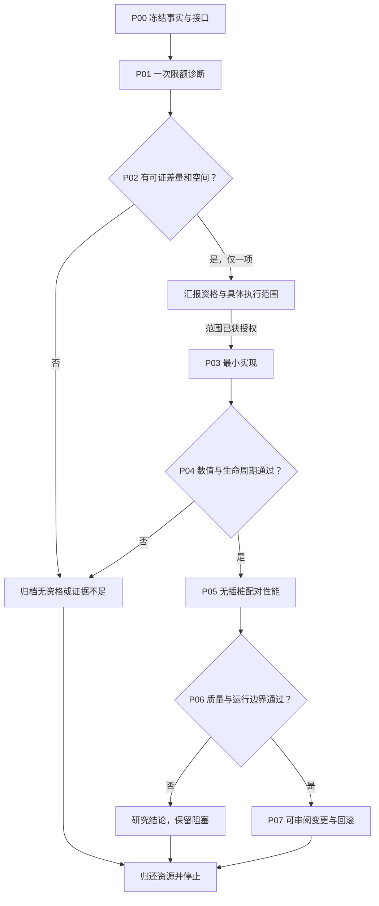

# 09 · 自主执行、并行与停止

## Phase串行，Task有条件并行

同Phase证据分析、不同源文件的静态审查、离线脚本测试可以并行。共享native入口、同一配置、same scratch ownership或同一GPU的任务串行。集成者拥有最终配置与SHA冻结权，其他agent不得悄悄切基线。

每Task写最小回执：输入身份、改动、最小验证、边界、失败、输出路径。阶段收口按实质变更安排独立检查，并复用仍有效的证据；以下是职责，不要求每个文档阶段固定派两人：

| 角色 | 检查 | 不做 |
|---|---|---|
| Reviewer | 新旧差量、数值/资源合同、统计归因、漏分支、scope | 不给自己写的候选自评代替独立review |
| Validator | 原件完整性、输入hash、最小必要测试和门计算、失败保留 | 不默认重新全跑所有历史实验 |

若两角色可独立并行且不占GPU则并行；GPU验证按锁串行。review发现设计错误先修文档/代码，再执行必要最小验证，不开新候选绕过失败。

## 状态

`PLAN_ONLY → EVIDENCE_LOCKED → DIAGNOSTIC_COMPLETE → ONE_CANDIDATE_QUALIFIED → IMPLEMENTED_OFF_VALIDATED → NUMERIC_LIFECYCLE_SUPPORTED → PERFORMANCE_GATE_ONLY → QUALITY_AND_BOUNDARY_SUPPORTED → READY_FOR_HUMAN_REVIEW`。

各边都需要证据文件，不能靠改STATE.json晋级。没有目标机证据不能越过DIAGNOSTIC；离线test通过只能记PACKAGE_TOOL_VALIDATED。

任何阶段可结束为NO_QUALIFIED_CANDIDATE、NOT_APPLICABLE、NO_GAIN、REJECTED_NUMERICS、REJECTED_PERFORMANCE、INSUFFICIENT、BLOCKED_RESOURCE/EVIDENCE/QUALITY。阻塞不算完成，失败不删。READY_FOR_HUMAN_REVIEW也不自动部署。

## 防止无限探索

一个campaign最多一个候选；P01一次限定预算；每个候选一个冻结正式批次。成功不自动增加任务，失败不自动放宽门。可提出后续问题并把缺证据写清，但不能在用户要求的范围外自动继续下一轮。

沿用已有用户授权，不制造每Task的确认弹窗。需要用户决定的只有实际改变范围、生产状态/系统环境、质量换速度等未获授权事项；先完成可离线交付的设计与变更清单，再提出具体决策。
