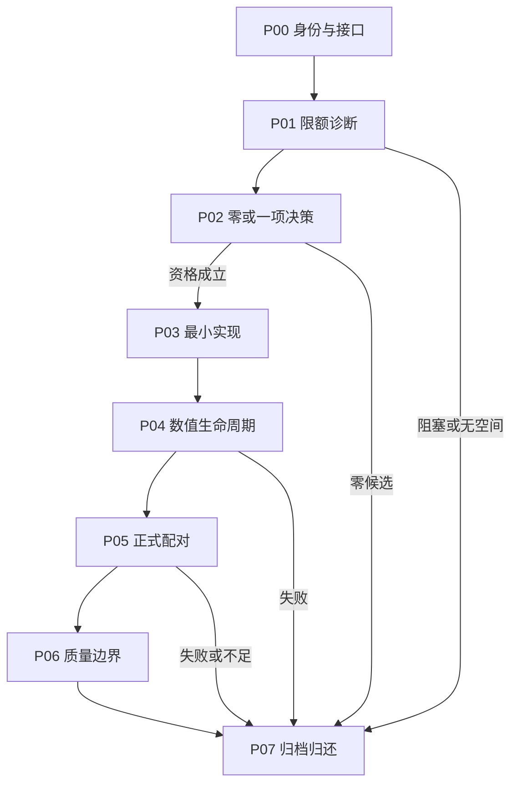

# Phase与Task执行总表

> 本文 P00–P07 均指 `frontier/P00`–`frontier/P07`，与历史 P0–P24 不同。当前阶段和授权范围由父目录 `plans/NEXT_ACTIONS.md` 确定。

原作者设计的P00–P07初始为计划；实际状态以父目录行动计划和原件为准。P01B是用户后续单独授权的新诊断合同，不改原32-task机器DAG，也不自动接入P02成功路径。

2026-10-31的[F03 CPU审计](F03_CPU_AUDIT.md)已以NO_QUALIFIED_CANDIDATE关闭，无GPU追加，不进入上述成功路径。

随后[Astra独立复核](../reports/ASTRA_REASSESSMENT_20261031.md)未支持F02继续投入，root采纳，本轮零候选文档收口已完成。取消原拟四小时F02审计；下表与DAG保留条件成功路径，不表示任何未执行Phase通过或授权启动。P05 BLOCKED_EVIDENCE及原六FAIL保持。

Phase串行，Task依赖明确；每Phase的T4是独立review/test门。P01或后续任一阶段终止时，可以直接完成P07的资源归还/报告收口动作；这不算绕过P03–P06获得成功。机器DAG列出成功路径，终止边见下图。

| Phase | 目标 | Task数 | 进入条件 |
|---|---|---:|---|
| [P00](P00_EVIDENCE.md) | 证据、基线与最小适配准备 | 4 | 冻结材料 |
| [P01](P01_DIAGNOSTIC.md) | 一次限额暖态长会话诊断 | 4 | P00 gate或已明示终止收口 |
| [P01B](P01B_DIAGNOSTIC.md) | 自然EOS、完整host窗口与原始IDs | 独立合同 | 用户2026-10-31明确授权；现已COMPLETE/资格INSUFFICIENT关闭 |
| [P02](P02_SELECT.md) | 唯一候选的资格决策 | 4 | P01 gate或已明示终止收口 |
| [P03](P03_IMPLEMENT.md) | 最小native实现与关闭路径 | 4 | P02 gate或已明示终止收口 |
| [P04](P04_NUMERICS.md) | 匹配数值、生命周期与成本 | 4 | P03 gate或已明示终止收口 |
| [P05](P05_PERFORMANCE.md) | 正式无插桩完整请求配对 | 4 | P04 gate或已明示终止收口 |
| [P06](P06_QUALITY.md) | 绝对质量、非劣与运行边界 | 4 | P05 gate或已明示终止收口 |
| [P07](P07_HANDOFF.md) | 报告、回滚与资源归还 | 4 | P06 gate或已明示终止收口 |

终止收口不代表后续未执行Phase通过。全程无自动部署。
