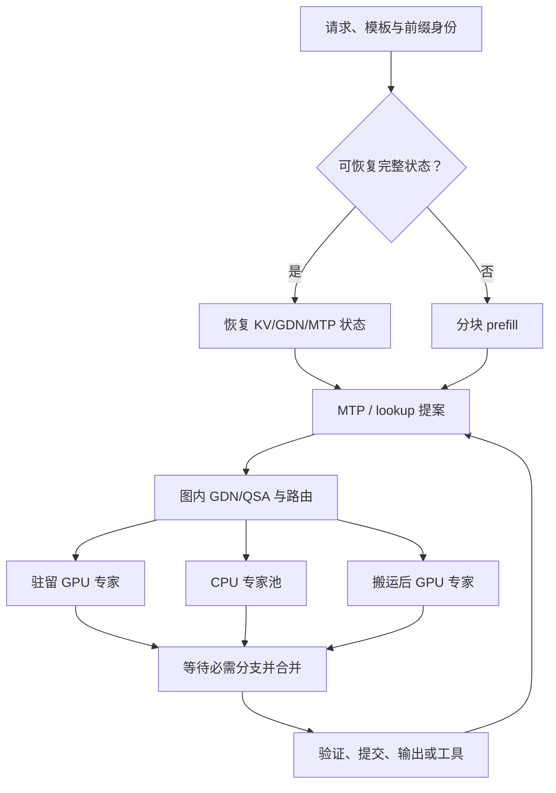
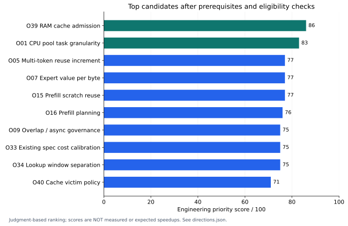
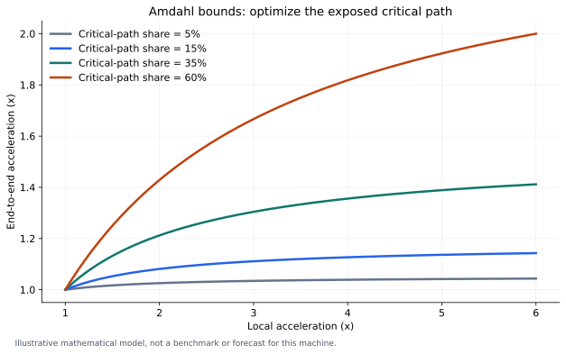

# Flash-Next / RTX4090 / Strata：极限软件优化研究汇报

日期：2026-10-25。最终基线：上游main **4b9e05a2a806a3fe24f7b2560d98626c37dade35 / v0.2.6**。研究类型：源码审计、附件证据复核、跨引擎机制对照、实施计划与工具验证。没有连接用户主机，没有新GPU加速结果。

## 一、主要判断

最值得继续投入的主线，是把Strata已有的异构MoE路径做成适合这台机器的执行方案：**CPU专家pool的两阶段屏障和中间量化、按成本选择专家驻留/执行位置、长会话切换的RAM准入，以及prefill scratch与spec窗口的资源协调。** 4090算子优化有价值，但必须沿实际关键路径找热点。GPU利用率高可能包括等待CPU的自旋；kernel吞吐提高不会自动变成用户任务提速。[源码审计](docs/08_KERNEL_SOURCE_AUDIT.md)

本次交付将主要理论空间划为64方向，并给出13份任务计划。优先分衡量潜力、硬件匹配、证据、实施工作与风险；它不是预测速度。所有收益需要目标机验证。研究边界包括算法、数值、kernel、运行时、内存、服务与工具链；不能证明未来不存在新的优化算法。

## 二、机器事实决定优化方向

| 项目 | 附件最后已知值 | 对优化的影响 |
|---|---|---|
| GPU | RTX4090 24GB，sm89 | 适用Ada/cp.async；不具Hopper TMA/WGMMA或Blackwell NVFP4硬件 |
| CPU | Silver4216，16C/32T | 有AVX512-VNNI，无VBMI/AMX；不能直接打开主线整套IQ512路径 |
| RAM | 2×32GB DDR4，读带宽约36GB/s | 专家读取与host KV/快照拷贝争同一DDR；线程越多未必越快 |
| 模型 | Flash-Next GSQ-RCO IQ3_XXS | 包名不是tensor类型；需要逐层布局manifest |
| 实际CPU专家 | 偶层IQ2_XS GU/IQ4_NL down；奇层IQ2_XXS GU/Q2_0 down | donor kernel必须覆盖真实格式、shape和nt |
| 服务 | spec4；spec-min-p0.5；KV int8；总ctx131072 | 0.5是草稿阈值；固定context上限不代表实际填充长度相同 |
| cache | 6144MiB总预算、4slot | 不是4×6144MiB，也不是4路同时decode |
| 生产 | v0.2.3 A0+EXACT6、performance+C6 off | 已做成果作为历史参考，不重新计为本轮收益 |

硬件与历史配置来源：[最新部署报告](history/reports/DEPLOY-A0-EXACT6-20261025.md)、[NP0](history/reports/P0-T7-NP0-20261025.md)、[环境/进度表](docs/01_MACHINE_AND_PROGRESS.md)。当前SSD、PCIe negotiated速率、实际KV驻留与资源余量仍需P00复核。

Flash-Next的主路径混合GDN与QSA，不是普通dense attention。源码默认几何为48层、36层GDN与12层QSA；QSA使用选择性历史cell。按默认int8布局，131072 token下主QSA K/V约1.547GiB，另加index、draft、GDN、图和scratch；这是源码理论计算，不是实测分配。因此不能拿dense27B的庞大KV或全attention加速比直接推导本机优先级。[推导与源码](docs/08_KERNEL_SOURCE_AUDIT.md)

## 三、瓶颈从哪里产生

CPU pool已经是持久线程池，也已经合并同expert多token。仍存在GU全局阶段→主线程中间量化→down全局阶段，以及每个阶段前后的park屏障。下一步应改任务粒度、并行中间量化和合法的expert局部流水，不能把16线程简单改8再试一次。GPU与CPU之间的门铃、fence、epoch与最后读者承担正确性，不能只因为等待耗时就删除。[P01设计](plans/P01_CPU_POOL.md)

缓存是另一类瓶颈。glibc释放对象不保证MemAvailable立即增加；旧准入可能逐出多个snapshot仍拒绝parking，下一次切回要重prefill。PR2253的机制与本机相关，但最新guarded donor保护使其不能机械移植；可逐出字节计算也要排除guarded entry，且capture后仍守住RAM floor。[P02设计](plans/P02_CACHE_ADMISSION.md)

## 四、优先推进的十项

| 顺序 | 方向 | 分数 | 收益落点 | 首个验证问题 |
|---:|---|---:|---|---|
| 1 | O39 RAM准入/释放/无望逐出 | 86 | 多会话恢复与尾延迟 | latest是否仍出现heap保留导致的park拒绝？ |
| 2 | O01 CPU pool任务粒度 | 83 | steady decode与spec verify | 屏障/dispatch/serial quant占多少未隐藏关键路径？ |
| 3 | O05 多token解包与ActQ增量复用 | 77 | CPU专家吞吐 | 已有multi路径之外还重复了哪些字节/计算？ |
| 4 | O07 时间收益/字节的expert驻留 | 77 | 减少昂贵CPU miss | cache hit增加是否真的减少总window？ |
| 5 | O15 prefill group scratch/区域复用 | 77 | cold-prefill与显存资源 | 实际走MMQ吗；缩buffer是否改变stream-K归约？ |
| 6 | O16 prefill chunk/CPU share规划 | 76 | 冷长输入与短追加 | 大chunk省搬运是否挤掉decode热专家？ |
| 7 | O09 adaptive overlap/async治理 | 75 | 驻留收敛与带宽竞争 | 现overlap与新async哪种对4216总wall更优？ |
| 8 | O33 已有成本spec策略校准 | 75 | 真实Java任务/长ctx | 是否已启用有效路径；细分miss成本是否有增量？ |
| 9 | O34 lookup长窗与MTP深度分离 | 75 | 复制/编辑代码 | 实际Pi流量是否足够重复；额外图是否挤出专家？ |
| 10 | O40 slot/byte淘汰价值 | 71 | 长主会话+短helper | smallest victim与压力容量学习分别贡献多少？ |

同分不表示同收益；缓存修复与decode是不同目标。完整64方向、6前置、评分维度、首个探针和停止条件见[方向图谱](docs/05_DIRECTIONS_ATLAS.md)与[机器可读catalog](config/directions.json)。4216专用VNNI放在真实bench和pool归因之后；不因“AVX512更宽”就默认更快。

## 五、从其它推理引擎吸收什么

| 来源 | 可研究机制 | 本机不能直接搬用的部分 |
|---|---|---|
| tqLLM | Flash-Next CPU miss任务组织、专家cache、prefill计划、active KV | 自有TQ3/TQ4格式不等于GSQ-RCO |
| ExLlamaV3 / llama.cpp | CPU亲和性与handoff、量化点积、attention向量路径 | EXL3/QTIP与本模型native布局、已有ISA前提 |
| KTransformers / Fiddler / HybriMoE / DALI / ScheInfer | 异构成本调度、workload感知cache、预取 | AMX平台、旧Mixtral专家数、指数枚举、作者硬件提速比 |
| HyperQwen / NInfer-4090 | tiny-query attention、int8 KV、draft head、ReplaySSM | dense27B checkpoint、draft权重和KV格式 |
| Kern | kernel合同、编译/运行manifest、paged/per-sequence状态池 | 其它架构cubin、模型/runtime整套替换 |
| FLARE / Mirage MPK | 完整状态生命周期、轮成本、局部persistent区域 | 面向其他卡的执行栈、整模型megakernel重写 |
| FlashAttention / FlashInfer / SGLang | Ada可用tiling、online-softmax合并、层级cache、状态重放 | FA3/4的硬件前提、FlashInfer新版本CUDA要求、稀疏QSA差异 |
| EAGLE-4 | 成本校准、候选head/tree设计参照 | source-available许可限制；不能当普通开源代码直接copy |

通用服务栈另见[vLLM / TensorRT-LLM / LMDeploy / MLC对照](docs/11_GENERAL_ENGINES_AND_EXCLUSIONS.md)。

每项有固定SHA、文件/函数、适用条件与退出规则，见[donor研究](docs/07_DONOR_RESEARCH.md)。DALI/ScheInfer本轮只有可确认官方论文来源，没有编造官方代码路径。许可明确不等于模型权重许可相同，实质copy前检查文件头与third-party notice。

## 六、GPU kernel路线仍然深入，但按已存在实现推进

Strata已有load8_q8就地解量化、CHUNK64分块/merge、可选int8 TensorCore split、FP32 GDN_CHUNKED、按T图和成本DraftPolicy。先测现有开关资格与实际命中，再开发：选中页交集复用、segment/query tile、GDN状态/投影融合、真实IQ专家局部融合、目标head精确归约、host metadata前移、局部persistent区域与sm89寄存器/SMEM调参。[已有能力表](docs/10_EXISTING_VS_NEW.md)

PR4039不是简单缩数组：改变MMQ n/max_rows可能改变stream-K拆分和舍入；原PR指针origin写法也要审查C++对象边界。P05专门给出owner/last-reader表、forced cap=T与极端路由测试，先数值后性能。[P05](plans/P05_CUDA_PREFILL.md)

Kern的pool统一paged/per-sequence状态的物理chunk预算，并不包办expert权重、CUDA graph或通用scratch；跨这些类别的预算器是本包另行提出的改造。其启发主要是让每个优化拥有明确的输入布局、状态读写集合、scratch与生命周期合同，以及数值校验和运行manifest。对本机而言，这比更换runtime语言更直接。局部persistent方案只有当GPU内部launch/依赖占明显份额时才值得；真实CPU专家算得慢时，用常驻GPU核等待并不会增加CPU带宽。

## 七、理论收益如何判断

采用Amdahl关键路径模型，不把重叠phase相加：`S=1/((1-f)+f/s)`。只有占5%的kernel即使2倍快，整体也约1.026倍；占35%的路径局部1.5倍，整体约1.132倍。这是数学条件例，不是本机预测。

历史18.5ms窗、约6.2ms CPU miss、粗估20GB/s若同口径且6.2ms全为未隐藏带宽瓶颈、能到36GB/s、其它驻留与提交token不变，才得到约15.74ms窗（1.175倍）。现实有同步、解包和竞争，不能把它当17.5%承诺。[完整模型](docs/04_BOTTLENECK_MODEL.md)

spec目标是总提交target token（含bonus/correction）除总round wall。接受率高但draft更贵、T增大挤专家、CPU nt恶化，都可能更慢。缓存收益则是避免重prefill减去park/restore/trim/竞争成本，不能与decode比例简单相加。

## 八、保留已做结果，避免浪费

附件已报告P→A0 MIG通过、EXACT6约5.3%window改善、host tuning短decode约2.2%中位改善；这些是历史报告口径，无原始数据不能重算CI。POOL8更差；IL0/IL89/Ada表、learned-profile稳态、旧LOOKUP2生成题没得到可靠收益。旧Q2_0微基准调用路径不一致，先修测量。PR2964因overlap冲突及低PCIe share暂不适用，不是VBMI问题。[附件审计](docs/09_ATTACHMENT_AUDIT.md)

## 九、激进研究单独管理

低比特/非对称KV、exact近期cell、替代权重量化、per-expert精度、少专家/延期专家、activation sparsity、额外QSA裁剪、上下文压缩和gpu-unlock-ada均有研究卡。明确区分E（实现等价）、N（数值变化）、Q（模型/请求语义变化）、X（系统/驱动实验）。它们不能靠同一个“质量没明显变差”自动成为默认方案。

gpu-unlock-ada的FP16/BF16→FP32 Tensor issue微基准提升不等于IQ/CPU受限Flash-Next翻倍；用户driver版本也不同。先profile相关Tensor指令实际份额，若不在关键路径，理论上限已低，应停止。zapabob fork的研究文档与资格JSON存在PENDING/BLOCKED及自我撤回旧placeholder资格，作为研究素材，不视作已验证4090替代品。[P10](plans/P10_RESEARCH_BRANCHES.md)

## 十、交给AI后的完成标准

P00先锁真实输入/路径/统计，P01–P11按测量资格展开，P12做留出与组合。交付工具已修严格JSON类型、HTTP绝对deadline/idle、reasoning/visible/tool计时、任意pair、计划缺项、生命周期/外来GPU身份审计；独立quality_gate实现保守paired非劣。所有本地测试与未覆盖项见[VALIDATION](VALIDATION.md)。

正式任务适配器、park/restore live adapter、窗口trace、restricted-time性能分析和新引擎kernel仍是明确实施任务；不会把文档拟新增接口伪装成现成一键优化。每项都要求源代码与binary hash、原始结果、失败记录、资源账、数值/任务/性能证据和回滚。包的目标是让AI能继续执行、测试和推翻假设，而不是提前宣布机器潜能已被榨干。
