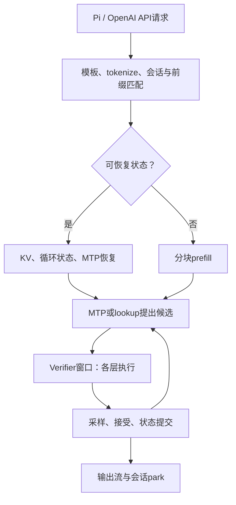
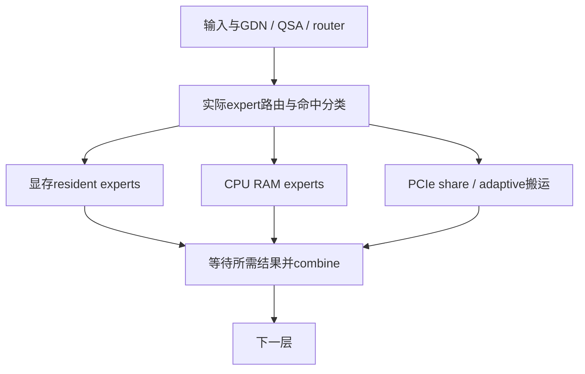

# Flash-Next真实执行链与改造位置

## 1. 一层的异构执行

正确性依赖意味着不能随便把CPU结果拖到下一层再加；那会改变网络计算。跨层预测只用于预取权重、且最终仍使用真实router结果时可以保持算法语义。专家延后PR2690属于Q轨道。

## 2. 源码地图

| 子系统 | 现有位置 | 主要检查 |
|---|---|---|
| 服务/请求 | `serve/server.py`、`src/program/generate.cpp` | 实际配置、缓存状态、取消、输出时间 |
| verify | `src/core/verify.cpp`、`include/strata/core/verify.hpp` | graph、CPU/GPU依赖、接受后提交 |
| CPU pool | `src/kernels/cpu/pool.cpp`、`include/strata/kernels/cpu/pool.hpp` | GU→量化→down、全局barrier、任务粒度 |
| CPU dtype | `native_expert.cpp`、`expert_layout.cpp`、`iq_avx2*`、`iq_avx512.cpp` | 实际dispatch、ActQ、nt和ISA |
| expert驻留 | `src/core/expert_cache.cpp`、generate内adaptive路径 | 热度、搬运、slot生存期 |
| prefill | `src/prefill/prefill.cpp`、`src/prefill/kernels.cu` | chunk、scratch借用、MMQ组、GDN chunk |
| speculative | `src/spec/draft_policy.cpp`、`src/core/mtp.cpp` | T、接受率、verify成本、draft状态 |
| RAM缓存 | `include/strata/core/conversation_cache.hpp`、`src/core/conversation_memory.cpp` | slots/bytes/物理RAM门、guarded donor |
| 快照 | `src/core/conversation_snapshot.cpp`、`src/core/conversation_state.cpp` | KV、循环状态、位置、draft一致性 |
| GPU kernel | `src/kernels/cuda/` | MMVQ/MMQ、QSA、GDN、sampler与同步 |

当前FlashNext路径不是`qwen35/q36_engine`，也不是`src/dsv41`。读其他family的优化时先确认数学、布局、量化和调用者都可映射。

## 3. 已有profile说明什么

附件DIAG记载约18.52ms/窗口，verify约90%，CPU专家约6.6ms、draft约1.61ms，等GPU约9.39ms。NP0回归指出CPU miss对CPU阶段/窗口有强相关；nsys的kernel时间中wait_flag自旋约17.5%。

这些计时有嵌套/并行关系，**不能把所有百分比叠成资源利用率饼图**。GPU处于kernel执行状态也可能只是在等待CPU。必须保留CPU wall、CUDA event、kernel累计时间和最终window wall四种语义。

本机未有ncu的完整带宽/occupancy证据，不把“GPU利用率高”解释成Tensor Core饱和。

主要源码：[src/core/verify.cpp](https://github.com/Niko1221/Strata/blob/41cf05a06a25dd29103b7b27a2279a3f60c21876/src/core/verify.cpp)、[src/kernels/cpu/pool.cpp](https://github.com/Niko1221/Strata/blob/41cf05a06a25dd29103b7b27a2279a3f60c21876/src/kernels/cpu/pool.cpp)、[src/prefill/prefill.cpp](https://github.com/Niko1221/Strata/blob/41cf05a06a25dd29103b7b27a2279a3f60c21876/src/prefill/prefill.cpp)。
