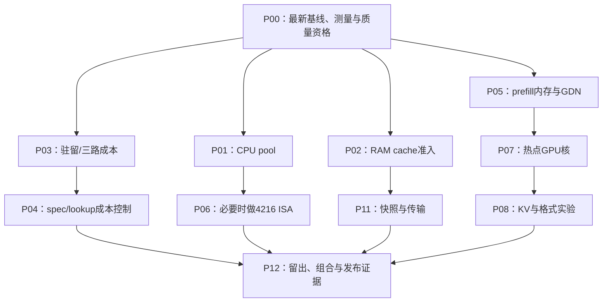

# 综合排序、依赖与推进顺序

## 1. 排名的解释

排序是以当前机器、历史负结果与源码为条件的工程判断。先完成F01–F06；否则最快的优化也可能建立在错误测量上。不同目标不混排：CPU pool改善稳定decode，park修复改善多会话尾延迟，prefill改善冷请求，KV压缩改变容量/精度。

## 2. 当前优先进入实验的方向

| 顺序 | ID | 方向 | 优先分 | 必须先确认 |
|---|---|---|---:|---|
| 1 | O39 | RAM准入释放与无效逐出修复 | 86 | 复现实际park/refuse；latest guarded donor/pinned保护；post-capture floor；trim延迟。 |
| 2 | O01 | CPU pool按expert/行块自适应切分 | 83 | 真实IQ2_XS/IQ4_NL与IQ2_XXS/Q2_0；miss0/1/2/多，nt1..8；测dispatch/barrier/compute及window。 |
| 3 | O05 | 多token共享权重解包与ActQ复用 | 77 | 使用实测每expert nt分布，统计重复字节、grouping开销和accepted/window。 |
| 4 | O07 | 按节省关键路径时间/字节选GPU专家 | 77 | 同路由trace离线模拟再A/B，报告CPUstall/bytes moved/hit和每层分配。 |
| 5 | O15 | prefill单group scratch与区域复用 | 77 | 极端路由偏斜、尾组、FP16fallback拒绝、最大ctx；记录恢复decode热集成本。 |
| 6 | O16 | prefill chunk/CPU-share/stream联合规划 | 76 | 短agent新增token与冷8/32/64/122K分组；测完整轮而非只prefill。 |
| 7 | O09 | adaptive tier与overlap/async成本治理 | 75 | 保持当前overlap基线；分离blocking/async/overlap单因素，记录effective资格与64窗状态。 |
| 8 | O33 | 已有成本spec策略的本机校准与细化 | 75 | 真实Pi sampled/thinking、长context；决策开销、振荡、T切换state与graph。 |
| 9 | O34 | lookup长窗与MTP深度分离 | 75 | PR相同GSQ-RCO IQ3_XXS但2060Super数据仅参考；在4090测extra graph挤出专家和longctx。 |
| 10 | O40 | slots/bytes价值与压力淘汰策略 | 71 | 长主会话+短子任务burst、等长冲突、guarded/pinned、RAM恢复；策略2x2消融。 |

## 3. 分阶段依赖

P09服务层与P10研究分支可在证据成熟后独立推进；GPU实验仍串行。先导实验结果可改变后续顺序，必须把改变原因写入决策日志。

## 4. 先不做的事

- 重跑已证明无益的IL表、POOL8、learned-profile稳态和错误Q2_0 micro。
- 把多卡PR4010/4002的全部收益推给单卡；只提取真正适用的机制。
- 把新DeepSeek引擎优化或少专家默认当FlashNext功能。
- 直接替换为Kern/FLARE/MPK；先移植可验证的局部合同/算子。
- 直接照搬NVFP4、TMA、WGMMA、tcgen05、AMX或VBMI路径。
- 用压缩prompt、更短输出、未运行质量测试换取“同等效果更快”的数字。

## 5. 预算停止规则

每个先导实验预先选一个主要瓶颈指标和一组端到端指标。两次独立复测都在A/A噪声内、或最大Amdahl收益已低于采用门槛，即NO_GAIN。研究分支若需要新模型训练/额外硬件/大量权重转换，保留设计与成本，不在主线默默扩张。
