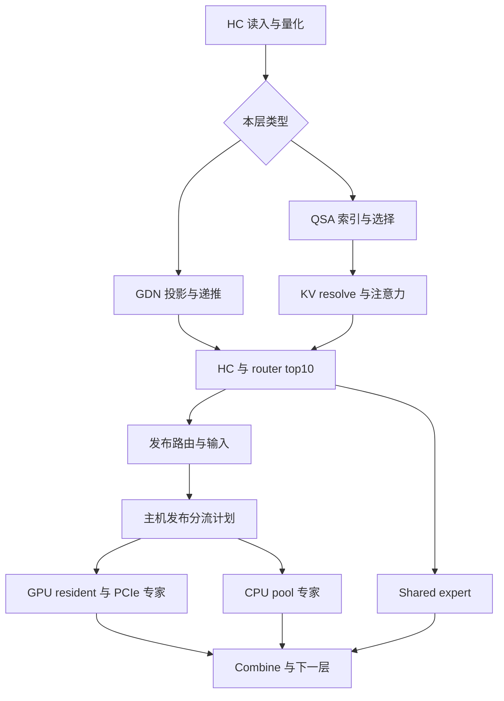

# Strata FlashNext 主路径与低层性能审计

审计对象：`Niko1221/Strata`，固定源码 SHA `41cf05a06a25dd29103b7b27a2279a3f60c21876`。本报告是静态源码审计和实施设计，没有在目标机器编译、执行 CUDA 或测得加速比。下文所有预计收益均须通过目标机器测试判定。

生产对照：用户已完成的 v0.2.3 `5c8dd322528cc84f68f461ad54a506b9da8fa8d4` 加 EXACT6 配置。硬件及配置以会话附件校正为准：RTX 4090 24 GB、Xeon Silver 4216 16 核 / 32 线程、64 GB DDR4（2×32 GB，附件实测约 36 GB/s）、Debian 12、驱动 610.57.04 / CUDA 12.3；模型为 **Qwen3.8-Flash-Next GSQ-RCO IQ3_XXS**，KV int8、上下文上限 131072、spec 4、spec-min-p 0.5、conversation cache 6144 MiB / 4 slots。`slots=4` 指会话停车缓存时，不等于运行时 `--batch 4`。

本文不把已失败的 Ada 默认表、IL0 / IL89、POOL8 / PROFILE 作为新路线；MTP Q4 head 已知只有边缘收益，保留为既有结果。EXACT6 的实际开关及对应路径须与最新版逐函数比对，不因上游版本号更大而丢失。

最终执行基线为4b9e05a2/v0.2.6；本文固定实现锚保留41cf，核心同blob核对见[sources/FRESHNESS_DELTA](../sources/FRESHNESS_DELTA.md)。

## 1. 最重要的架构结论

1. **FlashNext 已有整窗 CUDA Graph、GPU / CPU 专家并行、按专家合并多 token、量化激活复用、GPU resident cache、PCIe miss 与 CPU miss 分流。**“加 graph”“加专家批处理”“将 CPU 和 GPU 重叠”均不是从零缺失的功能。增量必须落到现有图内依赖、任务调度、缓存替换和数据传输的具体开销。[S2][S3][S4]
2. **NP-3 最明确的代码入口是 CPU pool 的两阶段全局屏障。**`run_split_multi_native` 执行 GU phase 5 → 主线程串行中间激活量化 → down phase 6；每个 `run_phase` 都要求工作线程在阶段开始前和结束后 parked。改造空间是并行量化、按成本分任务、减少安全协议允许的 re-park、专家局部完成驱动流水，而不只是把线程数改成 8。[S5]
3. **4216 的 AVX-512 VNNI 不等于当前 IQ512 路径可用。**`cpu_avx512_ok` 还要求 VBMI；IQ512 编译单元还启用了 VPOPCNTDQ，新 `iq512x_supported` 也检查它。不能单独删运行时门槛。必须独立实现只用 Cascade Lake 所有指令的编译单元，再单独 dispatch。AVX512_VNNI 也不等于 AVX-VNNI。[S6][S7][S8]
4. **“最新版”不是全面替换了 FlashNext GPU kernel。**本地完整 diff `5c8dd322..41cf05a` 在 `src/core`、`src/kernels/cpu`、`src/kernels/cuda`、`src/prefill`、`src/program` 及相关头文件中共 17 个文件、1407 增 / 100 删；`src/kernels/cuda`、`src/prefill`、`pool.cpp` 均无变更。主要是 CPU IQ/TQ 路径、激活统计研究接口、异步 adaptive tier 自动选择。DeepSeek 新核和新接口不能默认算作 FlashNext 当前收益。
5. **QSA 是选择性注意力，GDN 是循环状态。**几何默认是 48 层，其中 36 层 GDN、12 层 QSA，QSA 以 4-token page 聚合索引，从历史选择约 2048 个 cell 加尾部，并非每层对 128K 做完整 dense attention。普通全注意力 KV 计算器和 FlashAttention “全上下文平方复杂度”推断不能直接套用。[S1][S11]
6. **两种 GDN chunk 开关必须区分。**`STRATA_GDN_CHUNK` 对应独立 Volta 实验实现；`STRATA_GDN_CHUNKED` 已有 CUDA FP32、32-token chunk 实现，要求 sm80+、足够 shared memory、默认至少 128 SM，T≥128；4090 是可检查实际可用性的候选。后者改变 FP32 求和顺序，必须验证长上下文状态误差。[S13][S14]
7. **#2253 是缓存留存与切换延迟路线。**当前主线在物理 RAM admission 中依赖释放旧 snapshot 后 MemAvailable 马上增长；glibc 不保证这一点。PR 用 `malloc_trim(0)` 后重读。它可能减少误丢会话及因此发生的重 prefill；不能宣称提高已驻留对话的稳态 decode tok/s。[S20][S21][P1]
8. **#2253 不能机械 cherry-pick 后即称完成。**审计时该 PR open / unmerged，head `3ee9597a55815384e6732b78f5c788506b804227`；其可驱逐字节计算只排除 pinned，最新 main 还保护 `guarded_` borrowed donor。rebase 必须统一“可驱逐”的定义，否则高估可回收 RAM。[S19][P1]
9. **现有 profile 会改变执行图。**`STRATA_VERIFY_PROFILE` 不仅增加打点，还使部分 branch、shared fork、fused conv/AB 路径关闭。它适合找方向，不适合给最终生产速度盖章。以关闭 profile 的墙钟与有效输出 token 为主判据。[S2]
10. **许多优化改变输出，即使模型文件没变。**CPU / GPU 算术、单 token / 多 token IQ、prefill fused 路径、GDN chunk、adaptive placement、tail skip 都可能改变舍入或算法。需把“同路径按位等价”“限定数值误差”“任务质量允许变化”分成三个明确验收档位；不能把完成 speculative verify 当成全链路 bit-exact 保证。[S2][S4][S7][S12][S13]

## 2. 真实调用链与状态所有权

### 2.1 主 decode / verify

`src/program/generate.cpp` 的 FlashNext serving 路径建立 `Drive`、`ExpertPoolDispatch`、`Verifier`、`MtpDrafter`、expert cache 与 adaptive tier。`--family qwen35moe` 等有其他引擎分支；不能从 `src/qwen35/q36_engine.cu` 推断本模型主路径。[S3]

`Verifier::run` 按实际 T（1–8）选择 / 首次捕获图，`stage_inputs` 写 mapped host token、位置与门铃序号，然后 launch。`record_window` 每层按下列依赖组织工作：[S2]

GPU resident plan、PCIe copy ready、CPU complete 对应不同标志与发布时序。`expert_pool_dispatch_multi` 先发布 GPU / PCIe 分流计划，再做 CPU 输入量化和 CPU 工作；因此 CPU 工作的一个阶段耗时不是整个 verify 窗口的可直接相加项。`Verifier::run` 的 doorbell、fence、`sfence`、stream 同步共同承担跨 CPU / GPU 可见性，禁止仅凭“同步慢”删除。[S2][S4]

GPU 专家当前调用 `native_expert_grouped`（实现位于 `src/kernels/cuda/iq_kernels.cu`，不是一个名为 `native_expert.cu` 的 CUDA 文件），CPU 专家调用 `native_gu_rows` / `native_down_rows`。同一专家命中的多 token 合为一组，减少重复权重解码和读取；这使实际分布 `n_unique_cpu_experts`、每组 `nt` 比仅记录 spec 配置更有用。[S4][S7][S9]

`Verifier::commit` 只提交接受前缀，GDN 对接受的输入重放 / 更新、QSA index tail 复原并重新附加；被拒绝位置的 KV 之后覆盖。精确性测试必须包含接受 0、部分、全部及 page 边界，不能只有全接受短文本。[S2]

### 2.2 MTP、suffix lookup 与窗口宽度

MTP 不是 CPU 上的独立小模型：`MtpDrafter::record_front / record_rest` 用独立图处理 draft 层和 native head；`capture_round`、`capture_step`、`draft`、`prepare_chain / chain_launch` 支持不同调用方式。`--spec-min-p` 可以提前截断草稿。suffix drafter 与 lookup chain 还能影响实际 verify T，因此 `--spec 4` 不能替代实际 T 直方图。[S15][S16]

`DraftPolicy` 已经有上下文桶、EWMA 成本、异常样本限制、宽度探测、lookup match 桶、概率接受经验与单位时间产出决策。剩余路线应是让成本模型看到 CPU miss、PCIe、GDN/QSA 长上下文等特征，而不是重复实现“动态 spec”。`record_forward` / draft head subset / Q4 head / 多 block argmax 等已有实现，同理必须增量审计。[S15][S16][S29]

### 2.3 Prefill

`Prefill::run_impl` 以 prompt chunk 处理，dense 投影、GDN recurrence、QSA 索引与选取、分组 MoE 组成主路径；scratch carve / relayout、专家 VRAM 借用、MMQ 的表或直接指针等已有安排。短 decode 的 native MMVQ tile 选择不等于长 prefill MMQ 的优化空间。[S12]

`moe_fused_iq.cu::native_supported` 对当前 CUDA 默认只覆盖特定 sm120 / 80+ SM 与量化组合；Ada 可走现有 opt-in，但不能说最新主线已经为 4090 默认打开。GSQ-RCO IQ3_XXS 包中各层、GU / down 可能有不同实际类型，应先输出模型 tensor / native format manifest，再用真实形状测试。[S12][S17]

### 2.4 KV 分层与 128K 预算

`kv_plan` 区分 mode 0 全驻留、mode 1 host-backed streaming、mode 2 draft ring。streaming 的 pinned mapped host KV 是权威副本，GPU 保存 page cache；每 page 4 个 cell，选择集在一个 epoch 内不得被 eviction。`kv_stream_resolve` 执行 page 去重、标记、CLOCK 选受害页及搬运；不是通用磁盘 KV offload。[S10]

按默认 QSA 几何且全 int8 K/V 计算，每 QSA 层每 token：`2 KV heads × 256 dim × 2(K,V) × (1 byte + 2-byte scale/64) = 1056 bytes`；12 层在 131072 token 时约 **1.547 GiB** 主 K/V。还需单列 FP32 pooled index（约 192 MiB 量级）、尾部、page 元数据、draft KV、GDN 状态、checkpoint、图 scratch 及 allocator 余量。这个数字是按源码布局的理论值，必须用实际 shape / KV format 与分配日志复核，不能把它当全部运行内存。[S1][S10][S11]

VMM 增长与 host streaming 是不同模式，前者保留稳定虚拟地址让图继续复用，主线对模型加载 / 单 GPU 等有适用限制。不要将同时打开二者作为无条件组合。对当前 128K 上限，要先判断实际是否需要 streaming；若全驻留已占很小比例，额外页管理成本可能完全没有价值。[S10]

## 3. 已有功能、平台边界与诊断陷阱

| 领域 | 主线已经有 | 本机上需特别注意 |
|---|---|---|
| Graph | 每 T verify 图、commit 图、MTP round / step 图 | 关注首次 capture、地址 / scratch 生命周期；不再提“从 eager 改 graph” |
| CPU pool | 常驻 worker、spin / sleep、host working、分行、按专家多 token、NUMA 分片 | 仍有阶段前后 parked 屏障；POOL8 无收益并不能否定 NP-3 |
| CPU IQ | AVX2 multi、EXACT1 条件、IQ512 与新 exact wrapper | 4216 缺 VBMI / VPOPCNTDQ；AVX2 与 AVX512_VNNI 资格分开 |
| GPU MMVQ | 多 token、interleave、按形状 tile 表、shared / resident / miss 分流 | Ada 表与 IL 既有失败结果归档；必须出现新瓶颈证据才重开 |
| QSA | 精确 top-k、分块 attention、int8 / hybrid KV、page cache | sm90 cluster 不适用；sm75 split 可以 opt-in 测现有 CUDA 实现 |
| Prefill GDN | key-head 聚合 / cp.async、FP32 CUDA chunked | `CHUNKED` 与 Volta `CHUNK`、AMD WMMA 路径不同 |
| Prefill MoE | MMQ、row scatter / table、fused IQ opt-in | 实际 GU / down 类型决定覆盖，不能按包名假定全层命中 |
| Speculation | MTP、suffix lookup、在线宽度 / 来源策略 | 以 ms / 有效输出 token 为目标，接受率单独上升不保证更快 |
| Conversation cache | 分段 buffer、只复用不变完整页、尾页重拷、pinned / donor guard | 缺 glibc trim 驱动的 admission；不能把“差分 snapshot”说成全新 |
| Ada 限制 | dp4a / 原生量化、普通 CUDA stream / event、sm80+ cp.async 路径 | PDL 需要 sm90+；cluster、Hopper TMA / WGMMA 不可通过环境变量补出来 |

来源：[S2][S5][S6][S7][S10][S12][S13][S17][S18][S19][S22]。

### 3.1 最新版的自动异步 adaptive tier

新增 `AdaptAsyncSelf` 在 CUDA、serve、单卡、arena、adaptive 打开、无 batch / pipeline / peer / remote / adapt-overlap 等条件且用户未显式配置时启动：先略过 64 窗，再测 64 窗；wait 占比至少 5% 则尝试异步，略过 4 窗再测 64 窗。以 ms / output token 判断是否保留；阈值容忍约 2% 的变慢才回退。注释也承认短自然文本无法可靠分辨小增益。[S23]

当前生产ADAPT_OVERLAP=1使上述auto策略不具资格。低带宽4216上独立比较新策略时须固定处理变量：helper 可能与 CPU expert pool 争核、争 DDR；源码迁移先保留当前overlap与effective mode；独立async实验才显式选择`--adapt-async`并审查互斥条件。在稳定参数搜索结束前，禁止把自动策略转换造成的窗口混合当作 kernel 收益。后续若改自动控制，重判条件、功耗 / 带宽竞争和缓存收敛必须入设计。

### 3.2 已有观测与缺口

| 观测 | 能回答的问题 | 局限 / 拟补充 |
|---|---|---|
| `STRATA_DECODE_TIMING=1` | request 内 verify / draft / commit / adaptive 等累计墙钟 | 缺每窗实际 T、接受数、CPU miss 结构联结 |
| `STRATA_VERIFY_PROFILE=1` | GDN / QSA 各 GPU stage 与 T 分桶 | 关闭部分并行 / fusion，改变被测路径；只能作为诊断模式 |
| pool `ms_multi_gu/q/down` | 两 phase 与中间量化的时间占比 | phase 内 barrier / claim / tail 未分开；旧 `run` 的 waitpark breakdown 不代表 native multi 全路径 |
| `--dump-routing` | 路由频次 / 专家热点 | serving multi callback 的记录是单位 / 占位权重，不能直接作为真实权重 trace；需要真实 weights 时核对调用路径 |
| lookahead stats | 预测覆盖与命中 | 开启本身有 CPU 工作；需要同时看预测额外字节与实际收益 |
| `kv_stream_counters` | page misses、lookups、calls、overflow | 缺与选集、PCIe/CPU 并发带宽关联 |
| parking 日志 | token、bytes、evictions、reuse、耗时 | 需拆 admission / trim / host copy / D2H / H2D、RSS 峰值与失败原因 |
| route stats / adaptive 计数 | resident、miss、skip 等结构 | 最终应按接受 token 归一化，并区分先验路由改变与缓存位置改变 |

拟新增统一每窗 trace schema：`request_id, round_id, source, T, accepted, context, unique_experts, cpu_experts, nt_hist, cpu_weight_bytes, pcie_expert_bytes, kv_bytes, gu_ns, quant_ns, down_ns, wait_park_ns, claim_tail_ns, adapt_wait_ns, commit_ns`。这是设计建议，**不是主线已有 API**。使用低频采样 / ring buffer，离线落盘，避免热路径锁和每窗格式化。GPU 重叠区间用 event / NVTX 对齐，不直接相加；production timing 默认关详细 trace。[S2][S3][S5][S10]

## 4. 36 个可执行方向：优先级、改造、验收和停止条件

符号：**E** = 现有功能可做受控 A/B；**N** = 拟新增或改造；**P** = 未合并外部 PR 的候选。复杂度“小 / 中 / 大”指相对工程风险与工作量，不是承诺完成天数。优先级 P1 为优先证据路线，P2 依瓶颈启动，P3 为质量 / 架构探索。下面每项“停止”均要求最终关闭 profile、在固定 workload / 配置下按 paired A/B 判定。

### A. CPU pool 与原生 CPU 专家

#### K01（N，P1，小）：给 NP-3 添加可用的阶段证据

- **锚点**：`src/kernels/cpu/pool.cpp::run_phase / run_split_multi_native / worker / drain`；`src/core/expert_source.cpp::expert_pool_dispatch_multi`。[S4][S5]
- **前提与设计**：在每阶段有限采样记录 publish→first claim、host drain、last done、last parked，记录按 expert 的 nt、rows、quant type、每 worker 的任务 / 行数。现有 GU / q / down 累计不足以分清屏障与算术。
- **风险 / 正确性**：热循环计时和原子计数本身可能拉长尾部；使用独立 cache line、线程局部计数、抽样，trace on / off 做干扰对照。无数学改变，固定 placement 下输出须按位相同。
- **指标 / 停止**：有效 token/ms、barrier share、p95 / p99 worker tail；若抽样开销不可忽略则降低采样，若 phase 等待在总时间中很小，停止 K04/K05 大改。
- **冲突**：不与现有 VERIFY_PROFILE 混成最终性能证据；与 K14 的分流日志必须共享 round id。

#### K02（N，P1，中）：并行化 GU 后的中间激活量化

- **锚点**：`pool.cpp::run_split_multi_native` 中 `for e / for t`；`native_expert.cpp::native_quant_h`；`pool.cpp::drain` mode 5 / 6。[S5][S7]
- **前提与设计**：当前该循环由调用线程串行执行。先增加一种量化 task，每个 `(expert, token)` 使用现有 quantizer，先保持 GU / down 全局边界，验证后才考虑与 K05 融合。接口及任务模式为**拟新增**。
- **风险 / 正确性**：避免共享 thread-local scratch、Hadamard 临时区别名与 q8 block 被两个任务并写；bitwise 对照原 quantizer，涵盖全部实际 down 类型、Hadamard、nt=1…8。
- **指标 / 停止**：q ms、额外 publish / re-park、全窗 ms；若量化成本小于新一次唤醒 / 屏障或 CPU / DDR 已饱和则停，不以量化微基准快作为保留依据。
- **冲突**：与 K04/K05 分阶段合并；与 `STRATA_ACT_DUMP` 研究统计互斥测性能（其 mutex / covariance 开销会遮蔽）。

#### K03（N，P1，中）：按实际工作量分 CPU 行任务

- **锚点**：`pool.cpp::phase_tasks / drain / numa_plan_phase`；`expert_source.cpp::expert_pool_dispatch_multi` 的 unique expert jobs。[S4][S5]
- **前提与设计**：当前多为总行数等分，专家组 nt 不一、GU/down 格式不同；构造估计成本 `row_bytes × decode_cost(type) + nt × dot_cost`，形成固定有界行块，优先派发大组；相同输出 row 仍只有一个 owner。
- **风险 / 正确性**：调度开销、过细块 cache 竞争、任务重排改变专家组宽度则可能改变舍入。保持现有 group / nt，不改变任何 dot 求和顺序；覆盖 n=0、稀少 miss、超过 split buffer 数量与取消压力。
- **指标 / 停止**：最后 worker 完成时间、每 phase 离散度、claims 数、CPU effective GB/s、输出 token/ms；若平均与 tail 都未改善，停止继续细化启发式。
- **冲突**：与 NUMA slice 需要统一边界；若只有一个实际 NUMA 节点，不人为创建跨节点策略；K05 后需重校成本。

#### K04（N，P1，大）：减少阶段 re-park，保留发布协议

- **锚点**：`pool.cpp::publish / worker / begin_batch / wait_parked / wait_done / run_phase`。[S5]
- **前提与设计**：只有 K01 证明 parked / epoch 周转明显时启动。设计双缓冲 phase descriptor 与显式 generation，前一阶段所有读者退出后方可复用 descriptor；worker 可在短邻接阶段保持等待新 epoch，无需每次经过完整 sleep / parked 循环。
- **风险 / 正确性**：丢唤醒、ABA、descriptor 被覆盖、host participant 重入、析构 / timeout 死锁；并发协议需独立说明。`pool_tasks_test`、`pool_stress`、大量零 / 小任务、host_works on/off、异常退出和慢 worker 注入均必需。
- **指标 / 停止**：phase publish→complete、CPU空转时间、尾延迟、系统响应；若 GU/down 已几乎全为算术 / DDR 或功耗竞争抵消收益则停。
- **冲突**：禁止把 `wait_parked` 直接删除；Linux 4216 不支持借用源码 MSVC WAITPKG 分支来宣称已有低功耗等待方案。

#### K05（N，P2，大）：专家局部 GU→quant→down 流水

- **锚点**：`pool.cpp::run_split_multi_native / drain`；`NativeFmt` 与 `SplitBufMulti`。[S5][S7]
- **前提与设计**：为每专家 / token 的 GU 输出记录剩余行块；所有必要 GU row 完成后 quant，一份 hq 完成后 down row tasks 可入队，与其他专家 GU 重叠。保持最终 join 后再发布 CPU complete。
- **风险 / 正确性**：down 读取完整 h，不能“某 GU row 完成就开始对应 down row”；跨 block quant scale、Hadamard 可依赖完整向量。测试拒绝 / 取消、不同格式、task buffer 复用、每 output row 单写与 poison 未就绪内存。
- **指标 / 停止**：全层 CPU critical path、queue wait、cache misses；若依赖计数 / job 争用超过消除全局 tail 的价值，退回 K02/K03。
- **冲突**：与 K04 必须先分别验证；DDR 饱和时额外并发不产生带宽，可能打乱 GU/down locality。

#### K06（N，P2，大）：Cascade Lake 专属 VNNI 路径

- **锚点**：`expert_layout.cpp::cpu_avx512_ok / cpu_avx512bw_ok`，`native_expert.cpp::native_gu_rows`，`iq_avx512.cpp::iq512x_supported`，CMake IQ512 flags。[S6][S7][S8]
- **前提与设计**：实际 CPUID / XCR0 验证。拟新增单独编译单元，限定 AVX512F/BW/VL/DQ/VNNI，避免 VBMI/VPOPCNTDQ；按 IQ3_XXS 的 codebook/sign decode 写 LUT / gather 替代，优先复用已有 EXACT6 的算术合同。
- **风险 / 正确性**：非法指令、宽向量降频、gather 延迟、舍入。必须反汇编核查指令集合，真实 4216 执行全部覆盖格式，逐 row / SwiGLU / down parity，nt 与线程数矩阵验证。不能只编译成功。
- **指标 / 停止**：实际频率、cycles / row、解码与内存吞吐、全窗有效 token/ms；若 AVX2+EXACT6 已更快、频降抵消或主限 DDR，停止。
- **冲突**：不可放宽已有全局 `cpu_avx512_ok`；不得把 DeepSeek 的 `iq512x_rows` 新入口直接宣传为 FlashNext 现成优化。

#### K07（N，P2，中到大）：IQ 权重解码与有界热点预解码

- **锚点**：`iq_avx2.cpp / iq_avx2_rows.inl`、`native_expert.cpp::native_gu_rows / native_down_rows`；expert source 原始 blob。[S4][S7][S24]
- **前提与设计**：先区分 codebook gather / instruction bound 与 DRAM bound。优化代码本展开、相邻行 preload、按 nt 特化；更激进的热点专家预解码仅在有明确 RAM 余量和稳定热点时使用小容量 cache，保持原始 scale 和计算顺序。
- **风险 / 正确性**：展开到 int8 或 FP16 增大权重工作集，64 GB 下挤掉会话与 page cache；改变 layout 的缓存版本必须与 quant metadata 绑定。真实 expert 文件 + 随机 blocks + nt / 边界测试。
- **指标 / 停止**：instructions / decoded byte、LLC / DDR 流量、RSS、热点命中、全窗时间；若增大字节后带宽代价超过解码省时，立即停。
- **冲突**：和 K09–K13 竞争 RAM，和 K14/K16 改变缓存 residency 后须重校，不能拿孤立热 L1 benchmark 外推。

#### K08（E/N，P2，小到中）：CPU locality 与有限大页试验

- **锚点**：`pool.cpp`、`pool_affinity_linux.hpp`、`ExpertArenaSource` 的 arena 分配和映射逻辑。[S4][S5][S25]
- **前提与设计**：基于实际 `lscpu` / cpuset / NUMA / CPU frequency，比较物理核与 SMT 的独立配置，主机调度线程与 worker 角色分开；arena 对齐与 first-touch 可作为拟改动。只有 TLB miss 明显时试验 THP / 透明大页的局部映射。
- **风险 / 正确性**：NUMA 判断错误、强 affinity 抢控制线程、THP compaction 尾延迟；不允许全系统大页强制配置替代实验。保持 bitwise 输出并验证中断 / HTTP 响应。
- **指标 / 停止**：DTLB walk、CPU migrations、频率、DDR / sec、p95 decode；若原 POOL8 类型结果重现且无新瓶颈证据，归档，不继续扫任意线程数。
- **冲突**：异步 adapt / lookahead / sampling helper 要纳入核预算；16核不等于可同时给16个worker再免费增加helper。

### B. 会话停车、恢复与 RAM admission

#### K09（P/N，P1，中）：审慎移植 #2253 的 trim / admission

- **锚点**：`generate.cpp::park_current_body`、`conversation_cache.hpp::make_room / evict_oldest / guard`、`conversation_memory.cpp`；PR #2253。[S19][S20][S21][P1]
- **前提与设计**：先用日志确认 cache budget 够但 physical admission 拒绝 / 过度 eviction；在第一次因物理余量拒绝前及实际释放大对象后做受控 `malloc_trim(0)`，随后重新读可用内存。拟新增 `evictable_bytes / admit_ram` 若采用 PR 命名，要同时排除 pinned 与 guarded donor，并计入 held / 临时 snapshot。
- **风险 / 正确性**：trim 本身停顿、allocator 与 libc 差异、假定可释放额、后置 floor 仍失败。必须保留“未知内存 fail closed”与 cgroup low/max/high 保守合同；失败不得先破坏 donor。
- **指标 / 停止**：park 成功率、避免的重 prefill、evictions、trim p95、RSS峰值、切换 TTFT；若没有假拒绝或trim让切换更慢而无留存收益，默认关闭。
- **冲突**：K11 pinned 占用不能算可回收；K12共享引用对象不能按逻辑 bytes 全额相加；6144MiB /4 slots 不保证四个128K会话都能完整留存。

#### K10（N，P1，中）：snapshot transfer 排队后集中等待

- **锚点**：`conversation_copy.hpp::copy_nonblocking`、`conversation_snapshot.cpp::transfer / conversation_kv_save / conversation_kv_restore_prefix`、`conversation_state.cpp::conversation_snapshot_save / conversation_snapshot_restore`。[S18][S20]
- **前提与设计**：现有 private nonblocking stream 的默认调用仍每 copy sync。对已验证生命周期的一组段执行 queued copy，按有限 batch 同步并 progress beat；利用已有 queued / order 接口，补齐整个 save/restore的依赖，不能仅删除 wait。
- **风险 / 正确性**：pageable memory 未必实现真正 DMA overlap，退出时 source 被改写 / dest提前发布，异步 error 延迟；完整 snapshot publish 前统一确认成功，保存原状态失败回滚，测试 borrowed prefix / 尾页。
- **指标 / 停止**：copy 调用数、sync 次数、park / restore walltime、实际PCIe吞吐；若驱动隐式 pageable staging 同步主导且端到端无改善，停或转 K11。
- **冲突**：与 live decode 争PCIe不一定合算；queued窗口仍应有 watchdog进度，不能把几GB复制变成无心跳长等待。

#### K11（N，P2，中到大）：有界 pinned staging 与双缓冲

- **锚点**：`ConversationBuffer`、`conversation_copy.hpp`、snapshot save/restore。[S18][S20][S26]
- **前提与设计**：普通分段 buffer 为 pageable；拟新增小而有上限的 pinned staging pool，复制时 double buffer；停车长时保存仍可普通RAM，以免全体snapshot不可回收。只在K10证明pageable staging是瓶颈时启动。
- **风险 / 正确性**：额外host memcpy吃36GB/s DDR、pinned不能回收、锁页失败、断开取消后buffer仍在DMA中；以event控制回收，分配失败回退，内存估算计入双缓冲峰值。
- **指标 / 停止**：有效H2D/D2H速率、host memcpy占比、MemAvailable、切换TTFT；若两次DDR读写抵消PCIe收益或侵蚀CPU专家吞吐，停止。
- **冲突**：与KV streaming、专家pin/cache、异步adaptive共享锁页与DDR预算；不允许“全6GiB会话cache全pin”作为默认。

#### K12（N，P2，大）：checkpoint 不可变共享与写时复制

- **锚点**：`conversation_copy.hpp::copy_checkpoint_beating`，`conversation_state.cpp::conversation_snapshot_save`，`conversation_cache.hpp::ConversationCheckpoint / SavedConversation`。[S18][S19][S20]
- **前提与设计**：KV已复用完整不变页；剩余可考察checkpoint链的host复制。拟用不可变refcount段共享相同checkpoint，只有branch改变的尾部复制，metadata仍绑定token / image / cvec /模型身份。
- **风险 / 正确性**：别名污染、过早释放、共享内存重复计账、崩溃后兼容性；完整恢复指纹、A→B→A分支、donor被guard、pinnedprefix、序列化读写、失败注入测试。
- **指标 / 停止**：snapshot_bytes与reused_bytes之外新增唯一物理bytes、RSS峰值、host复制量、切换time；如果checkpoint复制占比很小或共享造成长期保留则停。
- **冲突**：须与K09/K13统一真实物理内存计账；不能直接重用旧cache `.bytes()` 总和当内存占用。

#### K13（N，P2，中）：按恢复价值与真实内存压力管理会话缓存

- **锚点**：`ConversationCache::best / make_room / evict_oldest / put`、`conversation_memory.cpp::sample` 周边逻辑、`park_current_body`。[S19][S21]
- **前提与设计**：现有LRU / pinned / donor约束保留，拟在可驱逐集合内加“预计再prefill成本 / 独占物理bytes”的价值；按memory telemetry收缩非pinned缓存，避免为了最后一个大snapshot清空所有高复用小会话。
- **风险 / 正确性**：预测偏差、饥饿、错误剔除donor、反复trim；策略必须有hysteresis、最短驻留和所有保护约束，离线trace重放加真实A/B。
- **指标 / 停止**：用户切换序列总TTFT、重prefill tokens、cache命中与RSS；若真实只有单会话或LRU已接近全命中则停。
- **冲突**：与K36 file page cache竞争RAM；不能只看逻辑6144MiB“尚未用满”。

### C. Hybrid 专家、PCIe 与 adaptive cache

#### K14（N，P1，中到大）：按关键路径成本分配 CPU / PCIe miss

- **锚点**：`expert_source.cpp::expert_pool_dispatch_multi` 的 kind / plan、`Verifier::publish_plan / fetch_dma / pcie_balance_window`。[S2][S4]
- **前提与设计**：当前已有PCIe share与计划先发。拟按实际expert bytes、nt、CPU pool压力、PCIe队列、cache slot形状估计增量成本，目标最小化CPU与GPU/copy两路的较慢者；保留简单策略作为fallback。
- **风险 / 正确性**：放置改变CPU/GPU舍入、反馈振荡、估计把可重叠时间重复相加；先冻结placement做模型验证，再跑允许数值误差档。路由ID/weights本身不改。
- **指标 / 停止**：plan到join walltime、CPU idle/GPU wait、H2D量、accepted token/ms；若与原校准策略无稳定收益或迁移频繁则停。
- **冲突**：与K03/K06 CPU内核变化互相重校；与KV streaming抢PCIe、与adapt抢DDR；不能同时改变tail skip / routing来掩盖分流效果。

#### K15（P/N，P2，大）：将已fetch的miss复用于GPU cache补位

- **锚点**：`expert_pool_dispatch_multi`、`Verifier::fetch_dma`、adaptive / ExpertCache publication；审计时当前 PR #2964 为 `STRATA_ADAPT_FETCH=1|2`。[S2][S4][P2]
- **前提与设计**：只有实际存在“同一expert先临时PCIe fetch、随后adaptive又复制一遍”时有价值。PR思路是在verify安全阶段依据usage直接admit已fetch的blob，减少双拷；它是未合并候选，不是当前main的开关。
- **风险 / 正确性**：slot已被图读、eviction与门铃顺序、host_res与device table一致性、row formats、被拒绝草稿的统计；覆盖强制miss、替换热点与错误回滚。与最新main rebase后重新审计。
- **指标 / 停止**：省下的真实bytes、adaptive wait、cachehit与全窗ms；如果没有重复copy或缓存抖动更大则停。
- **冲突**：PR列出的batch/pipeline/adapt-async/adapt-overlap/foresight/peer等排除条件必须逐个核实；PR编号可能与附件旧讨论混淆，不能据标题推断ISA。当前#2964与VBMI资格无直接关系。

#### K16（E/N，P1到P2，中）：adaptive 的带宽预算与重判

- **锚点**：`generate.cpp` 的 adaptive同步/异步路径、`AdaptAsyncSelf::window`。[S23]
- **前提与设计**：先固定显式async做A/B，已有auto self选择作为单独候选。后续拟增加每窗可用DDR/PCIe字节预算、最小收益hysteresis、GPUcache稳定后降低swap频率；上下文或CPU miss结构改变时允许重判。
- **风险 / 正确性**：helper抢低核数CPU、缓存迟迟不收敛、自然文本阶段变化误导；用固定route replay估计，再端到端任务质量确认。不可把每窗所有copy都延后导致miss更多。
- **指标 / 停止**：adaptivewait/join、实际swap字节、cachehit、accepted token/ms、p95；已占比小或异步竞争无净收益就保持blocking并停止。
- **冲突**：与K15多数模式互斥；K01测量前固定策略避免混合变量。

#### K17（E/N，P2，中）：lookahead 只预取高置信且有带宽余量的专家

- **锚点**：`expert_source.cpp::RouterLookahead::stats_score / submit` 周边、`expert_pool_dispatch_multi` lookahead调用、generate启用条件。[S4]
- **前提与设计**：lookahead已存在；拟以命中/额外读取/提前量建立收益门槛，低置信时不发，限定下一层与有界byte queue。真实128K workload路由trace优先，避免模型包外的泛化猜测。
- **风险 / 正确性**：错预取污染LLC/DDR/PCIe、prediction线程争核、提前使用陈旧状态；只预取不改router结果，固定placement时结果必须一致。
- **指标 / 停止**：用上的prefetch字节 / 总字节、miss等待、helper CPUtime、全窗ms；无收益连续稳定出现就关闭，不因“命中率高”单独保留。
- **冲突**：K15/16/36共用copy与DDR；Foresight或prefetch不可无预算叠开。

### D. QSA、KV 与 GPU decode

#### K18（E/N，P2，中到大）：Ada 精确 top-k 多 CTA

- **锚点**：`qsa_select.cu::qsa_block_topk / topk_split_device / qsa_block_topk_split`。[S27]
- **前提与设计**：当前sm90 cluster不适用4090；sm75 split六阶段CUDA实现可以由现有 `STRATA_TOPK_SPLIT=1` 试验。先测64K/128K、T1…8的实耗；如少CTA串行是瓶颈，再做sm89专用block数/合并方案，保持精确阈值与tie规则。
- **风险 / 正确性**：六launch更慢、scratch/global符号跨并发图冲突、NaN/tie/partial page；`qsa_topk_parity`、active parity与随机相同scores验证ID与顺序完全一致。并发使用应拟改为perVerifier scratch，而不是共享全局符号。
- **指标 / 停止**：topk us、launch数、occupancy、verify ms；短上下文 / 常见T无端到端价值则停止，不挪用Turing或Hopper结果。
- **冲突**：active-bound仅prefill知道真实上限；decode graph不能每次主机读pos改图而引入新同步。

#### K19（N，P2，大）：QSA score / selected-attention 的 Ada 形状专化

- **锚点**：`native_qsa_score.cu`、`qsa_decode_attn.cu::launch_chunks_batch / launch_merge_batch / qsa_decode_attn_batch`、verify QSA分支。[S2][S28]
- **前提与设计**：仅当真实profile显示这些阶段占关键路径；按T、selected length、KVtype调CTA/warp分配和split count，减少query或selected-KV重复读。利用已有chunk/merge设计，不把全量FlashAttention移植当直接替代。
- **风险 / 正确性**：改变softmax reduction顺序、scale/rope/index-tail不一致、未初始化partial，TensorCore改精度。先按位布局版本；改变计算顺序版本需数值与长期生成质量档。
- **指标 / 停止**：dram bytes、L2hit、score/attn/merge us、acceptedtoken/ms；若选择集已小、权重/CPU主导则停。
- **冲突**：K20/K21改变cache hit会改变kernel瓶颈；K32量化格式须分开A/B。

#### K20（N，P2，大）：KV miss 解析与搬运合并

- **锚点**：`kv_stream.cu::kv_stream_resolve / resolve / copy`、`layer.cpp::qsa_kv_resolve`。[S10]
- **前提与设计**：只用于mode1且miss/copy可见的场景。现有单CTA page选择/clock协议上，拟把selected union去重与连续page合并、异步copy批处理分开；可比较GPU UVA读取与host DMA staging，但必须计入新门铃成本。
- **风险 / 正确性**：epoch内selected页被换出、同页多claim、capacity不足死循环、拒绝草稿后脏KV、并发读写；`kv_stream_parity`加极小cache、满选集、重复page、tail和restore压力。
- **指标 / 停止**：resolve us、每miss有效PCIe带宽、overflow、GPU waiting；若KV已resident或page命中极高，停止。
- **冲突**：和expert H2D同PCIe，省KV延迟不能增加更多expert miss；mode0本来无需此路径。

#### K21（N，P2，中到大）：每 QSA 层的 KV 驻留预算

- **锚点**：`layer.cpp::kv_plan / kv_pool_bytes / qsa_state_bytes`、`QsaState`、KVstream计数。[S10]
- **前提与设计**：不同层selectedpage的局部性可能不同；拟以层级reuse/miss收益曲线在固定总VRAM预算下分配slots，图中地址稳定；必要时只在请求间重新规划而非热图中变指针。
- **风险 / 正确性**：将页槽压低于最大selected union、VRAM碎片、重新capture成本、恢复metadata错误；分配最低安全capacity，format/stream/resume矩阵与OOMfallback测试。
- **指标 / 停止**：每层missbyte、VRAM峰值、专家cache损失和整体token/ms；若从expertcache挪内存给KV导致更慢则停。
- **冲突**：与VMM成长、MTP head、prefill借用VRAM统一预算，不能分别声称各自“用空闲显存”。

#### K22（N，P2，中到大）：实际专家组分布驱动的 GPU grouped IQ 调度

- **锚点**：`iq_kernels.cu::native_expert_grouped`、`Verifier::record_window` grouped lambda；`native_mmvq.cu`只作为相关独立dense路径。[S2][S9][S30]
- **前提与设计**：从K01拿到resident/PCIe组数和nt分布，针对小组的低occupancy、代码本解码、GU/down中间写回调节rows/CTA和格式专化；保持总scratch、寄存器、sharedmemory约束。不是重新盲扫已失败的全局IL。
- **风险 / 正确性**：warp tail、mixed types、偶数/奇数行、capacity padding、oversubscription、scratch重用；native_grouped_parity、native_expert_parity实际文件与T1…8必须通过。
- **指标 / 停止**：grouped GU/down us、effectiveweightGB/s、L2hit、整个layer join；CPU路更慢时GPU微加速可能为零，遇此停止或等K02–K06后复测。
- **冲突**：K14分流会重塑组分布；相同微核只在新分布证据出现时重开。

#### K23（N，P2，中到大）：GDN decode 的依赖保持 fusion / 投影重叠

- **锚点**：`Verifier::record_window` GDN分支、`fused_gdn.cu`、`native_gdn_preprocess.cu`、`native_gdn.cu`。[S2][S31]
- **前提与设计**：已有conv+L2、AB、side投影、共享expert分支和native recurrence；进一步改造必须识别当前flag实际选中的路径。可考虑producer写下游量化布局、减少中间全局读写，或按T选择branch是否值得。
- **风险 / 正确性**：融合增加寄存器降低occupancy、branch占满SM使主流更慢、GDN状态在rejectedtoken上提前commit；逐stepstate对照，T1–8、部分接受、resume、cancel与长递推测试。
- **指标 / 停止**：GDN关键路径us、寄存器spill、memorybytes、wholeverify；只有launch数减少而墙钟不降则停。
- **冲突**：VERIFY_PROFILE关闭部分branch/fuse；sm90 PDL不能作为Ada方案；与K30图capture规则一起验证。

### E. Prefill

#### K24（E/N，P1到P2，中）：4090 上现有 fused IQ prefill

- **锚点**：`prefill.cpp::run_impl / MMQ计划 / fused分支`、`moe_fused_iq.cu::native_supported / pick_ww / native_kernel`。[S12][S17]
- **前提与设计**：已有 `STRATA_PF_FUSED=1` opt-in；先输出actualGU/downtypes、实际命中层、每expertrow直方图与fallback数量。在该真实分布上测64/128tile，必要时拟增加按直方图tile决策。
- **风险 / 正确性**：与原MMQ/FP16prompt不同舍入/激活量化、部分量化格式不覆盖、tile超sharedmemory；`prefill_fused_iq_test`、实际pack logitsKL、长任务和工具调用质量测试，按层隔离误差。
- **指标 / 停止**：prefill tok/s、TTFT、totalrequesttime、residentexpert eviction与RAM峰值；kernel快但fallback/borrow/copy抵消就停。
- **冲突**：不引用sm120、AMD或IQ3_S包的加速比例；不能和K26、K27同时初测后把总差异归功一个开关。

#### K25（N，P2，中到大）：MMQ 输入置换、表构造与 resident 排序

- **锚点**：`prefill.cpp` 中scatterquant、pointertable、expertbatch/MMQ调用，`moe_mmq.cu`、`moe_mmq_tab.cuh`、`mmq_resident_sort.hpp`。[S12][S32]
- **前提与设计**：已有直接指针与table方案；拟缓存不变表元信息、合并rowgather与quant、按format/bytes形成batch、减少padding。先确认成本在布局而非真正矩阵乘上。
- **风险 / 正确性**：指针/slot lifetime、边界读越界、token scatter错位、专家结果合并顺序；运行scatter/tab/kquant tests并用真实稀疏长尾路由校验每token输出。
- **指标 / 停止**：layout us、H2Dbytes、MMQutilization、TTFT；若准备阶段已很小或排序更多CPU work则停。
- **冲突**：K24 fused路径可能不使用对应MMQ布局；应按路径独立优化，避免无效代码修改。

**补充未合并候选 PR #4039**：head `c4dd0af3cb78cf8bc4c33df5ed279de5578168d6` 的 `STRATA_PF_GROUP_SCRATCH=1` 与 `STRATA_PF_HC_REGION=1` 可作为 K25 的内存子线，详见配套 [P05](../plans/P05_CUDA_PREFILL.md)。group scratch把GU/H/Hq缩到group容量；HC region把xn16/lo/lo16/gated及BF16x2低半加入attention/MoE共享region。这两个开关不是当前main已有功能。group模式要求全层MMQ、无FP16/pf_wmma，并拒绝当前direct guard布局；运行时遇fused或非MMQ不得继续写缩小buffer。拆group会改变MMQ `n/max_rows`，`whole_tiles` 合同明确128SM上的部分形状可能触发不同stream-k切分，所以不能未经4090测试即接受PR的按位一致描述。必须用forced cap=T、一个expert被全部token命中、同组10个hotexperts、空/残缺group验证bounds、输出和舍入；再验证KV/GDN/PLE、CUDA graph引用与borrowed expert slot的生命周期。作者8GB卡prefill收益不外推本机。[P3][S12][S32]

#### K26（E/N，P1到P2，中）：CUDA FP32 `GDN_CHUNKED`

- **锚点**：`prefill/kernels.cu::gdn_rec_chunked / gdn_chunk_prep_kernel / gdn_chunk_scan_kernel / gdn_recurrence_variant`；`gdn_rec_parity.cu`。[S13]
- **前提与设计**：已有 `STRATA_GDN_CHUNKED=1`，T≥128、sm80+、默认≥128SM且sharedmemory足够；scratch约25.6MB，scan约93.7KB shared/block。先记录4090实际deviceattrs与走入日志，测128/256/512/2K/实际chunk；后续可拟调整superblock或列块。
- **风险 / 正确性**：FP32 sum顺序改变、state长链误差、scratchperdevice全局共享的并发使用；`gdn_rec_parity`对output/state相对误差，短长混合chunk与128Kteacherforced/续写，不能只看FP16最终输出。
- **指标 / 停止**：GDNrecurrenceus、整个prefill时间、TTFT与质量；本机无全prefill净收益就停。独立Volta `STRATA_GDN_CHUNK` 不替代此实验。
- **冲突**：两类chunk路径、serial/head/pipe选项必须明确实际dispatch；多slot并发前先明确scratchowner。

#### K27（E/N，P2，中）：联合内存预算的 prefill chunk / CPU share

- **锚点**：`Prefill::carve / relayout / run_impl`；prefillCPUshare阈值与expertcache借用逻辑。[S12]
- **前提与设计**：chunk越大提升矩阵效率，但会增大scratch、专家uniques、KV流量。现有CPUshare有短chunk/多GPU等门槛；拟按scratch余量、路由hist和DDR预算选有限个chunk，保留checkpoint边界与prefix复用合同。
- **风险 / 正确性**：prefill与decode不同rounding、临时VRAM挤出cache、chunkboundaryGDN状态/partialindex错误；跨chunk等价/容差测试，包含非4倍数和多轮resume。
- **指标 / 停止**：冷TTFT、暖prefixTTFT、prefill吞吐、后续decodecachewarmup与OOM率；大chunk仅本段快却拖慢后续请求则停。
- **冲突**：K24/K26的最优tile受chunk改变；64GB/36GB/s下CPUshare并非免费算力。

### F. Speculation、head、graph 与整机

#### K28（N，P1到P2，中）：让现有 DraftPolicy 感知真实瓶颈

- **锚点**：`DraftPolicy::cost_ms / choose / observe / chain / observe_chain`，generate正常decodeloop。[S16][S3]
- **前提与设计**：沿用现有contextbucket和prob学习，拟加入actualCPUunique/nt、cachewarm状态、KVmiss与draftsource特征，用每有效输出token总cost选择T/lookup/MTP；样本不足回退现有policy。
- **风险 / 正确性**：增加特征导致过拟合、策略非平稳、拒绝/commit成本漏算、偏选带来冷启动循环；决策离线trace回放与固定seed多类文本，验证分布保真spec模式与普通精确匹配模式各自合同。
- **指标 / 停止**：accepted/round、draftcost、verifycost、有效token/ms、p95首token；acceptance上升但产出不增即停止。
- **冲突**：K03/K06/K14改变cost函数后重新训练；不能以低spec基线vs高spec新版本测试纯kernel收益。

#### K29（E/N，P2，中）：MTP vocab subset 与 catch-up 成本

- **锚点**：`MtpDrafter::bind / record_rest / make_q4_head / draft / prepare_chain`、draft_vocab生成工具、`argmax_rows`。[S15][S29]
- **前提与设计**：已有subsethead、Q4head和splitargmax；Q4head的用户边缘收益不重开。若head仍占显著draft成本，可研究工作负载覆盖的subsetsize或不同词表bank，但须统计被漏真实nexttoken导致的acceptance损失。
- **风险 / 正确性**：非英文/代码/工具JSON词表覆盖下降、VRAM节省被验证回合数抵消、动态换head破坏图指针；subset本身不应改变主模型接受合同，仍要验证最终输出分布/质量。
- **指标 / 停止**：headbytes、draftms、acceptance、totaltoken/ms；head微基准更快但总产出无增停止。
- **冲突**：扩subset与expertcache/KV抢VRAM；缩subset与K28草稿宽度形成交互。

#### K30（N，P2，中）：图生命周期与固定地址 scratch

- **锚点**：`Verifier::capture / capture_all / capture_commit`、`MtpDrafter::capture_round / capture_step`、prefill scratch管理。[S2][S15]
- **前提与设计**：所有主图已经存在。拟提前warm常见T、只预热实际会用宽度，显式登记每图引用buffer lifetime与稳定地址；避免会话切换因临时分配被迫recapture或首次请求承担coldcapture。
- **风险 / 正确性**：预热污染cache/状态、占用过多VRAM、danglinggraphpointer、错误重用不同slot/shape图。capture后状态恢复、连续不同T、cache resize、cancel/parkrestore测试。
- **指标 / 停止**：冷/暖TTFT、capture次数、persistentVRAM、稳态token/ms；若只改善一次启动且用户工作负载不敏感，则降优先级而不是宣称decode提速。
- **冲突**：K18/K26共享scratch若改并发所有权需一并改；graph不允许热路径任意cudaMalloc/sync。

#### K31（N，P2，大）：采样与返回路径的同步合并

- **锚点**：`Verifier::run` 后段采样/输出、`sampler.cu::sample_tokens / sample_tokens_spec`、`verify_kernels.cu::argmax_rows / row_top_prob_split`。[S2][S29][S33]
- **前提与设计**：已有GPU采样、split采样/argmax；先量实际D2H/sync占比。拟在同一最终event上取得token/acceptance/概率等少量结果，减少多次host等待；或在不改变RNG规则条件下合并最后reduce。
- **风险 / 正确性**：Philox按位置使用、penaltyhistory每row不同、top-k/top-p/ties、概率spec残差分布、EOS/stop、用户取消；sampler/specparity加统计分布测试必需。
- **指标 / 停止**：samplerus、syncwalltime、emit延迟与token/ms；source注释已有querypoll退化教训，不能先把blockingwait全部改忙轮询。
- **冲突**：sm90clusterargmax不适用Ada；扩展callback异步必须保证commit前不会暴露未接受token。

#### K32（E/N，P3，中）：更低 KV 精度的受控质量预算

- **锚点**：KVformat解析、`layer.cpp::kv_plan`、`qsa_decode_attn.cu` 中kv mode、snapshotlayout。[S10][S18][S28]
- **前提与设计**：当前int8已较小，只有确认VRAM/KVPCIe限制时再测现有k8v4/q4路径；按format分别计算真正bytes、cache命中和专家VRAM回流。拟新perlayerprecision属架构改造，不能伪称已有开关。
- **风险 / 正确性**：模型输出改变、长上下文needle/多跳/代码退化、scale格式与snapshot错配；KL/任务质量/128K检索/恢复一致性为硬门槛。
- **指标 / 停止**：少用bytes是否转化为有效token/ms或避免OOM；若int8已全resident且省量无效，不为压缩而压缩。
- **冲突**：不得与tail skip、router改动、模型重打包同时评估质量。

#### K33（E/N，P3，中到大）：tail skip / routing 的质量成本决策

- **锚点**：`expert_source.cpp::tail_skip_rank / expert_pool_dispatch_multi`、`Verifier::record_window` 的routeprior/resident分支；generate默认启用逻辑。[S2][S4]
- **前提与设计**：CUDAserve在适用缓存占比/格式下可能默认tail skip7。先明确生产基线实际是否开。任何改变rank、resident优先/routeprior是模型算法改变；只在用户接受质量预算时独立测。
- **风险 / 正确性**：跳过miss的贡献置零且不归一化，residentbias可改变专家选择；严格同输出档不允许。质量需对比tail skip0的同模型参考，不能只对比另一近似基线。
- **指标 / 停止**：省CPU/GPUbytes、taskscore/工具正确率/错误类型、token/ms；小收益但质量超界立即停。
- **冲突**：与adaptive/placement交织改变实际skip机会，单次greedy文本相同不能证明普遍等价。

#### K34（N，P3，大）：为本机重新量化/打包的格式探索

- **锚点**：NativeFmt/pack格式、CPU/GPU格式dispatch、prefill覆盖；最新版 `native_expert.cpp::act_dump_record` 仅研究统计接口。[S7][S9][S12]
- **前提与设计**：用户模型是固定GSQ-RCOIQ3_XXS。若允许换artifact，可按实际热点、CPU/GPU存储比例、量化误差分配混合bit预算；保留原模型作reference。是否有CPU快格式/GPU快格式的双副本必须先算64GB/24GB预算。
- **风险 / 正确性**：新量化误差、格式不支持、Hadamardbasis弄错、额外副本挤RAM、评测集过拟合；完整manifest、可重现pack、teacherforcedKL与任务benchmark。
- **指标 / 停止**：质量对等下的有效token/ms、总bytes/RSS；原IQ3_XXS更优或副本引入filetier就停。
- **冲突**：不能与K06核优化混成一项；ACT_DUMP开启时性能数据无代表性；NVFP4不是4090原生Blackwell加速通道。

#### K35（E/N，P2到P3，大）：请求级调度与并发隔离

- **锚点**：generate batch / serve loop、`Verifier::init_batch / capture_all / batch`相关接口，conversationcache。[S2][S3]
- **前提与设计**：仅用户确有多并发请求时衡量吞吐与单请求延迟。4个停车slots不意味着应开启batch4。拟按prefill/长decode/短互动的状态在安全边界调度，使用已有batch能力前先验证内存与共享scratch。
- **风险 / 正确性**：GDNslot串扰、每rowpenaltyhistory、KVpageowner、drafthead共享、cancel影响别的请求；多slot随机interleave与每slot单跑参考对照，单卡OOM/公平性测试。
- **指标 / 停止**：aggregateoutputtoken/s、每用户p95intertoken/TTFT、RSS/VRAM；若只需单会话则停止此方向，不用多用户吞吐冒充单流速度。
- **冲突**：某些adaptive/pipeline/PR2253borrow/scratch全局路径互斥或需重审；batch改变每专家nt使CPU舍入与cost结构改变。

#### K36（E/N，P2，中到大）：64GB RAM 下的专家 file tier 与 page cache

- **锚点**：`expert_source.cpp` 的arena/file/resident模式、prefetch/io stats、dispatch的blob读取；conversationmemory/缓存预算。[S4][S21]
- **前提与设计**：先实测模型映射/RSS/pagecache/pinned/snapshot总量。若arena放不下，针对冷expert文件读取优化有界prefetch、read合并、减少重复fault；已有mmap/IO路径，不要把SSD换高速等硬件动作算软件成果。
- **风险 / 正确性**：预取压垮RAM、绕过memoryadmission、mmapfile变动、冷热测混淆；固定文件hash、长跑majorfault、压力/取消/恢复与磁盘错误测试。
- **指标 / 停止**：majorfaults、实际readbytes/latency、CPUstall、requestp95与totalruntime；如果全部expert已在RAM且无fault，不做IO优化。
- **冲突**：trim释放allocator空间不等于modelpagecache免费可用；K07预解码、K11pin、K13会话留存都要进同一总预算。

## 5. 组合约束和推荐顺序

### 5.1 第一轮只做能解释结果的实验

1. 固定生产 v0.2.3+EXACT6 与最新 main 的可重现构建、modelhash、完整env / CLI / native format manifest；跨版本显式固定async、tail skip、spec / lookup来源、线程布局，分别测cold / warm。
2. K01只做采样证据，区分CPU算术、DDR、phase周转、PCIe、QSA、prefill与parking。已有P0不重做全量“常识优化”，只补缺失数据。
3. 若停车有物理admission假拒绝：K09优先，K10跟进；这与decodeNP-3可以独立分支推进。
4. NP-3优先小改 K02 / K03，确认真实改进再K04，最后K05。每步单独保留基线，避免最后只能知道整个大patch快/慢。
5. 对128K长prompt，K26与K24分别做现有opt-in短筛，再做真实128K质量/TTFT验证；不通过即停止，不急着移植新内核。
6. 剩余GPU/PCIe方向由关键路径决定：K14、K18–K23；只有在CPU部分降低后，先前被CPU遮盖的GPU收益才可能变可见。
7. K32–K34质量变化方向在严格/近似合同分开后再做，不能混入“原模型精确优化”总排名。

### 5.2 主要冲突矩阵

| 组合 | 冲突 / 合法条件 | 验证要求 |
|---|---|---|
| K02 + K04 + K05 | 都动phase与buffer生命周期 | 小改逐个通过后再组合；epochs/ownership证明与stress |
| K06 + EXACT6 | 单token算术参考、编译ISA可能不同 | 每格式反汇编与bitwise合同，生产patch不能静默丢失 |
| K09 + K12 + K13 | 逻辑bytes不等于可释放物理bytes | donor/pinned/held/sharedref统一计账 |
| K11 + KVstream + expertpinned | 竞争不可回收RAM与DDR | 锁页/总RAM峰值、fall back、低内存情景 |
| K14 + K16 + K20 | 共同抢DDR与PCIe | 用实际重叠timeline与总产出，不相加微基准收益 |
| K15 + async/overlap/batch/pipeline | 当前外部PR排除很多模式 | 按具体PRhead逐条审核，不能强开互斥flag |
| K18 + K26 + 多slot | 部分scratch按device全局 | 独立owner或显式串行生命周期；并发数据race测试 |
| K24 + K25 | fused与MMQ是不同路径 | 命中层/回退层计数，避免优化未执行路径 |
| K24 + K26 + K27 | 数值误差与chunk形状互相影响 | 各自质量通过，再测组合累计误差与TTFT |
| K28 +任意CPU/GPUkernel | T和nt分布随policy变化 | 先固定T微/中观，再恢复policy看真实有效token/ms |
| K29 + K21 + expertcache | 同一24GB预算 | 确认实际挤占对象与全请求结果 |
| K32 + K33 + K34 | 多种近似误差叠加 | 单项与组合质量报告，不直接相加收益 |
| VERIFY_PROFILE +branch/fuse | profile主动改变执行图 | 最终性能关闭profile；profile只用于解释 |

### 5.3 理论上界与停止规则

只在所测工作负载上估算。若目标阶段在端到端非重叠关键路径占比为 `f`，局部加速 `s` 的理想总上界是 `1 / ((1-f)+f/s)`。如果阶段与另一更慢分支重叠，`f` 应按关键路径被缩短的部分计算，而不是按profile累计毫秒计算。

CPU 权重流量下界应按每窗**distinct CPU experts 的真实格式bytes**（含GU/down必要读、miss导致的cache重取）估计，并与实际nt和cache状态匹配。附件36GB/s只适合作为该机器实测DDR带宽的参考尺度，不能直接作为每个核都可独享的速度。PCIe同理要测实际链路、payload大小、mapped读取/DMA方式及同时KV和expert traffic。

每一候选允许：短筛证明无明显退化 → 有代表性的paired A/B → 若过门槛才扩至128K /长跑 /切换。没有可解释的显著净收益就归档；新增假设（新的CPU任务分布、新model类型或新的长上下文瓶颈）才能重开，不因参数组合尚未穷尽而无限扫表。

## 6. 正确性与性能执行合同

### 6.1 三种正确性档位

| 档位 | 适用方向 | 必要验收 |
|---|---|---|
| A：同算术、同placement | pool调度、copy排队、精确topk、内存回收、图生命周期 | 中间tensor/状态或最终logits按位一致；greedytoken和sessionstate一致 |
| B：同数学、允许舍入变化 | 新VNNI算术、GDN_CHUNKED、prefillfused、CPU/GPU重新分流 | 明确abs/rel/KL门槛，真实model长链/长上下文teacherforced、任务质量与错误模式；不称bitexact |
| C：算法/量化变化 | tailskip、routerbias、KV低bit、模型重打包、MTPsubset策略质量 | 对固定高保真参考的质量成本，工具/JSON/代码/多语/检索等任务门槛，用户接受后才作为生产候选 |

specverify的接受机制不能自动消除B/C类主模型路径变化；主模型本身的logits变化仍然存在。sampled模式要核对RNG和分布保真合同，不能仅用一个seed输出文本是否相同验收。

### 6.2 已存在的可复用测试源

以下是源码中真实存在的target / source。目标可用性受当前CMake/backend选项约束；先用构建目标列表或 `ctest -N` 确认可执行，再选相关测试，不伪称本报告已运行。

| 修改族 | 真实测试 / 源码 |
|---|---|
| CPU pool | `pool_tasks_test`、`pool_plan_test`、`pool_cores_test`、`pool_affinity_test`、`numa_pool_test`、`pool_stress` |
| IQ / quant | `native_expert_parity`、`q8k_quant_parity`、`iq512_gather_parity`，`tests/data/native_experts/iq3_xxs.txt` 等真实expert列表 |
| GPU grouped | `src/kernels/native_grouped_parity.cpp`、`native_expert_parity`、`iq_multi_parity.cpp` |
| QSA / KV | `qsa_topk_parity`、`qsa_topk_active_parity`、`qsa_scores_parity.cpp`、`qsa_prompt_attn_parity.cpp`、`kv_stream_parity`、`qsa_slots_parity.cpp` |
| GDN | `gdn_parity.cpp`、`gdn_rec_parity`；`gdn_chunk_parity.cpp`对应另一独立chunk实现，不能替代CUDA CHUNKED测试 |
| Prefill MoE | `prefill_fused_iq_test`、`prefill_mmq_scatter_test`、`prefill_mmq_tab_test`、`prefill_mmq_kquant_test` |
| Sampling / spec | `sampler_parity --selftest`、`spec_verify_parity`、`draft_policy_test`、`suffix_drafter_test.cpp`、`spec_prob_test.cpp` |
| Conversation | `conversation_cache_test`、`conversation_memory_test`、`conversation_snapshot_test`、`conversation_validation_test`、`conversation_split_failure_test`、`conversation_file_test` |

来源：[S34]。已有微测只覆盖其各自合同；即使全通过，也不等于真实GSQ-RCO包在128K、停车、部分接受、多轮branch下正确。

### 6.3 端到端最小矩阵

- 上下文：短交互、8K/32K/64K、接近131072上限；上限应给实际生成预留位置，记录实际prompt+output，不把超限拒绝当性能差。
- 文本：中文普通问答、英文、代码、工具/JSON、多轮branch、长文检索；真实使用权重优先，不用一个固定短故事代表全部。
- spec：生产配置固定一轮；再固定T=1/2/4/最大实际T做瓶颈对照；记录实际来源、T、accept0/partial/full分布。
- 缓存：cold / warm分开；相同cacheinitialstate与placement；关闭或显式固定adaptive避免A/B互相污染。
- 会话：A→B→A、共享prefix分叉、donor guard、pinnedprefix、four-slot预算压力、取消/超时/失败回滚、长对话尾页边界。
- 性能：有效outputtokens / walltime、TTFT、prefilltime、intertoken p50/p95/p99、park/restore、GPU/CPU/PCIe/DDR/RSS/VRAM；同一轮只改变一个候选。

最终报告同时保存原始日志、binary与modelhash、gitdiff/commit、实际env、编译flags、线程/NUMA/频率、实测链路、phase命中统计和是否运行近似路径。只在正确性通过且真实目标指标改善时进入组合实验。

## 7. 固定源码证据索引

所有 S 链接固定在同一SHA，行号用于定位审计时实现；检索函数名优于只追行号。P 链接是未合并候选，须另记录head与读取时间。

- [S1 — ModelGeometry、QSA/GDN/MoE几何](https://github.com/Niko1221/Strata/blob/41cf05a06a25dd29103b7b27a2279a3f60c21876/include/strata/core/geometry.hpp#L10)
- [S2 — Verifier::record_window、run、commit、capture](https://github.com/Niko1221/Strata/blob/41cf05a06a25dd29103b7b27a2279a3f60c21876/src/core/verify.cpp#L1106)
- [S3 — generate主程序、Drive与serving](https://github.com/Niko1221/Strata/blob/41cf05a06a25dd29103b7b27a2279a3f60c21876/src/program/generate.cpp#L1123)
- [S4 — expert_pool_dispatch_multi、miss计划与CPU jobs](https://github.com/Niko1221/Strata/blob/41cf05a06a25dd29103b7b27a2279a3f60c21876/src/core/expert_source.cpp#L4779)
- [S5 — ExpertPool::run_phase / run_split_multi_native](https://github.com/Niko1221/Strata/blob/41cf05a06a25dd29103b7b27a2279a3f60c21876/src/kernels/cpu/pool.cpp#L1280)
- [S6 — cpu_avx512_ok及其他ISA检查](https://github.com/Niko1221/Strata/blob/41cf05a06a25dd29103b7b27a2279a3f60c21876/src/kernels/cpu/expert_layout.cpp#L43)
- [S7 — native_gu_rows及量化](https://github.com/Niko1221/Strata/blob/41cf05a06a25dd29103b7b27a2279a3f60c21876/src/kernels/cpu/native_expert.cpp#L296)
- [S8 — IQ512x支持检查与实现](https://github.com/Niko1221/Strata/blob/41cf05a06a25dd29103b7b27a2279a3f60c21876/src/kernels/cpu/iq_avx512.cpp#L603)
- [S9 — native_expert_grouped GPU实现](https://github.com/Niko1221/Strata/blob/41cf05a06a25dd29103b7b27a2279a3f60c21876/src/kernels/cuda/iq_kernels.cu#L5071)
- [S10 — kv_plan、KV pool与resolve](https://github.com/Niko1221/Strata/blob/41cf05a06a25dd29103b7b27a2279a3f60c21876/src/core/layer.cpp#L738)；[KVstream合同](https://github.com/Niko1221/Strata/blob/41cf05a06a25dd29103b7b27a2279a3f60c21876/include/strata/kernels/kv_stream.hpp#L1)；[CUDAresolve](https://github.com/Niko1221/Strata/blob/41cf05a06a25dd29103b7b27a2279a3f60c21876/src/kernels/cuda/kv_stream.cu#L89)
- [S11 — QSA shapes与selection width](https://github.com/Niko1221/Strata/blob/41cf05a06a25dd29103b7b27a2279a3f60c21876/include/strata/kernels/qsa.hpp#L109)
- [S12 — Prefill::run_impl与矩阵/专家路径](https://github.com/Niko1221/Strata/blob/41cf05a06a25dd29103b7b27a2279a3f60c21876/src/prefill/prefill.cpp#L2587)
- [S13 — CUDA GDN_CHUNKED实现与资源门槛](https://github.com/Niko1221/Strata/blob/41cf05a06a25dd29103b7b27a2279a3f60c21876/src/prefill/kernels.cu#L866)；[gdn_rec_chunked](https://github.com/Niko1221/Strata/blob/41cf05a06a25dd29103b7b27a2279a3f60c21876/src/prefill/kernels.cu#L1174)
- [S14 — 另一独立Volta gdn_chunk_available](https://github.com/Niko1221/Strata/blob/41cf05a06a25dd29103b7b27a2279a3f60c21876/src/prefill/gdn_chunk.cu#L523)
- [S15 — MtpDrafter实现](https://github.com/Niko1221/Strata/blob/41cf05a06a25dd29103b7b27a2279a3f60c21876/src/core/mtp.cpp#L661)
- [S16 — DraftPolicy既有在线决策](https://github.com/Niko1221/Strata/blob/41cf05a06a25dd29103b7b27a2279a3f60c21876/src/spec/draft_policy.cpp#L29)
- [S17 — fused IQ native_supported与tile](https://github.com/Niko1221/Strata/blob/41cf05a06a25dd29103b7b27a2279a3f60c21876/src/prefill/moe_fused_iq.cu#L1378)
- [S18 — conversation KV save/restore与完整页复用](https://github.com/Niko1221/Strata/blob/41cf05a06a25dd29103b7b27a2279a3f60c21876/src/core/conversation_snapshot.cpp#L147)；[copy_nonblocking](https://github.com/Niko1221/Strata/blob/41cf05a06a25dd29103b7b27a2279a3f60c21876/src/core/conversation_copy.hpp#L40)
- [S19 — donor guard与make_room/evict_oldest](https://github.com/Niko1221/Strata/blob/41cf05a06a25dd29103b7b27a2279a3f60c21876/include/strata/core/conversation_cache.hpp#L283)
- [S20 — conversation_snapshot_save/restore](https://github.com/Niko1221/Strata/blob/41cf05a06a25dd29103b7b27a2279a3f60c21876/src/core/conversation_state.cpp#L301)；[park_current_body](https://github.com/Niko1221/Strata/blob/41cf05a06a25dd29103b7b27a2279a3f60c21876/src/program/generate.cpp#L9496)
- [S21 — physical/cgroup memory观测](https://github.com/Niko1221/Strata/blob/41cf05a06a25dd29103b7b27a2279a3f60c21876/src/core/conversation_memory.cpp#L80)
- [S22 — PDL平台门槛](https://github.com/Niko1221/Strata/blob/41cf05a06a25dd29103b7b27a2279a3f60c21876/include/strata/kernels/pdl.hpp#L30)
- [S23 — AdaptAsyncSelf与自动启用门槛](https://github.com/Niko1221/Strata/blob/41cf05a06a25dd29103b7b27a2279a3f60c21876/include/strata/core/adapt_async_default.hpp#L1)
- [S24 — AVX2 IQ行核](https://github.com/Niko1221/Strata/blob/41cf05a06a25dd29103b7b27a2279a3f60c21876/src/kernels/cpu/iq_avx2.cpp#L1)
- [S25 — Linux pool affinity](https://github.com/Niko1221/Strata/blob/41cf05a06a25dd29103b7b27a2279a3f60c21876/src/kernels/cpu/pool_affinity_linux.hpp#L1)
- [S26 — ConversationBuffer分段与容量](https://github.com/Niko1221/Strata/blob/41cf05a06a25dd29103b7b27a2279a3f60c21876/include/strata/core/conversation_buffer.hpp#L1)
- [S27 — topk_split_device与qsa_block_topk dispatch](https://github.com/Niko1221/Strata/blob/41cf05a06a25dd29103b7b27a2279a3f60c21876/src/kernels/cuda/qsa_select.cu#L2246)
- [S28 — QSA分块decode attention](https://github.com/Niko1221/Strata/blob/41cf05a06a25dd29103b7b27a2279a3f60c21876/src/kernels/cuda/qsa_decode_attn.cu#L948)
- [S29 — split argmax与prob](https://github.com/Niko1221/Strata/blob/41cf05a06a25dd29103b7b27a2279a3f60c21876/src/kernels/cuda/verify_kernels.cu#L841)
- [S30 — native MMVQ与interleave](https://github.com/Niko1221/Strata/blob/41cf05a06a25dd29103b7b27a2279a3f60c21876/src/kernels/cuda/native_mmvq.cu#L2921)
- [S31 — fused GDN](https://github.com/Niko1221/Strata/blob/41cf05a06a25dd29103b7b27a2279a3f60c21876/src/kernels/cuda/fused_gdn.cu#L1)
- [S32 — MMQ实现](https://github.com/Niko1221/Strata/blob/41cf05a06a25dd29103b7b27a2279a3f60c21876/src/prefill/moe_mmq.cu#L1)
- [S33 — GPU sampler与spec分布采样](https://github.com/Niko1221/Strata/blob/41cf05a06a25dd29103b7b27a2279a3f60c21876/src/kernels/cuda/sampler.cu#L1239)
- [S34 — CMake实际构建与测试target、CPU ISA编译flags](https://github.com/Niko1221/Strata/blob/41cf05a06a25dd29103b7b27a2279a3f60c21876/CMakeLists.txt#L1742)
- [P1 — PR #2253：parking admission / allocator trim，审计时open未合并](https://github.com/Niko1221/Strata/pull/2253)
- [P2 — PR #2964：ADAPT_FETCH，审计时open未合并](https://github.com/Niko1221/Strata/pull/2964)
- [P3 — PR #4039：group scratch与HC region，审计时open未合并](https://github.com/Niko1221/Strata/pull/4039)

## 8. 本报告的验证范围

已完成：固定SHA源码阅读、真实函数/路径检索、production base到main的完整本地目录diff、#2253/#2964当前PR内容与主线对照、已有测试target检查；未修改upstream源码。

未完成且不得假称完成：目标4090/4216的构建运行、GPU微基准、当前GSQ-RCO模型shape/quantmanifest实机导出、128K质量验证、性能A/B、PR合并适配。上述36项是可审计的候选与执行合同，不是36个已经验证的加速补丁。
